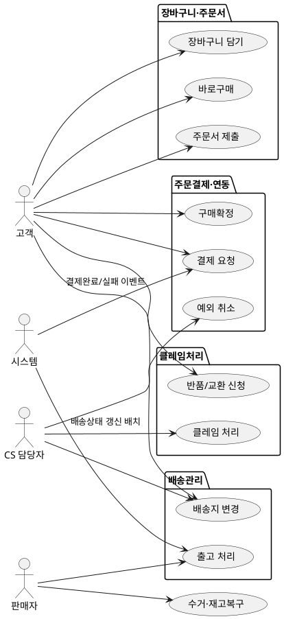

# 샘플: 상위 유스케이스 (Design, Domain: Order)

> **선행 산출물**: 컴포넌트(①에서 Order 모듈 경계가 이미 확정된 상태를 전제로 함)
> **작성 순서**: ① 액터 식별 → ② 액터별 유스케이스 나열 → ③ 권한 범위 정의 → ④ 업무그룹으로
> 소제목 정리. 업무그룹은 공식 Scope 단위가 아니라 이 문서 안의 구조화용 표기일 뿐이다.

## ① 액터 정의

| 액터 | 설명 | 채널 |
|---|---|---|
| 고객 | 로그인한 최종 구매자. 본인 주문에 대해서만 조회·조작 가능 | M(Mobile) |
| 판매자 | 입점사 운영자. 자기 매장으로 걸린 주문만 처리 | P(Partner) |
| CS 담당자 | 플랫폼 관리자. 예외 처리·클레임 중재 권한을 가짐 | A(Admin) |
| 시스템 | Payment·Catalog 도메인의 비동기 이벤트, 배치 스케줄러 | C(Consumer)/B(Batch) |

## ② 업무그룹별 유스케이스

도메인정의서의 책임 목록을 그대로 묶은 4개 업무그룹 — 실제 `04-기능요구사항(EARS)/01-Order-*.md`
4파일 분리 기준과 동일하다(Bolt 후보가 그룹별로 6개를 넘어 이미 중분류 없이 대분류만으로 나뉜 사례).

### 장바구니·주문서
| 유스케이스 | 액터 | 근거 EARS |
|---|---|---|
| 장바구니 담기 / 수량 변경 / 삭제 | 고객 | REQ-ORD-059~062 |
| 바로구매(장바구니 미경유) | 고객 | REQ-ORD-107 |
| 배송지·포인트·결제수단 선택 후 주문서 제출 | 고객 | REQ-ORD-072~076 |

### 주문결제·연동
| 유스케이스 | 액터 | 근거 EARS |
|---|---|---|
| 결제 요청(TEMP→PROCESSING) | 고객 | REQ-ORD-001 |
| 결제완료/결제실패 이벤트 수신 | 시스템(Payment 발행) | REQ-ORD-055, 095 |
| 재고선점 요청 | 시스템(Catalog 연동) | REQ-ORD-057 |
| 구매확정(수동/자동) | 고객 / 시스템(배치) | REQ-ORD-017, 054 |
| 예외 취소 | CS 담당자 | REQ-ORD-008 |

### 배송관리
| 유스케이스 | 액터 | 근거 EARS |
|---|---|---|
| 출고 처리 / 운송장 등록 | 판매자 | REQ-ORD-018, 020 |
| 배송지 변경(출고 전) | 고객 / CS 담당자 | REQ-ORD-024, 025 |
| 배송상태 갱신 배치 | 시스템(배치) | REQ-ORD-029 |

### 클레임처리
| 유스케이스 | 액터 | 근거 EARS |
|---|---|---|
| 반품/교환 신청 | 고객 | REQ-ORD-039, 046 |
| 수거·재고복구 처리 | 판매자 | REQ-ORD-033, 035 |
| 클레임 접수/처리시작/완료처리/반려확정 | CS 담당자 | REQ-ORD-047~050 |

## ③ 액터-유스케이스 관계도

## ④ 권한 범위

| 규칙 | 근거 |
|---|---|
| 고객은 본인 주문만 조회·결제·취소 가능(`order.memberId == 로그인 사용자`) | REQ-ORD-015 |
| 판매자는 자기 매장으로 걸린 주문만 출고·클레임 처리 가능 | REQ-ORD-018, 031 |
| 고객의 단순 취소는 PAYMENT_COMPLETED 상태에서만 허용, 이후 상태는 CS 예외 취소만 가능 | REQ-ORD-007~009 |
| 반품·교환 신청은 배송완료 후 10일 이내로 제한 | REQ-ORD-040, CONS-027 |
| 재고 수동 복구·귀책 이의제기는 반품 건당 1회로 제한(중복 방지) | REQ-ORD-036, 038 |

## Platform Bolt 예외 (참고)

이 문서는 Domain(Order) 스코프라 Platform Bolt(앱 셸) 유스케이스는 포함하지 않는다 — 로그인·메뉴
접근·탭 열기/닫기 같은 앱 공통 유스케이스는 컴포넌트 산출물의 "메뉴구조도·Platform Bolt 식별"
절로 갈음한다(`01-컴포넌트.md` 참고).

---
근거: `01-Spec/04-기능요구사항(EARS)/01-Order-{Cart,OrderPayment,Delivery,Claim}.md` 4파일(실제
작성 완료본)에서 액터·유스케이스·권한 규칙을 발췌 재구성. 관계도(③)와 업무그룹 분류(②)는 이
샘플에서 신규 구조화.
