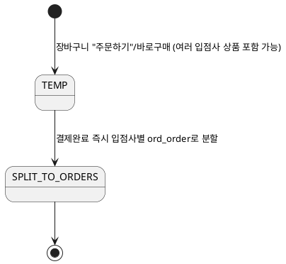
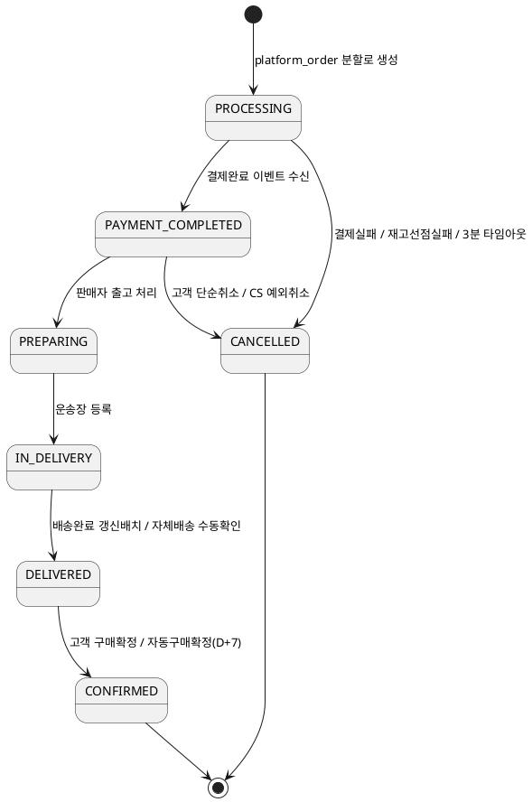

# 샘플: 상태머신 (Design, Domain: Order)

> **선행 산출물**: 상위 유스케이스, 도메인·ERD(엔티티 확정 후 상태 필드가 어느 테이블에 속하는지 정해짐)
> **2계층 주문구조 전제**: `ord_platform_order`(고객이 보는 주문 단위, 여러 입점사 상품을 묶음)와
> `ord_order`(입점사별로 쪼개진 처리 단위 — 배송·정산·클레임의 기본 단위)가 분리돼 있다
> (`01-용어집.md` HR#3, `도메인기능표/01-Order.md` "2계층 주문구조 반영" 절 참고). 두 엔티티는
> 상태 필드 자체가 다르므로 아래 ①·②로 나눠 다룬다 — 상세도는 ②(ord_order)에 집중한다.

---

## ① ord_platform_order — 경량 상태 (Human Review 필요)

`SPLIT_TO_ORDERS` 이후 platform_order 자신은 독자적인 상태를 더 갖지 않고, 화면(주문내역 목록 등)에
표시되는 "배송중 2건/배송완료 1건" 같은 요약은 자식 `ord_order` 상태를 **파생 집계**한 값이다 —
platform_order 테이블에 별도 상태 컬럼을 둘지, 뷰/쿼리로만 집계할지는 ERD 확정 시점의 결정 사항.

> **Human Review**: "결제완료 즉시 분할"은 도메인기능표가 "코드상 분할 시점 확인 필요"로 남겨둔
> 추정을 이 샘플이 채택한 것이다 — 실제로는 PG 승인 이후 비동기로 분할될 수도 있어(재고선점 결과에
> 따라 입점사 일부만 먼저 확정되는 경우 등) 코드/정책서 대조 후 확정 필요.

---

## ② ord_order (입점사별 처리 단위) — 상세 상태머신

### 상태 목록

| 상태 | 의미 |
|---|---|
| PROCESSING | 결제 요청 접수, PG 승인 대기 중(비동기) |
| PAYMENT_COMPLETED | 결제 승인 완료, 출고 대기 |
| PREPARING | 판매자가 출고 준비 시작(운송장 미등록) |
| IN_DELIVERY | 운송장 등록 완료, 배송 진행 중 |
| DELIVERED | 배송 완료(구매확정 대기) |
| CONFIRMED | 구매확정 — 정산 대상 포함, 최종 상태 |
| CANCELLED | 취소 확정 — 최종 상태 |

> TEMP는 platform_order 레벨 상태이며, 결제 요청 시점에 PROCESSING으로 시작하는 `ord_order`가
> 생성된다(①의 `SPLIT_TO_ORDERS` 산출물).

### 상태 전이도

### 허용 전이표

| From | To | 트리거 | 근거 EARS |
|---|---|---|---|
| PROCESSING | PAYMENT_COMPLETED | Payment 도메인 결제완료 이벤트 수신 | REQ-ORD-055 |
| PROCESSING | CANCELLED | 결제실패 이벤트 수신 | REQ-ORD-095 |
| PROCESSING | CANCELLED | 재고선점 실패 응답 수신 | REQ-ORD-058 |
| PROCESSING | CANCELLED | 3분 타임아웃(재고선점/PG 응답 지연) | REQ-ORD-078 |
| PAYMENT_COMPLETED | CANCELLED | 고객 단순 취소(취소 사유 포함 신청) | REQ-ORD-006, 007 |
| PAYMENT_COMPLETED | CANCELLED | CS 담당자 예외 취소 | REQ-ORD-008 |
| PAYMENT_COMPLETED | PREPARING | 판매자 출고 처리 실행 | REQ-ORD-018 |
| PREPARING | IN_DELIVERY | 판매자 운송장(택배사·운송장번호) 등록 | REQ-ORD-020 |
| IN_DELIVERY | DELIVERED | 배송상태 갱신 배치(택배사 API 확인) | REQ-ORD-029 |
| IN_DELIVERY | DELIVERED | 자체배송(배송사 미선택) 판매자 수동 확인 | REQ-ORD-088 |
| DELIVERED | CONFIRMED | 고객 구매확정 버튼 | REQ-ORD-017 |
| DELIVERED | CONFIRMED | 자동구매확정 배치(배송완료 후 7일) | REQ-ORD-054 |

### forbidden_transitions

| 금지 전이 | 사유 |
|---|---|
| PREPARING 이후 → CANCELLED (어떤 경로로도) | 고객 단순취소는 PAYMENT_COMPLETED 상태에서만 허용(REQ-ORD-007), CS 예외취소도 PAYMENT_COMPLETED 이외 상태는 거부(REQ-ORD-009) — 즉 출고 준비 시작 이후엔 주문 자체를 취소하는 경로가 아예 없고, 배송완료 후 클레임(반품/교환)만 가능 |
| IN_DELIVERY 이후 배송지 변경 | 변경 요청은 거부하고 택배사 직접 문의로 안내(REQ-ORD-081) |
| DELIVERED → CONFIRMED 되돌리기 | 구매확정은 정산 대상 포함과 동시에 확정되는 비가역 전이 — 확정 후 문제 발생 시 상태를 되돌리지 않고 별도 클레임(반품)으로 처리 |
| CONFIRMED → 임의 상태 | 최종 상태. 클레임(취소/반품/교환)은 `ord_order`의 상태를 바꾸지 않고 별도 엔티티(`ord_claim`)에서 접수→처리중→완료/반려로 독립 진행된다(클레임 Level2=입점사 단위가 이 order와 대응) |
| CANCELLED → 임의 상태 | 최종 상태. 재주문은 새 TEMP(platform_order)부터 다시 시작(REQ-ORD-006 "부분취소 불가 — 전체취소 후 재주문") |

---
근거: `01-Spec/04-기능요구사항(EARS)/01-Order-{OrderPayment,Delivery,Claim}.md` 3파일(실제 작성
완료본)에서 상태·전이·트리거를 발췌 재구성. 2계층 구조 반영은 `참고자료/도메인기능표/01-Order.md`
"2계층 주문구조 반영" 절 근거. ①의 분할 시점은 그 문서가 이미 "확인 필요"로 남겨둔 추정이라
Human Review로 동일하게 유지.
