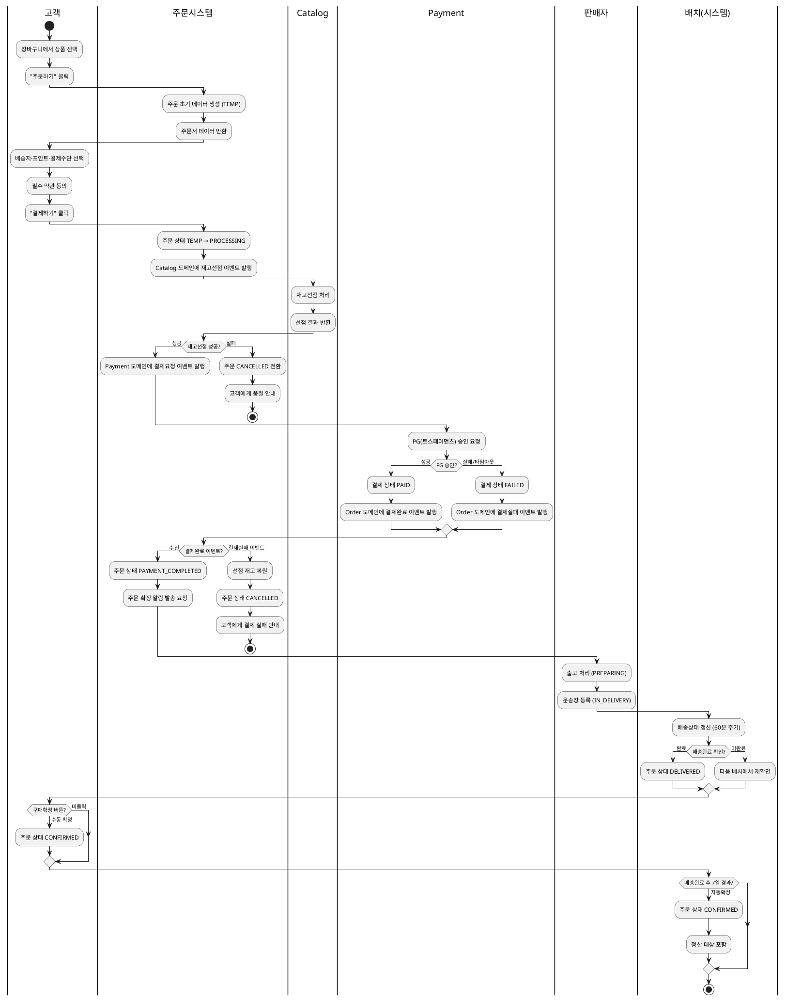

# 샘플: 비즈니스 프로세스 (Design, Domain: Order, 스윔레인)

> **선행 산출물**: 상태머신(전이 트리거를 액티비티로 확장)
> **Scope**: Domain
> **대상 플로우**: 주문결제 핵심 플로우 (장바구니→결제완료→배송→구매확정)

---

## 정상 흐름: 주문결제~구매확정

---

## 예외 흐름

| ID | 예외 | 분기 시점 | 처리 |
|---|---|---|---|
| E1 | 재고선점 실패(품절) | PROCESSING 진입 직후 | CANCELLED 전환 + 품절 안내 (REQ-ORD-058) |
| E2 | PG 승인 실패 | PG 응답 수신 | 재고 복원 + CANCELLED + 실패 안내 (REQ-ORD-095) |
| E3 | 3분 타임아웃 | PROCESSING 상태 3분 초과 | 재고 복원 + CANCELLED + 실패 안내 (REQ-ORD-078) |
| E4 | 고객 단순 취소 | PAYMENT_COMPLETED 상태 | Payment에 취소 이벤트 + 재고 복원 + CANCELLED (REQ-ORD-006) |
| E5 | 출고 기한 초과 | PAYMENT_COMPLETED 1영업일 초과 | 지연 안내 발송 (REQ-ORD-082) |
| E6 | 배송 미진행 3일 | IN_DELIVERY 상태 3일 미변동 | 지연 안내 발송 (REQ-ORD-083) |

---

## 시작/종료 조건

| 항목 | 조건 |
|---|---|
| 시작 조건 | 고객이 장바구니에서 1개 이상 상품을 선택하고 "주문하기" 클릭 |
| 정상 종료 | 주문 상태가 CONFIRMED (정산 대상 포함) |
| 예외 종료 | 주문 상태가 CANCELLED (재고 복원·환불 완료) |

---
근거: `04-상태머신.md`의 전이 트리거를 액티비티로 확장. EARS(REQ-ORD-001~055,078,095) 참조.
이 샘플에서 신규 구조화.
