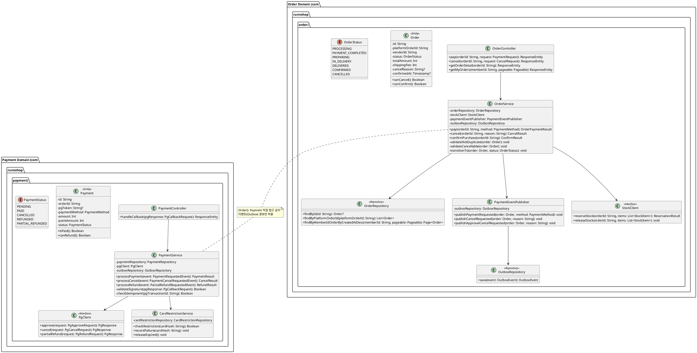

# 샘플: 클래스 설계 (Design, Bolt: 주문결제)

> **선행 산출물**: 시퀀스(`08-시퀀스.md`)의 참여 객체를 클래스로 전환
> **Scope**: Bolt (현행화)

---

## 클래스 다이어그램

---

## 책임 분배

| 클래스 | 책임 | 하지 않는 것 |
|---|---|---|
| OrderController | HTTP 요청 수신·응답 변환, 인증 정보 추출 | 비즈니스 로직, 상태 전이 판단 |
| OrderService | 주문 상태 전이 검증·실행, 이벤트 발행 오케스트레이션 | PG 통신, 재고 직접 조작 |
| PaymentEventPublisher | Outbox 테이블에 이벤트 INSERT (AFTER_COMMIT) | PG 통신, 상태 전이 |
| StockClient (Interface) | Catalog 도메인 재고 API 호출 캡슐화 | 재고 비즈니스 로직 (Catalog 소유) |
| PaymentService | PG 통신, 결제 상태 관리, 콜백 서명 검증, 멱등 처리 | 주문 상태 관리 |
| PgClient (Interface) | PG사(토스페이먼츠) API 호출 캡슐화 | 결제 비즈니스 로직 |
| CardRestrictionService | 이상거래 방지 (3회 실패 제한·익일 해제) | PG 통신 |
| Order (Entity) | 자기 상태 검증 (`canCancel()`, `canConfirm()`) | 외부 시스템 호출 |
| Payment (Entity) | 자기 상태 검증 (`isPaid()`, `canRefund()`) | 외부 시스템 호출 |

---

## 상속/합성 구조

| 패턴 | 적용 |
|---|---|
| Interface 분리 | `StockClient`, `PgClient` — 실제 구현(HTTP)과 Mock 구현 분리. 프로토타입에서는 MockStockClient, MockPgClient 사용 |
| Event-driven 합성 | OrderService → PaymentEventPublisher → OutboxRepository. 직접 PaymentService를 호출하지 않음 (도메인 경계 준수) |
| Entity 자기 검증 | Order/Payment 엔티티가 상태 전이 가능 여부를 자체 판단 (`canCancel()`) — Service는 Entity 메서드 결과만 확인 |

---

## 프로토타입 단순화 (설계 대비 차이)

| 설계 | 프로토타입 구현 | 사유 |
|---|---|---|
| OrderService.pay() 내부에 validateNotDuplicate(), transitionTo() 등 세부 메서드 | MockLoader 직접 반환 (상태 전이 로직 미구현) | 프로토타입 단계 — Mock 기반 |
| StockClient → 실제 Catalog HTTP 호출 | MockStockClient → 항상 SUCCESS 반환 | 재고 시스템 미연동 |
| PgClient → 토스페이먼츠 API 호출 | MockPgClient → 항상 APPROVED 반환 | PG 미연동 |
| CardRestrictionService → Redis 기반 | 미구현 (이상거래 방지 미적용) | 프로토타입 범위 외 |

> 본개발 전환 시 위 차이를 `04-Code/04-클래스설계(현행화).md`에 diff로 기록한다.

---
근거: 시퀀스(`08-시퀀스.md`)의 참여 객체를 클래스로 전환. 도메인 경계 규칙은 컴포넌트(`01-컴포넌트.md`)
에서 확정. 프로토타입 단순화 사유: `AI활용_개발공정_지침서_v2.2` 6.5절.
