# runNshop 업무 프로세스 정의서

> 작성 주체: 3TOP 2본부
> 문서 버전: v1.0
> 작성일: 2026.06.22
> 상태: 초안 (Draft)
> 다이어그램 형식: Mermaid flowchart

---

## 목차

1. [회원가입](#1-회원가입)
2. [로그인·인증](#2-로그인인증)
3. [상품 등록·심사](#3-상품-등록심사)
4. [메인페이지·전시 페이지 노출](#4-메인페이지전시-페이지-노출)
5. [주문·결제](#5-주문결제)
6. [배송](#6-배송)
7. [클레임 (취소·반품·교환)](#7-클레임-취소반품교환)
8. [정산·지급](#8-정산지급)
9. [입점사 심사·온보딩](#9-입점사-심사온보딩)
10. [회원 등급 산정](#10-회원-등급-산정)

---

## 다이어그램 범례

| 색상 | 의미 |
|------|------|
| 파란색 (🔵) | 고객 UI 행위 |
| 초록색 (🟢) | 시스템 처리 (서버·DB·외부 API) |
| 보라색 (🟣) | Notification 발송 |
| 주황색 (🟠) | 예외 처리 |
| 빨간색 (🔴) | 오류 |
| 회색 (⬜) | 시작·종료 |

```
classDef cust  fill:#dbeafe,stroke:#3b82f6,color:#1e3a8a
classDef sys   fill:#d1fae5,stroke:#059669,color:#064e3b
classDef noti  fill:#ede9fe,stroke:#7c3aed,color:#3b0764
classDef exc   fill:#fef3c7,stroke:#d97706,color:#78350f
classDef err   fill:#fee2e2,stroke:#dc2626,color:#7f1d1d
classDef gray  fill:#f3f4f6,stroke:#9ca3af,color:#374151
```

---

## 1. 회원가입

### 텍스트 시나리오

**정상 흐름**

```
Step 1. 약관 동의
    → 이용약관·개인정보처리방침 필수 동의
    → 마케팅 수신 동의 선택
    → 약관 동의 이력 저장 (mbr_terms_agreement)

Step 2. 가입방식 선택
    → SNS 간편가입 (네이버·Apple)
    → 이메일 일반가입

Step 3. SNS OAuth 인증 (SNS 선택 시)
    → SNS 버튼 클릭
    → OAuth URL 생성·SNS 인증 서버 리다이렉트
    → SNS 화면에서 로그인 완료
    → Authorization Code → Access Token 교환
    → 사용자 정보 수신 (이메일·이름·provider_id)
    → 기존 회원 매칭
        ├─ 기존 회원 → 로그인 처리 후 종료
        └─ 신규 → 계속 진행

Step 4. 본인인증 (옵션널)
    → 휴대폰 번호 입력
    → OTP 발송·검증 (유효시간 3분)
    → 건너뛰기 가능

Step 5. 정보 입력
    → 이메일·비밀번호·이름 입력
    → 이메일 중복 확인
    → 중복 시 오류 안내·로그인 유도

Step 6. 계정 생성
    → mbr_member INSERT
    → mbr_terms_agreement INSERT
    → 웰컴 쿠폰 자동 발급 (mbr_member_coupon)
    → 웰컴 알림 발송
    → 홈 이동 (로그인 처리 완료)
```

**예외 흐름**

```
이메일 중복
    → "이미 가입된 이메일입니다." 안내
    → 로그인 유도

SNS 이미 가입된 계정
    → SNS 제공 이메일 기존 계정과 매칭
    → 로그인 처리

휴대폰 중복
    → "이미 가입된 휴대폰 번호입니다." 안내
    → 기존 계정 로그인 유도

OTP 5회 실패
    → 24시간 발송 제한
```

### 다이어그램

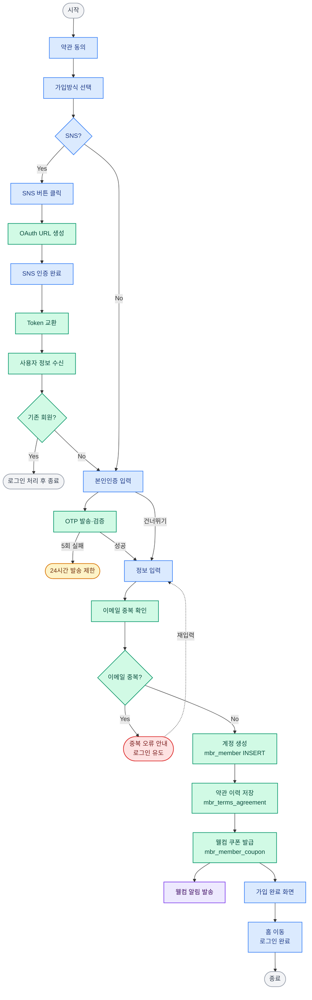

---


## 2. 로그인·인증

### 텍스트 시나리오

**정상 흐름 — 이메일 로그인**

```
Step 1. 이메일·비밀번호 입력 (고객)
    → 계정 존재 확인·비밀번호 검증
    → JWT 발급·디바이스 세션 등록 (mbr_device_session)

Step 2. 장바구니 머지 후 유효성 검사
    → 장바구니 머지 (로컬 + 서버)
    → 재고 확인 (available_quantity 재검증·품절 비활성)
    → 행사 유효성 검사
        → cart.carted_at vs 행사·상품 updated_at 비교
        → 변경 있음: 재조회·재계산·뱃지 표시
        → 변경 없음: 그대로 진행

Step 3. 약관 동의 확인
    → 필수 약관 미동의 → 추가 동의 팝업
    → 동의 완료 → 서비스 진입
```

**예외 흐름**

```
비밀번호 틀림 (1~4회)  → 실패 횟수 안내
5회 실패              → 계정 잠금 3일
SNS 신규 회원         → 회원가입 프로세스
약관 미동의           → 서비스 이용 불가
세션 만료             → Refresh Token 자동 갱신
Refresh Token 만료    → 재로그인
```

### 다이어그램

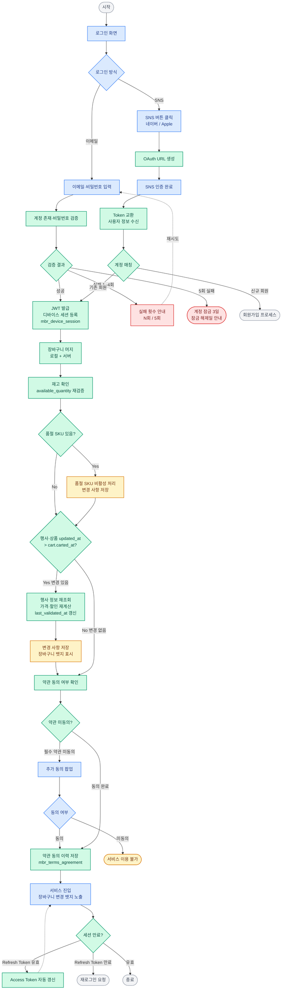

---

## 3. 상품 등록·심사

### 텍스트 시나리오

**정상 흐름**

```
Step 1. 상품 등록 (입점사)
    → 기본정보 입력 (상품명·카테고리·브랜드·태그)
    → 표준 카테고리 선택
        → 전시 카테고리 자동 매핑 (cat_standard_display_category_mapping)
    → 가격 입력 (정가·판매가·공급가)
    → 이미지 업로드 (최대 10장·5MB)
        → S3 저장
        → Rekognition 비동기 분석 (2단계)
        → 금지어 검증 (BLOCK·MASK)
    → 상세 소개 블록 작성
        → 상품 상세 타입 자동 적용 (cat_product_detail_type_mapping)
    → SKU 생성 (옵션값 입력 → 자동 생성)
    → 초기 재고 등록
        → cat_sku_stock INSERT
        → cat_sku_stock_history (change_source=CATALOG)
    → 임시저장 (DRAFT) or 심사 요청 (REVIEW_REQUESTED)

Step 2. 상품 심사 (MD)
    → 심사 대기 목록 확인
    → 기본정보·가격·이미지·상세소개 검토
    → Rekognition 분석 결과 참고 (2단계)

Step 3-A. 심사 승인
    → cat_product.status = ON_SALE
    → ES 상품 인덱스 동기화 (즉시)
    → 입점사 알림 발송 (승인)
    → 고객 화면 노출

Step 3-B. 심사 반려
    → reject_reason 저장
    → reject_count + 1
    → cat_product.status = REJECTED
    → 입점사 알림 발송 (반려 사유 포함)
    → 입점사 수정 후 재심사 요청 가능
```

**예외 흐름**

```
금지어 포함
    → BLOCK: 등록 차단
    → MASK: 마스킹 저장

재고 0으로 등록
    → 상품 상태 SOLD_OUT으로 시작
    → 재고 등록 후 ON_SALE 전환

반려 3회 이상
    → 반려 이력 표시
    → MD 특별 검토 플래그
```

### 다이어그램

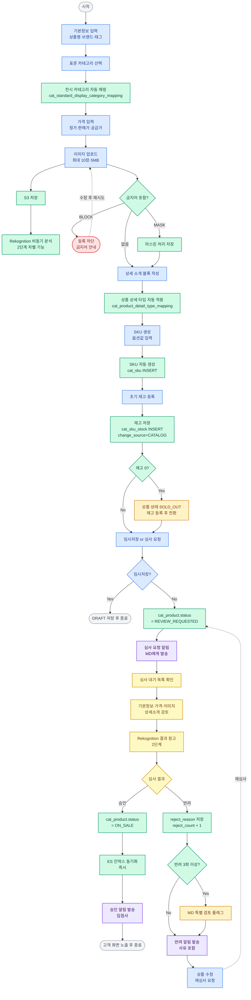

---


## 4. 메인페이지·전시 페이지 노출

### 텍스트 시나리오

**정상 흐름 — 즉시 게시**

```
Step 1. 전시 페이지 설정 (MD)
    → 페이지 선택 (홈·카테고리·기획전)
    → 템플릿 선택
    → 영역별 콘텐츠 구성
        ├─ BANNER: cfg_banner에서 선택
        ├─ PRODUCT_GRID: 상품 직접 선택
        ├─ PRODUCT_LIST: 카테고리 연결 (동적 조회)
        └─ EXHIBITION: 기획전 연결
    → 상태: PUBLISHED (즉시 게시)
    → Redis 캐시 무효화

Step 2. 고객 화면 렌더링
    → cat_display_page 조회
    → 템플릿·영역·콘텐츠 조합
    → 상품 노출 순서 결정
        md_override → ai_score → release_date
    → Redis 캐시 적용
```

**정상 흐름 — 예약 게시**

```
Step 1. 예약 설정 (MD)
    → 현재 페이지 (A템플릿) 운영 중
    → 신규 페이지 (B템플릿) 작성·콘텐츠 구성
    → 전환 일시 설정
    → cat_display_page_schedule INSERT (PENDING)
    → 신규 페이지 status = SCHEDULED
    → 페이지당 최대 1개 예약 (조건부 유니크 인덱스)

Step 2. 예약 배치 실행 (매 5분)
    → scheduled_at <= NOW() 확인
    → A페이지 PUBLISHED → RESERVED
    → B페이지 SCHEDULED → PUBLISHED
    → 스케줄 PENDING → APPLIED

Step 3. 자동 전환 완료
    → Redis 캐시 무효화
    → ES 인덱스 재동기화
    → 고객 화면 B템플릿으로 자동 전환
```

**예외 흐름**

```
예약 중복 시도
    → 1개 예약만 허용
    → 기존 예약 취소 후 재등록 안내

배치 실패
    → DLQ 적재
    → 운영자 알림
    → 수동 전환 처리

콘텐츠 없는 영역
    → FLEXIBLE: 영역 숨김
    → FIXED: 기본 콘텐츠 표시
```

### 다이어그램

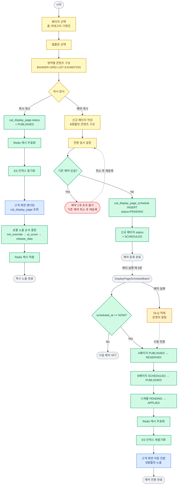

---

## 5. 주문·결제

### 텍스트 시나리오

**정상 흐름**

```
Step 1. 장바구니 진입
    → 재고 확인 (available_quantity 재검증·매번 실행)
        → 품절 SKU 비활성 처리
    → 행사 유효성 검사 (변경 시에만)
        → cart.carted_at vs 행사·상품 updated_at 비교
        → 변경 있음: 재조회·재계산·last_validated_at 갱신
    → 장바구니 목록 노출

Step 2. 주문서
    → 휴대폰 OTP 인증 (세션 기준 1회)
    → 임시 주문 생성 (ord_platform_order, status=TEMP)
    → 배송지 선택 (기본 배송지 자동)
    → 할인 적용 순서
        ① 정상가 → ② 행사가 → ③ 수량할인
        → ④ 쿠폰 → ⑤ 장바구니할인 → ⑥ 포인트(결제)
    → 최종 금액 확인

Step 3. 결제
    → 약관 동의 확인
    → PG 인증 요청 (AUTH_REQUEST → AUTH_APPROVED)
    → 재고 선점 (Redis TTL 30분, reserved_quantity + N)
    → PG 결제 요청 (PAYMENT_REQUEST → PAYMENT_RECEIVED)
    → 포인트·쿠폰 사용 처리
    → PlatformOrder status = PAYMENT_COMPLETED

Step 4. 비동기 주문 생성
    → status = PROCESSING (3분 타임아웃 시작)
    → 타임아웃·실패: CANCELLED + 재고·포인트·쿠폰 복원
    → 성공: 입점사별 ord_order INSERT
    → 재고 확정 차감 (change_source=ORDER)
    → 전체 SKU available_quantity=0 → SOLD_OUT
    → 입점사·고객 알림 발송
```

**예외 흐름**

```
품절 SKU 존재      → 비활성 처리·안내 후 진행
행사 변경          → 재계산·안내 후 진행
재고 선점 실패     → 품절 안내·장바구니 복귀
PG 인증 실패       → 재시도 안내
PG 결제 실패       → 선점 재고 해제·포인트·쿠폰 복원
PROCESSING 타임아웃 → CANCELLED·재고·포인트·쿠폰 복원·DLQ
선점 TTL 만료      → Redis 선점 해제·DB 동기화 배치
```

### 다이어그램

```mermaid
flowchart TD
    START([장바구니 진입]):::gray

    START --> B1[재고 확인
available_quantity 재검증
매번 실행]:::sys
    B1 --> D1{품절 SKU 있음?}:::sys
    D1 -->|Yes| EX1[품절 SKU 비활성 처리
변경 사항 저장]:::exc
    D1 -->|No| B2
    EX1 --> B2

    B2{행사·상품 updated_at
> cart.carted_at?}:::sys
    B2 -->|Yes 변경 있음| B3[행사 정보 재조회
가격·할인 재계산
last_validated_at 갱신]:::sys
    B3 --> EX2[변경 사항 안내]:::exc
    EX2 --> A1
    B2 -->|No 변경 없음| A1

    A1[장바구니 목록 노출
할인 혜택 안내]:::cust
    A1 --> A2[주문서 진입]:::cust
    A2 --> B3a[동기 사전 확인
Catalog 재고·Promotion 쿠폰조건
Member 잔액·보유 확인]:::sys
    B3a --> B4[휴대폰 OTP 인증
세션 기준 1회]:::sys
    B4 --> B5[임시 주문 생성
ord_platform_order status=TEMP]:::sys
    B5 --> B5a{TEMP 30분
타임아웃?}:::sys
    B5a -->|타임아웃| EX9([TempOrderTimeoutBatch
CANCELLED 처리]):::exc
    B5a -->|유효| A3
    A3[배송지 선택
기본 배송지 자동]:::cust
    A3 --> A4[할인 적용
①행사가 ②수량할인
③쿠폰(플랫폼+입점사 중복가능·동일주체 1장)
④장바구니할인 ⑤포인트]:::cust
    A4 --> B6[최종 금액 계산]:::sys
    B6 --> A5[약관 동의
결제하기 클릭]:::cust

    A5 --> B7[PG 인증 요청
AUTH_REQUEST]:::sys
    B7 --> D2{PG 인증 결과}:::sys
    D2 -->|실패| ERR1([인증 실패 안내
재시도]):::err
    ERR1 -.->|재시도| A5
    D2 -->|FDS 이상 탐지| ERR1a([FDS 자동 차단
고객 안내]):::err
    D2 -->|성공 AUTH_APPROVED| B8

    B8[PG 결제 요청 준비
재고 선점 시작
Redis TTL 30분
reserved_quantity + N]:::sys
    B8 --> D3{선점 성공?}:::sys
    D3 -->|실패 품절| ERR2([품절 안내
장바구니 복귀]):::err
    D3 -->|성공| B9[PG 결제 요청
PAYMENT_REQUEST
재고 선점 완료 후 전송]:::sys

    B9 --> D4{결제 결과}:::sys
    D4 -->|실패| B10[선점 재고 해제
포인트·쿠폰 복원]:::sys
    B10 --> ERR3([결제 실패 안내
사유 표시]):::err
    ERR3 -.->|재시도| A5
    D4 -->|성공 PAYMENT_RECEIVED| B11

    B11[포인트·쿠폰 사용 처리]:::sys
    B11 --> B12[PlatformOrder
status=PAYMENT_COMPLETED]:::sys
    B12 --> A6[주문 접수 완료 화면]:::cust

    B12 --> B13[비동기 주문 생성 시작
status=PROCESSING
3분 타임아웃 시작]:::sys
    B13 --> D5{3분 내
처리 완료?}:::sys
    D5 -->|타임아웃 실패| B14a{비동기 재시도
횟수}:::sys
    B14a -->|3회 미만
즉시→30초→1분| B13
    B14a -->|3회 초과| B14[status=CANCELLED
선점 재고 해제 1회 시도
포인트·쿠폰 복원 1회 시도
실패 시 운영팀 이관]:::sys
    B14 --> C0[고객 알림
주문 생성 실패 및 환불 안내]:::noti
    C0 --> EX3[DLQ 적재
운영자 알림]:::exc
    D5 -->|성공| B15[입점사별 ord_order INSERT
status=PAYMENT_COMPLETED]:::sys

    B15 --> B16[재고 확정 차감
stock_quantity - N
reserved_quantity - N
change_source=ORDER]:::sys
    B16 --> D6{전체 SKU
available_quantity=0?}:::sys
    D6 -->|Yes| B17[상품 status = SOLD_OUT]:::sys
    D6 -->|No| C1
    B17 --> C1[입점사 알림
주문 접수]:::noti
    C1 --> C2[고객 알림
주문 완료]:::noti
    C2 --> END1([종료]):::gray

    B8 -.->|TTL 30분 만료| EX4[선점 해제
reserved_quantity 동기화 배치]:::exc

    classDef cust  fill:#dbeafe,stroke:#3b82f6,color:#1e3a8a,stroke-width:1.5px
    classDef sys   fill:#d1fae5,stroke:#059669,color:#064e3b,stroke-width:1.5px
    classDef noti  fill:#ede9fe,stroke:#7c3aed,color:#3b0764,stroke-width:1.5px
    classDef exc   fill:#fef3c7,stroke:#d97706,color:#78350f,stroke-width:1.5px
    classDef err   fill:#fee2e2,stroke:#dc2626,color:#7f1d1d,stroke-width:1.5px
    classDef gray  fill:#f3f4f6,stroke:#9ca3af,color:#374151,stroke-width:1.5px
```

---

## 6. 배송

### 텍스트 시나리오

**정상 흐름**

```
Step 1. 상품 준비 시작 (입점사)
    → 주문·결제 프로세스의 입점사 알림 수신 후
    → 입점사 BO Order 목록에서 접수 건 확인
    → 상품 준비 시작

Step 2. 출고 처리 (입점사)
    → [출고처리] 클릭
    → Order status = PREPARING
    → 고객 알림 (준비 중)

Step 3. 운송장 등록 (입점사)
    → 배송사 선택 (기본 배송사 자동)
    → 운송장 번호 입력 (개별 or 엑셀 일괄)
    → ord_delivery 업데이트
    → Order status = IN_DELIVERY
    → 고객 알림 (배송 중·운송장 포함)

Step 4. 배송 중
    → 택배사 API 추적 (자동)
    → 고객 배송 추적 가능

Step 5. 배송 완료
    → 택배사 API 배송완료 수신 (자동) or 수동 처리
    → Order status = DELIVERED
    → 고객 알림 (배송 완료·구매확정 안내)

Step 6. 구매확정
    → 고객 수동 확정 or AutoConfirmBatch (배송완료 후 7일)
    → Order status = CONFIRMED
    → 정산 대상 등록 (stl_settlement_target)
    → 포인트 적립 (등급별 적립률)
    → 리뷰 작성 가능
```

**배송지 변경 정책**

```
PAYMENT_COMPLETED (접수)
    → 고객 직접 변경 가능
    → 주문 상세에서 배송지 수정

PREPARING (준비중)
    → CS를 통해서만 변경 가능
    → CS가 어드민에서 직접 배송지 업데이트
    → 입점사에 변경 알림 발송

IN_DELIVERY 이후
    → 변경 불가
    → 택배사 직접 문의 안내
```

**예외 흐름**

```
배송 지연         → CS 확인·고객 문의 처리
운송장 오입력     → 배송중 이전 수정 가능·이후 CS 협의
배송 분실·파손    → 반품 프로세스 (입점사 귀책)
택배사 API 미연동 → 수동 배송완료 처리
```

### 다이어그램

```mermaid
flowchart TD
    START([시작
PAYMENT_COMPLETED
입점사 알림 수신]):::gray

    START --> D0{배송지 변경
요청?}:::cust
    D0 -->|Yes PAYMENT_COMPLETED| A0[고객 직접 배송지 변경]:::cust
    A0 --> B0[ord_platform_order
배송지 업데이트]:::sys
    B0 --> V1
    D0 -->|No| V1

    SBATCH([ShippingDeadlineBatch
매일 09:00
출고기한 초과 감지]):::gray
    SBATCH --> V1
    V1[상품 준비 시작
출고 의무: 결제완료 후 1영업일]:::vend
    V1 --> D0a{1영업일 초과?}:::sys
    D0a -->|Yes| EX0[입점사 알림 발송
OrderMetricPublished → Vendor
운영팀 모니터링]:::exc
    D0a -->|No| V2
    EX0 --> V2
    V2[출고 처리 클릭]:::vend
    V2 --> B1[Order status = PREPARING]:::sys
    B1 --> C1[고객 알림 - 준비중]:::noti

    C1 --> D1{배송지 변경
요청?}:::cust
    D1 -->|Yes PREPARING| CS1[CS 배송지 변경 처리
어드민에서 직접 업데이트]:::cs
    CS1 --> B1a[ord_platform_order
배송지 업데이트]:::sys
    B1a --> C1a[입점사 알림
배송지 변경 안내]:::noti
    C1a --> V3
    D1 -->|No| V3

    V3[운송장 등록
배송사 선택]:::vend
    V3 --> D2{등록 방식}:::vend
    D2 -->|개별 입력| V4[운송장 번호 입력]:::vend
    D2 -->|엑셀 일괄| V5[엑셀 업로드]:::vend
    V4 --> B2[ord_delivery 업데이트
Order status = IN_DELIVERY]:::sys
    V5 --> B2

    B2 --> D3{운송장 오입력?}:::sys
    D3 -->|Yes 배송중 이전
IN_DELIVERY 전만 가능| V6[운송장 수정]:::vend
    V6 -.->|재등록| B2
    D3 -->|No| C2[고객 알림 - 배송중 및 운송장]:::noti

    C2 --> B3[택배사 API 추적 자동]:::sys
    B3 --> A1[고객 배송 추적]:::cust
    B3 -->|배송 지연| EX1[CS 확인
고객 문의 처리]:::exc

    A1 --> D4{배송완료 수신}:::sys
    D4 -->|택배사 API 자동| B4[Order status = DELIVERED]:::sys
    D4 -->|API 미연동| EX2[수동 배송완료 처리]:::exc
    EX2 --> B4
    B4 -->|분실 파손| EX3([반품 프로세스
입점사 귀책]):::exc

    B4 --> C3[고객 알림 - 배송완료
구매확정 안내]:::noti

    C3 --> D5{구매확정 방식}:::sys
    D5 -->|고객 수동| A2[구매확정 클릭]:::cust
    D5 -->|자동 배치 7일 후| BATCH([AutoConfirmBatch
매일 02:00]):::gray
    A2 --> B5[Order status = CONFIRMED]:::sys
    BATCH --> B5

    B5 --> B6[정산 대상 등록
stl_settlement_target INSERT]:::sys
    B6 --> B7[포인트 적립
등급별 적립률]:::sys
    B7 --> A3[리뷰 작성 가능]:::cust
    A3 --> D9{리뷰 작성?}:::cust
    D9 -->|Yes| A4[리뷰 등록]:::cust
    A4 --> B8a[ReviewCompleted 이벤트
→ Order → Member
리뷰 포인트 적립]:::sys
    B8a --> END1([종료]):::gray
    D9 -->|No| END1

    classDef vend  fill:#fef9c3,stroke:#ca8a04,color:#713f12,stroke-width:1.5px
    classDef cust  fill:#dbeafe,stroke:#3b82f6,color:#1e3a8a,stroke-width:1.5px
    classDef sys   fill:#d1fae5,stroke:#059669,color:#064e3b,stroke-width:1.5px
    classDef cs    fill:#fce7f3,stroke:#db2777,color:#831843,stroke-width:1.5px
    classDef noti  fill:#ede9fe,stroke:#7c3aed,color:#3b0764,stroke-width:1.5px
    classDef exc   fill:#fef3c7,stroke:#d97706,color:#78350f,stroke-width:1.5px
    classDef gray  fill:#f3f4f6,stroke:#9ca3af,color:#374151,stroke-width:1.5px
```

---

## 7-1. 취소 프로세스

### 텍스트 시나리오

```
Step 1. 취소 신청
    → 고객 직접 (Level 1·2·3 선택)
      or CS 접수 (COUNSELOR 채널)

Step 2. 취소 가능 상태 확인
    → PREPARING 이전: 정상 취소 진행
    → PREPARING 이후: CS 예외 취소 처리·입점사 협의

Step 3. 자동 처리
    → ord_claim INSERT (CANCEL)
    → PG 취소 요청
    → 재고 자동 복구 (change_source=CANCEL_RESTORE)
    → 포인트·쿠폰 복원
    → Order status = CANCELLED

Step 4. 알림
    → 고객 알림 (취소완료·환불 안내)
```

### 다이어그램

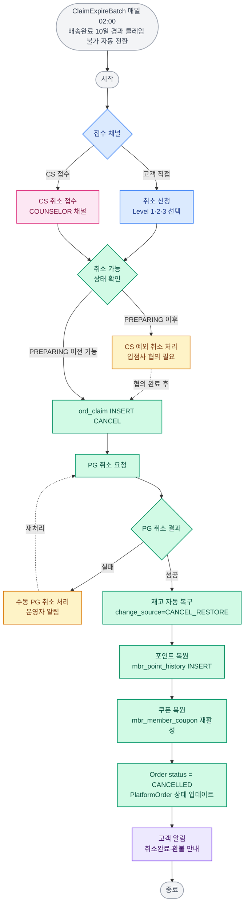

---

## 7-2. 반품 프로세스

### 텍스트 시나리오

```
Step 1. 반품 신청
    → 고객: 다중 상품 선택·부분 수량·사진 첨부
    → CS: COUNSELOR 채널·귀책 선판단
    → 고객 변심 시 반품 배송비 추가 결제

Step 2. 수거 처리 (입점사)
    → 수거 운송장 등록
    → 수거 완료 확인

Step 3. 귀책 판단 (플랫폼)
    → 입점사 이의제기 가능
    → 플랫폼 최종 귀책 확정
        ├─ 고객 귀책: 반품 배송비 고객 부담
        ├─ 입점사 귀책: 반품 배송비 입점사 부담
        └─ 플랫폼 귀책: 플랫폼 부담

Step 4. 환불·재고 처리
    → 환불 금액 계산
    → PG 환불·포인트·쿠폰 복원
    → 입점사 재고 수동 복구 (change_source=RETURN_RESTORE)
    → 고객 알림 (반품완료·환불 안내)
```

### 다이어그램

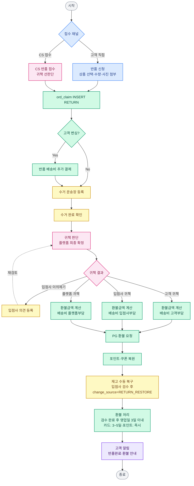

---

## 7-3. 교환 프로세스

### 텍스트 시나리오

```
Step 1. 교환 신청 (상품 단위만)
    → 변경 옵션 선택
    → 교환 재고 확인
    → 재고 없음: CS 협의·환불 전환

Step 2. 수거·출고 처리 (입점사)
    → 수거 운송장 등록
    → 수거 완료 확인
    → 교환 상품 출고 처리
    → 출고 운송장 등록

Step 3. 교환 완료
    → Order status = EXCHANGED
    → 고객 알림 (교환 출고 완료)
```

### 다이어그램

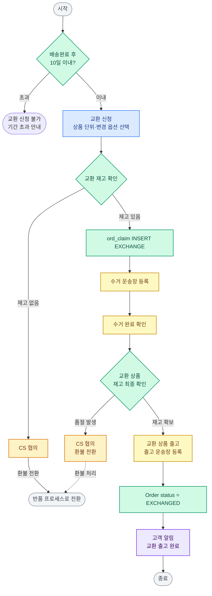

---


## 8. 정산·지급

### 텍스트 시나리오

**정상 흐름**

```
Step 1. 정산 대상 집계 (자동)
    → 구매확정 시 stl_settlement_target INSERT
    → 수수료율 스냅샷 저장 (확정 시점 기준)
    → 직매입 (is_platform_direct=TRUE) 제외

Step 2. 월 정산 계산 배치 (매월 5일)
    → 입점사별 월 정산 금액 계산
        매출 - 수수료 + 배송비정산
        - 쿠폰분담 - 포인트분담
        - 재정산(반품·취소) - 패널티 + 이월
    → stl_settlement INSERT (CALCULATING)

Step 3. 정산 확정 (정산담당)
    → 정산 내역 검토
    → stl_settlement.status = CONFIRMED
    → objection_deadline = 확정일 + 5영업일
    → 입점사 알림 (정산 확정·이의제기 기간 안내)

Step 3-1. 이의제기 (입점사, 선택)
    → 이의제기 가능 기간 내 (확정일 + 5영업일)
    → 사유·금액 입력
    → stl_settlement_objection INSERT (PENDING)

Step 3-2. 이의제기 처리 (정산담당)
    → 내역 재검토
    ├─ 수용: 재정산 처리·입점사 알림
    └─ 기각: 기각 사유 안내·기존 정산 유지

Step 4. 지급 처리 (매월 15일)
    → PENDING 이의제기 없을 때 지급 진행
    → 지급 계좌 확인
    → stl_settlement_payment.status = PAID
    → 입점사 알림 (지급 완료)
```

**예외 흐름**

```
이의제기 기간 초과   → 이의제기 불가·다음 달 정산 반영
지급 계좌 오류       → 지급 보류·계좌 변경 후 재지급
배치 실패            → DLQ 적재·운영자 알림·수동 재실행
패널티 차감 초과     → 이월 처리
```

### 다이어그램

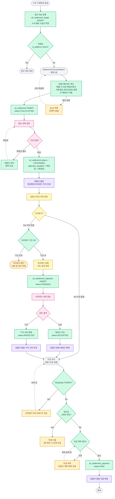

---


## 9. 입점사 심사·온보딩

### 텍스트 시나리오

**정상 흐름**

```
Step 1. 입점 신청 (입점사)
    → 사업자 정보·담당자 정보·비밀번호 설정
    → 서류 첨부 (사업자등록증·통신판매업신고증)
    → 약관 동의
    → vnd_vendor_application INSERT

Step 2. 심사 (입점관리)
    → 신청 목록 확인·서류 검토
    → 상태 변경: 대기 → 검토중

Step 3. 계약 진행
    → 계약서 작성 (오프라인)
    → 카테고리별 수수료율 협의
    → vnd_vendor_contract·vnd_vendor_fee_rate INSERT

Step 4. 승인
    → vnd_vendor_application.status = APPROVED
    → vnd_vendor INSERT (계정 생성)
    → 임시 비밀번호 이메일 발송

Step 5. 온보딩 (입점사)
    → 최초 로그인·비밀번호 변경 강제
    → 2단계 인증 설정 (필수)
    → 배송 설정 (배송사·배송비·무료배송 기준)
    → 정산 계좌 등록·1원 송금 인증
    → 상품 등록 시작
```

**예외 흐름**

```
심사 반려        → 반려 사유 발송·재신청 가능
사업자번호 중복  → 중복 안내
계약 결렬        → REJECTED·재신청 6개월 후
계좌 인증 실패   → 3회 실패 시 고객센터 안내
```

### 다이어그램

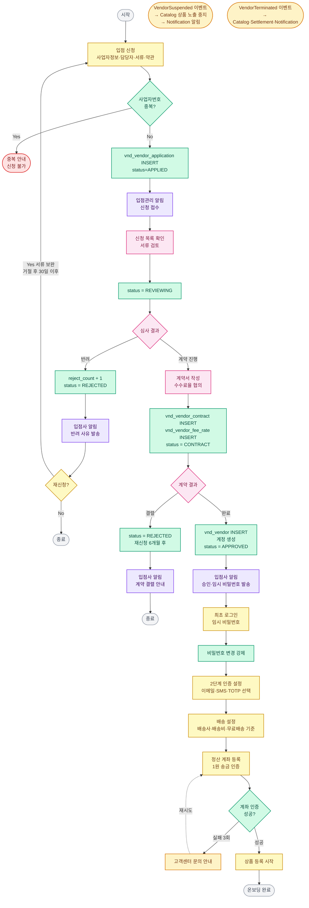

---


## 10. 회원 등급 산정

### 텍스트 시나리오

**정상 흐름**

```
Step 1. 등급 산정 배치 (매월 1일 00:00)
    → 활성 회원 전체 대상
    → 최근 3개월 기준 집계
        ├─ 누적 구매금액 (구매확정 기준)
        └─ 활동점수 (리뷰·QnA 등)

Step 2. 등급 결정
    → 구매금액 or 활동점수 중 높은 등급 적용
    → mbr_member_grade INSERT
    → mbr_member.grade_code UPDATE

Step 3. 등급별 혜택 지급
    → 월 정기 쿠폰 자동 발급 (MemberGradeCouponBatch)
    → 등급 혜택 복제 테이블 동기화
        member_grade_discount_replica UPDATE

Step 4. 등급 변경 알림
    → 등급 상승: 축하 알림 + 혜택 안내
    → 등급 하락: 하락 안내 + 유지 방법 안내
    → 등급 유지: 알림 없음
```

**예외 흐름**

```
배치 실패        → DLQ 적재·운영자 알림·수동 재실행
등급 이의제기    → CS 문의·슈퍼관리자 수동 조정·이력 기록
신규 회원 첫 달 → New 등급·웰컴 쿠폰만 지급·다음 달부터 정상 산정
```

### 다이어그램

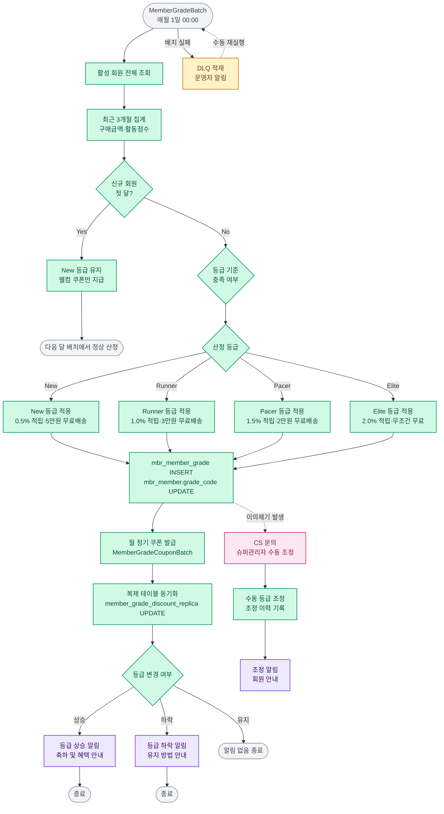

---

