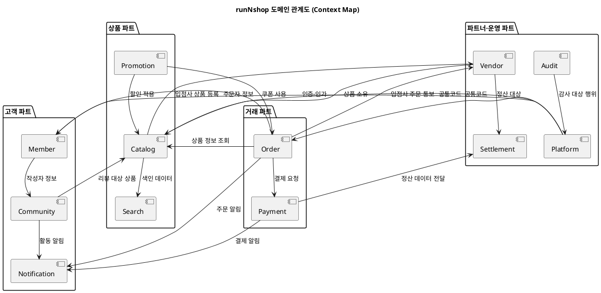

# 도메인 정의서

> **단계**: 범위정의
> **문서범위**: Project
> **문서종류**: Design
>
> **작성 목적**: 시스템을 구성하는 업무 도메인의 목록·책임·경계·관계를 정의한다 — 구조설계 이후 모든 산출물의 Scope 기준.
> **흐름 내 위치**: 시스템구성도 → **도메인 정의서** → (범위정의 완료) → 구조설계
> **작성 주체**: 시니어 + AI (기획·현업 검토)

| 항목 | 내용 |
|---|---|
| ID | DESIGN-DOMAIN-001 |
| 상태 | **Finalized** |
| 작성일 | 2026-08-11 |
| 갱신일 | 2026-08-11 |

---

## 도메인 전체 맵

---

## 도메인 목록 (12개)

| # | 도메인 | 패키지명 | 파트 | 핵심 책임 |
|---|---|---|---|---|
| 1 | Order | `order` | 거래 | 주문 생성·상태 관리·클레임(취소/반품/교환) |
| 2 | Payment | `payment` | 거래 | 결제 승인·취소·환불, 결제수단 관리 |
| 3 | Catalog | `catalog` | 상품 | 상품 등록·수정·전시, 카테고리·브랜드 관리 |
| 4 | Promotion | `promotion` | 상품 | 쿠폰·할인·이벤트, 운영·CS·마케팅 시스템 |
| 5 | Search | `search` | 상품 | 상품 검색·필터·자동완성, 검색 색인 관리 |
| 6 | Member | `member` | 고객 | 회원 가입·탈퇴·등급, 프로필·배송지 관리 |
| 7 | Community | `community` | 고객 | 상품 리뷰·Q&A·신고, 커뮤니티 콘텐츠 관리 |
| 8 | Notification | `notification` | 고객 | 알림 생성·발송·이력, 채널별(Push/SMS/Email) 관리 |
| 9 | Vendor | `vendor` | 파트너·운영 | 입점사 등록·계약·정보 관리, 입점사 BO 지원 |
| 10 | Settlement | `settlement` | 파트너·운영 | 정산 주기·계산·지급, 정산서·세금계산서 |
| 11 | Platform | `platform` (코드상 `config`) | 파트너·운영 | 인증·인가·세션, 공통코드·약관, 앱 셸, 인프라 보안 |
| 12 | Audit | `audit` | 파트너·운영 | 관리자 행위 로그, 감사 추적, 변경 이력 |

> **참고**: 코드베이스에서 Platform 도메인은 현재 `config` 패키지명으로 존재. 방법론 v2.3에서 Platform으로 승격 확정되었으며, 코드 리네이밍은 후속 작업으로 진행.

---

## 도메인별 상세 정의

### 1. Order (주문)

| 항목 | 내용 |
|---|---|
| **책임** | 주문 생성·확인·완료 라이프사이클, 클레임(취소/반품/교환) 처리 |
| **핵심 엔티티** | 주문(Order), 주문항목(OrderItem), 클레임(Claim) |
| **채널** | mobile(주문 생성), admin(주문 관리), partner(주문 확인·발송) |
| **의존** | ← Member(주문자), ← Catalog(상품), → Payment(결제), → Notification(알림), → Vendor(입점사 통보) |
| **이벤트 발행** | OrderCreated, OrderConfirmed, OrderCancelled, OrderCompleted, ClaimRequested |

### 2. Payment (결제)

| 항목 | 내용 |
|---|---|
| **책임** | 결제 승인·취소·환불 처리, 결제수단(카드·계좌·간편결제) 관리 |
| **핵심 엔티티** | 결제(Payment), 결제수단(PaymentMethod), 환불(Refund) |
| **채널** | mobile(결제 실행), admin(결제 관리·환불) |
| **의존** | ← Order(결제 요청), → Settlement(정산 데이터), → Notification(결제 알림), → External PG(Mock) |
| **이벤트 발행** | PaymentApproved, PaymentCancelled, RefundCompleted |

### 3. Catalog (상품)

| 항목 | 내용 |
|---|---|
| **책임** | 상품 등록·수정·삭제, 카테고리 체계, 브랜드 관리, 전시(Display) 관리 |
| **핵심 엔티티** | 상품(Product), 옵션(ProductOption), 카테고리(Category), 브랜드(Brand), 전시페이지(DisplayPage) |
| **채널** | mobile(상품 조회·전시), admin(상품 승인·카테고리·전시 관리), partner(상품 등록·수정) |
| **의존** | ← Vendor(상품 소유), ← Promotion(할인 적용), → Search(색인 데이터) |
| **이벤트 발행** | ProductCreated, ProductApproved, ProductUpdated, StockChanged |

### 4. Promotion (프로모션)

| 항목 | 내용 |
|---|---|
| **책임** | 쿠폰 생성·발급·사용, 할인 정책, 이벤트·기획전, 운영·CS·마케팅 시스템 |
| **핵심 엔티티** | 쿠폰(Coupon), 할인정책(DiscountPolicy), 이벤트(Event), 기획전(Exhibition) |
| **채널** | mobile(쿠폰 사용·이벤트 참여), admin(프로모션 관리·CS·마케팅) |
| **의존** | → Catalog(할인 대상 상품), → Order(쿠폰 적용), ← Member(쿠폰 발급 대상) |
| **이벤트 발행** | CouponIssued, CouponUsed, EventStarted, EventEnded |

### 5. Search (검색)

| 항목 | 내용 |
|---|---|
| **책임** | 상품 검색·필터·정렬, 자동완성, 인기 검색어, 검색 색인 관리 |
| **핵심 엔티티** | 검색색인(SearchIndex), 검색로그(SearchLog), 인기검색어(PopularKeyword) |
| **채널** | mobile(검색 실행), admin(검색어 관리·분석) |
| **의존** | ← Catalog(색인 원본 데이터) |
| **이벤트 발행** | IndexUpdated |

### 6. Member (회원)

| 항목 | 내용 |
|---|---|
| **책임** | 회원 가입·탈퇴, 등급 산정, 프로필·배송지 관리, 약관 동의 |
| **핵심 엔티티** | 회원(Member), 등급(Grade), 배송지(Address), 약관동의(Agreement) |
| **채널** | mobile(가입·마이페이지), admin(회원 관리·등급 관리) |
| **의존** | ← Platform(인증·인가), → Order(주문자 정보), → Community(작성자 정보) |
| **이벤트 발행** | MemberRegistered, MemberGradeChanged, MemberWithdrawn |

### 7. Community (커뮤니티)

| 항목 | 내용 |
|---|---|
| **책임** | 상품 리뷰 작성·관리, Q&A(상품 문의), 신고·블라인드 처리 |
| **핵심 엔티티** | 리뷰(Review), 질문(Question), 답변(Answer), 신고(Report) |
| **채널** | mobile(리뷰·Q&A 작성), admin(리뷰·Q&A 관리·신고 처리), partner(Q&A 답변) |
| **의존** | ← Member(작성자), ← Catalog(리뷰 대상 상품), → Notification(활동 알림) |
| **이벤트 발행** | ReviewCreated, QuestionCreated, AnswerCreated |

### 8. Notification (알림)

| 항목 | 내용 |
|---|---|
| **책임** | 알림 생성·발송·이력 관리, 채널별(Push/SMS/Email) 라우팅, 템플릿 관리 |
| **핵심 엔티티** | 알림(Notification), 알림템플릿(Template), 발송이력(SendLog) |
| **채널** | mobile(알림 수신·설정), admin(템플릿·발송 관리) |
| **의존** | ← Order(주문 알림), ← Payment(결제 알림), ← Community(활동 알림), → External SMS/Email(Mock) |
| **이벤트 발행** | NotificationSent, NotificationFailed |

### 9. Vendor (입점사)

| 항목 | 내용 |
|---|---|
| **책임** | 입점사 등록·계약·승인, 입점사 정보 관리, 입점사 대시보드 지원 |
| **핵심 엔티티** | 입점사(Vendor), 계약(Contract), 담당자(VendorUser) |
| **채널** | admin(입점사 관리·승인), partner(입점사 정보·대시보드) |
| **의존** | → Catalog(상품 소유), → Settlement(정산 대상), ← Order(주문 통보) |
| **이벤트 발행** | VendorRegistered, VendorApproved, ContractUpdated |

### 10. Settlement (정산)

| 항목 | 내용 |
|---|---|
| **책임** | 정산 주기·규칙 설정, 정산 금액 계산, 지급 처리, 정산서·세금계산서 |
| **핵심 엔티티** | 정산(Settlement), 정산규칙(SettlementRule), 정산서(SettlementStatement) |
| **채널** | admin(정산 관리·지급), partner(정산 조회·정산서 다운로드) |
| **의존** | ← Payment(결제 데이터), ← Vendor(정산 대상 입점사) |
| **이벤트 발행** | SettlementCalculated, SettlementPaid |

### 11. Platform (플랫폼)

| 항목 | 내용 |
|---|---|
| **책임** | 인증·인가·세션 관리, 공통코드, 약관 관리, 앱 셸(메뉴 구조), 인프라 보안(TLS, 방화벽 정책) |
| **핵심 엔티티** | 사용자(User), 역할(Role), 권한(Permission), 공통코드(CommonCode), 약관(Terms), 메뉴(Menu) |
| **채널** | mobile(로그인·약관), admin(사용자·권한·공통코드 관리), partner(로그인·메뉴) |
| **의존** | → Member(인증 대상), 전 도메인(공통코드 제공) |
| **이벤트 발행** | UserLoggedIn, RoleChanged, TermsUpdated |
| **편입 항목** | 인프라 보안 (D4-범위 2026-07-30 확정) |

### 12. Audit (감사)

| 항목 | 내용 |
|---|---|
| **책임** | 관리자 행위 전건 기록, 감사 추적 조회, 변경 이력 관리 |
| **핵심 엔티티** | 감사로그(AuditLog), 변경이력(ChangeHistory) |
| **채널** | admin(감사 로그 조회·검색) |
| **의존** | ← Platform(감사 대상 행위 수집), ← 전 도메인(변경 이력 수집) |
| **이벤트 발행** | 없음 (소비자 전용) |

---

## 도메인 간 통신 원칙

| 원칙 | 설명 | NFR 연계 |
|---|---|---|
| 도메인 간 직접 참조 금지 | 다른 도메인의 내부 엔티티·리포지토리 직접 호출 불가 | NFR-MA-03 |
| 이벤트 기반 비동기 연동 | 도메인 간 상태 전파는 도메인 이벤트로 처리 | NFR-RE-02 (정합성) |
| 조회용 API 허용 | 읽기 전용 정보(상품명, 회원명 등)는 API 호출로 조회 가능 | 성능 트레이드오프 |
| Anti-Corruption Layer | 외부 도메인 모델을 내부 모델로 변환하는 어댑터 계층 유지 | 결합도 최소화 |

---

## 파트 ↔ 도메인 ↔ 진행순서 매핑

| 파트 | 도메인 | 진행순서 | 예상 Bolt 수 |
|---|---|---|---|
| 거래 | Order, Payment | 1차 | 약 16개 (9+7) |
| 상품 | Catalog, Promotion, Search | 2차 | 약 21개 (9+6+6) |
| 고객 | Member, Community, Notification | 3차 | 약 16개 (6+6+4) |
| 파트너·운영 | Vendor, Settlement, Platform, Audit | 4차 | 약 19개 (6+6+4+3) |

> 부록 B 파트 구성 기준. 총 약 72개 Bolt 예상.

---

## Bounded Context 경계 규칙

| 규칙 | 설명 |
|---|---|
| 1 도메인 = 1 Bounded Context | 도메인 패키지가 곧 컨텍스트 경계 |
| 엔티티 공유 금지 | 동일 개념이라도 도메인마다 자체 모델 보유 (예: Order의 Product ≠ Catalog의 Product) |
| 공유 커널 최소화 | `common` 패키지는 순수 유틸·응답래퍼만 포함, 비즈니스 로직 불가 |
| 컨텍스트 맵 유지 | 도메인 간 관계 변경 시 본 문서 업데이트 필수 |

---

## 근거 자료 출처 매핑

| 서술 위치 | 출처 |
|---|---|
| 12개 도메인 목록 | `D4-범위(Scope).md`, 방법론 v2.3 §3.6 |
| 파트 구성·Bolt 수 | 방법론 v2.3 부록 B |
| Platform 승격 | 방법론 v2.3 변경이력 (Config→Platform) |
| 도메인 간 통신 원칙 | `D8-NFR.md` NFR-MA-03, NFR-RE-02 |
| 진행순서 | `D4-범위(Scope).md` "진행 순서 (4파트)" |
| 채널별 매핑 | `D9-컴포넌트.md` "도메인 패키지 ↔ 컴포넌트 매핑" |
| 편입 항목 (인프라 보안→Platform, 운영·CS·마케팅→Promotion) | `D4-범위(Scope).md` 2026-07-30 확정 |

## Human Review

| # | 항목 | 사유 |
|---|---|---|
| 1 | 도메인 간 이벤트 스키마 표준 | 구조설계 단계에서 이벤트 플로우 작성 시 확정 |
| 2 | Search 도메인의 검색 엔진 선정 | Elasticsearch vs 내장 구현, 본 구현 시 결정 |
| 3 | Platform 패키지명 리네이밍 시점 | config → platform 코드 변경 일정 미정 |
| 4 | Bolt 수 추정의 정확도 | 구조설계(상태머신·유스케이스) 후 재확인 필요 |

## 5.1 자가평가

- **완전성**: 충족 — 12개 도메인 전부 상세 정의(책임·엔티티·채널·의존·이벤트), Context Map·통신 원칙·파트 매핑 포함
- **일관성**: 충족 — `D4-범위(Scope).md` 도메인 목록·파트 순서와 정합, `D9-컴포넌트.md` 채널 매핑과 일치
- **추적성**: 충족 — 모든 도메인 정의가 범위 문서·방법론으로 역추적 가능
- **실행가능성**: 충족 — 도메인 경계가 명확하여 구조설계(상위UC, ERD, 상태머신) 즉시 착수 가능
