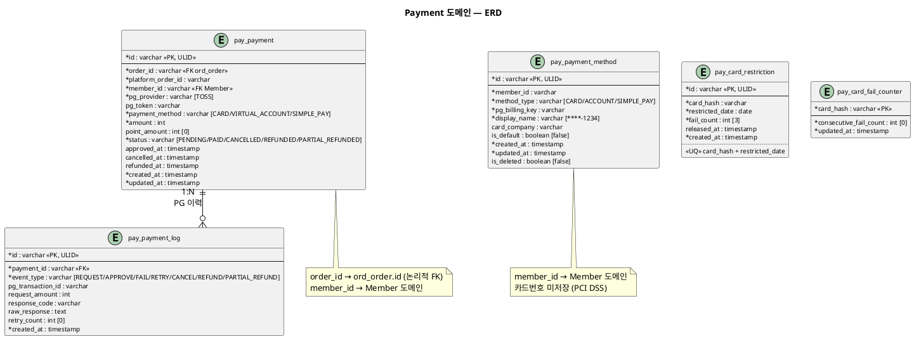

# 도메인 모델 (ERD) — Payment

> **단계**: 구조설계
> **문서범위**: Domain
> **문서종류**: Design
>
> **작성 목적**: EARS(DE)에서 도출된 엔티티·속성·관계를 테이블 설계로 구체화한다.
> **흐름 내 위치**: DE EARS → **DF 도메인 모델(ERD)** → DG 상태머신
> **작성 주체**: 시니어 개발자 + AI 협업 (DBA/아키텍트 검토)

| 항목 | 내용 |
|---|---|
| ID | DESIGN-ERD-PAYMENT-001 |
| 상태 | **Finalized** |
| 작성일 | 2026-08-11 |
| 갱신일 | 2026-08-21 |

---

## ERD 다이어그램 (PlantUML)



---

## 테이블 구조

```
pay_payment (결제 트랜잭션, 1 order : 1 payment)
  └── pay_payment_log (PG 요청·응답 이력)

pay_payment_method (고객 결제수단)
pay_card_restriction (카드 일일 제한)
pay_card_fail_counter (카드 연속실패 카운터, v2 신설 — REQ-PAY-023)
```

---

## DBML

```dbml
Table pay_payment {
  id varchar [pk, note: 'ULID']
  order_id varchar [not null, note: 'ord_order.id 참조 (논리적 FK)']
  platform_order_id varchar [not null, note: '역추적용']
  member_id varchar [not null, note: '결제자']
  pg_provider varchar [not null, default: 'TOSS', note: '토스페이먼츠']
  pg_token varchar [note: 'PG 발급 토큰 (카드번호 원본 저장 금지, REQ-PAY-017)']
  payment_method varchar [not null, note: 'CARD / VIRTUAL_ACCOUNT / SIMPLE_PAY']
  amount int [not null, note: 'PG 승인 요청 금액']
  point_amount int [default: 0, note: '포인트 사용액']
  status varchar [not null, note: 'PENDING / PAID / CANCELLED / REFUNDED / PARTIAL_REFUNDED']
  approved_at timestamp
  cancelled_at timestamp
  refunded_at timestamp
  created_at timestamp [not null]
  updated_at timestamp [not null]

  indexes {
    order_id [name: 'idx_payment_order']
    member_id [name: 'idx_payment_member']
    (status, created_at) [name: 'idx_payment_status_date']
  }

  note: '결제 트랜잭션. 1 order : 1 payment (REQ-PAY-001~007)'
}

Table pay_payment_log {
  id varchar [pk, note: 'ULID']
  payment_id varchar [not null, ref: > pay_payment.id]
  event_type varchar [not null, note: 'REQUEST / APPROVE / FAIL / RETRY / CANCEL / REFUND / PARTIAL_REFUND']
  pg_transaction_id varchar [note: 'PG측 거래번호 (멱등 판별)']
  request_amount int [note: '요청 금액']
  response_code varchar [note: 'PG 응답 코드']
  raw_response text [note: 'PG 원본 응답 (PII 마스킹)']
  retry_count int [default: 0, note: '최대 3회 (REQ-PAY-003)']
  created_at timestamp [not null]

  indexes {
    payment_id [name: 'idx_plog_payment']
    pg_transaction_id [name: 'idx_plog_pg_tx']
  }

  note: 'REQ-PAY-006: 모든 PG 요청·응답 기록'
}

Table pay_payment_method {
  id varchar [pk, note: 'ULID']
  member_id varchar [not null]
  method_type varchar [not null, note: 'CARD / ACCOUNT / SIMPLE_PAY']
  pg_billing_key varchar [not null, note: 'PG 토큰 (카드번호 미저장, REQ-PAY-017)']
  display_name varchar [not null, note: '마스킹 표시명: ****-1234']
  card_company varchar [note: '카드사명 (CARD 유형만)']
  is_default boolean [default: false]
  created_at timestamp [not null]
  updated_at timestamp [not null]
  is_deleted boolean [default: false]

  indexes {
    member_id [name: 'idx_pmethod_member']
    (member_id, is_default) [name: 'idx_pmethod_default']
  }

  note: 'REQ-PAY-014~016: 고객 등록 결제수단'
}

Table pay_card_restriction {
  id varchar [pk, note: 'ULID']
  card_hash varchar [not null, note: '카드 식별 해시 (원본 미저장)']
  restricted_date date [not null]
  fail_count int [not null, default: 3]
  released_at timestamp [note: '익일 00:00 자동 해제 (REQ-PAY-019)']
  created_at timestamp [not null]

  indexes {
    (card_hash, restricted_date) [unique, name: 'uq_card_date']
  }

  note: 'REQ-PAY-018: 동일 카드 3회 연속 실패 시 당일 제한'
}

Table pay_card_fail_counter {
  card_hash varchar [pk, note: '카드 식별 해시 (원본 미저장)']
  consecutive_fail_count int [not null, default: 0, note: '결제 성공 시 0으로 초기화 (REQ-PAY-023)']
  updated_at timestamp [not null]

  note: 'REQ-PAY-023: 3회 도달 시 pay_card_restriction 레코드 생성 후 이 카운터는 0으로 리셋'
}
```

---

## 불변식 (Invariants)

| 불변식 | 검증 시점 | 도출 근거 |
|---|---|---|
| `pay_payment.amount == ord_order.total_amount - point_used - coupon_discount` | 결제 요청 시 | REQ-PAY-007: 금액 위변조 방지 |
| `pay_payment_log`의 APPROVE 이벤트는 payment당 최대 1건 | 승인 처리 시 | 멱등성 보장 |
| `pay_card_restriction` 동일 card_hash+date는 unique | 제한 생성 시 | 중복 제한 방지 |
| 환불 금액 합계 ≤ 원결제 금액 | 환불 요청 시 | 과잉 환불 방지 |
| 부분환불(PARTIAL_REFUNDED) 금액은 배송비를 제외한 상품 결제금액 기준 | 부분 환불 요청 시 | REQ-PAY-024 |

---

## Soft Delete 정책

| 테이블 | 정책 | 사유 |
|---|---|---|
| pay_payment | 물리 삭제 없음, 영구 보존 | 결제 데이터 법적 보관 의무 |
| pay_payment_log | 물리 삭제 없음, 영구 보존 | PG 거래 감사 이력 |
| pay_payment_method | `is_deleted = true` | 고객 삭제 요청 시 논리 삭제 |
| pay_card_restriction | 90일 후 배치 물리 삭제 | 일시적 보안 데이터 |
| pay_card_fail_counter | 물리 삭제 없음(카드별 1행 upsert) | 상시 갱신되는 카운터 |

---

## 근거

| 항목 | 출처 |
|---|---|
| 엔티티 도출 | `DE-EARS기능요구(Payment).md` 주어/목적어 명사 추출 |
| 테이블 접두사 `pay_` | `DB-도메인정의서.md` 스키마 그룹핑 (rns_trade) |
| PCI DSS (카드 미저장) | `D8-NFR.md` NFR-SE-08, REQ-PAY-017 |
| 카드 3회 제한 | REQ-PAY-018 |
| 재시도 3회 | REQ-PAY-003 |
| 멱등 판별 (pg_transaction_id) | REQ-PAY-006 |
| 카드 연속실패 카운터(pay_card_fail_counter) | REQ-PAY-023 (바텀업 검토 보완, 2026-08-21) |
| 부분환불 배송비 미차감 | REQ-PAY-024 (바텀업 검토 보완, 2026-08-21) |
