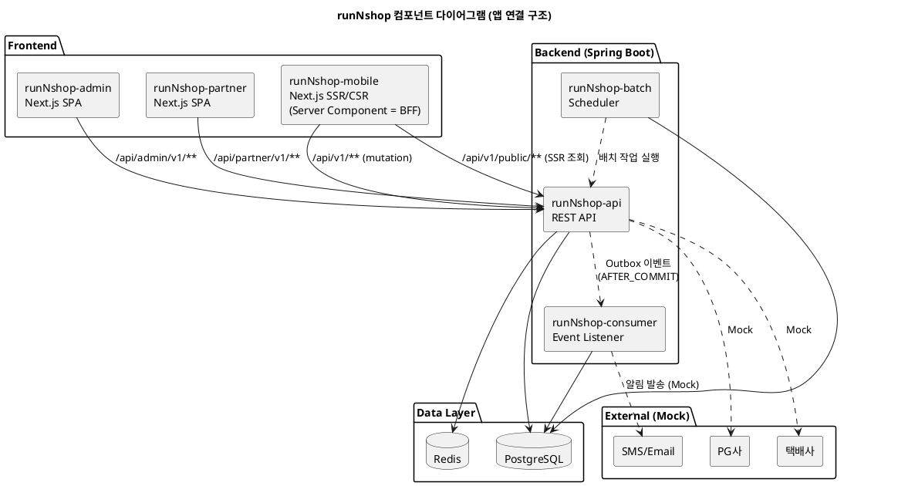

# 컴포넌트

> **단계**: 범위정의
> **문서범위**: Project
> **문서종류**: Design
>
> **작성 목적**: 시스템을 구성하는 논리적 모듈(컴포넌트)의 경계·책임·통신 방식을 정의한다.
> **흐름 내 위치**: NFR → **컴포넌트** → 시스템구성도
> **작성 주체**: 시니어 + AI (아키텍트 검토)
---

## 컴포넌트 전체 구조



---

## 배포 구조

| 항목 | 결정 | 비고 |
|---|---|---|
| 아키텍처 | Modular Monolith | MSA 전환 대비 — 도메인 = 패키지 분리 |
| BE API | Spring Boot 3.3 (Kotlin), 단일 jar | API 서버 |
| BE Consumer | Spring Boot (Event Listener) | 비동기 이벤트 처리 (별도 모듈) |
| BE Batch | Spring Boot (Scheduler) | 정산·통계 등 스케줄 배치 |
| FE | Next.js (App Router, TypeScript) | 앱별 독립 배포 |
| 이벤트 | Outbox Pattern + Spring Event Consumer | AFTER_COMMIT 발행, 도메인 간 비동기 연동 |
| 인증 | Bearer {userId} → JWT (본개발) | Path Prefix로 역할 판별 |
| BFF | Next.js Server Component (mobile 조회만) | admin/partner는 BE 직접 호출 |

---

## 앱 구성 요약

| 앱 | 기술 | 용도 | 화면 |
|---|---|---|---|
| runNshop-admin | Next.js 15 (SPA) | 플랫폼 관리자 | ✅ |
| runNshop-partner | Next.js 15 (SPA) | 입점 입점사 | ✅ |
| runNshop-mobile | Next.js 14 (SSR/CSR) | 고객 (SEO 대상). Server Component가 BFF 역할 수행 (조회) | ✅ |
| runNshop-api | Spring Boot 3.3 | BE API 서버 | ❌ |
| runNshop-consumer | Spring Boot (Event Listener) | 비동기 이벤트 처리 | ❌ |
| runNshop-batch | Spring Boot (Scheduler) | 스케줄 배치 작업 | ❌ |

---

## 컴포넌트 목록

### C-1. runNshop-mobile (고객웹)

| 항목 | 내용 |
|---|---|
| 역할 | 최종 소비자(러너)가 사용하는 모바일 웹 앱 |
| 기술 | Next.js 14 + React 18 + Tailwind CSS |
| 구조 | App Router 기반, Header + Content + BottomNav |
| 포트 | 3000 (개발) |
| 주요 기능 | 상품 탐색·검색, 장바구니, 주문·결제, 마이페이지, 리뷰·Q&A |
| 통신 | `→ runNshop-api` (REST, /api/v1/**) |
| 배포 단위 | 독립 배포 (Vercel 또는 Docker) |

### C-2. runNshop-admin (플랫폼 어드민)

| 항목 | 내용 |
|---|---|
| 역할 | 플랫폼 운영자가 사용하는 관리 시스템 |
| 기술 | Next.js 15 + React 19 + 순수 CSS (BEM) |
| 구조 | NavBar + TabBar + TabContent (MDI 멀티탭) |
| 포트 | 3001 (개발) |
| 주요 기능 | 상품 승인·관리, 주문·클레임 관리, 회원 관리, 프로모션, 정산, 전시 관리 |
| 통신 | `→ runNshop-api` (REST, /api/admin/v1/**) |
| 배포 단위 | 독립 배포 |

### C-3. runNshop-partner (입점사 어드민)

| 항목 | 내용 |
|---|---|
| 역할 | 입점사(셀러)가 사용하는 판매 관리 시스템 |
| 기술 | Next.js 15 + React 19 + 순수 CSS (틸 테마) |
| 구조 | NavBar + TabBar + TabContent (MDI 멀티탭) |
| 포트 | 3002 (개발) |
| 주요 기능 | 상품 등록·관리, 주문 확인·발송, 정산 조회, 문의 응대 |
| 통신 | `→ runNshop-api` (REST, /api/partner/v1/**) |
| 배포 단위 | 독립 배포 |

### C-4. runNshop-api (API 서버)

| 항목 | 내용 |
|---|---|
| 역할 | 3개 채널의 공통 백엔드. 비즈니스 로직·데이터 접근·외부 연동 담당 |
| 기술 | Spring Boot 3.3.0 + Kotlin 1.9.25 + Java 21 |
| 구조 | 단일 애플리케이션, 도메인별 패키지 분리 (`com.runnshop.{domain}`) |
| 포트 | 8080 |
| 패키지 | order, catalog, member, payment, promotion, settlement, vendor, notification, community, search, platform(config), audit, common |
| 통신 (인바운드) | `← Client Layer` (REST) |
| 통신 (아웃바운드) | `→ DB`, `→ Cache`, `→ External (Mock)` |
| 배포 단위 | Docker 컨테이너 (단일 jar) |

### C-4-1. runNshop-consumer (이벤트 컨슈머)

| 항목 | 내용 |
|---|---|
| 역할 | 비동기 이벤트 수신·처리 (알림 발송, 정산 집계, 검색 색인 갱신 등) |
| 기술 | Spring Boot + Kotlin (runNshop-api와 동일 도메인 패키지 공유) |
| 패턴 | Outbox 테이블에서 이벤트 polling 또는 AFTER_COMMIT 이벤트 리스닝 |
| 배포 단위 | 별도 jar (API와 독립 스케일링 가능) |
| 비고 | 프로토타입: API 내 동기 처리, 본 구현 시 분리 |

### C-4-2. runNshop-batch (배치 스케줄러)

| 항목 | 내용 |
|---|---|
| 역할 | 주기적 배치 작업 실행 (정산 계산, 회원 등급 갱신, 통계 집계, 데이터 정합성 검증) |
| 기술 | Spring Boot + Spring Batch (또는 Scheduler) |
| 배포 단위 | 별도 jar |
| 비고 | 프로토타입: 미구현, 본 구현 시 활성화 |

### C-5. PostgreSQL (RDBMS)

| 항목 | 내용 |
|---|---|
| 역할 | 주 데이터 저장소 — 주문·상품·회원·정산 등 모든 영속 데이터 |
| 버전 | PostgreSQL 16 |
| 스키마 분리 | 도메인별 테이블 prefix (`ord_`, `cat_`, `mem_` 등) |
| 비고 | 프로토타입 단계: 미사용 (Mock JSON), 본 구현 시 활성화 |

### C-6. Redis (캐시/세션)

| 항목 | 내용 |
|---|---|
| 역할 | 세션 저장, 캐시 (상품 목록, 검색 결과), 분산 락 |
| 버전 | Redis 7.x |
| 비고 | API 서버 Stateless 유지를 위한 외부 세션 저장소 (NFR-SC-01) |

### C-7. External Integrations (외부 연동)

| 대상 | 역할 | 현재 상태 |
|---|---|---|
| PG사 (결제 게이트웨이) | 결제 승인·취소·환불 | Mock (CT-6-1) |
| 택배사 API | 배송 추적·송장 등록 | Mock (CT-6-2) |
| SMS/Email 서비스 | 알림 발송 | Mock, 로그만 기록 (CT-6-3) |

---

## 컴포넌트 간 통신 규칙

| 규칙 | 설명 |
|---|---|
| 프로토콜 | REST (JSON over HTTP/HTTPS) |
| 인증 | JWT Bearer Token (프로토타입: 미적용) |
| 응답 표준 | `{ "code": "SUCCESS", "data": { ... } }` |
| 에러 응답 | `{ "code": "ERROR_CODE", "message": "...", "detail": "..." }` |
| API 버전 | URL Path Prefix 방식 (v1, v2 ...) |
| 동일 로직 다채널 | 하나의 메서드에 다중 URL 매핑 (CT-3 연계) |
| 앱별 분기 필요 시 | 별도 Controller 분리 |

---

## 도메인 패키지 ↔ 컴포넌트 매핑

| 도메인 패키지 | 주요 서비스 채널 | 비고 |
|---|---|---|
| order | mobile, admin, partner | 주문 생성(M), 관리(A), 확인·발송(P) |
| catalog | mobile, admin, partner | 상품 조회(M), 승인·관리(A), 등록(P) |
| member | mobile, admin | 가입·마이페이지(M), 회원 관리(A) |
| payment | mobile, admin | 결제(M), 결제 관리(A) |
| promotion | mobile, admin | 쿠폰·이벤트(M), 프로모션 관리(A) |
| settlement | admin, partner | 정산 관리(A), 정산 조회(P) |
| vendor | admin, partner | 입점사 관리(A), 입점사 정보(P) |
| notification | mobile, admin | 알림 수신(M), 알림 관리(A) |
| community | mobile, admin | 리뷰·Q&A(M), 커뮤니티 관리(A) |
| search | mobile, admin | 상품 검색(M), 검색 관리(A) |
| platform (config) | mobile, admin, partner | 인증·공통코드·약관·앱 셸 |
| audit | admin | 감사 로그 조회 |
| common | — | 공통 유틸, MockLoader, 응답 래퍼 |

---

## 코드 저장소 구조

```
runNshop/
├── apps/
│   ├── runNshop-admin/        ← Next.js (SPA, 순수 CSS)
│   │   └── lib/              ← FE 공통 (API 클라이언트·타입·유틸)
│   ├── runNshop-partner/      ← Next.js (SPA, 틸 테마)
│   │   └── lib/
│   └── runNshop-mobile/       ← Next.js (SSR/CSR, Server Component = BFF)
│       ├── app/               ← 클라이언트 페이지 (CSR)
│       ├── app/api/           ← BFF (Route Handler)
│       └── lib/
├── api/
│   ├── runNshop-api/          ← Spring Boot (REST API)
│   │   └── src/.../common/   ← BE 공통 (응답 구조·예외 처리·Outbox 기반)
│   ├── runNshop-consumer/     ← Spring Boot (Event Listener) — 본 구현 시 추가
│   ├── runNshop-batch/        ← Spring Boot (Scheduler) — 본 구현 시 추가
│   └── resources/mock/        ← Mock 데이터 (도메인별 JSON)
├── docs/                      ← 산출물·방법론
├── docs_ai/                   ← AI 협업 자산
└── .kiro/                     ← Kiro 설정 (steering, hooks)
```

> - **BE 공통**: `api/runNshop-api/src/.../common/` — 응답 구조·예외 처리·Outbox 기반 클래스. 전 도메인에서 공유
> - **FE 공통**: `apps/{app}/lib/` — API 클라이언트·타입·유틸. 각 앱 내부 (앱 간 공유는 추후 패키지 추출)
> - **api·consumer·batch**: 같은 레벨 별도 모듈. 독립 jar 배포 가능 (MSA 전환 대비)
> - **BFF**: `runNshop-mobile/app/api/` — 별도 프로젝트가 아닌 mobile 앱 내 Route Handler

---

## 도메인 간 통신 방식

| 호출 유형 | 방식 | 사용 조건 | 예시 |
|---|---|---|---|
| **동기 (PublicApi)** | 도메인 인터페이스 호출 (in-process) | 즉시 응답 필요 | 재고 선점, 포인트 확인, 상품 정보 조회 |
| **비동기 (이벤트)** | Outbox + Event Consumer (AFTER_COMMIT) | 후속 처리·알림·정산·보상 | 주문 완료→정산 집계, 결제→알림 발송 |

### 경계 규칙

| # | 규칙 |
|---|---|
| 1 | 각 도메인 소유 데이터는 타 도메인이 직접 SQL 접근 금지 → PublicApi 경유 |
| 2 | 비동기 이벤트는 AFTER_COMMIT 발행 (Outbox 테이블에 기록 후 Consumer가 처리) |
| 3 | 도메인 패키지 간 import는 PublicApi 인터페이스만 허용 (구현체 직접 참조 금지) |
| 4 | common 패키지는 순수 유틸·응답래퍼만 포함, 비즈니스 로직 불가 |

---

## 확장 전략

| 시점 | 전략 | 트리거 |
|---|---|---|
| 단기 (프로토타입) | 모노리스 (단일 API 서버) | 현재 상태 |
| 중기 (오픈 후 6개월) | 모듈러 모노리스 (패키지 경계 강화, ArchUnit 검증) | 도메인 간 의존성 증가 시 |
| 장기 | 마이크로서비스 분리 (Order, Payment 우선) | 아래 정량 트리거 2개 이상 동시 충족 시 |

### 중기 → 장기 전환 정량 트리거

| # | 트리거 | 임계치 | 측정 방법 | 사유 |
|---|---|---|---|---|
| 1 | 단일 도메인 트래픽 비중 | 특정 도메인 API 호출이 전체의 ≥ 60% | APM (도메인별 RPS) | 한 도메인이 전체 리소스 독점 → 독립 스케일링 필요 |
| 2 | 배포 충돌 빈도 | 주 3회 이상 타 도메인 변경으로 인한 배포 대기/롤백 | 배포 로그 | 독립 배포 필요성 증명 |
| 3 | API 응답시간 초과 | p95 응답시간이 NFR 기준의 2배 초과 상태가 1주 지속 | APM | 수평 확장만으로 해결 불가 → 격리 필요 |
| 4 | 팀 규모 | 단일 리포 기여자 ≥ 10명 + 2개 이상 파트가 동시 릴리즈 | Git 이력 | Conway's Law — 팀 경계 = 서비스 경계 |
| 5 | 장애 전파 | 특정 도메인 장애가 타 도메인까지 영향 (Cascading Failure) 분기 2회 이상 | 장애 리포트 | 결함 격리(Fault Isolation) 필요 |

**판단 규칙:**
- 위 5개 중 **2개 이상 동시 충족** 시 MSA 분리 검토 착수
- 1개만 충족 시 모듈러 모노리스 내 최적화(캐시·비동기화·쿼리 튜닝)를 먼저 시도
- 분리 대상 도메인 우선순위: Order > Payment > Catalog (트래픽·장애 전파 영향 순)

---

## 근거 자료 출처 매핑

| 서술 위치 | 출처 |
|---|---|
| C-1~C-3 기술·구조 | `package.json` 실측, 코딩 표준 "앱별 스타일링 방식" |
| C-4 패키지 구조 | `com/runnshop/` 실측, API 설계 규칙 |
| C-5, C-6 선정 | NFR-SC-01 (Stateless), NFR-RE-04 (백업), 조직 표준 |
| C-7 외부 연동 | `D7-제약사항.md` CT-6, `D4-범위(Scope).md` Out-of-Scope |
| 통신 규칙 | API 설계 규칙, Mock 데이터 규칙 |
| 확장 전략 | `D7-제약사항.md` CT-2-2, NFR-MA-03 |

## Human Review

| # | 항목 | 사유 |
|---|---|---|
| 1 | C-5 PostgreSQL 16 버전 확정 여부 | 인프라 환경 미구성 상태 |
| 2 | C-6 Redis 도입 시점 | 프로토타입에서는 불필요, 본 구현 전환 시 결정 |

## 5.1 자가평가

- **완전성**: 충족 — Client 3개 + API 1개 + Data 2개 + External 3개, 전체 시스템 구성요소 망라
- **일관성**: 충족 — `D7-제약사항.md` CT-1~CT-3과 정합, `D8-NFR.md` 성능·확장성 항목과 연계
- **추적성**: 충족 — 각 컴포넌트의 기술 선택 근거가 제약사항/NFR로 역추적 가능
- **실행가능성**: 충족 — 각 컴포넌트의 역할·기술·통신·배포 단위가 구체적으로 정의되어 구조설계 착수 가능
