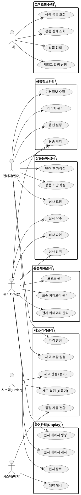

# 상위 유스케이스 — Catalog

> **단계**: 구조설계
> **문서범위**: Domain
> **문서종류**: Design
>
> **작성 목적**: 도메인 정의서(⑤)의 책임 목록을 "누가(액터) 무엇을(업무) 하는가" 단위로 분해한다.
> **흐름 내 위치**: ⑤ 도메인 정의서 → **⑥ 상위 유스케이스** → ⑦ 메뉴구조도 → ⑧ EARS
> **작성 주체**: 시니어 개발자 + AI 협업 (기획자·현업 검토·확인)

| 항목 | 내용 |
|---|---|
| ID | DESIGN-UC-CATALOG-001 |
| 상태 | **Draft** |
| 작성일 | 2026-07-08 |
| 갱신일 | 2026-07-08 |

---

## ① 액터 정의

| 액터 | 설명 | 채널 |
|---|---|---|
| 관리자(MD) | 플랫폼 운영자. 상품 심사·분류체계·전시 관리 권한 | A(Admin) |
| 판매자(벤더) | 입점 판매자. 상품 등록·수정·재고 관리 | V(Vendor) |
| 고객 | 로그인한 최종 구매자. 상품 조회·검색 | M(Mobile) |
| 시스템(Order) | Order 도메인의 재고 차감/복원 요청, 주문 취소 이벤트 | C(Consumer) |
| 시스템(배치) | 스케줄러. 전시 페이지 예약 게시, 재고 상태 자동 전환 | B(Batch) |

---

## ② 업무그룹별 유스케이스

### 상품등록·심사

| 유스케이스 | 액터 | 도출 근거 |
|---|---|---|
| 상품 초안 작성 (DRAFT) | 판매자 | 도메인정의서 "상품 등록" 책임 |
| 심사 요청 (DRAFT→REVIEW_REQUESTED) | 판매자 | 도메인정의서 "상품 심사" 프로세스 |
| 심사 착수 (REVIEW_REQUESTED→UNDER_REVIEW) | 관리자(MD) | 운영 정책: 상품 검수 |
| 심사 승인 (UNDER_REVIEW→ON_SALE) | 관리자(MD) | 운영 정책: 판매 승인 |
| 심사 반려 (UNDER_REVIEW→REJECTED) | 관리자(MD) | 운영 정책: 부적합 상품 |
| 반려 사유 확인 후 재작성 (REJECTED→DRAFT) | 판매자 | 반려 후 수정 재등록 |

### 상품정보관리

| 유스케이스 | 액터 | 도출 근거 |
|---|---|---|
| 상품 기본정보 수정 | 판매자 | 도메인정의서 "상품 정보 관리" |
| 상품 이미지 등록·순서변경·삭제 | 판매자 | 상품 상세 페이지 구성 |
| 옵션그룹·옵션값 설정 | 판매자 | SKU 생성 근거 |
| 상품 단종 처리 (ON_SALE/SOLD_OUT→DISCONTINUED) | 판매자/관리자 | 운영 정책: 영구 판매 중단 |
| 상품 상세 조회 (관리) | 관리자(MD)/판매자 | 관리 화면 |

### 분류체계관리

| 유스케이스 | 액터 | 도출 근거 |
|---|---|---|
| 표준 카테고리 생성·수정·삭제 | 관리자(MD) | 도메인정의서 "분류체계 관리" |
| 전시 카테고리 생성·수정·삭제 | 관리자(MD) | 전시 목적 분류 |
| 카테고리-상품 매핑 | 관리자(MD)/판매자 | 상품 분류 배치 |
| 브랜드 등록·수정 | 관리자(MD) | 브랜드 마스터 관리 |

### 재고·가격관리

| 유스케이스 | 액터 | 도출 근거 |
|---|---|---|
| SKU 재고 수량 설정·변경 | 판매자 | 재고 운영 |
| 재고 선점 (동기, Order 연동) | 시스템(Order) | 도메인정의서 §4: Order→Catalog |
| 재고 복원 (비동기, 주문 취소) | 시스템(Order) | ORDER_CANCELLED 수신 |
| 재고 부족 시 품절 자동 전환 (ON_SALE→SOLD_OUT) | 시스템(배치) | 자동 상태 전환 정책 |
| 재입고 시 판매 재개 (SOLD_OUT→ON_SALE) | 시스템(배치)/판매자 | 자동 상태 전환 정책 |
| 판매가·공급가·원가 설정·변경 | 판매자 | 가격 정책 |
| 가격 이력 기록 | 시스템 | 감사 추적 |

### 고객조회·응대

| 유스케이스 | 액터 | 도출 근거 |
|---|---|---|
| 상품 목록 조회 (카테고리별) | 고객 | 메인/카테고리 페이지 |
| 상품 상세 조회 | 고객 | 상품 상세 페이지 |
| 상품 검색 (키워드·필터) | 고객 | 검색 기능 |
| 재입고 알림 신청 | 고객 | 품절 상품 알림 |

### 화면관리(Display)

| 유스케이스 | 액터 | 도출 근거 |
|---|---|---|
| 전시 페이지 생성·편집 (DRAFT) | 관리자(MD) | 도메인정의서 "화면 관리" |
| 전시 페이지 게시 (PUBLISHED) | 관리자(MD) | 즉시 게시 |
| 전시 페이지 예약 게시 (SCHEDULED→PUBLISHED) | 시스템(배치) | 예약 시간 도래 시 |
| 전시 섹션·템플릿 구성 | 관리자(MD) | 페이지 레이아웃 |
| 전시 페이지 종료 (CLOSED) | 관리자(MD)/시스템(배치) | 기간 만료 |

### 연동지원

| 유스케이스 | 액터 | 도출 근거 |
|---|---|---|
| PublicApi: 상품 정보 조회 (Order 연동) | 시스템(Order) | 도메인정의서 §4: Order→Catalog 동기 |
| PublicApi: 재고 차감 요청 | 시스템(Order) | 주문 생성 시 재고 선점 |
| PublicApi: 재고 확인 (가용 수량) | 시스템(Order) | 장바구니/결제 전 검증 |
| 이벤트 발행: StockChanged | 시스템 | 재고 변동 후속 처리 |
| 이벤트 수신: ORDER_CANCELLED | 시스템(Order) | 취소 시 재고 복원 |

---

## ③ 액터-유스케이스 관계도

---

## ④ 권한 범위

| 규칙 | 도출 근거 |
|---|---|
| 판매자는 본인 등록 상품만 수정·삭제 가능 | 멀티벤더 정책 |
| 심사 승인/반려 권한은 관리자(MD)에게만 부여 | 품질 관리 정책 |
| 고객은 ON_SALE/SOLD_OUT 상품만 조회 가능 (DRAFT/REJECTED/DISCONTINUED 노출 불가) | 전시 정책 |
| 재고 차감은 Order 도메인의 동기 요청으로만 수행 | 도메인 간 계약 |
| 전시 페이지 관리는 관리자(MD)에게만 부여 | 운영 권한 분리 |
| 가격 변경 시 반드시 price_history 기록 | 감사 추적 정책 |

---

## ⑤ Bolt 분할 후보

| Bolt 후보 | 업무그룹 | 예상 규모 |
|---|---|---|
| 상품 등록·초안 | 상품등록·심사 | 1일 |
| 상품 심사 프로세스 | 상품등록·심사 | 반나절 |
| 상품정보 수정 (이미지·옵션 포함) | 상품정보관리 | 1일 |
| 분류체계 CRUD | 분류체계관리 | 반나절 |
| 재고 관리 (선점·복원·자동전환) | 재고·가격관리 | 1일 |
| 가격 관리·이력 | 재고·가격관리 | 반나절 |
| 고객 조회 API | 고객조회·응대 | 반나절 |
| 전시 페이지 관리 | 화면관리 | 1일 |
| PublicApi (Order 연동) | 연동지원 | 반나절 |

---

## 근거

| 항목 | 출처 |
|---|---|
| 업무그룹 분류 | `DB-도메인정의서.md` Catalog "핵심 책임" |
| 액터·채널 | `D9-컴포넌트.md` 앱 구성 + 도메인 정의서 "채널" |
| 재고 연동 | `DB-도메인정의서.md` §4: Order→Catalog 의존 관계 |
| 심사 프로세스 | 정책서 §3 상품 심사 정책 |
| 전시 관리 | 도메인기능표 Catalog "화면관리" 영역 |
| 분류체계 | 정책서 §4 카테고리 운영 정책 |
