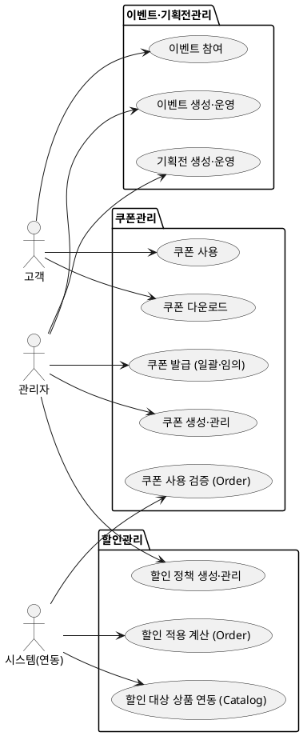

# 상위 유스케이스 — Promotion

> **단계**: 구조설계
> **문서범위**: Domain
> **문서종류**: Design
>
> **작성 목적**: 도메인 정의서(⑤)의 책임 목록을 "누가(액터) 무엇을(업무) 하는가" 단위로 분해한다.
> **흐름 내 위치**: ⑤ 도메인 정의서 → **⑥ 상위 유스케이스** → ⑦ 메뉴구조도 → ⑧ EARS
> **작성 주체**: 시니어 개발자 + AI 협업 (기획자·현업 검토·확인)

| 항목 | 내용 |
|---|---|
| ID | DESIGN-UC-PROMOTION-001 |
| 상태 | **Draft** |
| 작성일 | 2026-07-08 |
| 갱신일 | 2026-07-08 |

> **도출 근거 원칙**: 본 문서의 모든 유스케이스는 **범위정의(S1) 산출물** — 특히 **도메인정의서(DB)의 Promotion "핵심 책임·핵심 엔티티·채널·의존·이벤트 발행"** 과 **컴포넌트(D9)의 채널 매핑** — 에서만 도출한다. 정책서의 세부 구현 규칙(가격 복원 방식, 재시도 등)이나 후행 산출물(EARS)·비공식 참고자료(도메인기능표)는 도출 근거로 사용하지 않는다. 구현 규칙에서 파생되는 시스템 동작(예: 행사 종료 시 가격 복원)은 상위 유스케이스가 아니라 EARS(⑧)·상태머신(⑩)·비즈니스 프로세스(⑪)에서 도출한다.

---

## 도메인정의서(DB) Promotion 정의 — 도출 기준

| 항목 | 도메인정의서 명시 내용 |
|---|---|
| **핵심 책임** | 쿠폰 생성·발급·사용 / 할인 정책 / 이벤트·기획전 / 운영·CS·마케팅 시스템 |
| **핵심 엔티티** | 쿠폰(Coupon), 할인정책(DiscountPolicy), 이벤트(Event), 기획전(Exhibition) |
| **채널** | mobile(쿠폰 사용·이벤트 참여), admin(프로모션 관리·CS·마케팅) |
| **의존** | → Catalog(할인 대상 상품), → Order(쿠폰 적용), ← Member(쿠폰 발급 대상) |
| **이벤트 발행** | CouponIssued, CouponUsed, EventStarted, EventEnded |

> **채널 주의**: 도메인정의서·컴포넌트(D9) 기준 Promotion 채널은 **mobile·admin 2종**이다. partner(입점사) 채널은 S1 산출물에 정의되어 있지 않으므로, 입점사 관련 유스케이스는 본 문서에 포함하지 않는다(향후 범위 확정 시 편입 — 부록 A).

---

## ① 액터 정의

> 도메인정의서 "채널"(mobile·admin)과 "의존"(Order·Catalog·Member 연동)에서 도출.

| 액터 | 설명 | 채널 | 도출 근거 |
|---|---|---|---|
| 관리자 | 프로모션 관리·CS·마케팅 담당 (쿠폰·할인·이벤트·기획전 운영) | A(Admin) | 도메인정의서 채널 "admin(프로모션 관리·CS·마케팅)" |
| 고객 | 쿠폰 사용·이벤트 참여 주체 | M(Mobile) | 도메인정의서 채널 "mobile(쿠폰 사용·이벤트 참여)" |
| 시스템(연동) | Order·Catalog가 쿠폰 적용·할인 대상 상품을 동기 요청 | C(Consumer) | 도메인정의서 의존 "→ Order(쿠폰 적용), → Catalog(할인 대상 상품)" |

---

## ② 업무그룹별 유스케이스

> 도메인정의서 "핵심 책임"을 업무그룹으로 묶는다: **쿠폰 / 할인 정책 / 이벤트·기획전**.
> 각 유스케이스는 "핵심 엔티티"의 생명주기와 "이벤트 발행" 목록에 대응한다.

### 쿠폰관리

> 도메인정의서 책임: "쿠폰 생성·발급·사용" / 핵심 엔티티: 쿠폰(Coupon) / 이벤트: CouponIssued·CouponUsed

| 유스케이스 | 액터 | 도출 근거 |
|---|---|---|
| 쿠폰 생성·관리 | 관리자 | 도메인정의서 책임 "쿠폰 생성", 엔티티 Coupon |
| 쿠폰 발급 (일괄·임의) | 관리자 | 도메인정의서 책임 "쿠폰 발급" (운영·CS 발행 포함), 이벤트 CouponIssued |
| 쿠폰 다운로드 | 고객 | 도메인정의서 채널 "mobile(쿠폰 사용)", 이벤트 CouponIssued |
| 쿠폰 사용 (쿠폰 상태 확정) | 시스템(연동) | 도메인정의서 책임 "쿠폰 사용", 이벤트 CouponUsed |
| 쿠폰 사용 검증 (Order 연동) | 시스템(연동) | 도메인정의서 의존 "→ Order(쿠폰 적용)" |

> **쿠폰 사용의 도메인 경계**: 고객이 주문서에서 쿠폰을 선택·적용하는 **행위 자체는 Order 도메인**에서 일어난다. Promotion은 그 요청에 대해 ① 사용 가능 여부 **검증**(REQ-PRM-003~005)과 ② 결제 완료 시 쿠폰 발급 건을 **USED로 확정**(CouponUsed 이벤트)하는 역할만 담당한다. 따라서 "쿠폰 사용"은 고객 UC가 아니라 시스템(연동) UC로 분류한다.
>
> "운영·CS·마케팅 시스템" 책임 중 **쿠폰 임의 발행(CS)·쿠폰 대상 타겟팅(마케팅)**은 쿠폰의 발급·생성 하위 기능이므로 본 그룹에 흡수한다. 별도 업무그룹으로 분리하지 않는다. (성과·현황 조회 등 나머지 운영 기능은 도메인정의서에 구체 근거가 없어 부록 A로 분리)

### 할인관리

> 도메인정의서 책임: "할인 정책" / 핵심 엔티티: 할인정책(DiscountPolicy)

| 유스케이스 | 액터 | 도출 근거 |
|---|---|---|
| 할인 정책 생성·관리 | 관리자 | 도메인정의서 책임 "할인 정책", 엔티티 DiscountPolicy |
| 할인 적용 계산 (Order 연동) | 시스템(연동) | 도메인정의서 의존 "→ Order(쿠폰 적용)" |
| 할인 대상 상품 연동 (Catalog 연동) | 시스템(연동) | 도메인정의서 의존 "→ Catalog(할인 대상 상품)" |

### 이벤트·기획전관리

> 도메인정의서 책임: "이벤트·기획전" / 핵심 엔티티: 이벤트(Event), 기획전(Exhibition) / 이벤트 발행: EventStarted·EventEnded

| 유스케이스 | 액터 | 도출 근거 |
|---|---|---|
| 이벤트 생성·운영 | 관리자 | 도메인정의서 책임 "이벤트", 엔티티 Event, 이벤트 EventStarted/EventEnded |
| 이벤트 참여 | 고객 | 도메인정의서 채널 "mobile(이벤트 참여)" |
| 기획전 생성·운영 | 관리자 | 도메인정의서 책임 "기획전", 엔티티 Exhibition |

> **참고**: 도메인정의서 책임 "운영·CS·마케팅 시스템"은 Promotion 도메인 전반의 성격을 나타내는 횡단(cross-cutting) 서술로, 단일 업무그룹으로 분리하지 않는다. 구체 업무는 각 업무그룹에 흡수한다 — 쿠폰 임의 발행·타겟팅 → 쿠폰관리, 프로모션 운영 현황·성과 조회 → 부록 A(구체 근거 확정 후 편입).

---

## ③ 액터-유스케이스 관계도

---

## ④ 권한 범위

> 도메인정의서 "채널"·"의존"에서 도출 가능한 권한 경계만 명시. 세부 권한 규칙(직매입/입점형 분기 등)은 정책 확정 후 EARS에서 정의한다.

| 규칙 | 도출 근거 |
|---|---|
| 프로모션 생성·관리(쿠폰·할인·이벤트·기획전)는 관리자만 수행 | 도메인정의서 채널 "admin(프로모션 관리·CS·마케팅)" |
| 프로모션 운영·CS·마케팅 업무는 관리자만 수행 | 도메인정의서 책임 "운영·CS·마케팅 시스템", 채널 admin |
| 고객은 쿠폰 사용·이벤트 참여만 가능 | 도메인정의서 채널 "mobile(쿠폰 사용·이벤트 참여)" |
| 쿠폰 발급 대상은 회원 (Member 연동) | 도메인정의서 의존 "← Member(쿠폰 발급 대상)" |
| 쿠폰 적용·할인 계산은 Order 요청으로만 수행 | 도메인정의서 의존 "→ Order(쿠폰 적용)" |
| 할인 대상 상품은 Catalog와 연동 | 도메인정의서 의존 "→ Catalog(할인 대상 상품)" |

---

## ⑤ Bolt 분할 후보

> 상위 유스케이스 기준 개략 후보. 세부 분할은 EARS(⑧) 도출 후 확정한다.

| Bolt 후보 | 업무그룹 | 비고 |
|---|---|---|
| 쿠폰 생성·발급·사용 | 쿠폰관리 | 엔티티 Coupon 생명주기 |
| 쿠폰 사용 검증 PublicApi (Order 연동) | 쿠폰관리 | 의존 → Order |
| 할인 정책 관리 | 할인관리 | 엔티티 DiscountPolicy |
| 할인 계산 PublicApi (Order·Catalog 연동) | 할인관리 | 의존 → Order·Catalog |
| 이벤트 운영·참여 | 이벤트·기획전관리 | 엔티티 Event |
| 기획전 운영 | 이벤트·기획전관리 | 엔티티 Exhibition |

---

## 부록 A. 향후 범위 확정 후 편입 대상

> 아래 항목은 상위 유스케이스로 도출하려면 **도메인정의서(또는 상위 범위정의 산출물)에 명시적 근거가 추가되어야 하는** 항목이다. 현재 S1 산출물에 근거가 없어 본문에서 제외한다.

| 항목 | 제외 사유 | 편입 조건 |
|---|---|---|
| 입점사(partner) 쿠폰 등록·비활성화 | 도메인정의서·컴포넌트(D9) 채널에 partner 없음 (mobile·admin만) | 컴포넌트에 promotion-partner 채널 추가 시 |
| 직매입/입점형 쿠폰 승인 게이트 분기 | 세부 운영 규칙 (정책서 §9.0 기반) — 도메인정의서 책임 아님 | EARS(⑧)에서 정책서 근거로 도출 |
| 행사 종료 시 가격 복원 / 수량 소진 종료 | 할인 정책의 하위 구현 동작 (정책서 §3.7·§9.1-1 기반) — 도메인정의서 책임 아님 | **EARS(⑧)에 요구사항 등록 → 세부 유스케이스(DK)에서 행위 분해** (상태머신·비즈니스 프로세스에도 반영) |
| 노출 할인가 사전 계산·갱신 | 화면 노출 구현 규칙 (정책서 §3.10 기반) — 도메인정의서 책임 아님 | EARS(⑧)·이벤트플로우(⑫)에서 도출 |
| 프로모션 운영 현황·성과 조회 | 도메인정의서 책임 "운영·마케팅 시스템"은 횡단 서술로 구체 근거 없음 (도메인기능표 "성과분석"은 후행·비공식 산출물이라 근거 불가) | 성과 지표·화면이 범위정의 산출물에 정의될 때 편입 |
| 쿠폰 타겟팅·임의 발행 세부 규칙 | 쿠폰관리 "쿠폰 생성·발급"의 하위 세부 기능 (본문 흡수 완료) | 세부 유스케이스(DK)에서 분해 |

---

## 근거

| 항목 | 출처 (단계) |
|---|---|
| 업무그룹 분류 (쿠폰/할인/이벤트·기획전) | `DB-도메인정의서.md` Promotion "핵심 책임" (S1-범위정의) |
| 유스케이스별 도출 | `DB-도메인정의서.md` Promotion "핵심 엔티티·이벤트 발행" (S1) |
| 액터·채널 (관리자·고객) | `DB-도메인정의서.md` Promotion "채널" + `D9-컴포넌트.md` 채널 매핑 (S1) |
| 시스템(연동) 액터 | `DB-도메인정의서.md` Promotion "의존" (→ Order, → Catalog, ← Member) (S1) |
| 권한 범위 | `DB-도메인정의서.md` Promotion "채널·의존" (S1) |
| 운영·CS·마케팅 처리 | `DB-도메인정의서.md` 책임 "운영·CS·마케팅 시스템"을 횡단 서술로 판단 — 쿠폰 임의발행·타겟팅은 쿠폰관리로 흡수, 성과·현황 조회는 부록 A로 분리 (S1) |
| 부록 A 제외 근거 | `DB-도메인정의서.md`·`D9-컴포넌트.md` 미명시 항목 (S1) |
