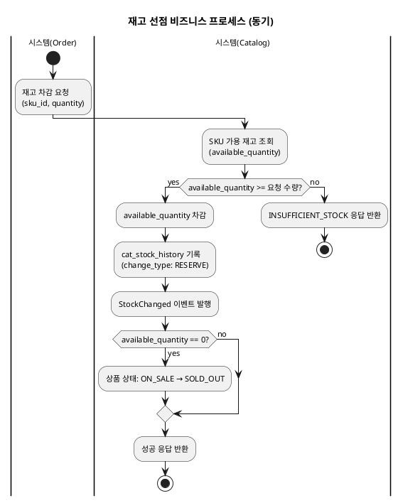
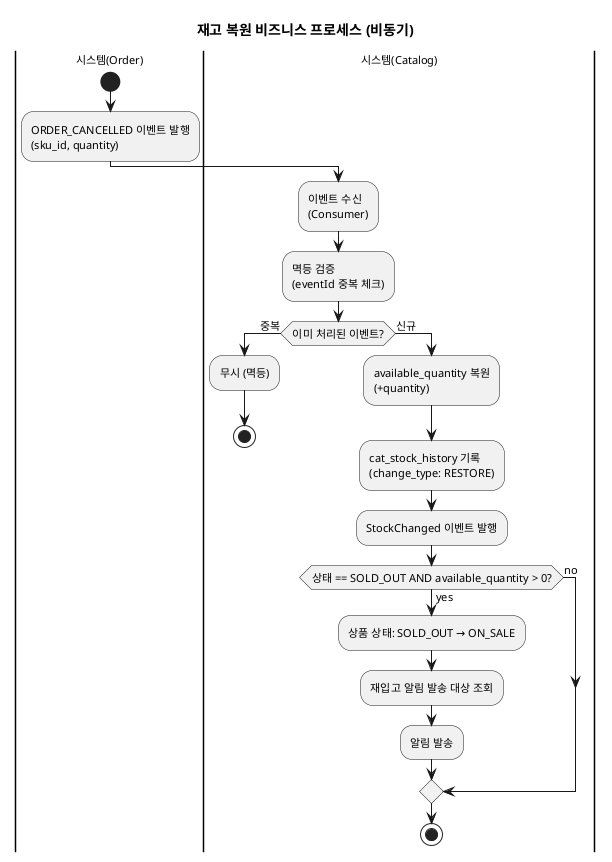
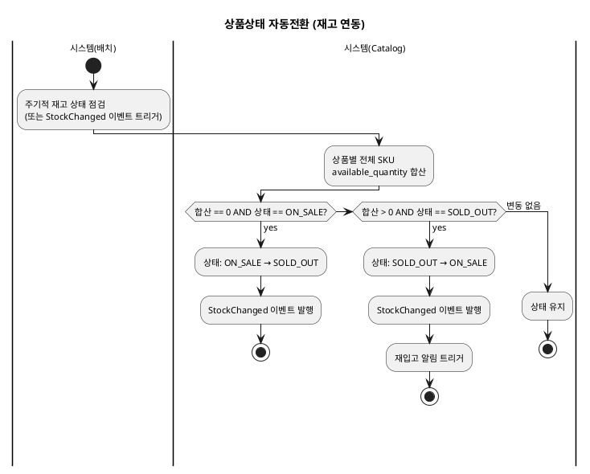
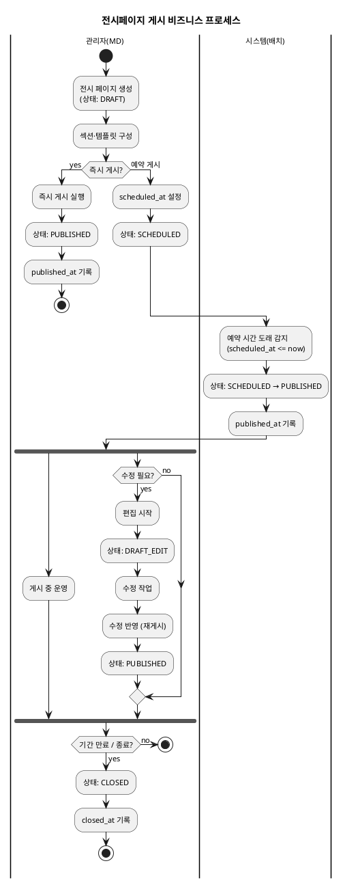

# 비즈니스 프로세스 — Catalog

> **단계**: 구조설계
> **문서범위**: Domain
> **문서종류**: Design
>
> **작성 목적**: 상태머신(⑩)의 전이를 액티비티 흐름으로 확장하여, "누가 어떤 순서로 업무를 수행하는가"를 시각화한다.
> **흐름 내 위치**: ⑩ 상태머신 → **⑪ 비즈니스 프로세스** → ⑫ 이벤트 플로우
> **작성 주체**: 시니어 개발자 + AI 협업 (기획자·현업 검토·확인)

| 항목 | 내용 |
|---|---|
| ID | DESIGN-BP-CATALOG-001 |
| 상태 | **Draft** |
| 작성일 | 2026-07-08 |
| 갱신일 | 2026-07-08 |

---

## 1. 상품등록·심사 프로세스

```plantuml
@startuml
skinparam backgroundColor transparent
skinparam defaultFontSize 11
title 상품등록·심사 비즈니스 프로세스

|판매자(벤더)|
start
:상품 초안 작성\n(name, category, price, image);
:상태: DRAFT;

if (필수 필드 충족?) then (yes)
  :심사 요청;
  :상태: REVIEW_REQUESTED;
else (no)
  :필수 필드 미충족 안내;
  stop
endif

|관리자(MD)|
:심사 착수;
:상태: UNDER_REVIEW;

if (상품 적합?) then (승인)
  :심사 승인;
  :상태: ON_SALE;
  :ProductApproved 이벤트 발행;
  stop
else (반려)
  :반려 사유 작성;
  :상태: REJECTED;
  :판매자 알림 발송;
endif

|판매자(벤더)|
:반려 사유 확인;
:상품 수정;
:상태: DRAFT;
backward :심사 요청;

@enduml
```

---

## 2. 재고 선점 프로세스 (동기)



---

## 3. 재고 복원 프로세스 (비동기)



---

## 4. 상품상태 자동전환 프로세스 (재고 연동)



---

## 5. 전시페이지 게시 프로세스



---

## 근거

| 항목 | 출처 |
|---|---|
| 상태 전이 | `DH-상태머신(Catalog).md` |
| 심사 흐름 | `DC-상위유스케이스(Catalog).md` 상품등록·심사 업무그룹 |
| 재고 선점 규칙 | REQ-CAT-002, REQ-CAT-003 |
| 재고 복원 규칙 | REQ-CAT-004, REQ-CAT-005 |
| 자동 상태 전환 | REQ-CAT-023, REQ-CAT-024 |
| 전시 예약 게시 | 운영 정책: 예약 게시 배치 |
| 재입고 알림 | REQ-CAT-029 |
