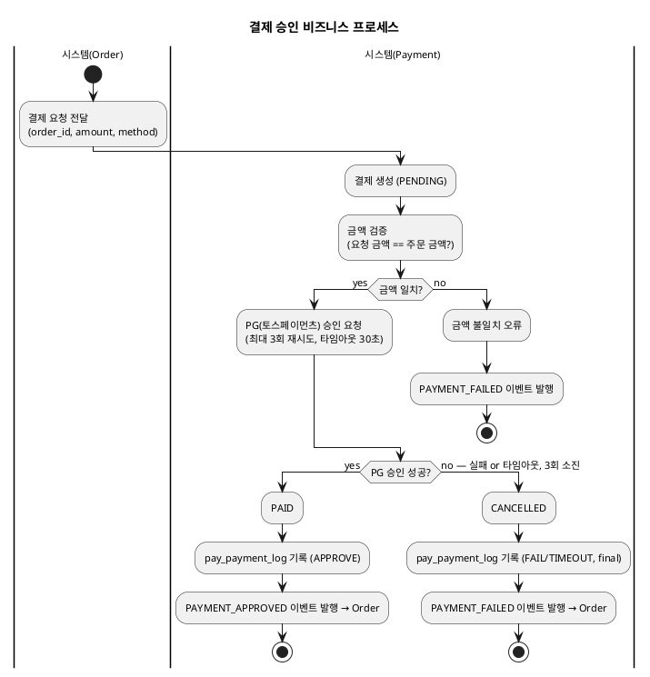
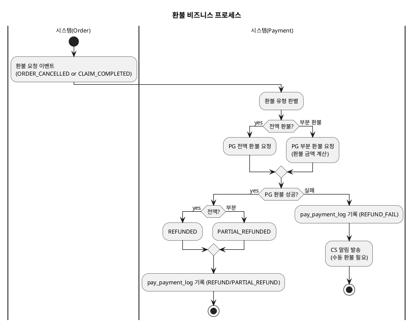
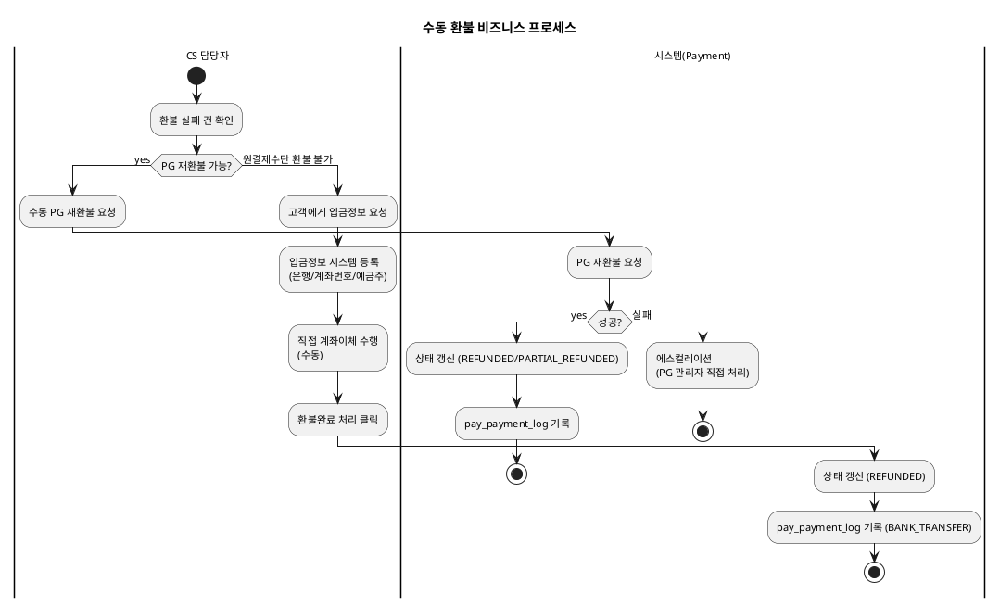
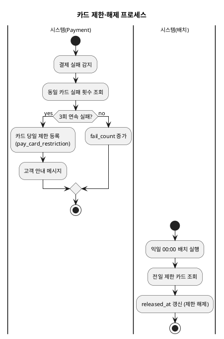

# 비즈니스 프로세스 — Payment

> **단계**: 구조설계
> **문서범위**: Domain
> **문서종류**: Design
>
> **작성 목적**: 상태머신(DH)의 전이를 액티비티 흐름으로 확장하여, "누가 어떤 순서로 업무를 수행하는가"를 시각화한다.
> **흐름 내 위치**: DF ERD → **DG 비즈니스 프로세스** → DH 상태머신 → DI 이벤트 플로우
> **작성 주체**: 시니어 개발자 + AI 협업 (기획자·현업 검토·확인)

| 항목 | 내용 |
|---|---|
| ID | DESIGN-BP-PAYMENT-001 |
| 상태 | **Finalized** |
| 작성일 | 2026-08-11 |
| 갱신일 | 2026-08-11 |

---

## 1. 결제 승인 프로세스

> **재시도 상세**: PG 실패/타임아웃 시 지수 백오프(1초→2초→4초)로 최대 3회 재시도.
> 3회 모두 실패 시 CANCELLED로 전환. 각 시도마다 pay_payment_log에 기록.

---

## 2. 환불 프로세스

---

## 3. 수동 환불 프로세스

---

## 4. 카드 제한·해제 프로세스

---

## 근거

| 항목 | 출처 |
|---|---|
| 상태 전이 | `../DH-상태머신/payment.md` |
| 결제 흐름 | `../DC-상위유스케이스/payment.md` 결제 실행 업무그룹 |
| 재시도 규칙 | REQ-PAY-003 (3회), REQ-PAY-005 (30초 타임아웃) |
| 금액 검증 | REQ-PAY-007 |
| 카드 제한 | REQ-PAY-018, REQ-PAY-019 |
| 환불 정책 | REQ-PAY-008~013 |
