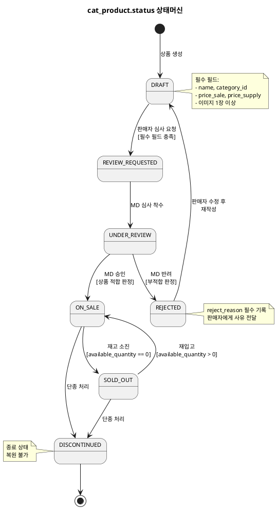
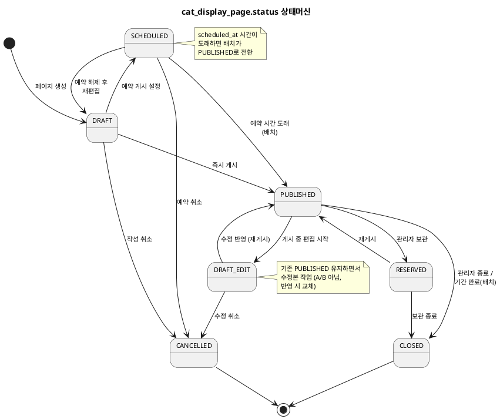

# 상태머신 — Catalog

> **단계**: 구조설계
> **문서범위**: Domain
> **문서종류**: Design
>
> **작성 목적**: ERD(⑨)의 status 컬럼에서 허용 상태와 전이 규칙을 정의한다.
> **흐름 내 위치**: ⑨ ERD → **⑩ 상태머신** → ⑪ 비즈니스 프로세스 → ⑫ 이벤트 플로우
> **작성 주체**: 시니어 개발자 + AI 협업 (기획자·현업 검토·확인)

| 항목 | 내용 |
|---|---|
| ID | DESIGN-SM-CATALOG-001 |
| 상태 | **Draft** |
| 작성일 | 2026-07-08 |
| 갱신일 | 2026-07-08 |

---

## 1. cat_product.status 상태머신

### 상태 목록

| 상태 | 설명 | 진입 조건 |
|---|---|---|
| DRAFT | 초안 (판매자 작성 중) | 상품 생성 시 / 반려 후 재작성 |
| REVIEW_REQUESTED | 심사 요청됨 (판매자→MD) | 판매자 심사 요청 |
| UNDER_REVIEW | 심사 중 (MD 검토 진행) | MD 심사 착수 |
| ON_SALE | 판매 중 (고객 노출) | 심사 승인 / 재입고 |
| SOLD_OUT | 품절 (재고 소진) | available_quantity == 0 |
| DISCONTINUED | 단종 (영구 판매 중단) | 판매자/관리자 단종 처리 |
| REJECTED | 심사 반려 (수정 필요) | MD 반려 처리 |

### 전이 다이어그램

### 전이 규칙 상세

| From | To | 트리거 | 가드 (조건) | 액션 (부수효과) |
|---|---|---|---|---|
| DRAFT | REVIEW_REQUESTED | 판매자 심사 요청 | name, category_id, price_sale, 이미지 ≥ 1장 | ProductCreated 이벤트 (최초 등록 시) |
| REVIEW_REQUESTED | UNDER_REVIEW | MD 심사 착수 클릭 | — | 심사 담당자 할당 |
| UNDER_REVIEW | ON_SALE | MD 승인 | 상품 적합 판정 | ProductApproved 이벤트 발행 |
| UNDER_REVIEW | REJECTED | MD 반려 | 부적합 판정 | reject_reason 기록, 판매자 알림 |
| REJECTED | DRAFT | 판매자 수정 저장 | — | reject_reason 초기화 |
| ON_SALE | SOLD_OUT | 재고 차감 결과 | available_quantity == 0 (모든 SKU) | StockChanged 이벤트 발행 |
| SOLD_OUT | ON_SALE | 재고 복원/재입고 | available_quantity > 0 (1개 이상 SKU) | StockChanged 이벤트 발행 |
| ON_SALE | DISCONTINUED | 판매자/관리자 단종 | — | 전시 페이지에서 제거 |
| SOLD_OUT | DISCONTINUED | 판매자/관리자 단종 | — | 전시 페이지에서 제거 |

### 금지 전이

| From | To | 사유 | EARS 근거 |
|---|---|---|---|
| DRAFT | ON_SALE | 심사 없이 판매 불가 | REQ-CAT-009~011: 심사 프로세스 필수 |
| DRAFT | SOLD_OUT | 미승인 상태에서 재고 개념 없음 | 논리적 불가 |
| REVIEW_REQUESTED | ON_SALE | MD 심사 단계 생략 불가 | REQ-CAT-010: 심사 착수 필수 |
| REJECTED | ON_SALE | 반려 후 바로 판매 불가 (재심사 필수) | REQ-CAT-013: DRAFT 경유 필수 |
| DISCONTINUED | 모든 상태 | 종료 상태, 복원 불가 | 운영 정책: 영구 판매 중단 |
| ON_SALE/SOLD_OUT | DRAFT | 이미 승인된 상품 초안 회귀 불가 | 운영 정책 |
| ON_SALE/SOLD_OUT | UNDER_REVIEW | 이미 판매 중 상품 재심사 불가 | 운영 정책 |

---

## 2. cat_display_page.status 상태머신

### 상태 목록

| 상태 | 설명 | 진입 조건 |
|---|---|---|
| DRAFT | 초안 (최초 작성) | 페이지 생성 시 |
| DRAFT_EDIT | 수정 중 (게시 후 재편집) | PUBLISHED 상태에서 편집 시작 |
| PUBLISHED | 게시 중 (고객 노출) | 즉시 게시 / 예약 시간 도래 |
| SCHEDULED | 예약됨 (게시 대기) | 예약 게시 설정 |
| RESERVED | 예비 보관 (미사용 대기) | 관리자 보관 처리 |
| CLOSED | 종료 (기간 만료) | 관리자 종료 / 배치 자동 종료 |
| CANCELLED | 취소 (폐기) | 관리자 취소 처리 |

### 전이 다이어그램

### 전이 규칙 상세

| From | To | 트리거 | 가드 (조건) | 액션 (부수효과) |
|---|---|---|---|---|
| DRAFT | PUBLISHED | 관리자 즉시 게시 | 섹션 1개 이상 | published_at 기록 |
| DRAFT | SCHEDULED | 관리자 예약 설정 | scheduled_at > now | scheduled_at 기록 |
| DRAFT | CANCELLED | 관리자 취소 | — | — |
| SCHEDULED | PUBLISHED | 배치: scheduled_at ≤ now | — | published_at 기록 |
| SCHEDULED | CANCELLED | 관리자 예약 취소 | — | scheduled_at 초기화 |
| SCHEDULED | DRAFT | 관리자 예약 해제 | — | scheduled_at 초기화 |
| PUBLISHED | DRAFT_EDIT | 관리자 편집 시작 | — | — |
| PUBLISHED | CLOSED | 관리자 종료 / 배치 기간 만료 | — | closed_at 기록 |
| PUBLISHED | RESERVED | 관리자 보관 | — | — |
| DRAFT_EDIT | PUBLISHED | 관리자 수정 반영 | 섹션 1개 이상 | published_at 갱신 |
| DRAFT_EDIT | CANCELLED | 관리자 수정 취소 | — | 이전 PUBLISHED 복원 |
| RESERVED | PUBLISHED | 관리자 재게시 | — | published_at 갱신 |
| RESERVED | CLOSED | 관리자 보관 종료 | — | closed_at 기록 |

### 금지 전이

| From | To | 사유 | EARS 근거 |
|---|---|---|---|
| CLOSED | PUBLISHED/DRAFT | 종료 후 재활성화 불가 | 운영 정책 |
| CANCELLED | 모든 상태 | 취소 후 복원 불가 | 운영 정책 |
| DRAFT | CLOSED | 미게시 상태에서 종료 개념 없음 | 논리적 불가 |
| DRAFT | RESERVED | 미게시 상태에서 보관 불가 | 논리적 불가 |

---

## Bolt 분할 후보 (상태 전이 기반)

| Bolt 후보 | 상태 전이 | 예상 규모 |
|---|---|---|
| 상품 초안 등록 | →DRAFT | 반나절 |
| 심사 요청·착수 | DRAFT→REVIEW_REQUESTED→UNDER_REVIEW | 반나절 |
| 심사 승인·반려 | UNDER_REVIEW→ON_SALE / →REJECTED | 반나절 |
| 재고 선점·복원 | ON_SALE↔SOLD_OUT 연동 | 1일 |
| 상품 단종 | →DISCONTINUED | 반나절 |
| 전시 페이지 생성·게시 | DRAFT→PUBLISHED/SCHEDULED | 1일 |
| 전시 페이지 수정·종료 | PUBLISHED→DRAFT_EDIT, →CLOSED | 반나절 |

---

## 근거

| 항목 | 출처 |
|---|---|
| 상태 목록 (product) | `DF-도메인모델ERD(Catalog).md` cat_product.status |
| 상태 목록 (display_page) | `DF-도메인모델ERD(Catalog).md` cat_display_page.status |
| 전이 규칙 | `08-EARS기능요구(Catalog).md` REQ-CAT-008~018 |
| 재고 연동 전환 | REQ-CAT-023, REQ-CAT-024 |
| 심사 프로세스 | 정책서 §3 상품 심사 정책 |
| 전시 예약 게시 | 운영 정책: 예약 게시 배치 |
| Bolt 분할 기준 | 방법론 부록 A (전이 1개 = Bolt 1개) |
