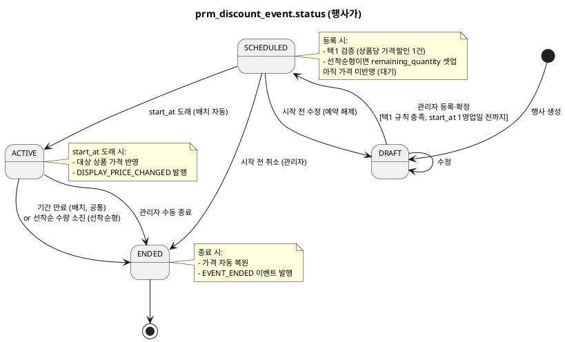
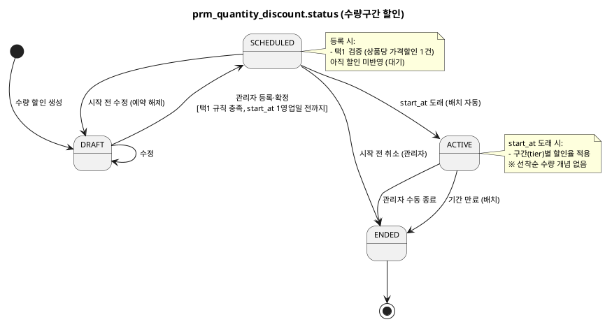
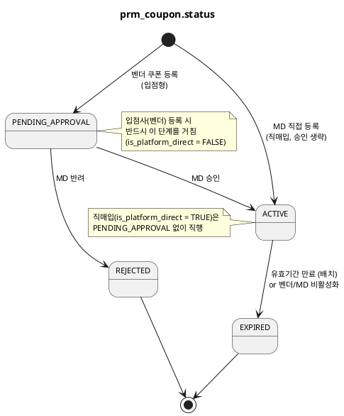
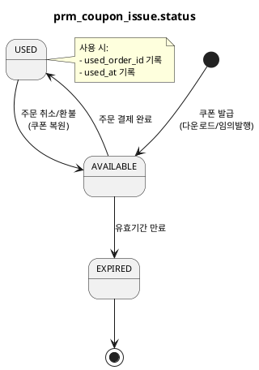

# 상태머신 — Promotion

> **단계**: 구조설계
> **문서범위**: Domain
> **문서종류**: Design
>
> **작성 목적**: ERD(⑨)의 status 컬럼에서 허용 상태와 전이 규칙을 정의한다.
> **흐름 내 위치**: ⑨ ERD → **⑩ 상태머신** → ⑪ 비즈니스 프로세스 → ⑫ 이벤트 플로우
> **작성 주체**: 시니어 개발자 + AI 협업 (기획자·현업 검토·확인)

| 항목 | 내용 |
|---|---|
| ID | DESIGN-SM-PROMOTION-001 |
| 상태 | **Draft** |
| 작성일 | 2026-07-08 |
| 갱신일 | 2026-10-13 (partner 쿠폰 "협의 대기" 해제, 이슈 #7) |

---

> **상품 가격할인 택1 원칙**: 행사가(prm_discount_event)와 수량구간 할인(prm_quantity_discount)은 상태 전이 구조는 동일하나 **별도 테이블**이며, 동일 상품에 **동시에 1건만 ACTIVE**를 허용한다(REQ-PRM-007). 두 상태머신은 §1(행사가)·§1-2(수량구간 할인)로 분리 정의한다. 차이점: **선착순 종료(limit_type/remaining_quantity)는 행사가 전용**이며, 수량구간 할인은 기간으로만 종료한다.

## 1. prm_discount_event.status (행사가)

> **예약 활성화 원칙 (정책서 §3.7)**: 행사는 시작 1영업일 전까지 등록하며, 등록 즉시 활성화되지 않는다. 관리자가 등록·확정하면 **SCHEDULED(예약)** 상태로 대기하고, **start_at 도래 시 배치가 자동으로 ACTIVE 전환**한다.

### 상태 목록

| 상태 | 설명 | 진입 조건 |
|---|---|---|
| DRAFT | 작성 중, 미활성 | 행사 생성 시 |
| SCHEDULED | 등록 확정, 시작일 대기 | 관리자 등록·확정 (start_at 1영업일 전까지) |
| ACTIVE | 활성 (할인 적용 중) | start_at 도래 (배치 자동 전환) |
| ENDED | 종료 (기간 만료, 또는 선착순형의 제한 수량 소진) | 배치/시스템 처리 |

### 전이 다이어그램

### 전이 규칙 상세

| From | To | 트리거 | 가드 (조건) | 액션 (부수효과) |
|---|---|---|---|---|
| DRAFT | SCHEDULED | 관리자 등록·확정 | 동일 상품에 SCHEDULED/ACTIVE 가격할인(행사가·수량구간) 없음 (통합 택1, REQ-PRM-007) + start_at ≥ now+1영업일 | 선착순형이면 remaining_quantity 셋업 (가격 미반영) |
| SCHEDULED | ACTIVE | start_at 도래 (배치 자동) | start_at ≤ now | 대상 상품 할인가 반영, DISPLAY_PRICE_CHANGED 발행 |
| SCHEDULED | DRAFT | 관리자 시작 전 수정 | start_at > now | 예약 해제 |
| SCHEDULED | ENDED | 관리자 시작 전 취소 | — | — |
| ACTIVE | ENDED | 기간 만료 (기간형·선착순형 공통) | end_at ≤ now | 가격 복원, EVENT_ENDED 이벤트 발행 |
| ACTIVE | ENDED | 선착순 수량 소진 (선착순형만) | limit_type=QUANTITY AND remaining_quantity = 0 | 가격 복원, EVENT_ENDED 이벤트 발행 |
| ACTIVE | ENDED | 관리자 수동 종료 | — | 가격 복원 |

### 금지 전이

| From | To | 사유 |
|---|---|---|
| DRAFT | ACTIVE | 예약(SCHEDULED) 없이 즉시 활성화 불가 — 시작일에 배치가 전환 (정책서 §3.7) |
| ENDED | DRAFT / SCHEDULED / ACTIVE | 종료 상태는 불변 (재활성화는 신규 생성으로) |
| ACTIVE | DRAFT / SCHEDULED | 역행 불가 (이미 고객에게 노출) |

---

## 1-2. prm_quantity_discount.status (수량구간 할인)

> 행사가와 동일한 DRAFT→SCHEDULED→ACTIVE→ENDED 구조이나, **선착순 종료가 없다** (기간으로만 종료). 동일 상품에 행사가와 택1(REQ-PRM-021).

> **예약 활성화 원칙 (정책서 §3.7)**: 수량구간 할인도 행사가와 동일하게 시작 1영업일 전까지 등록하며, 등록 즉시 활성화되지 않는다. 관리자 등록·확정 시 **SCHEDULED(예약)** 대기 후 **start_at 도래 시 배치가 자동 ACTIVE 전환**한다.

### 상태 목록

| 상태 | 설명 | 진입 조건 |
|---|---|---|
| DRAFT | 작성 중, 미활성 | 수량 할인 생성 시 |
| SCHEDULED | 등록 확정, 시작일 대기 | 관리자 등록·확정 (start_at 1영업일 전까지) |
| ACTIVE | 활성 (구간별 할인 적용 중) | start_at 도래 (배치 자동 전환) |
| ENDED | 종료 (기간 만료) | 배치/시스템 처리 |

### 전이 다이어그램

### 전이 규칙 상세

| From | To | 트리거 | 가드 (조건) | 액션 (부수효과) |
|---|---|---|---|---|
| DRAFT | SCHEDULED | 관리자 등록·확정 | 동일 상품에 SCHEDULED/ACTIVE 가격할인(행사가·수량구간) 없음 (통합 택1, REQ-PRM-021) + start_at ≥ now+1영업일 | 예약 등록 (할인 미반영) |
| SCHEDULED | ACTIVE | start_at 도래 (배치 자동) | start_at ≤ now | 구간별 할인율 적용 |
| SCHEDULED | DRAFT | 관리자 시작 전 수정 | start_at > now | 예약 해제 |
| SCHEDULED | ENDED | 관리자 시작 전 취소 | — | — |
| ACTIVE | ENDED | 기간 만료 | end_at ≤ now | 할인 해제 |
| ACTIVE | ENDED | 관리자 수동 종료 | — | 할인 해제 |

### 금지 전이

| From | To | 사유 |
|---|---|---|
| DRAFT | ACTIVE | 예약(SCHEDULED) 없이 즉시 활성화 불가 (정책서 §3.7) |
| ENDED | DRAFT / SCHEDULED / ACTIVE | 종료 상태는 불변 |
| ACTIVE | DRAFT / SCHEDULED | 역행 불가 |
| — | — | 선착순 수량 소진 전이 없음 (행사가 전용) |

---

## 2. prm_coupon.status (쿠폰 정의)

> **확정**: PENDING_APPROVAL 상태 및 직매입/입점형 승인 분기(is_platform_direct)는 입점사(partner) 프로모션 등록을 전제로 하며, 도메인정의서(DB)에 partner 채널이 추가되어(2026-10-13, 이슈 #5) 확정되었다. 직매입 쿠폰은 admin(MD) 등록 시 즉시 ACTIVE, 입점형 쿠폰은 입점사 등록 → PENDING_APPROVAL → 관리자 승인 시 ACTIVE 흐름이다.

### 상태 목록

| 상태 | 설명 | 진입 조건 |
|---|---|---|
| PENDING_APPROVAL | 벤더 등록, MD 승인 대기 | 입점사 쿠폰 등록 시 |
| ACTIVE | 승인 완료, 발급·사용 가능 | MD 승인 또는 MD 직접 등록 |
| REJECTED | 반려 (사유 기록) | MD 반려 |
| EXPIRED | 만료 (기간 경과 또는 조기 비활성화) | 배치 또는 비활성화 (⚠️ 발급·사용 가능 판정은 `status=ACTIVE AND now ≤ valid_to` 조합 — §3 판정식 원칙 동일 적용) |

### 전이 다이어그램

### 전이 규칙 상세

| From | To | 트리거 | 가드 (조건) | 액션 (부수효과) |
|---|---|---|---|---|
| — | ACTIVE | MD 직매입 쿠폰 직접 등록 | vendor.is_platform_direct = TRUE | 승인 게이트 생략, 즉시 발급 가능 |
| PENDING_APPROVAL | ACTIVE | MD 승인 | vendor.is_platform_direct = FALSE | 쿠폰 발급 가능 상태 |
| PENDING_APPROVAL | REJECTED | MD 반려 | 사유 필수 입력 | reject_reason 기록 |
| ACTIVE | EXPIRED | 유효기간 만료 | valid_to < now | 미사용 발급 건 일괄 EXPIRED |
| ACTIVE | EXPIRED | 벤더/MD 비활성화 | — | 조기 종료 |

### 금지 전이

| From | To | 사유 |
|---|---|---|
| REJECTED | ACTIVE | 반려 쿠폰 재승인 불가 (신규 등록 필요) |
| EXPIRED | ACTIVE | 만료 후 재활성화 불가 |
| ACTIVE | PENDING_APPROVAL | 역행 불가 |

---

## 3. prm_coupon_issue.status (발급 건별)

> **쿠폰 사용 검증 기준 (⚠️ 상태 단독 판정 금지 — status + 기간 조합 필수)**:
> 쿠폰 사용 가능 여부는 **상태와 유효기간을 반드시 함께(AND) 검증**한다. 상태만으로 판정하면 안 된다.
>
> **사용 가능 판정식**: `status = AVAILABLE AND (valid_from ≤ now ≤ valid_to) AND 최소주문금액 충족 AND 적용상품 일치`
> (여기서 `valid_from`/`valid_to`는 발급 건 자체 컬럼이 아니라 **부모 쿠폰 `prm_coupon`의 유효기간**을 참조 — 발급 건은 별도 기간 미보유)
>
> - **유효기간(기간)이 판정의 진실의 원천(Source of Truth)**이다. EXPIRED 상태는 배치가 사후에 붙이는 **캐시(파생 값)**일 뿐, 판정의 전제가 아니다.
> - **이유**: 만료 배치는 주기적(예: 매일 02:00)으로 실행되므로, 자정~배치 실행 사이에 만료된 쿠폰은 아직 `status = AVAILABLE`로 남아 있다. 이 구간에 **상태만 보면 만료 쿠폰을 사용 가능으로 오판**한다. 따라서 결제 등 사용 검증 경로는 반드시 `now ≤ valid_to` 날짜 조건을 함께 본다.
> - USED(이미 사용됨/소진)는 상태로 차단. "사용 횟수" 개념이 아니라 발급 건 상태 + 기간으로 판별한다.
> - 배치 EXPIRED 전환(§DH-6)은 **판정용이 아니라** 조회 성능(status 인덱스)·통계(미사용 소멸 집계)·만료 알림 목적의 캐시 갱신이다. 배치가 지연·미실행되어도 위 판정식 때문에 정합성은 깨지지 않는다.

> **⚠️ 소유 도메인 협의 대기**: 발급 건(prm_coupon_issue) 상태를 Promotion이 소유하는 현행 설계는 도메인정의서(S1) "Promotion 책임 = 쿠폰 생성·발급·사용"에 근거한다(A안). "발급된 쿠폰은 회원 자산이므로 Member가 소유해야 한다"는 대안(B안)은 도메인정의서 개정을 수반하므로 협의 상정함 — `참고자료/협의문서/프로모션-회원 쿠폰소유 협의내용_김승태.md` 참조. 협의 확정 전까지 현행(A안) 유지.

### 상태 목록

| 상태 | 설명 | 진입 조건 |
|---|---|---|
| AVAILABLE | 사용 가능 | 발급 시 |
| USED | 사용 완료 (소진) | 주문 결제 시 |
| EXPIRED | 만료 | 유효기간 경과 (배치) |

### 전이 다이어그램

### 전이 규칙 상세

| From | To | 트리거 | 가드 (조건) | 액션 (부수효과) |
|---|---|---|---|---|
| AVAILABLE | USED | 주문 결제 완료 | `now ≤ prm_coupon.valid_to` (유효기간 내) + 사용 조건 충족 | used_order_id, used_at 기록 |
| AVAILABLE | EXPIRED | 유효기간 만료 (배치) | `now > prm_coupon.valid_to` (판정 기준은 부모 쿠폰의 valid_to) | expired_at = now 기록 (만료 처리 시각) |
| USED | AVAILABLE | 주문 취소/환불 | `now ≤ prm_coupon.valid_to` (원래 쿠폰이 아직 유효기간 내) | used_order_id 초기화, used_at 초기화 |

> **유효기간 출처 명확화**: 발급 건(`prm_coupon_issue`)에는 자체 유효기한 컬럼이 없다. 판정식 `now ≤ valid_to`의 `valid_to`는 **부모 쿠폰 `prm_coupon.valid_to`**를 참조한다. `prm_coupon_issue.expired_at`은 유효기한이 아니라 **배치가 EXPIRED로 전환한 시각을 기록하는 값**이므로 만료 판정 가드로 사용하지 않는다.

---

## 4. prm_cart_discount.status (장바구니 할인)

> prm_discount_event.status와 동일한 DRAFT → SCHEDULED → ACTIVE → ENDED 전이 (선착순 종료 없음, 기간으로만 종료).
> **예약 활성화 원칙 (정책서 §3.7)**: 관리자 등록·확정 시 SCHEDULED(예약) 대기 후 start_at 도래 시 배치가 자동 ACTIVE 전환.
> 추가 제약: **ACTIVE 상태 최대 1건** (REQ-PRM-032). SCHEDULED는 복수 예약 가능하나, start_at 도래 시점에 이미 ACTIVE 1건이 있으면 활성화 보류.
>
> **⚠️ 장바구니 할인 ≠ 장바구니 쿠폰**: 여기의 장바구니 할인(`prm_cart_discount`)은 주문 총액 조건 충족 시 **자동 적용되는 할인 정책**(정책서 §9.2)이다. 회원이 발급받아 선택 사용하는 **장바구니 쿠폰**(`prm_coupon.coupon_type=CART`, §2·정책서 §9.1)과는 별개 개념이다. 종류 판별 방식 상세는 `DF-도메인모델ERD(Promotion).md` "개념 구분: 할인 vs 쿠폰" 참조.

### 상태 목록

| 상태 | 설명 | 진입 조건 |
|---|---|---|
| DRAFT | 작성 중, 미활성 | 장바구니 할인 생성 시 |
| SCHEDULED | 등록 확정, 시작일 대기 | 관리자 등록·확정 (start_at 1영업일 전까지) |
| ACTIVE | 활성 (장바구니 할인 적용 중) | start_at 도래 (배치 자동, ACTIVE 1건 제약 검증) |
| ENDED | 종료 (기간 만료) | 배치/시스템 처리 |

### 전이 규칙 상세

| From | To | 트리거 | 가드 (조건) | 액션 (부수효과) |
|---|---|---|---|---|
| DRAFT | SCHEDULED | 관리자 등록·확정 | start_at ≥ now+1영업일 | 예약 등록 (할인 미반영) |
| SCHEDULED | ACTIVE | start_at 도래 (배치 자동) | start_at ≤ now AND 현재 ACTIVE 장바구니 할인 없음 (REQ-PRM-032) | 장바구니 할인 적용 |
| SCHEDULED | DRAFT | 관리자 시작 전 수정 | start_at > now | 예약 해제 |
| SCHEDULED | ENDED | 관리자 시작 전 취소 | — | — |
| ACTIVE | ENDED | 기간 만료 | end_at ≤ now | 할인 해제 |
| ACTIVE | ENDED | 관리자 수동 종료 | — | 할인 해제 |

### 금지 전이

| From | To | 사유 |
|---|---|---|
| DRAFT | ACTIVE | 예약(SCHEDULED) 없이 즉시 활성화 불가 (정책서 §3.7) |
| SCHEDULED | ACTIVE | 이미 ACTIVE 장바구니 할인 1건 존재 시 활성화 보류 (REQ-PRM-032) |
| ENDED | DRAFT / SCHEDULED / ACTIVE | 종료 상태는 불변 |

---

## Bolt 분할 후보 (상태 전이 기반)

| Bolt 후보 | 관련 상태 전이 | 예상 규모 |
|---|---|---|
| 쿠폰 등록·승인 워크플로우 | PENDING_APPROVAL→ACTIVE/REJECTED | 1일 |
| 쿠폰 발급·사용·복원 | AVAILABLE→USED→AVAILABLE | 1일 |
| 행사가 관리 (기간형/선착순형) | DRAFT→SCHEDULED→ACTIVE→ENDED (§1) | 1일 |
| 수량구간 할인 관리 | DRAFT→SCHEDULED→ACTIVE→ENDED (§1-2, 선착순 없음) | 1일 |
| 장바구니 할인 관리 | DRAFT→SCHEDULED→ACTIVE→ENDED (§4) | 반나절 |
| PublicApi (할인 계산·쿠폰 검증) | — (상태전이 없음, 조회·계산) | 1일 |
| 노출 할인가 갱신 (Catalog 연동) | — (상태전이 없음, 이벤트 발행) | 반나절 |

---

## 근거

| 항목 | 출처 |
|---|---|
| 상태 목록 | `DF-도메인모델ERD(Promotion).md` 각 테이블 status 컬럼 |
| 전이 규칙 | `DD-EARS기능요구(Promotion).md` REQ-PRM-010~048 |
| 행사가/수량구간 별도 테이블·택1 | REQ-PRM-007, REQ-PRM-021 (상품당 가격할인 1건 통합 택1) |
| 행사가 종료방식 (기간형/선착순형) | REQ-PRM-010~012, 정책서 §3.7·§9.1-1 (선착순은 행사가 전용) |
| SCHEDULED 예약 활성화 (즉시 활성화 금지) | 정책서 §3.7 "행사 등록 마감: 시작 1영업일 전까지" — 등록≠활성화, start_at 배치 자동 전환 |
| 수량구간 할인 (선착순 없음, 기간 종료) | REQ-PRM-020, 021, 정책서 §3.11 |
| 쿠폰 사용 검증 (AVAILABLE만) | REQ-PRM-003, 004 (상태 기반, 사용횟수 개념 아님) |
| 장바구니 1건 제한 | REQ-PRM-032 |
| 쿠폰 승인 워크플로우 | REQ-PRM-040~042 |
| 쿠폰 복원 (주문 취소) | 정책서 §9 + 정산 정책 연동 |
