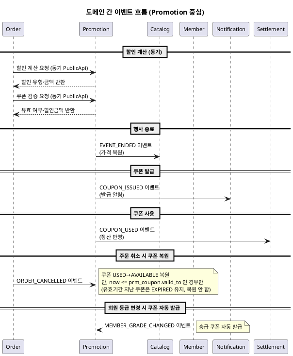

# 이벤트 플로우 — Promotion

> **단계**: 구조설계
> **문서범위**: Domain 간
> **문서종류**: Design
>
> **작성 목적**: Promotion 도메인이 발행·수신하는 비동기 이벤트 계약을 정의한다.
> **흐름 내 위치**: ⑪ 비즈니스 프로세스 → **⑫ 이벤트 플로우** → Bolt 분할
> **작성 주체**: 시니어 개발자 + AI 협업 (아키텍트 검토)

| 항목 | 내용 |
|---|---|
| ID | DESIGN-EVENT-PROMOTION-001 |
| 상태 | **Draft** |
| 작성일 | 2026-07-08 |
| 갱신일 | 2026-07-08 |

> **범위**: Promotion 도메인과 Order·Catalog·Member·Notification 간 이벤트. 1차 본개발(Order+Payment)에서 Promotion은 PublicApi Mock으로 제공하며, 2차 파트에서 본 이벤트 구현.

---

## 도메인정의서(DB) 이벤트 발행 기준 매핑

> 도메인정의서(DB) Promotion "이벤트 발행" 목록(CouponIssued, CouponUsed, EventStarted, EventEnded)을 본 문서의 이벤트로 매핑한다. 그 외 이벤트는 비즈니스 프로세스(DH)에서 도출된 연동 이벤트이다.

| 도메인정의서 이벤트 | 본 문서 대응 이벤트 | 비고 |
|---|---|---|
| CouponIssued | COUPON_ISSUED | 쿠폰 발급 완료 |
| CouponUsed | COUPON_USED | 쿠폰 사용 (주문 결제) |
| EventStarted | (이벤트·기획전관리 — 부록 A) | 이벤트 도메인 기능, 세부 미확정 |
| EventEnded | EVENT_ENDED (행사 종료) / (이벤트 종료 — 부록 A) | 행사가 종료는 확정, 이벤트 종료는 부록 A |

> DISPLAY_PRICE_CHANGED·COUPON_RESTORED·ORDER_* 수신 이벤트는 도메인정의서 발행 목록에는 없으나, 비즈니스 프로세스(DH)와 도메인 간 연동(의존 관계)에서 도출된 이벤트다.

---

## 이벤트 카탈로그

| 이벤트명 | 발행 도메인 | 수신 도메인 | 트리거 | 수신 액션 |
|---|---|---|---|---|
| EVENT_ENDED | Promotion | Catalog | 행사 종료 (기간 만료/수량 소진) | 상품 판매가 원래 가격으로 복원 |
| DISPLAY_PRICE_CHANGED | Promotion | Catalog, Search | 행사 시작/종료/수량 소진 시 | 상품 display_sale_price 갱신 + 검색 인덱스 동기화 |
| COUPON_ISSUED | Promotion | Notification* | 쿠폰 발급 완료 | 고객에게 쿠폰 발급 알림 |
| COUPON_USED | Promotion | Settlement* | 쿠폰 사용 (주문 결제) | 정산 시 쿠폰 할인액 반영 |
| COUPON_RESTORED | Promotion | — | 쿠폰 복원 (주문 취소) | 내부 처리 (발급 건 AVAILABLE 복원) |
| ORDER_CANCELLED | Order | Promotion | 주문 취소 | 사용된 쿠폰 복원 (USED→AVAILABLE) |
| ORDER_CONFIRMED | Order | Promotion* | 구매 확정 | 쿠폰 사용 확정 (복원 불가 상태 잠금) |
| MEMBER_GRADE_CHANGED | Member | Promotion* | 회원 등급 변경 | 등급별 쿠폰 자동 발급 (승급 쿠폰) |

> `*` 표시: 2~4차 파트 착수 시 수신측 구현. 이벤트 스키마는 본 문서에서 확정.

---

## 이벤트 흐름 다이어그램



---

## 이벤트 스키마

### EVENT_ENDED

```json
{
  "eventType": "EVENT_ENDED",
  "eventId": "evt-ulid-101",
  "timestamp": "2026-08-15T00:00:00Z",
  "payload": {
    "promotionType": "DISCOUNT_EVENT",
    "promotionId": "prm-ulid-001",
    "endReason": "PERIOD_EXPIRED",
    "products": [
      {
        "productId": "prod-001",
        "originalPrice": 50000,
        "discountedPrice": 40000
      }
    ]
  }
}
```

### DISPLAY_PRICE_CHANGED

```json
{
  "eventType": "DISPLAY_PRICE_CHANGED",
  "eventId": "evt-ulid-106",
  "timestamp": "2026-08-15T00:00:05Z",
  "payload": {
    "products": [
      {
        "productId": "prod-001",
        "displaySalePrice": 40000,
        "displayDiscountRate": 20,
        "originalPrice": 50000,
        "activeEventId": "prm-ulid-001",
        "changeReason": "EVENT_STARTED"
      },
      {
        "productId": "prod-002",
        "displaySalePrice": 89000,
        "displayDiscountRate": 0,
        "originalPrice": 89000,
        "activeEventId": null,
        "changeReason": "EVENT_ENDED"
      }
    ]
  }
}
```

### COUPON_ISSUED

```json
{
  "eventType": "COUPON_ISSUED",
  "eventId": "evt-ulid-102",
  "timestamp": "2026-08-10T14:30:00Z",
  "payload": {
    "couponIssueId": "ci-ulid-001",
    "couponId": "cpn-ulid-001",
    "couponName": "여름 시즌 10% 할인",
    "memberId": "mem-001",
    "validFrom": "2026-08-10T00:00:00Z",
    "validTo": "2026-09-10T23:59:59Z"
  }
}
```

### COUPON_USED

```json
{
  "eventType": "COUPON_USED",
  "eventId": "evt-ulid-103",
  "timestamp": "2026-08-12T10:00:00Z",
  "payload": {
    "couponIssueId": "ci-ulid-001",
    "couponId": "cpn-ulid-001",
    "memberId": "mem-001",
    "orderId": "ord-ulid-001",
    "discountAmount": 3000,
    "couponType": "PRODUCT"
  }
}
```

### COUPON_RESTORED

```json
{
  "eventType": "COUPON_RESTORED",
  "eventId": "evt-ulid-104",
  "timestamp": "2026-08-12T15:00:00Z",
  "payload": {
    "couponIssueId": "ci-ulid-001",
    "couponId": "cpn-ulid-001",
    "memberId": "mem-001",
    "orderId": "ord-ulid-001",
    "restoreReason": "ORDER_CANCELLED"
  }
}
```

---

## 동기 vs 비동기 판단

| 호출 | 방식 | 사유 |
|---|---|---|
| Order → Promotion (할인 계산) | **동기** (PublicApi) | 즉시 할인 결과 필요 (UX 대기) |
| Order → Promotion (쿠폰 검증) | **동기** (PublicApi) | 즉시 유효성 결과 필요 |
| Order → Promotion (주문 취소 시 쿠폰 복원) | **비동기** (이벤트) | 후속 처리, 즉시 응답 불필요 |
| Promotion → Catalog (가격 복원) | **비동기** (이벤트) | 배치 종료 시점 후속 처리 |
| Promotion → Notification (쿠폰 발급 알림) | **비동기** (이벤트) | 알림은 후속 처리 |
| Promotion → Settlement (쿠폰 사용) | **비동기** (이벤트) | 정산은 후속 처리 |
| Member → Promotion (등급 변경) | **비동기** (이벤트) | 자동 발급은 후속 처리 |

---

## 이벤트 운영 규칙

| 규칙 | 설명 |
|---|---|
| Outbox 패턴 | 이벤트는 AFTER_COMMIT으로 Outbox 테이블에 기록 후 Consumer가 처리 |
| 멱등 보장 | 수신 측은 `eventId`로 중복 처리 방지 |
| 이벤트 스키마 버전 | 필드 추가는 허용, 삭제는 금지 (하위 호환) |
| 발행자는 수신자를 모름 | 이벤트 발행 시 수신 도메인을 하드코딩하지 않음 |
| 재시도 정책 | 수신 실패 시 최대 3회 재시도 (지수 백오프), 이후 DLQ |
| 순서 보장 | 동일 promotionId에 대한 이벤트는 순서 보장 |

---

## 근거

| 항목 | 출처 |
|---|---|
| 이벤트 목록 | `DH-비즈니스프로세스(Promotion).md` 이벤트 발행 지점 |
| 발행/수신 관계 | `DB-도메인정의서.md` §4 Promotion "의존·이벤트 발행" |
| Outbox 패턴 | `D9-컴포넌트.md` 배포 구조·도메인 간 통신 방식 |
| 동기/비동기 판단 | 응답 즉시성 요구 여부 (UX 대기 vs 후속 처리) |
| 쿠폰 복원 | REQ-PRM-003~004, 정산 정책 |
| 가격 복원 | REQ-PRM-011~012, 정책서 §3.7 |
| 승급 쿠폰 | 정책서 §4.3 회원 등급 혜택 |
