# 세부 유스케이스 — Order 도메인

> 상위 문서: [readme.md](readme.md)
> **단계**: 상세설계 (S3) | **문서범위**: Bolt (Order) | **문서종류**: Design
> Payment 관련 시나리오는 [DK-세부유스케이스/payment.md](payment.md) 참조

---

## 1. [장바구니 담기] 장바구니 담기 Bolt

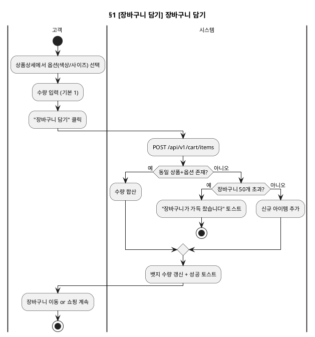

### 기본 흐름

| Step | 액터 | 행위 | 시스템 응답 | 비고 |
|---|---|---|---|---|
| 1 | 고객 | 상품상세 화면에서 옵션(색상/사이즈) 선택 | 선택된 옵션 표시, 가격 갱신 | |
| 2 | 고객 | 수량 입력 (기본 1) | 수량 × 단가 소계 표시 | |
| 3 | 고객 | "장바구니 담기" 버튼 클릭 | API: POST /api/v1/cart/items | |
| 4 | 시스템 | — | 성공 응답 + 장바구니 뱃지 수량 갱신 | |
| 5 | 고객 | "장바구니 바로가기" 또는 쇼핑 계속 | 장바구니 화면 이동 or 현재 유지 | |

### 대안 흐름

| 조건 | Step 변경 | 결과 |
|---|---|---|
| 이미 동일 상품+옵션이 장바구니에 있음 | Step 4에서 수량 합산 | 기존 수량 + 새 수량 |
| 장바구니 50개 초과 | Step 4에서 거부 | "장바구니가 가득 찼습니다" 토스트 |
| 품절 상품 | Step 3 전에 버튼 비활성화 | "품절" 표시, 담기 불가 |

---

## 2. [장바구니 담기] 장바구니 조회·관리 Bolt

```plantuml
@startuml
skinparam backgroundColor transparent
skinparam defaultFontSize 11
title §2 [장바구니 담기] 장바구니 조회·관리

|고객|
start
:장바구니 화면 진입;

|시스템|
:GET /api/v1/cart;

if (장바구니 비어있음?) then (예)
  :빈 상태 + "쇼핑하러 가기" 버튼 표시;
  stop
else (아니오)
  :입점사별 그룹 표시;
endif

|고객|
:수량 +/- 버튼 클릭;

|시스템|
:PATCH /api/v1/cart/items/{id}/quantity
→ 소계 갱신;

|고객|
if (삭제?) then (예)
  |시스템|
  :DELETE /api/v1/cart/items/{id}
  → 목록 갱신;
else (아니오)
endif

|고객|
:"선택상품 주문하기" 클릭;

|시스템|
:주문서 화면(/orders/new)으로 이동;
stop
@enduml
```

### 기본 흐름

| Step | 액터 | 행위 | 시스템 응답 | 비고 |
|---|---|---|---|---|
| 1 | 고객 | 장바구니 화면 진입 | API: GET /api/v1/cart → 입점사별 그룹 표시 | |
| 2 | 고객 | 수량 +/- 버튼 클릭 | API: PATCH /api/v1/cart/items/{id}/quantity → 소계 갱신 | |
| 3 | 고객 | 삭제 버튼 클릭 | API: DELETE /api/v1/cart/items/{id} → 목록 갱신 | |
| 4 | 고객 | "선택상품 주문하기" 버튼 클릭 | 주문서 화면(/orders/new)으로 이동 | |

### 대안 흐름

| 조건 | Step 변경 | 결과 |
|---|---|---|
| 장바구니 비어있음 | Step 1에서 빈 상태 표시 | "쇼핑하러 가기" 버튼 노출 |
| 품절 상품 포함 | Step 1에서 비활성화 표시 | "품절" 배지, 주문 시 제외 안내 |

---

## 3. [주문서 제출] 주문서 작성·제출 Bolt

> v2 (2026-08-21 바텀업 재검증): Step7~8을 "결제 즉시 성공/실패 확인" 동기 모델에서 "재고선점까지만 동기 확인, PG승인 결과는 비동기 알림"으로 정정(DM-시퀀스 §4/§4-1, REQ-ORD-012~014와 일치). CARD_RESTRICTED 대안흐름 추가.

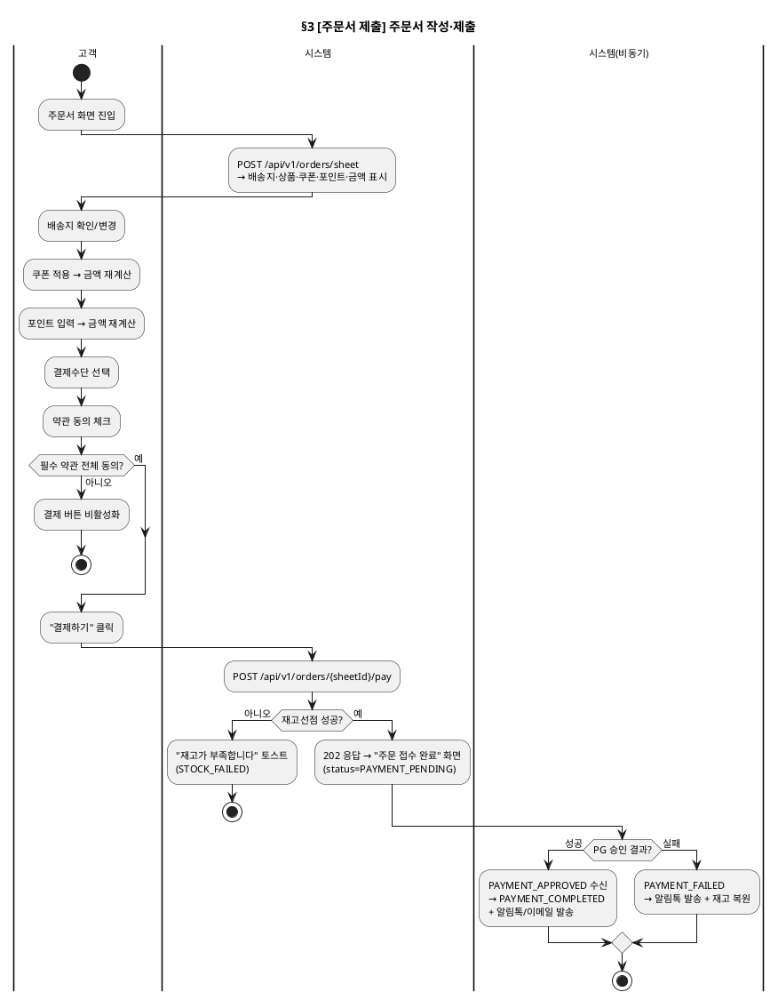

### 기본 흐름

| Step | 액터 | 행위 | 시스템 응답 | 비고 |
|---|---|---|---|---|
| 1 | 고객 | 주문서 화면 진입 | API: POST /api/v1/orders/sheet → 배송지·상품·쿠폰·포인트·결제수단·금액 표시 | |
| 2 | 고객 | 배송지 확인/변경 | 배송지 목록에서 선택 또는 신규 입력 | |
| 3 | 고객 | 쿠폰 적용 | 사용 가능 쿠폰 목록에서 선택 → 금액 재계산 | |
| 4 | 고객 | 포인트 입력 | 사용 가능 범위 내 입력 → 금액 재계산 | |
| 5 | 고객 | 결제수단 선택 | 신용카드/계좌이체 등 버튼 선택 | |
| 6 | 고객 | 약관 동의 체크 | 필수 약관 전체 동의 시 결제 버튼 활성화 | |
| 7 | 고객 | "결제하기" 버튼 클릭 | API: POST /api/v1/orders/{sheetId}/pay → 재고선점(동기) 성공 시 즉시 202 응답 | |
| 8 | 시스템 | — | "주문 접수 완료" 화면으로 즉시 이동 (status=PAYMENT_PENDING, "결제 진행 중" 안내). PG 승인 성공/실패 결과는 이 응답에 없음 | |
| 9 | 시스템(비동기) | — | PAYMENT_APPROVED 수신 시 주문상세가 PAYMENT_COMPLETED로 갱신 + 알림톡/이메일 발송 (DM-시퀀스 §4-1/§16) | |

### 대안 흐름

| 조건 | Step 변경 | 결과 |
|---|---|---|
| 필수 약관 미동의 | Step 7에서 버튼 비활성화 | 결제 불가 |
| 배송지 미입력 | Step 7에서 검증 실패 | "배송지를 입력해주세요" 토스트 |
| 재고 부족 | Step 7에서 즉시 실패 응답(동기) | "재고가 부족합니다" 토스트, STOCK_FAILED |
| 결제수단 카드가 당일 결제 제한 상태 | Step 7에서 즉시 실패 응답(동기) | "카드가 당일 결제 제한 상태입니다" 토스트, CARD_RESTRICTED(REQ-PAY-018) |
| PG 승인 실패 (3회 재시도 소진, 비동기) | Step 9에서 PAYMENT_FAILED 수신 | 주문상세가 PAYMENT_FAILED로 갱신, "결제에 실패했습니다" 알림톡 발송, 재고 복원 |

---

## 4. [바로구매] 바로구매 Bolt

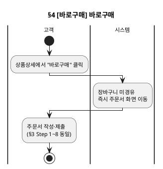

### 기본 흐름

| Step | 액터 | 행위 | 시스템 응답 | 비고 |
|---|---|---|---|---|
| 1 | 고객 | 상품상세에서 "바로구매" 버튼 클릭 | 장바구니 미경유, 즉시 주문서 화면 이동 | |
| 2~8 | — | (주문서 작성·제출 Bolt Step 1~8 동일) | — | |

---

## 5. [고객 단순 취소] 고객 주문 취소 Bolt

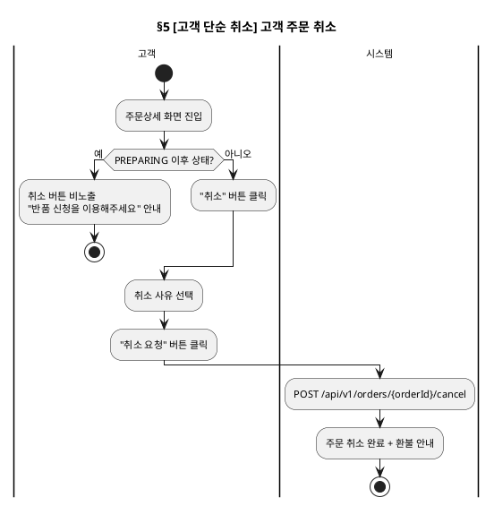

### 기본 흐름

| Step | 액터 | 행위 | 시스템 응답 | 비고 |
|---|---|---|---|---|
| 1 | 고객 | 주문상세 화면에서 "취소" 버튼 클릭 | 취소 사유 선택 UI 표시 | |
| 2 | 고객 | 취소 사유 선택 | — | |
| 3 | 고객 | "취소 요청" 버튼 클릭 | API: POST /api/v1/orders/{orderId}/cancel | |
| 4 | 시스템 | — | 주문 취소 완료 + 환불 안내 | |

### 대안 흐름

| 조건 | Step 변경 | 결과 |
|---|---|---|
| 주문이 PREPARING 이후 상태 | Step 1에서 취소 버튼 비노출 | "반품 신청을 이용해주세요" 안내 |

---

## 6. [예외 취소] CS 예외 취소 Bolt (admin)

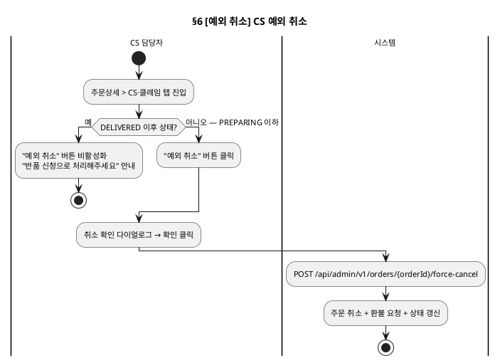

### 기본 흐름

| Step | 액터 | 행위 | 시스템 응답 | 비고 |
|---|---|---|---|---|
| 1 | CS 담당자 | 주문상세 > CS·클레임 탭 진입 | 주문 정보 + CS 액션 버튼 표시 | PREPARING 상태만 버튼 활성화 |
| 2 | CS 담당자 | "예외 취소" 버튼 클릭 | 취소 확인 다이얼로그 | |
| 3 | CS 담당자 | 확인 클릭 | API: POST /api/admin/v1/orders/{orderId}/force-cancel | |
| 4 | 시스템 | — | 주문 취소 + 환불 요청 + 상태 갱신 | |

### 대안 흐름

| 조건 | Step 변경 | 결과 |
|---|---|---|
| 주문이 DELIVERED 이후 상태 (배송완료/구매확정) | Step 1에서 "예외 취소" 버튼 비활성화 | "배송 시작 후에는 취소할 수 없습니다. 반품 신청으로 처리해주세요" 안내 (상태머신DG 금지 전이: CS 예외취소는 PREPARING까지만 허용) |

---

## 7. [출고·운송장 등록] 입점사 출고·배송 Bolt (partner)

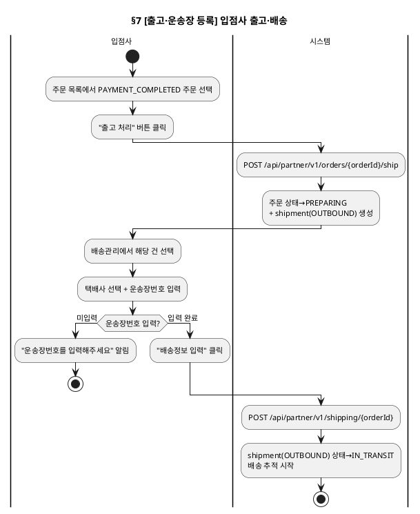

### 기본 흐름

| Step | 액터 | 행위 | 시스템 응답 | 비고 |
|---|---|---|---|---|
| 1 | 입점사 | 주문 목록에서 PAYMENT_COMPLETED 주문 선택 | 주문상세 탭 오픈 | |
| 2 | 입점사 | "출고 처리" 버튼 클릭 | API: POST /api/partner/v1/orders/{orderId}/ship | |
| 3 | 시스템 | — | 주문 상태→PREPARING (+ shipment(OUTBOUND) 생성) | |
| 4 | 입점사 | 배송관리에서 해당 건 선택 | 배송정보 입력 모달 표시 | |
| 5 | 입점사 | 택배사 선택 + 운송장번호 입력 | — | |
| 6 | 입점사 | "배송정보 입력" 버튼 클릭 | API: POST /api/partner/v1/shipping/{orderId} | |
| 7 | 시스템 | — | shipment(OUTBOUND) 상태→IN_TRANSIT (주문 상태는 PREPARING 유지), 배송 추적 시작 | |

### 대안 흐름

| 조건 | Step 변경 | 결과 |
|---|---|---|
| 운송장번호 미입력 | Step 6에서 검증 실패 | "운송장번호를 입력해주세요" 알림 |

---

## 8. [배송지 변경] 배송지 변경 Bolt

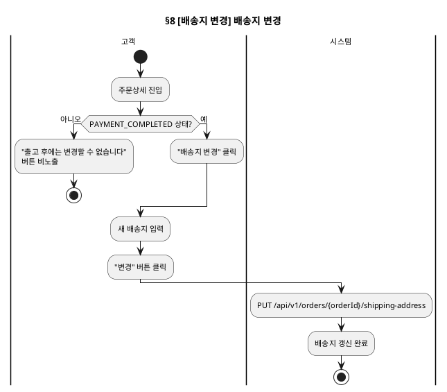

### 기본 흐름

| Step | 액터 | 행위 | 시스템 응답 | 비고 |
|---|---|---|---|---|
| 1 | 고객 | 주문상세에서 "배송지 변경" 클릭 | 배송지 입력 UI 표시 | PAYMENT_COMPLETED 상태만 |
| 2 | 고객 | 새 배송지 입력 | — | |
| 3 | 고객 | "변경" 버튼 클릭 | API: PUT /api/v1/orders/{orderId}/shipping-address | |
| 4 | 시스템 | — | 배송지 갱신 완료 | |

### 대안 흐름

| 조건 | Step 변경 | 결과 |
|---|---|---|
| 주문이 PREPARING 이후 | Step 1에서 버튼 비노출 | "출고 후에는 변경할 수 없습니다" |

---

## 9. [구매확정] 고객 구매확정 Bolt

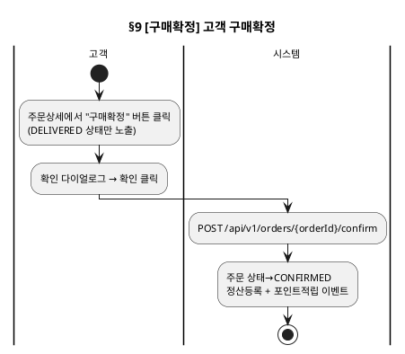

### 기본 흐름

| Step | 액터 | 행위 | 시스템 응답 | 비고 |
|---|---|---|---|---|
| 1 | 고객 | 주문상세에서 "구매확정" 버튼 클릭 | 확인 다이얼로그 표시 | DELIVERED 상태만 |
| 2 | 고객 | 확인 클릭 | API: POST /api/v1/orders/{orderId}/confirm | |
| 3 | 시스템 | — | 주문 상태→CONFIRMED, 정산등록+포인트적립 이벤트 | |

---

## 10. [반품/교환 신청] 고객 반품·교환 신청 Bolt

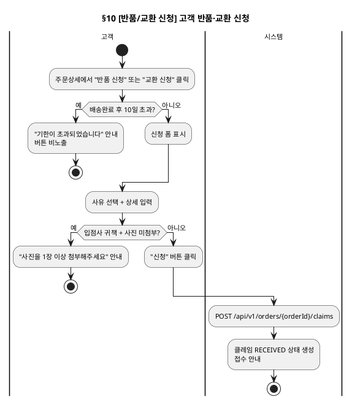

### 기본 흐름

| Step | 액터 | 행위 | 시스템 응답 | 비고 |
|---|---|---|---|---|
| 1 | 고객 | 주문상세에서 "반품 신청" 또는 "교환 신청" 클릭 | 신청 폼 표시 (사유 선택, 상세 입력) | DELIVERED 상태 + 10일 이내 |
| 2 | 고객 | 사유 선택 + 상세 입력 | — | |
| 3 | 고객 | "신청" 버튼 클릭 | API: POST /api/v1/orders/{orderId}/claims | |
| 4 | 시스템 | — | 클레임 RECEIVED 상태 생성, 접수 안내 | |

### 대안 흐름

| 조건 | Step 변경 | 결과 |
|---|---|---|
| 배송완료 후 10일 초과 | Step 1에서 버튼 비노출 | "기한이 초과되었습니다" 안내 |
| VENDOR(입점사) 귀책 사유 선택 시 사진 미첨부 | Step 3에서 검증 실패 | "상품 상태를 확인할 수 있는 사진을 1장 이상 첨부해주세요" 안내, 신청 거부 (사진 최소 1장 첨부 필수, REQ-ORD-058) |

---

## 11. [클레임 접수/반려] CS 클레임 접수 확인·반려·귀책판정 Bolt (admin)

> **역할 경계**: §11은 클레임 접수 단계(RECEIVED→REJECTED)만 담당.
> 수거완료 후 환불/폐기/반송 판정은 §22에서 처리.
> v2 (2026-08-21 바텀업 재검증): Step 3a에 "CS가 고객 자진신고와 다르게 판정할 수 있다"는 REQ-ORD-066을 명시하고, 실제 호출 API(blame-decision)를 표기. EXCHANGE 재고부족 거부(REQ-ORD-069) 대안흐름 추가.

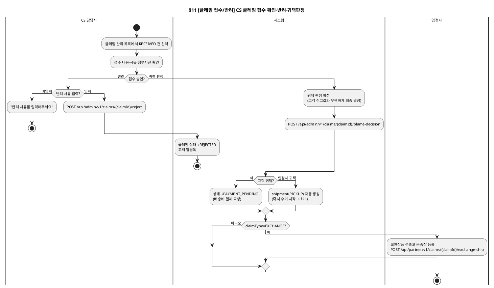

### 기본 흐름

| Step | 액터 | 행위 | 시스템 응답 | 비고 |
|---|---|---|---|---|
| 1 | CS 담당자 | 클레임 관리 목록에서 RECEIVED 건 선택 | 클레임상세 MDI 탭 오픈 | 고객이 신청 시 자진신고한 `submitted_responsibility`가 참고값으로 표시됨 |
| 2 | CS 담당자 | 접수 내용·사유·첨부사진(고객 업로드분) 확인 | — | |
| 3a | CS 담당자 | 귀책 판정 확정 (고객 신고값과 무관하게 최종 결정, REQ-ORD-066) | API: POST /api/admin/v1/claims/{claimId}/blame-decision {responsibility} → 고객 귀책: 상태→PAYMENT_PENDING (배송비 결제 요청) / 입점사 귀책: 클레임 상태 유지, shipment(PICKUP) 자동 생성 (즉시 수거 시작, §21로 이어짐) | CS가 고객이 제출한 값(`submitted_responsibility`)과 다르게 확정해도 `responsibility` 컬럼만 갱신되고 원신고값은 보존됨 |
| 3a-1 | 입점사 | (EXCHANGE + 입점사 귀책인 경우) 귀책판정 즉시 교환상품 선출고 운송장 등록 | API: POST /api/partner/v1/claims/{claimId}/exchange-ship (REQ-ORD-056, 맞교환 원칙) | 고객 귀책 건은 §20 Step 6에서 동일하게 트리거 |
| 3b | CS 담당자 | "반려" 클릭 + 사유 입력 | API: POST /api/admin/v1/claims/{claimId}/reject | |
| 4b | 시스템 | — | 클레임 상태→REJECTED, 고객 알림톡 | |

### 대안 흐름

| 조건 | Step 변경 | 결과 |
|---|---|---|
| 반려 시 사유 미입력 | Step 3b에서 거부 | "반려 사유를 입력해주세요" |
| claimType=EXCHANGE (귀책 무관) | Step 3a 직후 3a-1(또는 §20 Step 6) 트리거 | 원상품 수취 전 교환상품 선출고 완료 — §12에서 "이미 선출고됨"으로 조회됨 |
| claimType=EXCHANGE + 입점사 귀책 판정 시 exchangeSkuId 재고 없음 | Step 3a에서 판정 자체가 거부됨 | "교환 가능한 재고가 없습니다" 안내, 판정 보류(REQ-ORD-069) — 선출고 이전 단계에서 차단 |
| RECEIVED로 접수 후 24시간 경과, Step 1~4 미처리 | 배치가 CS에게 리마인드 알림 발송(DM-시퀀스 §18-1) | REQ-ORD-068 |

---

## 12. [클레임 접수/반려] 입점사 클레임 조회 Bolt (partner)

> 접수·처리 판정은 어드민 담당. 입점사는 클레임 현황 조회 + 클레임상세 MDI에서 수거·품질점검 수행 (§21 참조). 교환상품은 이미 선출고됨(맞교환 원칙) — 원상품 회수만 진행.

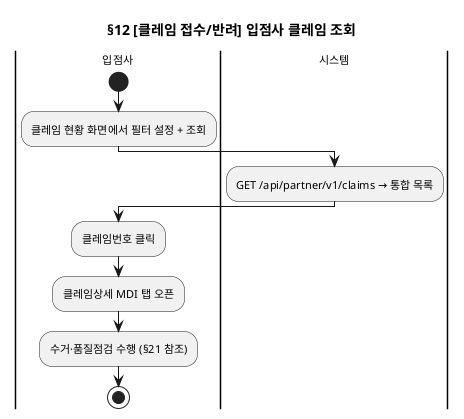

### 기본 흐름

| Step | 액터 | 행위 | 시스템 응답 | 비고 |
|---|---|---|---|---|
| 1 | 입점사 | 클레임 현황 화면에서 필터 설정 + 조회 | API: GET /api/partner/v1/claims → 통합 목록 | 유형(취소/반품/교환) + 상태 필터 |
| 2 | 입점사 | 클레임번호 클릭 | 클레임상세 MDI 탭 오픈 | |
| 3 | 입점사 | 클레임상세에서 수거·품질점검 수행 | (§21 참조) | 교환상품은 이미 선출고됨(맞교환 원칙) — 원상품 회수만 진행 |

---

## 14. [전체 주문 검색] 주문 조회 Bolt (admin — 주문 현황)

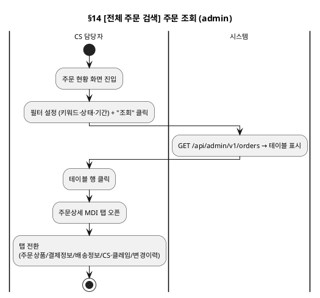

### 기본 흐름

| Step | 액터 | 행위 | 시스템 응답 | 비고 |
|---|---|---|---|---|
| 1 | CS 담당자 | 주문 현황 화면 진입 | 빈 목록 + 필터바 표시 | |
| 2 | CS 담당자 | 필터 설정 (키워드·상태·기간) + "조회" 클릭 | API: GET /api/admin/v1/orders → 테이블 표시 | |
| 3 | CS 담당자 | 테이블 행 클릭 | 주문상세 MDI 탭 오픈 | |
| 4 | CS 담당자 | 탭(주문상품/결제정보/배송정보/CS·클레임/변경이력) 전환 | 해당 탭 데이터 로드 | |

---

## 15. [입점사 주문 조회] 주문 조회 Bolt (partner — 주문 목록)

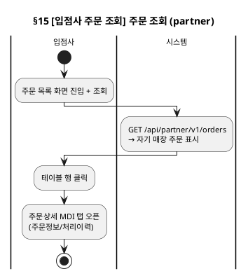

### 기본 흐름

| Step | 액터 | 행위 | 시스템 응답 | 비고 |
|---|---|---|---|---|
| 1 | 입점사 | 주문 목록 화면 진입 + 조회 | API: GET /api/partner/v1/orders → 자기 매장 주문 표시 | |
| 2 | 입점사 | 테이블 행 클릭 | 주문상세 MDI 탭 오픈 (주문정보/처리이력) | |

---

## 16. [반품/교환 신청] 고객 클레임 목록 조회 Bolt (mobile — 마이페이지)

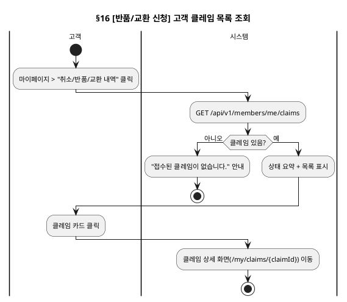

### 기본 흐름

| Step | 액터 | 행위 | 시스템 응답 | 비고 |
|---|---|---|---|---|
| 1 | 고객 | 마이페이지 > "취소/반품/교환 내역" 클릭 | 클레임 목록 화면(/my/claims) 이동 | |
| 2 | 시스템 | — | API: GET /api/v1/members/me/claims → 상태 요약(접수/처리중/완료/반려) + 목록 표시 | |
| 3 | 고객 | 클레임 카드 클릭 | 클레임 상세 화면(/my/claims/{claimId}) 이동 | |

### 대안 흐름

| 조건 | Step 변경 | 결과 |
|---|---|---|
| 클레임 없음 | Step 2에서 빈 상태 표시 | "접수된 클레임이 없습니다." 안내 |

---

## 17. [반품/교환 신청] 고객 클레임 상세 조회 Bolt (mobile — 마이페이지)

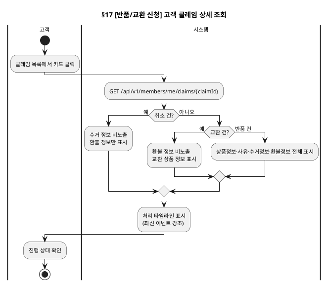

### 기본 흐름

| Step | 액터 | 행위 | 시스템 응답 | 비고 |
|---|---|---|---|---|
| 1 | 고객 | 클레임 목록에서 카드 클릭 | 상세 화면(/my/claims/{claimId}) 이동 | |
| 2 | 시스템 | — | API: GET /api/v1/members/me/claims/{claimId} → 상품정보, 사유, 수거정보, 환불정보, 처리 타임라인 표시 | |
| 3 | 고객 | 타임라인에서 진행 상태 확인 | 최신 이벤트 강조 표시 | |

### 대안 흐름

| 조건 | Step 변경 | 결과 |
|---|---|---|
| 취소 건 (수거 없음) | Step 2에서 수거 정보 섹션 비노출 | 환불 정보만 표시 |
| 교환 건 (환불 없음) | Step 2에서 환불 정보 섹션 비노출 | 교환 상품 정보 표시 |

---

## 18. [내 주문 조회] 고객 주문 상세 조회 Bolt (mobile)

```plantuml
@startuml
skinparam backgroundColor transparent
skinparam defaultFontSize 11
title §18 [내 주문 조회] 고객 주문 상세 조회

|고객|
start
:주문/배송 조회 목록에서 주문번호 클릭;

|시스템|
:GET /api/v1/members/me/orders/{orderId};
:입점사별 상품·결제·배송·이력 표시;

|고객|
if (상태?) then (DELIVERED)
  :구매확정/반품교환/배송조회 버튼 노출;
  :입점사별 액션 버튼 클릭;
else (PAYMENT_PENDING)
  :"결제 진행 중" 안내 표시;
else (취소/결제실패)
  :취소 사유 + 환불 상태 추가 표시;
endif
stop
@enduml
```

### 기본 흐름

| Step | 액터 | 행위 | 시스템 응답 | 비고 |
|---|---|---|---|---|
| 1 | 고객 | 주문/배송 조회 목록에서 주문번호 클릭 | 주문 상세 화면(/my/orders/{orderId}) 이동 | |
| 2 | 시스템 | — | API: GET /api/v1/members/me/orders/{orderId} → 입점사별 상품·결제·배송·이력 표시 | |
| 3 | 고객 | 입점사별 액션 버튼 클릭 | 상태에 따라 구매확정/반품교환/배송조회 수행 | 상품 단위 구매확정, 입점사 단위 반품/교환 |

### 대안 흐름

| 조건 | Step 변경 | 결과 |
|---|---|---|
| 접수(ORDER_RECEIVED) / 결제 진행중(PAYMENT_PENDING) 상태 | 액션 없음 | "결제 진행 중" 안내 표시 |
| 취소/결제실패 | 결제 정보에 취소 사유 + 환불 상태 추가 표시 | |

---

## 19. [반품/교환 신청] 고객 클레임 신청 Bolt (mobile — 반품/교환 신청 상세)

> 주문상세(§18) 또는 주문/배송 조회(§8)에서 [반품/교환] 클릭 시 진입.
> 반품/교환은 **입점사 단위**로 진행. 복수 아이템 선택 가능(주문상세에서만).

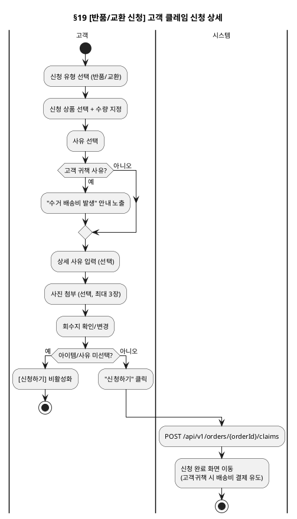

### 기본 흐름

| Step | 액터 | 행위 | 시스템 응답 | 비고 |
|---|---|---|---|---|
| 1 | 고객 | 신청 유형 선택 (반품/교환) | — | 라디오 |
| 2 | 고객 | 신청 상품 선택 + 수량 지정 | 클레임 가능 수량 범위 내 | 체크박스 + 수량 Select |
| 3 | 고객 | 사유 선택 (단순변심/사이즈/불량/오배송/기타) | 고객귀책 사유 시 배송비 안내 문구 노출 | |
| 4 | 고객 | 상세 사유 입력 (선택) | — | |
| 5 | 고객 | 사진 첨부 (선택, 최대 3장) | — | 불량 시 필수 권장 |
| 6 | 고객 | 회수지 확인/변경 | 기본: 주문 배송지. [변경] → 배송지 팝업 | |
| 7 | 고객 | "신청하기" 클릭 | API: POST /api/v1/orders/{orderId}/claims | |
| 8 | 시스템 | — | 신청 완료 화면 이동 (고객귀책 시 배송비 결제 유도) | |

### 대안 흐름

| 조건 | Step 변경 | 결과 |
|---|---|---|
| 클레임 가능 아이템 없음 | Step 2에서 "반품/교환 가능한 상품이 없습니다" | 신청 불가 |
| 사유 미선택 / 아이템 미선택 | Step 7에서 [신청하기] 비활성화 | |
| 고객 귀책 사유 선택 | Step 3에서 안내 노출 | "수거 배송비 발생 + 품질점검 불합격 시 반송 배송비 추가 가능" |

---

## 20. [반품/교환 신청] 고객 클레임 배송비 결제 Bolt (mobile)

> 클레임 신청 완료 화면(§8-3) 또는 클레임 상세(§10)에서 진행.
> 결제 기한 24시간. 미결제 시 클레임 자동 취소.

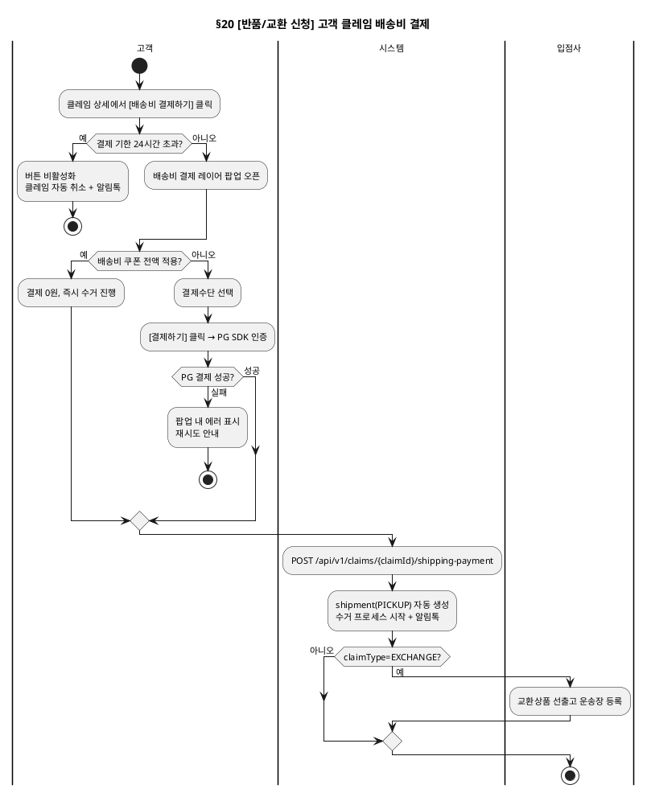

### 기본 흐름

| Step | 액터 | 행위 | 시스템 응답 | 비고 |
|---|---|---|---|---|
| 1 | 고객 | [배송비 결제하기] 버튼 클릭 | 배송비 결제 레이어 팝업 오픈 | |
| 2 | 고객 | 쿠폰 적용 (선택) | 배송비 쿠폰 있으면 적용 → 결제금액 0원 가능 | |
| 3 | 고객 | 결제수단 선택 (쿠폰 미적용 시) | 기등록 결제수단 선택 | |
| 4 | 고객 | [결제하기] 클릭 | PG SDK 호출 → 인증 | |
| 5 | 시스템 | PG 결제 완료 콜백 | 팝업 닫힘 → 클레임 상세 화면에서 결제완료 상태 반영 | API: POST /api/v1/claims/{claimId}/shipping-payment |
| 6 | 시스템 | — | shipment(PICKUP) 자동 생성 (클레임 상태는 PAYMENT_PENDING 유지), 수거 프로세스 시작 + 알림톡 발송. **claimType=EXCHANGE면 이 시점에 입점사가 교환상품 선출고 운송장 등록**(§11 Step 3a-1과 동일 트리거, REQ-ORD-056) | |

### 대안 흐름

| 조건 | Step 변경 | 결과 |
|---|---|---|
| 결제 기한 24시간 초과 | [배송비 결제하기] 비활성화 | 클레임 자동 취소 + 알림톡 |
| PG 결제 실패 | Step 5에서 팝업 내 에러 표시 | 재시도 안내 |
| 배송비 쿠폰 전액 적용 | Step 3~4 생략 | 결제 0원, 즉시 수거 진행 |

---

## 21. [수거·재고복구] 입점사 수거·품질점검 Bolt (partner)

> 배송관리에서 회수 건 처리 또는 클레임상세 MDI에서 수행.

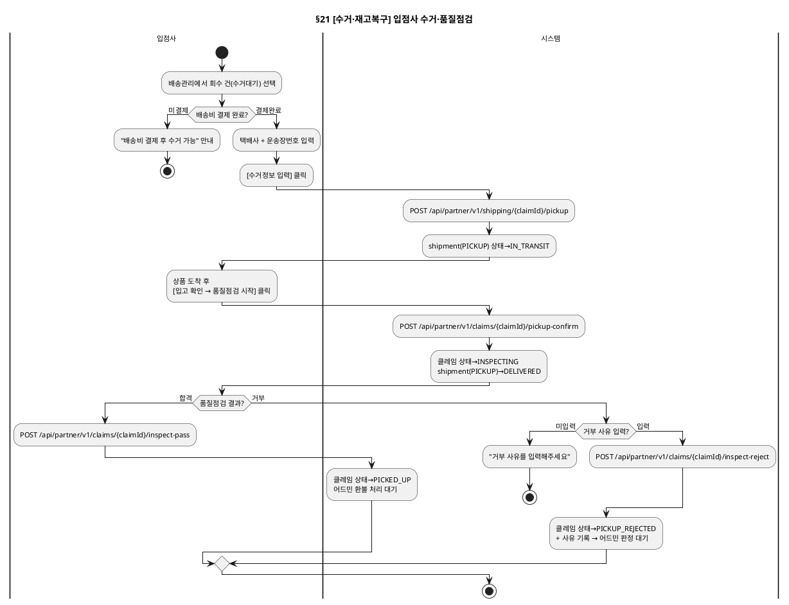

### 기본 흐름

| Step | 액터 | 행위 | 시스템 응답 | 비고 |
|---|---|---|---|---|
| 1 | 입점사 | 배송관리에서 회수 건(수거대기) 선택 | 수거정보 입력 모달 표시 | 배송비 ⦿결제완료 확인 후 |
| 2 | 입점사 | 택배사 + 운송장번호 입력 | — | |
| 3 | 입점사 | [수거정보 입력] 클릭 | API: POST /api/partner/v1/shipping/{claimId}/pickup | |
| 4 | 시스템 | — | shipment(PICKUP) 상태 → IN_TRANSIT (수거중) | |
| 5 | 입점사 | 상품 도착 후 [입고 확인 → 품질점검 시작] 클릭 | API: POST /api/partner/v1/claims/{claimId}/pickup-confirm | |
| 6 | 시스템 | — | 클레임 상태 → INSPECTING (품질점검), shipment(PICKUP) 상태 → DELIVERED (동시 전환) | |
| 7 | 입점사 | 품질 확인 후 [합격] 또는 [거부] 클릭 | API: POST /api/partner/v1/claims/{claimId}/inspect-pass 또는 /inspect-reject | 판정 기준: **RETURN 유형**은 상품 상태(훼손 여부), **EXCHANGE 유형**은 택(TAG) 유지 여부 |
| 8a | 시스템 (합격) | — | 클레임 상태 → PICKED_UP (수거완료) → 어드민 환불 처리 대기 | |
| 8b | 시스템 (거부) | — | 클레임 상태 → PICKUP_REJECTED (수거거부) + 사유 기록 → 어드민 판정 대기 | |

### 대안 흐름

| 조건 | Step 변경 | 결과 |
|---|---|---|
| 배송비 미결제 | Step 1에서 [수거정보 입력] 비활성화 | "배송비 결제 후 수거 가능" 안내 |
| 거부 시 사유 미입력 | Step 7에서 거부 불가 | "거부 사유를 입력해주세요" |
| RETURN 유형 품질점검 | Step 7에서 상품 훼손 여부로 합격/거부 판정 | 훼손 시 [거부] |
| EXCHANGE 유형 품질점검 | Step 7에서 택(TAG) 유지 여부로 합격/거부 판정 | 택 제거·훼손 시 [거부] |

---

## 22. [수거·재고복구] 어드민 환불/폐기/반송결제 판정 Bolt (admin)

> 수거완료(PICKED_UP) 또는 수거거부(PICKUP_REJECTED) 상태에서 어드민이 후속 처리.

```plantuml
@startuml
skinparam backgroundColor transparent
skinparam defaultFontSize 11
title §22 [수거·재고복구] 어드민 환불/폐기/반송결제 판정

|CS 담당자|
start

if (클레임 상태?) then (PICKED_UP — 수거완료)
  :클레임상세 > 환불정보 탭 진입;
  :[환불 처리] 클릭;
  |시스템|
  :POST /api/admin/v1/claims/{claimId}/refund;
  :클레임 상태→REFUNDED→COMPLETED\n고객 알림톡 발송;
  stop
else (PICKUP_REJECTED — 수거거부)
  :거부 사유 조회;
  if (반송 가능?) then (불가)
    :[폐기 처리] 클릭;
    |시스템|
    :POST /api/admin/v1/claims/{claimId}/dispose;
    :상태→DISPOSED→COMPLETED;
    stop
  else (가능)
    :[반송 배송비 추가결제 요청] 클릭;
    |시스템|
    :POST /api/admin/v1/claims/{claimId}/request-return-payment;
    :고객에게 결제 알림톡 발송;
  endif
endif

|고객|
:반송 배송비 결제 (§20, paymentType=RETURN);

|입점사|
:반송 운송장 등록;
:POST /api/partner/v1/claims/{claimId}/return-ship;

|시스템|
:shipment(RETURN)→IN_TRANSIT→DELIVERED;
:배치 자동전환 → COMPLETED\n고객 알림톡 발송;
stop
@enduml
```

### 기본 흐름 (수거완료 → 환불)

| Step | 액터 | 행위 | 시스템 응답 | 비고 |
|---|---|---|---|---|
| 1 | CS 담당자 | 클레임상세 > 환불정보 탭 진입 | 환불금액·수단 표시 | |
| 2 | CS 담당자 | [환불 처리] 클릭 | API: POST /api/admin/v1/claims/{claimId}/refund | 원결제수단 또는 계좌이체 |
| 3 | 시스템 | — | 클레임 상태 → REFUNDED → (배치) COMPLETED | 고객 알림톡 발송 |

### 대안 흐름 (수거거부 → 폐기 또는 반송)

| Step | 액터 | 행위 | 시스템 응답 | 비고 |
|---|---|---|---|---|
| 1 | CS 담당자 | 클레임상세에서 PICKUP_REJECTED 건 확인 | 거부 사유 조회 | |
| 2a | CS 담당자 | [폐기 처리] 클릭 | API: POST /api/admin/v1/claims/{claimId}/dispose | 상품 반송 불가 판단 시 |
| 2b | CS 담당자 | [반송 배송비 추가결제 요청] 클릭 | API: POST /api/admin/v1/claims/{claimId}/request-return-payment | 고객에게 결제 알림톡 발송 |
| 3b | 고객 | 알림톡 수신 → 클레임상세에서 반송 배송비 결제 | §20 배송비 결제 Bolt (paymentType=RETURN) | |
| 4b | 입점사 | 반송 운송장 등록 | API: POST /api/partner/v1/claims/{claimId}/return-ship | shipment(RETURN) 생성, 상태 → IN_TRANSIT (클레임 상태는 RETURN_PAYMENT_PENDING 유지) |
| 5b | 시스템 | 반송 배송완료 확인 (택배사 API) | shipment(RETURN) 상태 → DELIVERED | |
| 6b | 시스템 | 배치 자동전환 | 배치가 클레임 상태를 COMPLETED로 자동 전환 | 고객 알림톡 발송 |

---

## 23. [장바구니 담기] 장바구니 옵션 변경 Bolt (mobile)

```plantuml
@startuml
skinparam backgroundColor transparent
skinparam defaultFontSize 11
title §23 [장바구니 담기] 장바구니 옵션 변경

|고객|
start
:장바구니에서 [옵션변경] 클릭;
:옵션 변경 레이어 팝업 오픈;

if (선택한 옵션 품절?) then (예)
  :해당 옵션 [×] 표시, 선택 불가;
  stop
else (아니오)
  :색상/사이즈 선택;
  :[변경 완료] 클릭;
endif

|시스템|
:PUT /api/v1/cart/items/{cartItemId}/option;
:옵션 갱신 + 소계 재계산;
stop
@enduml
```

### 기본 흐름

| Step | 액터 | 행위 | 시스템 응답 | 비고 |
|---|---|---|---|---|
| 1 | 고객 | 장바구니에서 [옵션변경] 클릭 | 옵션 변경 레이어 팝업 오픈 | |
| 2 | 고객 | 색상/사이즈 선택 | 품절 옵션(실재고−장바구니 선점 ≤ 0) 비활성화 | |
| 3 | 고객 | [변경 완료] 클릭 | API: PUT /api/v1/cart/items/{cartItemId}/option | |
| 4 | 시스템 | — | 옵션 갱신 + 소계 재계산 | |

### 대안 흐름

| 조건 | Step 변경 | 결과 |
|---|---|---|
| 선택한 옵션 품절 | Step 2에서 선택 불가 | 해당 옵션 [×] 표시 |

---

## 24. [반품/교환 신청] 고객 클레임 자진 취소 Bolt (mobile — 신규)

> 신규 (2026-08-21 바텀업 재검증): REQ-ORD-073/071 대응. RECEIVED/PAYMENT_PENDING 상태에서만 가능, 귀책판정(INSPECTING 진입) 이후는 불가.

```plantuml
@startuml
skinparam backgroundColor transparent
skinparam defaultFontSize 11
title §24 [반품/교환 신청] 고객 클레임 자진 취소

|고객|
start
:내 클레임 상세 진입;

if (INSPECTING 이후 상태?) then (예)
  :"취소" 버튼 비노출\n"귀책 판정/수거 시작 이후에는\n취소할 수 없습니다" 안내;
  stop
else (RECEIVED/PAYMENT_PENDING)
  :"취소" 버튼 클릭;
  :취소 확인 다이얼로그 → 확인 클릭;
endif

|시스템|
:POST /api/v1/claims/{claimId}/cancel;
:클레임 상태→REJECTED\n(사유="고객 자진 철회")\n취소완료 알림톡;
stop
@enduml
```

### 기본 흐름

| Step | 액터 | 행위 | 시스템 응답 | 비고 |
|---|---|---|---|---|
| 1 | 고객 | 내 클레임 상세에서 "취소" 버튼 클릭 | 취소 확인 다이얼로그 | RECEIVED/PAYMENT_PENDING 상태만 버튼 노출 |
| 2 | 고객 | 확인 클릭 | API: POST /api/v1/claims/{claimId}/cancel | |
| 3 | 시스템 | — | 클레임 상태→REJECTED(사유="고객 자진 철회"), 취소완료 알림톡 | |

### 대안 흐름

| 조건 | Step 변경 | 결과 |
|---|---|---|
| 클레임이 INSPECTING 이후 상태 | Step 1에서 "취소" 버튼 비노출 | "귀책 판정/수거 시작 이후에는 취소할 수 없습니다" 안내(REQ-ORD-071) |

---

## 25. [배송실패 재발송] 입점사·CS 배송 재발송 처리 Bolt (partner/admin — 신규)

> 신규 (2026-08-21 바텀업 재검증): REQ-ORD-062 대응. shipment_type 공통(OUTBOUND/PICKUP/RETURN/EXCHANGE_OUT).

```plantuml
@startuml
skinparam backgroundColor transparent
skinparam defaultFontSize 11
title §25 [배송실패 재발송] 입점사·CS 배송 재발송 처리

|입점사 또는 CS 담당자|
start
:배송관리에서 FAILED 상태 건 선택;

if (shipment 상태 = FAILED?) then (아니오)
  :"FAILED 상태만 재발송 가능합니다"\n(RESHIP_NOT_ALLOWED);
  stop
else (예)
  :재발송 처리 모달 표시;
  :택배사 + 새 운송장번호 입력;
endif

if (운송장번호 입력?) then (미입력)
  :"운송장번호를 입력해주세요";
  stop
else (입력 완료)
  :[재발송 처리] 클릭;
endif

|시스템|
:POST /api/partner/v1/shipping/{shipmentId}/reship;
:shipment 상태 FAILED→PENDING→IN_TRANSIT\n추적 재시작;
stop
@enduml
```

### 기본 흐름

| Step | 액터 | 행위 | 시스템 응답 | 비고 |
|---|---|---|---|---|
| 1 | 입점사 또는 CS 담당자 | 배송관리에서 FAILED 상태 건 선택 | 재발송 처리 모달 표시 | 배송실패 뱃지 노출 건만 (DM-시퀀스 §19 배치가 FAILED로 전환) |
| 2 | 입점사/CS | 택배사 + 새 운송장번호 입력 | — | |
| 3 | 입점사/CS | [재발송 처리] 클릭 | API: POST /api/partner/v1/shipping/{shipmentId}/reship | 인증: Partner 또는 Admin Bearer |
| 4 | 시스템 | — | shipment 상태 FAILED→PENDING→IN_TRANSIT, 추적 재시작 | 이후 DM-시퀀스 §19 배치가 다시 추적 |

### 대안 흐름

| 조건 | Step 변경 | 결과 |
|---|---|---|
| shipment 상태가 FAILED가 아님 | Step 3에서 거부 | "FAILED 상태만 재발송 가능합니다" (RESHIP_NOT_ALLOWED) |
| 운송장번호 미입력 | Step 3에서 검증 실패 | "운송장번호를 입력해주세요" |

