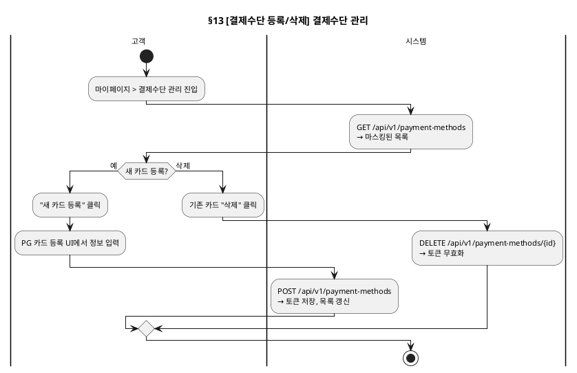

# 세부 유스케이스 — Payment 도메인

> 상위 문서: [readme.md](readme.md)
> **단계**: 상세설계 (S3) | **문서범위**: Bolt (Payment) | **문서종류**: Design
> Order 관련 시나리오는 [DK-세부유스케이스/order.md](order.md) 참조

---

## 13. [결제수단 등록/삭제] 결제수단 관리 Bolt (mobile)

### 기본 흐름

| Step | 액터 | 행위 | 시스템 응답 | 비고 |
|---|---|---|---|---|
| 1 | 고객 | 마이페이지 > 결제수단 관리 진입 | API: GET /api/v1/payment-methods → 마스킹된 목록 | |
| 2 | 고객 | "새 카드 등록" 클릭 | PG 카드 등록 UI 표시 | |
| 3 | 고객 | 카드 정보 입력 | PG로 전송 (서버 미저장) | |
| 4 | 시스템 | — | API: POST /api/v1/payment-methods → 토큰 저장, 목록 갱신 | |
| 5 | 고객 | 기존 카드 "삭제" 클릭 | API: DELETE /api/v1/payment-methods/{id} → 토큰 무효화 | |

