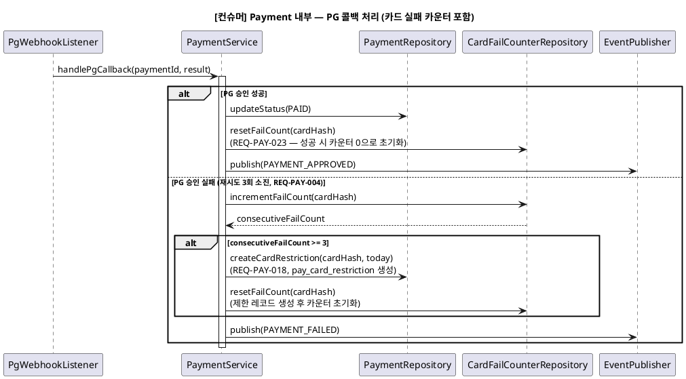

# 시퀀스 — Payment 도메인

> 상위 문서: [readme.md](readme.md)
> **단계**: 상세설계 (S3) | **문서범위**: Bolt (Payment) | **문서종류**: Design
> Order 관련 시퀀스는 [DM-시퀀스/order.md](order.md) 참조

---

## 4-1. [컨슈머] Payment 내부 — PG 콜백 처리 (비동기, 카드 실패 카운터 포함)

> 신규 (2026-08-21 바텀업 재검증): §4에서 "Payment 내부 비동기 처리"로 블랙박스 처리했던 부분을 구체화. REQ-PAY-023(카드 연속실패 카운터)이 여기서 실제로 호출된다.

- **트리거**: PG사 콜백(승인/실패 웹훅) 또는 Payment 자체 재시도 루프 종료
- **상태전이**: Payment `PENDING` → `PAID`(승인) / 재시도 소진 시 그대로 유지하며 `PAYMENT_FAILED` 이벤트만 발행(REQ-PAY-004). `pay_card_fail_counter` 증가(실패) 또는 0 리셋(성공)

