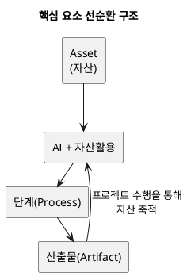

# **AI 활용 개발방법론**

**버전: 2.3**  
**적용 범위: B2C 커머스 플랫폼 신규 구축 (기준: runNshop)**  
**전제: 업무 도메인 초기 분류 완료 (12개), 단계 진행에 따라 도메인 경계 보완 가능**

> **작성 목적**: 본 문서는 AI 에이전트가 설계 산출물과 컨벤션 산출물을 활용해 AI 코딩 시 품질을 높이고, 수정 요청 시 수정 부분을 제외한 동일한 결과를 기대하며 작성하였다.
>
> **검증 기준**: 컨벤션 산출물의 완성도는 "설계 산출물(화면레이아웃·인터페이스명세 등) + 컨벤션 산출물(디자인시스템·코딩컨벤션 등)을 AI에게 입력으로 주었을 때, 동일한 코드가 생성되는지"로 검증한다. 생성 결과가 다르면 컨벤션에 누락이 있다는 뜻이며, 차이점을 컨벤션에 역축적한다.
>
> **AI 도구별 적용**: `.kiro/steering/` 파일은 컨벤션 산출물(`docs/assets/tobe/conventions/`)을 기준으로 작성된 **Kiro IDE 전용 축약본**이다. Kiro IDE가 아닌 환경(VS Code + Claude/Cursor 등)에서는 컨벤션 산출물 원본을 직접 AI 컨텍스트로 제공하여 동일한 역할을 수행한다.

## **1\. 산업 현황 (Problem)**

기존 개발 방법론은 오랫동안 프로젝트 수행의 기준으로 활용되어 왔지만, 최근 AI 기반 개발 환경에서는 다음과 같은 변화와 한계가 나타나고 있습니다.

> * 요구사항 변경이 빈번하여 산출물 유지 비용이 증가  
> * 산출물이 많아질수록 관리 부담 증가  
> * 핵심 인력 의존도가 높아 생산성 편차 발생  
> * 테스트와 검증에 많은 시간과 비용 소요  
> * 개발 방식이 사람이 도구를 사용하는 형태에서 AI Agent와 협업하는 형태로 빠르게 변화

이러한 변화로 인해 기존 개발 방법론만으로는 AI를 개발 공정에 효과적으로 활용하기 어려워졌습니다. 특히 AI가 단계별 산출물을 생성하고 재활용하기 위해서는 입력자료와 산출물의 관계가 명확하게 정의된 체계가 필요합니다.  
따라서 **AI가 개발 공정을 이해하고 자산을 활용하여 산출물을 생성할 수 있는 새로운 AI 활용 방법론이 필요하게 되었습니다.**

## **2\. AI 활용 방법론 (Solution)**

본 방법론은 AI(Kiro, Claude 등)를 개발 공정에 실질적으로 활용하기 위해 정의한 **AI 기반 개발 활용 방법론**입니다.  
기존 개발 방법론이 사람이 요구사항을 분석하고 산출물을 작성·관리하는 방식이었다면, 본 방법론은 **AI가 조직의 자산(Asset)과 이전 산출물을 활용하여 각 단계의 산출물 초안을 생성하고, 사람이 검토·의사결정하는 협업 방식**을 목표로 합니다.  
이를 위해 각 단계를 AI가 이해할 수 있는 형태로 표준화하고, 단계별 입력자료·자산·산출물 간의 관계를 명확하게 정의합니다. 이 관계가 구체적으로 어떻게 작동하는지는 3장(구조)에서 다룹니다.  
본 방법론은 Proposal부터 Code까지는 의사결정과 구현을 위한 **Artifact 생성 중심 공정**으로 구성하고, 이후 통합 테스트와 안정화 단계는 실행 결과와 운영 경험을 **Artifact 및 Asset으로 축적하는 실행 중심 공정**으로 확장합니다.

## **3\. AI 활용 방법론 구조 (Framework)**

본 방법론은 **공정(Process), 산출물(Artifact), 자산활용(Asset Utilization)**의 세 가지 핵심 요소와 이를 뒷받침하는 기반 정의(Scope 단위, 역할)로 구성됩니다. 이들은 각각 독립적인 개념이 아니라 하나의 실행 체계를 구성하며, 프로젝트 수행 과정에서 유기적으로 연결되어 산출물 생성과 자산 축적을 반복하는 선순환 구조를 형성합니다.



프로젝트가 반복될수록 자산이 증가하고, 자산을 활용한 AI 초안의 품질과 생산성이 함께 향상되는 선순환 구조를 지향합니다. 아래에서 세 가지 핵심 요소(3.1~3.3)와 기반 정의(3.4~3.5)를 정의합니다.

### **3.1 단계 (Stage) — 실행 순서**

단계는 **산출물 작업순서와 의존관계 기반으로 세분화한 것**이며, AI와 협업하여 개발을 수행하는 실행 흐름을 정의합니다.

| 단계 | 핵심 질문 | 한 줄 설명 |
| :---: | ----- | ----- |
| **착수** | 왜, 무엇을 하는가 | 해결할 문제와 목표, 추진 범위를 정의합니다. |
| **범위정의** | 경계와 틀은 무엇인가 | 기술 제약·품질 목표·시스템 구조·도메인 경계를 확정합니다. |
| **구조설계** | 어떻게 나누고 연결하는가 | 도메인별 내부 구조를 설계하고, 구현 단위(Bolt)를 나눠 일정을 계획합니다. |
| **상세설계** | 구체적으로 어떻게 만드는가 | 각 Bolt를 구현 가능한 수준까지 상세하게 설계합니다. |
| **구현** | 코드로 만든다 | 설계를 기반으로 실제 동작하는 코드를 구현합니다. |
| **테스트** | 동작하는가 | 구현 결과가 요구사항대로 동작하는지 통합 환경에서 검증합니다. |
| **안정화** | 서비스 가능한가 | 운영 중 발생하는 문제를 해결하고 시스템을 안정화합니다. |

### **3.2 산출물 (Artifact)**

산출물은 각 단계의 공식 결과물로, AI가 초안을 생성하고 사람이 검토·확정합니다. 확정된 산출물은 다음 단계 AI 초안 작성의 방향성과 범위를 정하는 입력자료(컨텍스트)이자, 재사용 가능한 자산으로 다시 활용됩니다.

이 선순환을 위해 프로젝트 산출물을 아래 세 가지 기준으로 표준화하여 작성합니다.
- **산출물 유형**(3.2.1): 어떤 방향·게이트로 관리되는지를 결정합니다 (설계/컨벤션).
- **산출물 종류**(3.2.2): AI의 작성 방식과 검토자의 확인 기준을 결정합니다. 설계 산출물에만 적용됩니다 (Proposal/Spec/Design/Task).
- **산출물 범위**(3.2.3): AI의 입력자료 참조 범위와 변경 시 영향 범위를 결정합니다. 설계 산출물에만 적용되며, 컨벤션 산출물은 항상 Project 범위입니다 (Project/Domain/Bolt).

#### **3.2.1 산출물 유형 (Artifact Type)**

산출물 유형은 산출물이 두 축(설계/컨벤션) 중 어디에 속하는지를 결정하는 최상위 분류 기준입니다.

| 유형 | 명칭 | 방향 | 역할 | 게이트 |
|---|---|---|---|---|
| 설계 | 설계 산출물 (Design Artifacts) | 수직 (S0→S1→…→S6 단계순 진행) | "무엇을 만들었는가" — 시스템의 요구·구조·구현 결과 | 단계별 게이트 통과 조건 (필수) |
| 컨벤션 | 컨벤션 산출물 (Convention Artifacts) | 수평 (각 단계 산출물에 참고 공급) | "어떤 기준으로 만들었는가" — 표준화 기준 | 비강제 (없어도 진행 가능, 있으면 속도·품질 향상) |

```
프로젝트 산출물
├── 설계 산출물 (Design Artifacts)
│     S0→S1→S2→S3→S4→S5→S6
│     도메인정의→ERD→시퀀스→클래스설계→코드...
│     (수직 흐름, Domain/Bolt 단위, 단계 게이트 통과 조건)
│
└── 컨벤션 산출물 (Convention Artifacts)
      아키텍처·코딩·디자인시스템·API·데이터·이벤트·테스트·보안·용어·UX Writing
      (수평 참고, Project 단위, 표준화를 통한 일관성·속도 확보)
```

각 유형은 아래에서 서로 다른 하위 기준으로 세분화됩니다 — 설계 산출물은 종류(3.2.2)·범위(3.2.3)로, 컨벤션 산출물은 원칙·범주·타임라인(3.2.4)으로 관리됩니다.

#### **3.2.2 산출물 종류 (Artifact Kind) — 설계 산출물**

산출물 종류는 AI가 어떤 방식으로 작성해야 하는지, 검토자가 무엇을 기준으로 확인해야 하는지를 결정하는 분류 기준입니다. **설계 산출물에만 적용됩니다** — 컨벤션 산출물은 종류 대신 범주(보안/업무/기술/UX/품질, 3.2.4.2)로 분류됩니다.
각 설계 산출물은 아래 4가지 종류 중 하나로 분류됩니다.

| 산출물 종류 | AI 작성 방식 | 검토자 확인 기준 | 해당 산출물 예시 |
| :---: | ----- | ----- | ----- |
| **Proposal** | 문제와 목표를 정의하고, 대안을 비교하여 결정 근거를 서술합니다 | "할 가치가 있는가, 방향이 맞는가" | 문제정의서, 목표KPI, 범위, 리스크 |
| **Spec** | 시스템이 해야 할 것을 정형화된 구문으로 빠짐없이 나열합니다 | "요구가 정확하고 빠짐없는가" | 제약사항, NFR, EARS, GWT, 인터페이스 명세 |
| **Design** | 구조와 흐름을 다이어그램과 테이블로 시각화합니다 | "구조가 적합하고 구현 가능한가" | 컴포넌트, ERD, 상태머신, 시퀀스, 클래스 |
| **Task** | 작업을 분해하고 담당·순서·일정을 배정합니다 | "일정·담당·순서가 현실적인가" | RACI, WBS, DoD, 의존성맵, 리스크대응 |

> **단계와 산출물 종류의 관계**: 하나의 단계에 여러 산출물 종류가 혼재합니다. 예를 들어 구조설계 단계에는 Spec(EARS)과 Design(ERD)과 Task(WBS)가 모두 포함됩니다.
> 이는 "의존관계가 순서를 결정하기 때문"이며, 산출물 종류는 실행 순서가 아닌 산출물의 성격만을 분류합니다.

#### **3.2.3 산출물 범위 (Artifact Scope) — 설계 산출물**

산출물 범위는 AI가 참조할 입력자료의 범위, 검토자가 판단할 변경 영향 범위를 결정하는 기준입니다. **설계 산출물에만 적용됩니다** — 컨벤션 산출물은 조직 표준으로서 항상 Project 범위로 관리됩니다(3.2.4.2 컨벤션 목록 참고).
각 설계 산출물은 아래 3가지 범위 중 하나로 작성됩니다.

| 산출물 범위 | 정의 | AI 입장 (입력자료 참조) | 검토자 입장 (변경 영향) | 예시 |
| :---: | ----- | ----- | ----- | ----- |
| **Project** | 프로젝트 전체의 전제조건 | 모든 Domain·Bolt 산출물 작성 시 참조 | 변경 시 전체 Domain·Bolt 재검토 | 제약사항, NFR, 컴포넌트, 시스템구성도, 도메인정의서 |
| **Domain** | 해당 도메인의 전제조건 | 그 도메인 하위 Bolt 산출물 작성 시 참조 | 변경 시 해당 도메인 Bolt만 재검토 | EARS, ERD, 상태머신, 이벤트 플로우, 상위UC |
| **Bolt** | 해당 Bolt 내부 | 그 Bolt 내 산출물 간에서만 참조 | 변경 시 그 Bolt 내부만 재검토 | GWT, 시퀀스, 인터페이스 명세, 클래스설계, 화면레이아웃 |

계층 관계: Project ⊃ Domain ⊃ Bolt

#### **3.2.4 컨벤션 산출물 (Convention Artifacts)**

##### **3.2.4.1 컨벤션 산출물의 원칙**

- **참고 자료이며 블로커가 아니다**: 컨벤션 미비 시 현업이 즉시 판단하고 진행한다.
- **현업 판단이 컨벤션보다 우선**: 컨벤션과 다른 판단도 허용 — 사유를 ADR에 기록.
- **축적 시점**: 파일럿에서는 설계 산출물과 동시 생성(초판 축적), 실 프로젝트에서는 프로젝트 종료 시 보완·버전업.
- **AI 효과**: 컨벤션이 풍부할수록 AI 초안의 품질과 일관성이 향상되는 선순환.

##### **3.2.4.2 컨벤션 산출물 목록 및 수립 데드라인**

컨벤션 산출물은 설계 산출물의 종류(Proposal/Spec/Design/Task) 대신 아래 **범주**로 분류되며, 범위는 모두 Project로 고정됩니다.

| ID | 컨벤션명 | 범주 | 수립 데드라인 | 참고하는 설계 산출물 (축 1) |
|---|---|---|---|---|
| C1 | 보안 컨벤션 | 보안 | **S0 착수 중** | D8 NFR |
| C2 | 용어 컨벤션 | 업무 | **S1 시작 전** | DB 도메인정의서, DE EARS, 모든 산출물의 용어 |
| C3 | 아키텍처 컨벤션 | 기술 | **S2 시작 전** | D9 컴포넌트, DF ERD, DI 이벤트플로우, DM 시퀀스 |
| C4 | 데이터 모델링 컨벤션 | 기술 | **S2 ERD 작성 전** | DF ERD, DG 상태머신 |
| C5 | 이벤트 설계 컨벤션 | 기술 | **S2 이벤트플로우 작성 전** | DI 이벤트플로우, DM 시퀀스 |
| C6 | API 설계 컨벤션 | 기술 | **S3 인터페이스명세 작성 전** | DL 인터페이스명세, DM 시퀀스, DQ 프로그램목록 |
| C7 | 디자인 시스템 | UX | **S3 화면레이아웃 작성 전** | DN 화면레이아웃, tsx 구현 |
| C8 | UX Writing 컨벤션 | UX | **S3 화면레이아웃 작성 전** | DN 화면레이아웃, 알림 문구 |
| C9 | 코딩 컨벤션 | 기술 | **S3 클래스설계 작성 전** | DP 클래스설계, 코드구현, 코드리뷰 |
| CA | 테스트 컨벤션 | 품질 | **S4 구현 시작 전** | 단위테스트, 통합테스트 |

##### **3.2.4.3 수립 타임라인**

```
단계     S0-착수      S1-요구       S2-구조          S3-상세              S4-구현
         │            │             │                │                   │
컨벤션   C1 보안      C2 용어       C3 아키텍처       C6 API              CA 테스트
산출물   │            │             C4 데이터         C7 디자인시스템      │
수립     │            │             C5 이벤트         C8 UX Writing       │
시점     │            │             │                C9 코딩             │
         ▼            ▼             ▼                ▼                   ▼
설계     D8 NFR       DB 도메인정의  DF ERD           DL 인터페이스명세    코드구현
산출물   ←C1          ←C2           ←C3,C4           ←C6                ←C9,CA
(참고)                D9 컴포넌트    DG 상태머신       DM 시퀀스
                      ←C3,C2        ←C4              ←C3,C6,C5
                                    DI 이벤트플로우   DN 화면레이아웃
                                    ←C5              ←C7,C8
                                                      DP 클래스설계
                                                      ←C2
                                                      DQ 프로그램목록
                                                      ←C4
```

> 상세 내용은 `docs/methodology/검토자료/공정자산-가이드.md` 참조.

#### **3.2.5 컨벤션 산출물 ↔ 설계 산출물 중복 해소 규칙**

컨벤션 산출물과 설계 산출물은 같은 주제를 다룰 수 있으나, **추상 수준이 다르면 중복이 아니다.**

| 구분 원칙 | 컨벤션 산출물 (축 2) | 설계 산출물 (축 1) |
|---|---|---|
| 질문 | "조직 차원에서 HOW (기준·규칙·패턴)" | "프로젝트 차원에서 WHAT (결정·결과·구조)" |
| 범위 | 크로스 프로젝트 재사용 | 이 프로젝트 한정 |
| 예시 | C1 보안 표준 = "PII는 AES-256 암호화" | D8 NFR = "로그인 응답시간 200ms 이내" |

**중복 유형별 해소 방안:**

| 유형 | 해당 컨벤션 | 중복 설계산출물 | 해소 방안 |
|---|---|---|---|
| 사실상 동일 | C2 용어 | 용어집(안정화 보완) | C2로 **통합** — 설계산출물에서 제거, 컨벤션으로 이관 |
| 추상 수준 다름 | C1 보안 | D7 제약사항, D8 NFR | **분리 유지** — C1=조직 표준, 제약·NFR=프로젝트 결정값 |
| 추상 수준 다름 | C3 아키텍처 | D7 제약사항, D9 컴포넌트 | **분리 유지** — C3=기술 원칙+금지패턴, 제약·컴포넌트=프로젝트 결과 |
| 내재 중복 | C4 데이터 | DF ERD 내 규칙 섹션 | **추출 분리** — C4에 원본, ERD에 `C4 참조` 링크 |
| 내재 중복 | C5 이벤트 | DI 이벤트플로우 내 규칙 섹션 | **추출 분리** — C5에 원본, 이벤트플로우에 `C5 참조` 링크 |
| 신규 (중복 없음) | C2, C3, C4, C7, CA | — | 기존 설계산출물에 없으므로 순수 추가 |

**적용 규칙 요약:**
1. 같은 내용이 두 곳에 존재하면 → 컨벤션 산출물에 **원본(Single Source of Truth)**, 설계 산출물에 **참조 링크**.
2. 추상 수준이 다르면 → **분리 유지**. 컨벤션(조직 기준)이 설계(프로젝트 결정)의 참고 입력이 되는 관계.
3. 파일럿에서 설계 산출물 내에 규칙이 내재된 경우 → 프로젝트 종료 시 컨벤션으로 추출·축적.

### **3.3 자산활용 (Asset Utilization)**

자산활용은 조직이 축적한 자산(컨벤션 산출물·정책서·이전 산출물 등)을 AI의 입력자료로 제공하여,
산출물 초안의 품질과 일관성을 높이고, 사람은 검토와 의사결정에 집중할 수 있게 하는 활동입니다.

단계별 자산활용 예시는 다음과 같습니다.

| 단계 | 참고 컨벤션 산출물 (축 2) | 기타 자산 | 설계 산출물 (축 1) |
| :---: | ----- | ----- | ----- |
| 착수 | — | 정책서, 장애 사례, 리스크 | 문제정의서, 목표·KPI, 이해관계자맵, 범위, 대안비교, 리스크·가정 |
| 범위정의 | C1 보안, C2 용어, C3 아키텍처 | 정책서, 기술스택 문서 | 제약사항, NFR, 컴포넌트, 시스템구성도, 도메인정의서 |
| 구조설계 | C2 용어, C3 아키텍처, C4 데이터, C5 이벤트 | 정책서, 도메인기능표 | 상위UC, 메뉴구조도, EARS, ERD, 상태머신, 비즈니스프로세스, 이벤트플로우 |
| 상세설계 | C3 아키텍처, C5 이벤트, C6 API, C7 디자인시스템, C8 UX Writing, C9 코딩 | 정책서, 화면 프로토타입 | GWT, 세부UC, 인터페이스명세, 시퀀스, 화면레이아웃, ADR, 클래스설계, 프로그램목록 |
| 구현 | C7 디자인시스템, C8 UX Writing, C9 코딩, CA 테스트 | — | 코드, 자동검증 결과, 단위테스트 |
| 테스트 | CA 테스트 | 테스트 시나리오, 운영 환경 정보 | 통합테스트 계획서, 결과보고서, E2E, Go/No-Go |
| 안정화 | — | 운영 매뉴얼, 장애 이력 | 운영매뉴얼(Runbook), Go-Live 승인, 안정화 결과보고서 |

> "참고 컨벤션 산출물"의 "—"는 해당 컨벤션이 없다는 뜻이다(비어 있는 게 아니라 명시적으로 없음). 각 단계 행에는 그 단계 **자체**의 설계 산출물이 참고 대상인 컨벤션만 나열한다 — 3.2.4.2 목록에서 어떤 컨벤션의 참고 대상이 하위 단계의 산출물뿐이라면, 그 컨벤션은 이 표에서 하위 단계 행에만 표기하고 앞선 단계 행에는 역참조하지 않는다.

프로젝트를 수행할수록 산출물이 자산으로 축적되고, 축적된 자산이 다음 프로젝트의 AI 입력이 되는 선순환 구조입니다.
특히 컨벤션 산출물(축 2)은 프로젝트 종료 시 보완·버전업되어 조직의 표준화 수준을 점진적으로 높입니다.

### **3.4 역할 정의**

#### 조직 역할

| 역할 | 약어 | 책임 범위 |
| :---: | :---: | ----- |
| **PM (Project Manager)** | PM | 단계 전이 판단, Input/Output 관리, 일정·리소스 조율 |
| **Tech Lead / AI CoE** | TL | 기술 의사결정, 설계 승인, 프롬프트 표준 관리, AI 도구 선정·평가·활용 기준 고도화 |
| **기획자 / 디자이너** | PL | 고객 화면(mobile) 기획·UI/UX 디자인 — 메뉴구조도·세부UC·화면레이아웃 스펙, Figma 시안·디자인 토큰 |
| **도메인 전문가 / BA** | DE | 업무 적합성 검토, 요구사항·정책 준수 판단, BO 화면(admin/partner) 업무 기획 |
| **QA** | QA | 산출물 품질 기준 관리, 테스트 계획·실행·판정 |
| **개발자** | Dev | 코드 구현, 단위 테스트, AI 초안 검토·보완 |

## **4\. 단계 진행 방식**

3장이 방법론의 구성 요소(What)를 정의했다면, 4장은 **각 단계가 실제로 어떻게 진행되는가(How)**를 정의합니다.

### **4.1 산출물 작성**

모든 산출물은 **AI 초안 생성 → 사람 검토 → 확정** 사이클로 만들어집니다.

| 단계 | 수행 | 주체 |
| :---: | ----- | ----- |
| AI 초안 생성 | 자산 + 이전 산출물을 입력으로 초안 작성 | AI |
| 사람 검토 | 업무 적합성·설계 타당성·정책 준수 확인 | 검토자 (6장 "작성주체" 열 참조) |
| 확정 | 공식 산출물로 버전 태깅 | PM/TL |

> * 구현 단계는 사람 검토 전에 자동 검증(컴파일·Lint·보안스캔)을 추가로 거칩니다.

### **4.2 단계전이 조건**

다음 단계로 넘어가려면 해당 단계의 산출물이 모두 확정(Finalization)되어야 합니다.

| 전이 | 확인 사항 |
| :---: | ----- |
| 착수 → 범위정의 | 문제·목표·범위가 합의되고, 리스크 수용 여부가 결정됨 |
| 범위정의 → 구조설계 | 기술 제약·품질 목표가 확정되고, 시스템 구조와 도메인 경계가 합의됨 |
| 구조설계 → 상세설계 | 도메인별 기능요구·데이터·상태·이벤트 구조가 확정되고, Bolt 분할과 구현 계획(WBS·담당·순서)이 합의됨 |
| 상세설계 → 구현 | 해당 Bolt의 수용기준·API 계약·호출 순서·클래스 구조가 확정되어 구현 착수 가능 |
| 구현 → 테스트 | 코드가 자동 검증을 통과하고, 단위테스트가 완료됨 |
| 테스트 → 안정화 | 통합테스트 결과 Critical 0건, Major ≤3건(전부 우회 확보)으로 Go 판정됨 |

### **4.3 단계진행 절차**

착수~구조설계는 순차 진행하고, 상세설계~구현은 Bolt단위로 반복합니다.

```
[착수] → [범위정의] → [구조설계] → { [상세설계 → 구현] × Bolt 반복 } → [테스트] → [안정화]
```

| 구간 | 진행 방식 | 단위 |
| :---: | ----- | ----- |
| 착수 → 구조설계 | 순차 | Project → Domain |
| 상세설계 → 구현 | WBS 순서에 따라 Bolt별 반복 | Bolt |
| 테스트 → 안정화 | 통합검증 | Project |

### **4.4 유연 적용 규칙**

정상 진행 절차를 상황에 따라 유연하게 적용할 수 있는 규칙입니다.

| 예외 | 조건 | 처리 |
| :---: | ----- | ----- |
| 단계 생략 | 경미한 변경(버그 수정, UI 미세 조정) | 상세설계 또는 구현부터 시작 가능. 사유를 ADR에 기록 |
| 단계 병행 | 인터페이스 명세↔시퀀스 상호 참조 | 동일 Bolt 내에서 병행 작성 가능 |
| 역행 보완 | 구현 중 설계 결함 발견 | 해당 산출물 직접 갱신 (자연 보완). 대규모 변경 시 5.4 영향 분석 절차 |

## **5\. 품질 기준 (Standards)**

4장에서 정의한 진행 방식을 **어떤 기준으로 판단하는가**를 정의합니다.

> 일부 섹션은 (초안) 상태이며, 해당 단계 도달 시점에 확정합니다.

### **5.1 품질 평가 기준**

Human Review 단계에서 AI 생성 산출물의 Pass/Reject를 판단하는 기준입니다. 개별 산출물이 이 기준을 Pass해야 확정으로 진행되며(4.1), 한 단계에 속한 산출물이 모두 확정된 상태가 4.2 단계 간 전이 조건의 전제가 됩니다.

| 평가 항목 | 정의 | Pass 기준 |
| :---: | ----- | ----- |
| **완전성(Completeness)** | 요구된 항목이 빠짐없이 포함되어 있는가 | 표준양식의 필수 항목 100% 포함 |
| **일관성(Consistency)** | 용어·형식·논리가 문서 내/문서 간에 모순 없는가 | 용어집 준수, 이전 산출물과 모순 0건 |
| **추적성(Traceability)** | 이전 단계 산출물과의 연결(출처)이 명확한가 | 각 항목에 입력 산출물 참조 명시 |
| **실행가능성(Actionability)** | 다음 단계에서 즉시 활용 가능한 수준인가 | 모호한 표현 0건, 구체적 수치/기준 포함 |
| **정책 준수(Compliance)** | 조직 정책·표준·제약사항을 위반하지 않는가 | 정책서 대비 위반 사항 0건 |

**산출물 종류별 평가 가중치**

| 산출물 종류 | 최우선 평가 항목 | 사유 |
| :---: | ----- | ----- |
| Proposal | 완전성, 일관성 | 후속 모든 단계의 출발점이므로 누락·모순이 치명적 |
| Spec | 완전성, 추적성 | 요구사항 누락이 설계·구현 전체에 파급 |
| Design | 일관성, 실행가능성 | 설계 간 모순은 구현 시 혼란, 추상적 설계는 활용 불가 |
| Task | 실행가능성, 추적성 | 작업 분해가 모호하면 구현 착수 불가 |

### **5.2 결함 분류 체계**

통합 테스트 및 안정화 단계에서 발견된 결함의 심각도를 분류하는 기준입니다. 4.4 "통합 테스트 → 안정화" 전이 조건의 "결함 0-Critical"은 아래 정의를 따릅니다.

| 등급 | 정의 | 예시 | Go/No-Go 영향 |
| :---: | ----- | ----- | ----- |
| **Critical** | 핵심 업무가 완전히 중단되며 우회 방법이 없음 | 결제 불가, 주문 데이터 유실, 시스템 전면 장애 | 0건이어야 Go |
| **Major** | 주요 기능이 정상 동작하지 않으나 우회 방법 존재 | 특정 조건에서 취소 실패(수동 처리 가능), 성능 NFR 미달 | 잔존 시 우회 방안·일정 합의 필요 |
| **Minor** | 사용에 지장은 없으나 불편하거나 표준에 어긋남 | UI 오정렬, 오탈자, 비필수 필드 누락 | Go 가능 (차기 수정 계획 수립) |
| **Trivial** | 외관·문서상의 경미한 결함 | 로그 메시지 오타, 주석 누락 | Go 가능 (백로그 등록) |

**Go/No-Go 판단 매트릭스**

| 조건 | 판정 |
| :---: | ----- |
| Critical 0건 + Major 0건 | Go |
| Critical 0건 + Major ≤ 3건 (전체 우회 방안 확보) | 조건부 Go (합의 필요) |
| Critical ≥ 1건 | No-Go |
| Major > 3건 또는 우회 불가 Major 존재 | No-Go |

**결함 분류 원칙**

> * 결함 등급은 "영향 범위 × 우회 가능성"으로 판단
> * 동일 결함이라도 운영 환경의 트래픽·사용자 규모에 따라 등급이 달라질 수 있음 — 최종 등급은 PM·QA 합의
> * 분류 시점: 결함 발견 즉시 초기 분류 → Human Review에서 최종 확정
> * Critical/Major 결함은 발견 즉시 의존성 맵에 영향 표기, 5.4 변경 영향 분석 절차 적용

### **5.3 변경 영향 분석**

산출물 현행화 또는 수정 시 영향받는 범위를 판단하는 기준입니다.

**영향 전파 매트릭스**

| 변경 발생 산출물 | 영향받는 산출물 | 조치 |
| :---: | ----- | ----- |
| 기능요구(EARS) | GWT, 인터페이스 명세, 시퀀스, WBS, 코드 | 하위 전체 현행화 검토 |
| ERD | 상태머신, 시퀀스, 클래스, 테스트 케이스 | 관련 Bolt 재검토 |
| 인터페이스 명세 | 시퀀스, 클래스, 통합테스트 | API 계약 변경 공지 후 현행화 |
| WBS | 의존성 맵, DoD 체크리스트, 일정 | 리소스 재배정 검토 |
| 도메인 분리/통합 | ERD, 상태머신, 이벤트 플로우, 상위 유스케이스, 의존성 맵, 해당 Bolt 전체 | 영향 Domain의 Design 산출물 전면 재검토, Bolt 백로그 재구성 |

**변경 영향 분석 절차**

> 1. 변경 요청 접수 → 변경 대상 산출물 식별
> 2. 영향 전파 매트릭스에 따라 영향받는 산출물 목록 도출
> 3. 영향 범위를 의존성 맵에 표기
> 4. 변경 비용(재작업 공수) 산정 → 변경 승인/거부 결정
> 5. 승인 시 영향받는 산출물을 역순으로 현행화

## **6\. 단계별 산출물 상세**

*각 단계 설명 아래 "자산" 줄은 그 단계에 참고 자료로 투입되는 자산을 뜻합니다. 4.2의 단계별 AI 활용 패턴이 개괄이라면, 아래는 산출물 단위의 세부 실행표입니다. 상세 작성순서·선행관계는 **산출물 흐름 문서**를 참조합니다.*

### **6.1 착수**

왜 이 일을 하는지, 어떤 목표와 범위로 추진할지 정의하는 단계입니다.

*자산: 정책서, 과거 장애 이력, 유사 사례*

| # | 산출물 | 문서종류 | 범위 | 작성주체 | 입력자료 | AI 초안 | 휴먼 결정 포인트 |
| :---: | ----- | :---: | ----- | ----- | ----- | ----- | ----- |
| D1 | 문제 정의서 | Proposal | Project | PM+AI | 우선: 제안요청서(RFP)·제안서(있는 경우) / 참조: 정책서·이슈/CS 로그·회의록(있으면) / 자산: - | BPIO 구조 서술 초안 | 문제의 실제 우선순위 |
| D2 | 목표·KPI | Proposal | Project | PM+AI | 우선: 문제정의서(선행 산출물) / 참조: 팀 OKR(Objectives and Key Results), 과거 지표 / 자산: - | Objective + KR 수치 초안 | 목표 수준 확정 |
| D3 | 이해관계자 맵 | Proposal | Project | PM+AI | 참조: 조직도, 과거 참여자(선행 산출물인 문제정의서·목표KPI가 있으면 함께 참고) / 자산: - | 후보 + 관심사/영향력 추정 | 의사결정권자 확정 |
| D4 | 범위(Scope) | Proposal | Project | PM+AI | 우선: 문제정의서(선행 산출물) / 참조: AS-IS 정책서, 요구사항정의서(있으면), 기존 시스템 문서(있으면) / 자산: - | In/Out Scope 분류 | 제외 항목 리스크 수용 |
| D5 | 대안 비교 | Proposal | Project | PM+시니어+AI | 참조: AS-IS 정책서, 유사 사례 / 자산: - | 대안 목록 + 장단점 초안 | 최종 대안 선택 |
| D6 | 리스크·가정 | Proposal | Project | PM+시니어+AI | 참조: 과거 장애 이력(이슈로그) / 자산: - | 리스크 후보 + 확률/영향도 | 수용/완화/회피 결정 |

> **입력자료 구분**: **우선** = 실제 내용의 최우선 근거(충돌 시 항상 이김) · **참조** = 있으면 참고하는 보조 자료(우선과 충돌 시 짐) · **자산** = 조직이 보유한 기존 문서(이 프로젝트는 `docs_archive/docs` 하위 폴더) — 양식·구조는 그대로 참고하되, 업무 내용은 해당 산출물의 범주(예: 도메인정의서·정책서 등 그 산출물의 우선/참조 기준)에 맞게 취사선택하고 "샘플"로만 표기. 대응하는 문서가 없으면 "-"로 표기

### **6.2 범위정의**

프로젝트의 기술적 경계를 확정하는 단계입니다.

*자산: Proposal 산출물 전체(확정된 기술스택 문서 포함)*

| # | 산출물 | 문서종류 | 범위 | 작성주체 | 입력자료 | AI 초안 | 휴먼 결정 포인트 |
| :---: | ----- | :---: | ----- | ----- | ----- | ----- | ----- |
| D7 | 제약사항 | Spec | Project | 시니어+AI (기획 검토) | 우선: RFP(있는 경우), 확정된 기술스택 문서(D5 산출물) / 참조: 정책서(보안·개인정보 챕터 포함), 아키텍처 설계서(초안 상태여도 있으면 재참조) / 자산: - | 제약 후보 + 카테고리 분류 | 적용/예외 승인 |
| D8 | NFR | Spec | Project | 시니어+AI (기획 검토) | 우선: 인프라 스펙·SLA(있는 경우, 계약/인프라 확정 수치) / 참조: 정책서, 요구사항정의서 §15 NFR-001~006(있으면 — 계약 수치와 충돌 시 우선 티어가 이김) / 자산: - | 품질특성별 기준치 초안 | 기준 조정 |
| D9 | 컴포넌트 | Design | Project | 시니어+AI (아키텍트 검토) | 우선: 확정된 기술스택 문서(D5 산출물), 제약사항(선행 산출물) / 참조: - / 자산: `docs_archive/docs/3. 도메인`(modular_monolith, 모듈 구조 샘플 — 실제 경계는 우선 티어 기준으로 판단) | 모듈 경계 초안 | 배포/책임 경계 확정 |
| DA | 시스템구성도 | Design | Project | 시니어+AI (인프라 검토) | 우선: NFR·제약사항·컴포넌트(모두 선행 산출물) / 참조: - / 자산: - | 인프라 배치 초안 | 환경·스케일링 확정 |
| DB | 도메인 정의서 | Design | Project | 시니어+AI (기획·현업 검토) | 우선: 제약사항·NFR·컴포넌트·시스템구성도(선행 산출물) / 참조: AS-IS 정책서·현업 작업매뉴얼·회의록(있으면) / 자산: `docs_archive/docs/3. 도메인`(bounded_context, 도메인 경계 샘플 — 실제 경계는 우선 티어 기준으로 판단) | 도메인 목록·책임·관계 초안 | 도메인 경계 확정 |

> **입력자료 구분**: **우선** = 실제 내용의 최우선 근거(충돌 시 항상 이김) · **참조** = 있으면 참고하는 보조 자료(우선과 충돌 시 짐) · **자산** = 조직이 보유한 기존 문서(이 프로젝트는 `docs_archive/docs` 하위 폴더) — 양식·구조는 그대로 참고하되, 업무 내용은 해당 산출물의 범주(예: 도메인정의서·정책서 등 그 산출물의 우선/참조 기준)에 맞게 취사선택하고 "샘플"로만 표기. 대응하는 문서가 없으면 "-"로 표기

### **6.3 구조설계**

도메인별 내부 구조를 잡고, Bolt를 분할한 뒤 구현 계획(Tasks)을 수립하는 단계입니다.

*자산: 도메인정의서, 정책서, 도메인기능표*

| # | 산출물 | 문서종류 | 범위 | 작성주체 | 입력자료 | AI 초안 | 휴먼 결정 포인트 |
| :---: | ----- | :---: | ----- | ----- | ----- | ----- | ----- |
| DC | 상위 유스케이스 | Design | Domain | 시니어+AI (기획 검토) | 우선: 도메인정의서(선행 산출물) / 참조: 정책서, 기존 도메인의 상위UC(샘플 — 관계도 형식은 참고하되 업무범주·상세도는 도메인정의서 기준으로 별도 판단, 그대로 이식 금지) / 자산: - | 액터-UC 관계도 초안 | 액터 범위/권한 확정 |
| DD | 메뉴구조도(IA) | Design | Project(앱별) | 기획+개발 협업 | 우선: 상위UC, 컴포넌트(앱 목록, 선행 산출물) / 참조: - / 자산: `docs_archive/docs/6. 화면정의`(화면 목록, 샘플) | 메뉴 트리 초안 | 배치·명칭 확정 |
| DE | EARS (기능요구) | Spec | Domain | 시니어+AI (기획 검토) | 우선: 상위UC, 메뉴구조도(선행 산출물) / 참조: 정책서 / 자산: `docs_archive/docs/1.요구사항`(FR 카탈로그, 샘플) | EARS 패턴별 문장 | 누락/모순 검토 |
| DF | 도메인 모델(ERD) | Design | Domain | 시니어+AI (DBA 검토) | 우선: EARS(선행 산출물) / 참조: 용어집, 정책서 / 자산: `docs_archive/docs/5. 엔티티정의`(ERD 초안, 샘플) | DBML 초안 | 정규화·제약 확정 |
| DG | 상태머신 | Design | Domain | 시니어+AI (기획 검토) | 우선: ERD(status), EARS(선행 산출물) / 참조: - / 자산: - | 상태-전이 초안 | 금지 전이 확정 |
| DH | 비즈니스 프로세스 | Design | Domain | 시니어+AI (기획 검토) | 우선: 상태머신(선행 산출물) / 참조: 정책서 / 자산: `docs_archive/docs/4. 업무플로우`(샘플) | 액티비티 초안 | 프로세스 정합성 |
| DI | 이벤트 플로우 | Design | Domain 간 | 시니어+AI (아키텍트 검토) | 우선: 비즈니스 프로세스, 컴포넌트(선행 산출물) / 참조: - / 자산: `docs_archive/docs/3. 도메인`(event_flow.mmd, 샘플) | 이벤트 카탈로그 초안 | 스키마·결합도 확정 |
| — | **▼ Bolt 분할** | — | — | PM+시니어 | 우선: 상태머신, 이벤트플로우(선행 산출물) / 참조: - / 자산: - | Bolt 목록 초안 | Bolt 범위 확정 |
| — | RACI | Task | Project | PM+AI | 우선: 상위UC, 컴포넌트(선행 산출물) / 참조: 조직도 / 자산: - | R/A/C/I 배정 초안 | 담당자 확정 |
| — | DoD 템플릿 | Task | Project | 시니어+AI (QA 검토) | 우선: NFR(선행 산출물) / 참조: 코딩 표준 / 자산: - | 항목 풀 초안 | 구성 승인 |
| — | 의존성 맵 | Task | Domain→Bolt | 시니어+AI | 우선: 이벤트플로우, Bolt 목록(선행 산출물) / 참조: - / 자산: - | DAG 초안 | 순서 조정 |
| — | WBS·산정 | Task | Project→Bolt | PM+시니어+AI | 우선: Bolt 목록, 의존성맵(선행 산출물) / 참조: - / 자산: - | 작업분해+공수 초안 | 확정 |
| — | 리스크 대응계획 | Task | Project | PM+AI | 우선: 리스크·가정(D6, 선행 산출물) / 참조: - / 자산: - | 트리거-액션 초안 | 우선순위 결정 |
| — | DoD 체크리스트 | Task | Bolt | 시니어+AI | 우선: DoD 템플릿, Bolt 관심사(선행 산출물) / 참조: - / 자산: - | 체크리스트 초안 | 항목 확정 |
### **6.4 상세설계**

Bolt별로 GWT·인터페이스·시퀀스·화면·클래스를 상세화하고, 도메인별 프로그램 목록으로 전수 도출을 확정하는 단계입니다.

*자산: EARS, ERD, 상태머신, 이벤트플로우, 화면 프로토타입*

| # | 산출물 | 문서종류 | 범위 | 작성주체 | 입력자료 | AI 초안 | 휴먼 결정 포인트 |
| :---: | ----- | :---: | ----- | ----- | ----- | ----- | ----- |
| DJ | GWT (수용기준) | Spec | Bolt | 시니어+AI (QA·기획 검토) | 우선: EARS(선행 산출물) / 참조: 정책서 예외 / 자산: - | Given-When-Then 초안 | 시나리오 완전성 |
| DK | 세부 유스케이스 | Design | Bolt | 기획+개발 협업 | 우선: 상위UC(선행 산출물) / 참조: 화면 프로토타입 / 자산: `docs_archive/docs/6. 화면정의`(화면별 주요 기능, 샘플) | 행위 분해 | 완전성 확인 |
| DL | 인터페이스 명세 | Spec | Bolt | 시니어+AI (FE 검토) | 우선: GWT, 세부UC(선행 산출물) / 참조: - / 자산: - | Endpoint/Req/Res 초안 | API 계약 확정 |
| DM | 시퀀스 | Design | Bolt | 시니어+AI | 우선: 인터페이스명세, 이벤트플로우(선행 산출물) / 참조: - / 자산: - | 흐름 초안 | 트랜잭션 경계 |
| DN | 화면 레이아웃 | Design | Bolt | admin: 시니어+AI, mobile: 기획→Figma | 우선: 시퀀스, 인터페이스명세(선행 산출물) / 참조: - / 자산: `docs_archive/docs/6. 화면정의`(레이아웃 패턴, 샘플) | 와이어프레임 초안 | UX 승인 |
| DO | ADR | Design | 발생 시 | 시니어 (참여자 검토) | 우선: 대안비교(D5, 선행 산출물) / 참조: 제약사항 / 자산: - | 결정배경-선택안 초안 | 기술 선택 승인 |
| DP | 클래스 설계 | Design | Bolt | 시니어+AI | 우선: 시퀀스, ERD(선행 산출물) / 참조: 코딩 컨벤션 / 자산: - | 클래스 다이어그램 초안 | 책임 분배 확정 |
| DQ | 프로그램 목록 | Design | Domain | 시니어+AI | 우선: 화면레이아웃, 인터페이스명세, 시퀀스(선행 산출물) / 참조: 이벤트플로우, EARS / 자산: - | 전수 도출 초안 | 누락 검증·확정 |

### **6.5 구현**

설계를 기반으로 실제 동작하는 코드를 구현하는 단계입니다.

*자산: 코딩 컨벤션, API 스펙 샘플*

| # | 산출물 | 문서종류 | 범위 | 작성주체 | 입력자료 | AI 초안 | 휴먼 결정 포인트 |
| :---: | ----- | :---: | ----- | ----- | ----- | ----- | ----- |
| 1 | 코드 구현 | — | Bolt | 개발자+AI | 우선: 클래스설계, ERD, 시퀀스, GWT(선행 산출물) / 참조: - / 자산: `docs_archive/docs/7. 기술정의`(scaffolding_guide, 샘플) | 코드 초안 | 품질·설계 준수 |
| 2 | 자동 검증 | — | Bolt | AI(자동) | 우선: 코드(선행 산출물) / 참조: 보안 정책 / 자산: - | 컴파일/Lint/SAST 결과 | 반복 실패 시 개입 |
| 3 | 단위 테스트 | — | Bolt | 개발자+AI | 우선: GWT, DoD 체크리스트(선행 산출물) / 참조: - / 자산: - | 테스트 코드+결과 | 커버리지 판정 |
| 4 | 클래스 설계 (보완) | Design | Bolt | 시니어+AI | 우선: 구현 중 발견 차이 / 참조: - / 자산: - | 갱신 초안 | 변경 승인 |
| 5 | ERD·상태머신 (보완) | Design | Domain | 시니어+AI | 우선: 구현 중 발견 사항 / 참조: - / 자산: - | 갱신 초안 | 반영 승인 |

### **6.6 테스트**

Bolt 간 통합 환경에서 요구사항대로 동작하는지 검증하는 단계입니다.

*자산: 프로젝트 자체 산출물이 입력자료의 중심*

| # | 산출물 | 문서종류 | 범위 | 작성주체 | 입력자료 | AI 초안 | 휴먼 결정 포인트 |
| :---: | ----- | :---: | ----- | ----- | ----- | ----- | ----- |
| 1 | 통합테스트 계획서 | — | Project | QA+AI | 우선: 의존성맵, ADR(선행 산출물) / 참조: - / 자산: - | 시나리오 초안 | 범위/우선순위 |
| 2 | GWT 실행 | — | Bolt | QA | 우선: GWT 정의(선행 산출물) / 참조: - / 자산: - | — | 통과/실패 판정 |
| 3 | 이벤트 플로우 (보완) | Design | Domain 간 | 시니어+AI | 우선: 통합 중 발견 사항 / 참조: - / 자산: - | 갱신 초안 | 반영 승인 |
| 4 | 의존성 맵 (보완) | Task | Domain+Bolt | 시니어+AI | 우선: 통합 중 발견 사항 / 참조: - / 자산: - | 갱신 초안 | 반영 승인 |
| 5 | 리스크·가정 (보완) | Proposal | Project | PM+AI | 우선: 통합 중 발견 사항 / 참조: - / 자산: - | 갱신 초안 | 반영 승인 |
| 6 | 통합테스트 결과보고서 | — | Project | QA+AI | 우선: 테스트 결과(선행 산출물) / 참조: - / 자산: - | 결과 종합 | — |
| 7 | E2E 시나리오 | — | Project | QA+AI | 우선: 통합테스트 결과(선행 산출물) / 참조: - / 자산: - | 시나리오 초안 | 완전성 검토 |
| 8 | NFR (보완) | Spec | Project | 시니어+AI | 우선: 실측치 / 참조: - / 자산: - | 보정 초안 | 기준치 확정 |
| 9 | DoD 체크리스트 (최종) | Task | Bolt | QA | 우선: 전체 항목(선행 산출물) / 참조: - / 자산: - | 최종 확인 | Go/No-Go 게이트 |
| 10 | Go/No-Go 판단 근거 | — | Project | PM+QA | 우선: 전체 결과(선행 산출물) / 참조: - / 자산: - | 승인 문서 초안 | 최종 오픈 승인 |

### **6.7 안정화**

Go-Live 이후 운영 문제를 해결하고 시스템을 안정화하는 단계입니다.

*자산: 이 단계의 산출물이 다음 프로젝트를 위한 자산이 됨*

| # | 산출물 | 문서종류 | 범위 | 작성주체 | 입력자료 | AI 초안 | 휴먼 결정 포인트 |
| :---: | ----- | :---: | ----- | ----- | ----- | ----- | ----- |
| 1 | 운영 매뉴얼/Runbook | — | Project | 시니어+AI | 우선: 운영 절차, 장애 대응(실제 운영 경험) / 참조: - / 자산: `docs_archive/docs/8. 운영매뉴얼`(ops_manual_backlog, 샘플) | 초안 | 최종 승인 |
| 2 | Go-Live 승인 기록 | — | Project | PM | 우선: Go/No-Go 판단근거(선행 산출물) / 참조: - / 자산: - | 기록 문서화 | 오픈 결정 |
| 3 | 목표·KPI (베이스라인) | Proposal | Project | PM+AI | 우선: 실측값 / 참조: - / 자산: - | 베이스라인 기록 | — |
| 4 | 장애/이슈 로그 | — | Project | 개발팀 | 우선: 오픈 이후 이슈 / 참조: - / 자산: - | 로그 누적 | — |
| 5 | 리스크 대응계획 (보완) | Task | Project | PM+AI | 우선: 실제 발생 이슈 / 참조: - / 자산: - | 갱신 초안 | 우선순위 재조정 |
| 6 | NFR (보완) | Spec | Project | 시니어+AI | 우선: 운영 실측 / 참조: - / 자산: - | 재조정 초안 | 기준치 승인 |
| 7 | 용어집 (보완) | Spec | Project | 시니어+AI | 우선: 운영 중 신조어 / 참조: - / 자산: - | 갱신 초안 | 확정 |
| 8 | 목표·KPI (최종) | Proposal | Project | PM | 우선: 목표 대비 실적 / 참조: - / 자산: - | 최종 갱신 | KPI 평가 |
| 9 | 안정화 결과보고서 | — | Project | PM+AI | 우선: 전체 종합(선행 산출물) / 참조: - / 자산: - | 보고서 초안 | 최종 승인 |
## **7\. 자산활용 전략 (Strategy)**

1~2장에서 정의한 방법론의 방향성(AI와 사람의 협업, 자산 기반 선순환)을 구체적인 실행 전략으로 전환합니다.  
본 방법론은 프로젝트 수행 과정에서 생성된 산출물을 AI가 활용 가능한 자산으로 관리하여 반복 작업을 최소화하고 개발 생산성을 향상시키는 것을 목표로 합니다.  
이를 위해 다음의 자산활용 전략을 적용합니다.

> 1. **표준 산출물을 재사용 가능한 자산으로 관리한다.**  
>    정책서, 화면정의서, API 명세, 설계서, 코드 등을 표준 형식으로 관리하여 AI의 입력자료로 활용한다.  
> 2. **단계별 산출물을 다음 단계의 입력자료로 활용한다.**  
>    이전 단계의 결과를 다음 단계에서 재사용하여 중복 작성과 정보 손실을 최소화한다.  
> 3. **프로젝트 자산을 조직의 공통 자산으로 재사용한다.**  
>    축적된 자산을 신규 프로젝트와 신규 Bolt의 입력자료로 활용하여 초안 작성 시간을 단축하고 산출물의 일관성을 높인다.  
> 4. **AI는 자산을 우선 활용하여 초안을 생성한다.**  
>    신규 작성보다 기존 자산의 재사용을 우선 적용하여 초안을 생성하고, 사용자는 이를 검토·보완하여 최종 산출물을 완성한다.

이 전략을 통해 프로젝트를 반복할수록 자산 활용률이 높아지고, AI 산출물의 품질과 개발 생산성이 지속적으로 향상됩니다.

### **7.1 기존 개발 방식과 차이**

| 구분 | 기존 방식 | AI 활용 방법론 | 기대 효과 |
| :---: | ----- | ----- | ----- |
| 문서 작성 | 사람이 직접 작성 | AI 초안 생성 \+ 사람 검토 | 초안 작성 시간 50~70% 단축 |
| 지식 활용 | 개인 경험 중심 | Asset 기반 재사용 | 인력 교체 시 지식 손실 최소화 |
| 설계 방식 | 경험 기반 결정 | Pattern \+ Asset 기반 제안 | 설계 대안 탐색 범위 확대 |
| 품질 검증 | 수동 검토 중심 | AI 자동 검증 \+ 사람 판단 | 반복 검증 비용 절감 |
| 개선 방식 | 프로젝트 종료 후 소멸 | Asset으로 축적·재활용 | 프로젝트 반복 시 생산성 점진 향상 |

### **7.2 자산 분류 체계 (초안)**

조직의 자산을 효과적으로 관리·검색·재사용하기 위한 분류 체계입니다.

| 분류 기준 | 분류 값 | 설명 |
| :---: | ----- | ----- |
| **유형(Type)** | 정책, 표준, 템플릿, 샘플, 가이드 | 자산의 성격별 구분 |
| **단계(Stage)** | 착수, 범위정의, 구조설계, 상세설계, 구현, 테스트, 안정화 | 어떤 단계에서 활용되는가 |
| **도메인(Domain)** | order, catalog, member, payment 등 12개 | 업무 도메인별 구분 |
| **적용 범위(Scope)** | 조직 공통, 프로젝트 한정 | 재사용 범위 |
| **상태(Status)** | Active, Deprecated, Archived | 현행화 상태 |
| **민감도 등급(Sensitivity)** | 1(공개)~4(기밀/개인정보) | AI 도구 입력 허용 범위 판단 기준, 7.4 참고 |

**자산 등록 시 필수 메타데이터**: 유형, 단계, 도메인, 적용 범위, 버전, 최종 현행화 일자, 담당자, 민감도 등급

**Asset Registry 운영 방식**

> * **초기 운영**: Git 레포지토리 + 태그/디렉토리 기반 관리 (별도 도구 없이 시작)
> * **확장 기준**: 등록 자산이 50건을 초과하거나 3개 이상의 프로젝트에서 공유 시, 전용 Asset Registry 도구(Confluence, Notion DB, 자체 시스템 등) 도입 검토
> * **전환 시 원칙**: 기존 Git 기반 자산을 신규 도구로 마이그레이션하며, 메타데이터 스키마는 동일하게 유지

**초기 운영 디렉토리 구조 (runNshop 예시)**

```
runNshop/
├── docs_ai/
│   ├── 02-정책서/              ← [유형: 정책] 플랫폼 정책서 챕터별 분리
│   │   ├── 3.13-섹션종류관리정책.md
│   │   └── 19.3-소프트삭제-Display추가.md
│   ├── 03-도메인/              ← [유형: 가이드] 도메인별 업무 설명
│   │   └── Catalog-Display.md
│   ├── 05-엔티티정의/          ← [유형: 샘플] ERD 교차참조 문서 (Design 공정 자산)
│   │   ├── cat_display_page-교차참조.md
│   │   └── cat_display_template-교차참조.md
│   ├── 06-화면정의/            ← [유형: 표준] 화면정의서 (Spec/Design 공정 자산)
│   │   └── admin/
│   ├── 09-표준양식/            ← [유형: 템플릿] 산출물 작성 템플릿
│   │   └── 09. Task Spec 하네스 표준양식 v1_1.md
│   ├── 09-task-spec/           ← [유형: 샘플] Task Spec 실제 작성 예시 (Tasks 공정 자산)
│   │   ├── TSK-ADM-020-007-FE-v2.md
│   │   └── TSK-DPL-001-BE-v2.md
│   └── README.md               ← Asset Registry 인덱스 (자산 목록·메타데이터 요약)
└── docs_method/                ← [유형: 가이드] 방법론·프롬프트·표준양식 등 단계 횡단 자산 (docs/·docs_ai/와 대등한 최상위 폴더)
    ├── AI활용_개발방법론_v2.3.md
    ├── AI활용_개발방법론_적용가이드_v2.0.md
    ├── 별첨/                    ← [유형: 템플릿/샘플] 본문에서 분리한 참고 문서
    │   ├── AI활용_개발방법론_산출물_표준양식_v1.0.md
    │   ├── AI활용_개발방법론_프롬프트_라이브러리_v2.0.md
    │   └── AI활용_개발방법론_산출물_흐름.md
    └── 산출물-샘플/
```

**디렉토리 ↔ 자산 분류 매핑**

| 디렉토리 | 유형(Type) | 주 활용 단계 | 민감도 기본값 |
| ----- | ----- | ----- | :---: |
| 02-정책서/ | 정책 | Proposal, Spec, Design | 3 (민감) |
| 03-도메인/ | 가이드 | Spec, Design | 2 (내부) |
| 05-엔티티정의/ | 샘플 | Design | 3 (민감) |
| 06-화면정의/ | 표준 | Spec, Design | 2 (내부) |
| 09-표준양식/ | 템플릿 | Tasks | 2 (내부) |
| 09-task-spec/ | 샘플 | Tasks, Code | 2 (내부) |
| docs_method/ | 가이드 | 전 단계 | 2 (내부) |
| docs_method/별첨/ | 템플릿/샘플 | 전 단계 | 2 (내부) |

> * README.md를 Asset Registry 인덱스로 활용: 각 자산의 파일명·유형·단계·도메인·버전·최종현행화일자를 테이블로 관리
> * 자산 50건 초과 시 디렉토리를 도메인별로 하위 분리 (예: `05-엔티티정의/order/`, `05-엔티티정의/catalog/`)

### **7.3 AI 도구 선정 기준 및 매핑**

단계별로 적합한 AI 도구를 선정하고 매핑하는 기준입니다.

**도구 선정 기준**

| 기준 | 설명 |
| :---: | ----- |
| Context Window | 입력 가능한 자산·산출물의 크기 제한 |
| 출력 품질 | 단계별 요구 수준(정확도, 구조화 수준) |
| 도구 연동성 | IDE, 버전관리, CI/CD 등과의 통합 용이성 |
| 비용 효율 | 토큰 단가 대비 산출물 생성 효율 |
| 보안·컴플라이언스 | 데이터 유출 방지, 조직 보안 정책 준수 (세부 기준은 7.4 참고) |

**단계별 도구 매핑 (예시)**

| 단계 | 권장 도구 | 선정 사유 |
| :---: | ----- | ----- |
| 착수~구조설계 | Claude, ChatGPT | 긴 문서 분석·구조화에 강점, 큰 Context Window |
| 구조설계 (Tasks) | Kiro, Claude | 설계→작업 분해의 구조적 추론 능력 |
| 상세설계~구현 | Kiro, Cursor | IDE 통합, 코드 생성·리팩터링 특화 |
| 테스트 | Kiro, Claude | 테스트 시나리오 생성, 결과 분석 |
| 안정화 | Claude, ChatGPT | 로그 분석, 장애 패턴 인식 |

> * 도구 매핑은 분기 1회 재평가하며, AI 도구 시장 변화에 따라 갱신
> * 특정 도구에 Lock-in되지 않도록 프롬프트를 도구 비종속적으로 유지 (작성가이드·프롬프트 라이브러리 참조)

### **7.4 AI 입력 데이터 보안 정책 (초안)**

정책서·ERD·소스코드 등 민감할 수 있는 자산을 AI 도구에 입력할 때의 데이터 취급 기준입니다. 7.2의 자산 메타데이터 "민감도 등급"과 연동됩니다.

**데이터 민감도 등급 및 외부 AI 도구 입력 허용 기준**

| 등급 | 정의 | 예시 | 외부 SaaS형 AI 도구(Claude, ChatGPT 등) 입력 |
| :---: | ----- | ----- | ----- |
| 1 (공개) | 외부 공개해도 무방 | 공개 API 문서, 오픈소스 코드 | 허용 |
| 2 (내부) | 사내 한정, 유출 시 영향 경미 | 코딩 컨벤션, 일반 설계 문서 | 허용 |
| 3 (민감) | 유출 시 사업·보안에 영향 | 정책서, ERD, 소스코드, 아키텍처 문서 | 조건부 허용 (DPA 체결 도구만) |
| 4 (기밀/개인정보) | 법적 규제 대상, 유출 시 중대한 영향 | 고객 PII, 결제정보, 인증키/시크릿 | **입력 금지** |

**입력 전 처리 규칙**

> * 4등급 데이터(PII, 인증키, 결제정보 등)는 AI 입력 전 마스킹·익명화 또는 완전 제외
> * 3등급 데이터는 조직과 데이터처리 계약(DPA)이 체결된 도구에서만 사용, 미체결 도구는 사용 금지
> * 실제 고객 데이터 대신 합성 데이터/샘플 데이터로 대체 가능한 경우 우선 사용
> * 소스코드 내 하드코딩된 시크릿(API Key 등)은 입력 전 스캔·제거 (6.5 Code "자동 검증" 단계에서 함께 점검)

**도구별 데이터 처리 원칙**

> * 외부 SaaS형 AI 도구: 3등급 이하만 입력, 4등급은 금지
> * 온프레미스/사내 배포형 AI 도구: 접근 통제·감사 로그를 전제로 3~4등급까지 입력 가능
> * 신규 AI 도구 도입 시 AI CoE가 데이터 처리 리전, 학습 재사용 여부, 보존 기간을 검토 후 승인 (7.3 도구 선정 기준과 연계)

**책임 주체**

> * 등급 분류 및 메타데이터 등록: Asset Manager
> * 입력 전 마스킹/제외 확인: 실제 입력을 수행하는 담당자 본인
> * 위반 발견 시 Tech Lead·AI CoE에 즉시 공유, 노출 자산의 현행화·폐기 여부 검토

### **7.5 산출물 버전 관리 정책**

AI가 생성·재생성하는 산출물의 이력을 관리하는 정책입니다.

| 항목 | 정책 |
| :---: | ----- |
| **버전 관리 단위** | 버전은 산출물 "유형" 전체가 아니라, 3.4 Scope 단위의 개별 인스턴스마다 독립적으로 관리한다. 예: "시퀀스"는 Bolt마다 별도 인스턴스이므로 "주문취소 Bolt의 시퀀스 v1.2"와 "결제 Bolt의 시퀀스 v2.0"은 서로 무관한 버전. Initiative/Project 범위 산출물(목표·KPI, NFR 등)은 인스턴스가 하나이므로 그 하나가 계속 현행화되며 버전이 누적된다. 식별자 표기: `{산출물명}-{Scope 인스턴스명}-v{버전}` |
| **버전 채번** | Major.Minor (예: 1.0 → 1.1 → 2.0). AI 재생성은 Minor 증가, Human 확정은 Major 증가 |
| **이력 보존** | 모든 버전을 보존. 최소 직전 3개 버전은 즉시 접근 가능 상태 유지 |
| **Diff 관리** | 버전 간 변경 사항을 자동 추적. 변경 행/섹션 단위로 하이라이트 |
| **롤백 기준** | 현재 버전에서 품질 저하 발견 시, 직전 Finalized 버전으로 롤백 가능 |
| **태깅** | Finalized 산출물에 "APPROVED" 태그 부여, Draft 상태는 "DRAFT-v{n}" |
| **보관 주기** | 프로젝트 완료 후 최소 2년 보관, 자산 등록 산출물은 영구 보관 |

## **부록**

A(Bolt 분할 기준 및 분할 시점 가이드), B(프로젝트 마일스톤 가이드), C(RACI 조건표)는 아래에 초안으로 정리했습니다. 나머지 D(참고할 원문)는 이전 버전(v0.5)에 있던 내용으로, 새 구조에 맞춰 재검토 후 별도로 정리할 예정입니다.

### **부록 A. Bolt 분할 기준**

Bolt(유스케이스 1개) 단위를 실무적으로 어떻게 나눌지에 대한 7가지 기준입니다. 아래 "도메인"은 3.4에서 정의한 Domain Scope(=Bounded Context)를 가리킵니다.

| 기준 | 내용 | 위반 시 문제 |
| :---: | ----- | ----- |
| 1. 액터 목표 단위 | 유스케이스가 액터가 하나의 목표를 완수하는 수준이어야 함 (예: "주문한다", "정산을 확인한다") | 목표보다 작으면 Bolt 오버헤드가 가치보다 커짐 |
| 2. 하나의 Bounded Context 안에서 완결 | Bolt는 반드시 도메인 1개 안에서 끝나야 함. 여러 도메인에 걸치면 이벤트 플로우로 연결하고 각 도메인은 별도 Bolt로 분리 | 도메인을 걸치면 여러 팀/여러 ERD에 걸쳐 완결 불가능해짐 |
| 3. 하나의 상태 전이(트리거→액션) | 상태머신에서 트리거 1개 → 액션 1개 단위 (예: "결제확인→CONFIRMED"와 "취소→CANCELLED"는 별도 Bolt) | 여러 전이를 한 Bolt에 넣으면 GWT 시나리오가 기하급수적으로 늘어남 |
| 4. API 1~3개 이내 | 인터페이스 명세가 한 Bolt당 API 1~3개 정도로 좁혀져야 함 | API가 5개 이상이면 시퀀스가 복잡해지고 리뷰가 어려워짐 |
| 5. Time-box: 반나절~1일 | Inception·Construction(본 문서의 Design~Tasks 논의와 Code 구현에 해당)이 이 시간 안에 끝나야 함 | 너무 크면 Bolt의 존재 의미(빠른 순환)를 상실 |
| 6. 독립적 배포/테스트 가능한 Vertical Slice | 화면+API+로직+DB를 전부 관통해서 이 Bolt 하나만으로 실제 동작 확인 가능해야 함 | 로직만 있고 화면이 없으면 다른 Bolt를 기다려야 함 |
| 7. 화면 1개 또는 화면의 핵심 상태 1개 | 자산(화면 프로토타입) 활용 관점에서 화면 하나 또는 주요 상태(목록/상세/작성 등) 하나에 대응 | 화면 여러 개를 한 Bolt에 넣으면 프로토타입 자산과 1:1 매칭이 깨짐 |

**runNshop 예시**

> * [X] 너무 큼: "주문 프로세스 전체"(Bolt 1개) → 장바구니, 결제, 재고예약, 주문분할까지 다 포함 = 여러 도메인 + 여러 상태전이 위반
> * [O] 적절함: "결제 전 재고 선점"(ADR-002) 하나만 Bolt 1개 → Inventory 도메인 안에서 완결, 상태전이 1개(AVAILABLE→RESERVED), API 1~2개, 화면 1개
> * [X] 너무 작음: "재고 선점 버튼의 로딩 스피너 표시"(Bolt 1개) → 액터 목표 수준이 아님, 별도 Bolt로 쪼갤 가치 없음

**판단이 애매할 때의 우선순위**

> 1. Bounded Context 경계 (절대 넘으면 안 됨)
> 2. 상태 전이 단위 (도메인 안에서 논리적 완결 단위)
> 3. Time-box (반나절~1일 초과 시 상태전이 기준으로도 쪼갤 방법 찾기)
> 4. API 개수(4번 기준)·화면 개수(7번 기준)는 경고 신호일 뿐 절대 기준이 아니다 — 액터 목표 완결성(1번)·Vertical Slice 완결성(6번)을 해치면서까지 API/화면 수를 맞추려고 쪼개지 않는다. 초과 시 먼저 "숨어 있는 상태전이가 있는지"(2번 기준 재적용) 확인하고, 없다면 쪼개지 않고 리뷰 시간을 늘리는 것으로 대응한다

### **부록 A.2 Bolt 분할 시점 가이드**

Bolt 분할(매크로 레벨)은 Design 공정 안에서, Domain 단위 산출물이 끝나고 Bolt 단위 산출물이 시작되기 직전, 정확히 그 경계 지점에서 일어납니다.

```
Design 공정
  ├─ Domain 단위 (1회 작성)
  │    상위 유스케이스 → 도메인·ERD → 상태머신 → 비즈니스 프로세스 → 이벤트플로우
  │
  │    ▼ 여기서 Bolt 분할 (매크로 레벨)
  │
  └─ Bolt 단위 (반복 작성)
       세부 유스케이스 → 시퀀스 → 화면 레이아웃
            ↓
       Spec 공정 (Bolt 단위): EARS, GWT, 인터페이스명세
            ↓
       Tasks 공정 (Bolt 단위): WBS·산정, DoD 체크리스트  ← 마이크로 레벨
```

> Design과 Spec의 Bolt 단위 작업(세부 유스케이스·시퀀스 ↔ EARS·GWT·인터페이스명세)은 4.4 "단계 병행" 예외에 따라 실제로는 동시에 진행될 수 있습니다. 위 다이어그램은 Bolt 분할 이후 각 단계에서 무엇이 만들어지는지를 나열한 것이며, Design이 전부 끝난 뒤에만 Spec이 시작된다는 뜻은 아닙니다.

**왜 이 지점인가**: Bolt 분할기준 2번(Bounded Context 완결)과 3번(상태전이 단위)을 판단하려면 도메인·ERD와 상태머신이 이미 확정되어 있어야 합니다. 이 두 산출물이 없으면 "이 Bolt가 도메인 경계를 넘는지", "상태전이 1개 단위가 맞는지"를 판단할 근거 자체가 없습니다.

**두 가지 레벨**

| 레벨 | 시점 | 하는 일 |
| :---: | ----- | ----- |
| 매크로 (Bolt 백로그 구성) | Design 공정의 Domain 단위 완료 직후, Bolt 단위 반복 시작 직전 — 1회 | 도메인 전체를 몇 개의 Bolt로 쪼갤지 결정하고, 실행 순서를 배치 |
| 마이크로 (개별 Bolt 산정) | 각 Bolt의 Tasks 공정(WBS·산정) 시점 — Bolt마다 반복 | 그 Bolt 하나가 반나절/1일짜리인지 실제 작업량 추정 |

**매크로 상세: Domain 단위 산출물별 필요성**

| Domain 단위 산출물 (6.3) | Bolt 백로그 구성에 필요한 이유 |
| :---: | ----- |
| 상위 유스케이스 (item 2) | 이걸 쪼개야 Bolt 후보 목록이 나옴 |
| 도메인·ERD (item 3) | Bolt 분할기준 2번(Bounded Context 완결) 확인 가능 |
| 상태머신 (item 4) | Bolt 분할기준 3번(상태전이 단위) 확인 가능 |
| 이벤트 플로우 (item 6) + 의존성 맵 (6.4 item 4) | Bolt 순서(어떤 Bolt를 먼저 할지) 결정 가능 |

### **부록 B. 프로젝트 마일스톤 가이드 (초안, runNshop 예시)**

전체 프로젝트를 몇 주 단위로 배치할지에 대한 예시입니다. 아래 주차·기간은 runNshop 예시(12개 도메인, 7.2 참고)를 기준으로 한 추정치이며, 실제로는 팀 규모·도메인 복잡도(특히 정산·결제)·PG사 연동 등 외부 의존성에 따라 조정됩니다. 통합테스트·내부오픈의 정의는 6.6을 참고하세요.

**리소스 전제 조건**

| 항목 | 가정 |
| :---: | ----- |
| 팀 규모 | PM(PMO 겸임) 1명, 테크리드 1명, 개발 파트 4개(주문 4명, 상품 4명, 나머지 2개 파트 3명씩) — 총 16명, 개발자 14명 |
| 승인 구조 | 파트장(시니어) 위임 없이 Design·Code 산출물은 PM&테크리드 공동 승인 |
| AI 도구 활용도 | 구현 단계 기준 60~70% (초안 생성 + 자동 검증), Spec/Design 공정 40~50% |
| 도메인 수 | 12개 (order, catalog, member, payment, promotion, settlement, vendor, notification, community, search, platform, audit) — 파트당 3개 |
| Bolt 규모 (추정) | 도메인당 평균 5~8개 Bolt, 전체 약 60~90개 Bolt |
| 1 Bolt 소요 | 최소 2일 (부록 A Time-box의 Inception·Construction 반나절~1일에 산출물 확인·구현 검토·테스트 결과 보정 등 리뷰·수정 사이클을 더한 총 소요) |
| 병렬도 | 4개 파트 병렬 진행, 주당 8~10 Bolt 처리 가능 (Bolt당 최소 2일 기준으로 재추정, PM&테크 리뷰 병목 감안) |
| 외부 의존성 | PG사 연동 테스트 2주, 외부 API 연동 없음 (Mock 기반 프로토타입) |

> * 위 전제가 달라지면 마일스톤 주차는 비례하여 조정 필요
> * AI 도구 활용도가 30% 이하로 떨어지면 Bolt 반복 기간이 1.5~2배 증가 예상
> * 목표: 26주. 공정간 중첩 없이(순차 진행) 26주에 맞춰 배분하며, 단계별 최소 일정은 1주로 고정한다

**파트 구성 (runNshop 예시)**

12개 도메인을 업무 연관성과 예상 작업량(Bolt 수)을 기준으로 4개 파트에 배분한 예시입니다.

| 파트 | 도메인 | 인원 | 예상 Bolt | 1인당 Bolt | 묶은 이유 |
| :---: | ----- | :---: | :---: | :---: | ----- |
| 주문 | Order, Payment, Settlement | 4명 | 22 (9+7+6) | 5.5 | 주문→결제→정산으로 이어지는 돈의 흐름 축. 주문 확정은 결제 확정과 직결되고, 정산은 결제 데이터를 기반으로 하므로 강하게 결합 |
| 상품 | Catalog, Vendor, Promotion | 4명 | 21 (9+6+6) | 5.25 | 벤더가 상품을 등록·관리하는 마켓플레이스 구조라 Catalog-Vendor 결합이 강함. Promotion(할인)도 상품 단위 적용이 많아 함께 배치 |
| 회원 | Member, Community, Notification | 3명 | 16 (6+6+4) | 5.3 | 회원이 커뮤니티 활동(리뷰·Q&A)을 하고 그 결과로 알림을 받는 흐름 — 사용자 상호작용 축으로 결합 |
| 운영 | Search, Platform, Audit | 3명 | 13 (5+4+4) | 4.3 | 특정 비즈니스 도메인에 종속되지 않는 횡단 관심사(검색·플랫폼 공통·감사)를 묶음 |

합계 72 Bolt (리소스 전제 조건의 60~90 범위 내), 1인당 4.3~5.5개로 파트 간 부담이 대체로 균형.

> * Search는 기술적으로 Catalog(상품 검색)와 의존이 강하지만, 상품 파트가 이미 3개 도메인·4명으로 배정되어 있어 1인당 부담을 늘리지 않기 위해 운영 파트로 배치했습니다. 대신 상품 파트와 Search 담당 간 인터페이스 명세 조율이 필요합니다.

| 공정 | 세부공정 | 기간 | 시점 |
| :---: | ----- | ----- | ----- |
| Proposal | 이니셔티브 착수 | 2주 | Week 1-2 |
| Spec | Project 공통 (용어집·제약사항·NFR) | 1주 | Week 3 |
| Design | Domain 단위 확정 (상위유스케이스·ERD·상태머신·비즈니스프로세스·이벤트플로우, 부록 A.2 Bolt 분할 포함) | 1주 | Week 4 |
| Tasks | Project 공통 (RACI·DoD 템플릿) | 1주 | Week 5 |
| Spec·Design·Tasks·Code | Bolt 반복 (60~90개, Bolt마다 최소 2일) | 10주 | Week 6-15 |
| 버퍼 | 일정 리스크 대응 (팀 재편·처리속도 추정 불확실성) | 3주 | Week 16-18 |
| 통합 테스트 | Bolt 간 연동·성능·보안 | 3주 | Week 19-21 |
| 통합 테스트 | 내부오픈 (실사용자 근접 환경 E2E 최종 검증) | 2주 | Week 22-23 |
| 안정화 | 오픈 (Go-Live) | - | Week 24 |
| 안정화 | Hypercare | 3주 | Week 24-26 |

총 기간: 26주

**공정 기간 산정 근거**

| 공정(세부공정) | 기간 | 산정 근거 |
| :---: | :---: | ----- |
| Proposal(이니셔티브 착수) | 2주 | 초기 추정치 — 별도 재계산 없음. 이해관계자 조율(3.4 Initiative 착수) 감안한 최소 배정 이상의 여유 |
| Spec(Project 공통) | 1주 | 산출물 3종(용어집·제약사항·NFR), 승인 PM&테크 공동 → 단계별 최소 일정(1주) 적용 |
| Design(Domain 단위) | 1주 | 원래 승인자 테크리드 1인 기준 60건(12도메인×5산출물) 검토가 빠듯해 2주였으나, PM&테크 2인 공동 승인으로 병목이 완화되어 Spec과 동일하게 최소 1주로 재조정 |
| Tasks(Project 공통) | 1주 | 산출물 2종(RACI·DoD템플릿), 도메인 반복 없음 → 단계별 최소 일정(1주) 적용, 실제로는 여유 있는 배정 |
| Bolt 반복 | 10주 | 60~90 Bolt ÷ 주당 8~10 Bolt(Bolt당 최소 2일, 4파트 14명 기준) ≈ 6~11주 중 상단 채택 — 파트 구성·처리속도 추정이 아직 검증 안 된 가정이라 보수적으로 설정 |
| 버퍼 | 3주 | 파트 재편과 처리속도 추정의 불확실성에 대비한 리스크 버퍼. 26주 목표에서 위 5개 공정(15주)과 아래 3개 공정(8주)을 뺀 나머지를 명시적으로 배정. Bolt 반복이 예상대로 진행되면 여유 기간으로 남기거나 안정화 강화에 재배정 가능 |
| 통합 테스트(Bolt 간 연동·성능·보안) | 3주 | 초기 추정치 — 별도 재계산 없음 |
| 통합 테스트(내부오픈) | 2주 | 초기 추정치 — 별도 재계산 없음 |
| 안정화(Go-Live + Hypercare) | 3주 | 초기 추정치 — 별도 재계산 없음 |

> * "1 Bolt 최소 2일"과 부록 A Time-box(반나절~1일)는 서로 다른 걸 잽니다 — 부록 A는 Inception·Construction(순수 설계·구현) 시간만, 여기는 그 위에 산출물 확인·구현 검토·테스트 결과 보정까지 더한 Bolt 하나의 전체 소요라 상충하지 않습니다.
> * "초기 추정치" 표시된 4개 공정은 아직 이 문서에서 근거를 재검토하지 않은 값입니다 — Design·Bolt 반복·버퍼처럼 구체적 근거가 필요하면 이어서 다뤄야 합니다.

**남은 정리 대상**

> * **D. 참고할 원문** (AI-DLC 원문 확인 필요 사항)

### **부록 C. RACI 조건표 (초안)**

3.5 역할 정의와 6장 단계별 산출물을 연결하는 전공정 통합 RACI 매트릭스입니다. 각 산출물에 대해 "누가 수행(R)하고, 누가 최종 승인(A)하며, 누가 자문(C)·통보(I) 대상인가"를 정의합니다.

**3.5 역할 ↔ 부록 C 역할 매핑**

본 방법론(3.5)의 일반 역할과, runNshop 프로젝트에 구체화한 부록 C의 역할은 다음과 같이 대응됩니다.

| 3.5 방법론 역할 | 부록 C 프로젝트 역할 | 비고 |
| :---: | :---: | ----- |
| PM (Project Manager) | 수행PM / 발주PM | 발주·수행을 분리하여 A(승인) 소재 명확화 |
| Tech Lead (TL) | 테크 | 동일 |
| 도메인 전문가 (DE) | 현업(MD) | 사업부 현업이 도메인 전문가 역할 수행 |
| QA | QA | 동일 |
| AI CoE | (테크 겸임) | 소규모 팀 겸임 가이드(3.5) 적용 |
| Asset Manager (AM) | (수행PM 겸임) | 소규모 팀 겸임 가이드(3.5) 적용 |
| 개발자 (Dev) | 개발팀 | 동일 |
| — | 운영팀 | 안정화 공정 전담, 3.5에는 미정의 (운영 전담 역할) |
| — | 기획 | Front 화면기획(UX 흐름·화면구성) 전담, 3.5에는 미정의 (화면기획 전담 역할). Admin 화면구성은 개발팀이 직접 수행하나 Front는 기획이 먼저 화면구성을 결정 — 채널별 R 소재가 다름 |

**단계별 주관 책임 요약**

| 공정 | 주관 | 비고 |
| :---: | ----- | ----- |
| Proposal | 발주PM | |
| Spec / Design | 테크리드 | |
| Tasks | 수행PM | |
| Code | 테크리드 + 개발팀 | |
| 통합 테스트 | 수행PM | Go/No-Go 판단만 발주PM |
| 안정화 | 발주PM | Runbook·장애로그만 운영팀 |

**역할 약어**

| 약어 | 역할 |
| :---: | ----- |
| 현업(MD) | 현업 도메인 전문가 (Managing Director / 사업부) |
| 운영팀 | 시스템 운영 담당 |
| 개발팀 | 개발자 (FE/BE) |
| QA | 품질 보증 |
| 테크 | Tech Lead |
| 수행PM | 수행 Project Manager |
| 발주PM | 발주 Project Manager (고객사/사업 오너) |
| 기획 | 화면 기획/UX 흐름 설계 담당 (Planner) — Front 채널 화면구성 전담, Admin은 개발팀이 직접 수행 |

**RACI 범례**: R = Responsible(수행), A = Accountable(최종승인), C = Consulted(자문), I = Informed(통보)

---

**1. Proposal**

| 산출물 | 현업(MD) | 운영팀 | 개발팀 | QA | 테크 | 수행PM | 발주PM | 기획 |
| ----- | :---: | :---: | :---: | :---: | :---: | :---: | :---: | :---: |
| 문제 정의서 | C | C | I | I | I | R | A | I |
| 목표·KPI | C | I | I | I | I | R | A | I |
| 이해관계자 맵 | C | C | I | I | I | R | A | C |
| 범위(Scope) | C | C | I | I | C | R | A | I |
| 대안 비교 | I | I | C | I | R | A | C | I |
| 리스크·가정 | C | C | C | C | C | R | A | I |

---

**2. Spec**

| 산출물 | 현업(MD) | 운영팀 | 개발팀 | QA | 테크 | 수행PM | 발주PM | 기획 |
| ----- | :---: | :---: | :---: | :---: | :---: | :---: | :---: | :---: |
| 기능요구(EARS) | C | I | R | C | A | I | I | C |
| 비기능요구(NFR) | I | C | R | C | A | I | I | I |
| 수용기준(GWT) — 정의 | C | I | R | A | C | I | I | I |
| 용어집 | C | C | R | I | A | I | I | I |
| 제약사항 | C | C | R | I | A | C | I | I |
| 인터페이스 명세 | I | I | R | C | A | I | I | I |

---

**3. Design**

| 산출물 | 현업(MD) | 운영팀 | 개발팀 | QA | 테크 | 수행PM | 발주PM | 기획 |
| ----- | :---: | :---: | :---: | :---: | :---: | :---: | :---: | :---: |
| 유스케이스 (상위·세부) | C | C | R | C | A | I | I | C |
| 도메인·ERD | C | I | R | I | A | I | I | I |
| 시퀀스 | I | I | R | C | A | I | I | I |
| 상태머신 | C | I | R | C | A | I | I | I |
| 컴포넌트 | I | I | R | I | A | C | I | I |
| 비즈니스 프로세스 | A | R | C | I | C | I | I | C |
| 이벤트 플로우 | I | I | R | C | A | I | I | I |
| 화면 레이아웃 | A | C | R\* | C | C | I | I | R\* |
| ADR | I | I | C | I | A | I | I | I |
| 클래스 설계 | I | I | R | C | A | I | I | I |

> \* 화면 레이아웃의 R은 채널에 따라 소재가 다르다 — **Admin은 개발팀이 직접 R**(정형화된 패턴 적용),
> **Front는 기획이 R**(UX 흐름·화면구성을 먼저 결정한 뒤 개발팀이 구현). 산출물 1건이 두 채널을
> 동시에 다루면 채널별로 R을 구분해 기록한다.

---

**4. Tasks**

| 산출물 | 현업(MD) | 운영팀 | 개발팀 | QA | 테크 | 수행PM | 발주PM | 기획 |
| ----- | :---: | :---: | :---: | :---: | :---: | :---: | :---: | :---: |
| WBS | I | I | R | I | C | A | I | I |
| DoD 템플릿 | I | I | C | R | A | C | I | I |
| DoD 체크리스트(Bolt) | I | I | R | A | C | I | I | I |
| 의존성 맵 | I | I | C | I | R | A | I | I |
| 산정·일정 | I | I | R | I | C | A | I | I |
| RACI | I | I | I | I | I | R/A | C | I |
| 리스크 대응계획 | C | C | C | C | C | A | I | I |

---

**5. Code**

| 산출물 | 현업(MD) | 운영팀 | 개발팀 | QA | 테크 | 수행PM | 발주PM | 기획 |
| ----- | :---: | :---: | :---: | :---: | :---: | :---: | :---: | :---: |
| 코드 구현 | I | I | R | C | A | I | I | I |
| 자동 검증 (컴파일·정적분석·보안스캔) | I | I | R | C | A | I | I | I |
| 단위 테스트 실행·결과 | I | I | R | C | A | I | I | I |
| 클래스 설계 (현행화) | I | I | R | C | A | I | I | I |
| 도메인·ERD / 상태머신 (현행화) | I | I | R | I | A | I | I | I |

---

**6. 통합 테스트**

| 산출물 | 현업(MD) | 운영팀 | 개발팀 | QA | 테크 | 수행PM | 발주PM | 기획 |
| ----- | :---: | :---: | :---: | :---: | :---: | :---: | :---: | :---: |
| 통합테스트 계획서 | I | I | C | R | C | A | I | I |
| 수용기준(GWT) — 실행 | I | I | C | R | I | A | I | I |
| 이벤트플로우/의존성맵 (현행화) | I | I | C | C | A | I | I | I |
| 리스크·가정 (현행화) | C | C | C | C | C | R | A | I |
| 통합테스트 결과보고서 | I | I | C | R | I | A | I | I |
| E2E 시나리오 | I | I | C | R | C | A | I | C |
| NFR (현행화) | I | I | I | C | A | I | I | I |
| DoD 체크리스트 (최종확인) | I | I | C | R | C | A | I | I |
| Go/No-Go 판단 근거 | C | C | I | R | C | R | A | I |

---

**7. 안정화**

| 산출물 | 현업(MD) | 운영팀 | 개발팀 | QA | 테크 | 수행PM | 발주PM | 기획 |
| ----- | :---: | :---: | :---: | :---: | :---: | :---: | :---: | :---: |
| 운영 매뉴얼/Runbook | C | R/A | C | I | C | I | I | I |
| Go-Live 승인 기록 | I | I | I | I | I | R | A | I |
| 목표·KPI (베이스라인) | I | C | I | I | I | R | A | I |
| 장애/이슈 로그 | C | R/A | C | I | C | I | I | I |
| 리스크 대응계획 (현행화) | I | C | C | C | C | A | I | I |
| NFR (현행화) | I | C | I | C | A | I | I | I |
| 용어집 (현행화) | C | C | R | I | A | I | I | I |
| 목표·KPI (최종) | I | C | I | I | I | R | A | I |
| 안정화 결과보고서 | I | R | I | I | I | R | A | I |

### **약어 정리**

> * **BPIO**: Background-Problem-Impact-Opportunity (배경-문제-영향-기회 구조로 문제정의서를 서술하는 프레임워크)
> * **OKR**: Objectives and Key Results (목표·핵심결과 지표 체계)
> * **EARS**: Easy Approach to Requirements Syntax (패턴 기반 기능요구사항 서술 방식)
> * **GWT**: Given-When-Then (수용기준 시나리오 서술 방식)
> * **SRS**: Software Requirements Specification (소프트웨어 요구사항 명세서)
> * **SDD**: Software Design Document (소프트웨어 설계 문서)
> * **WBS**: Work Breakdown Structure (작업 분해 구조)
> * **DoD**: Definition of Done (완료 정의)
> * **ADR**: Architecture Decision Record (아키텍처 결정 기록)
> * **NFR**: Non-Functional Requirement (비기능 요구사항)
> * **RACI**: Responsible-Accountable-Consulted-Informed (역할별 책임 구분 매트릭스)
> * **DPA**: Data Processing Agreement (데이터처리 계약, AI 도구에 민감 자산 입력 시 체결 필요)

---

**변경 이력**  
v1.7 → v1.8 (2026-07-22): (당시 번호 기준) 1\~5번 섹션 전체를 사용자 제공 문안으로 교체.  
v1.8 → v1.9 (2026-07-22): (당시 번호 기준) 검토 피드백 반영 — ① 3장에 "3.3 자산(Asset)" 섹션을 신설해 기존 4개념 선언과 하위섹션 수 일치, ② 2장 선순환 설명 축약, ③ 5.2 표 위에 6장 참조 안내문 추가, ④ 5.1 표 "Asset Management" 주체 컬럼에 "사람" 기입, ⑤ 6-4 Tasks 표 이스케이프 문자 정상화.  
v1.9 → v2.0 (2026-07-22): (당시 번호 기준) 목차 구조 전면 재편 — ① 3장 핵심 요소를 3개(공정/산출물/자산활용)로 정리, ② 기존 5장(AI 활용 공정)을 4장으로 승격 및 전면 보완, ③ 기존 6장(산출물 상세)을 5장으로 이동, ④ 기존 4장(자산활용 전략)을 6장으로 이동, ⑤ 부속 섹션을 부록(A~D)으로 재편.  
v2.0 → v2.1 (2026-07-22): 신규 섹션 추가(초안) — ① 3.4 Scope 단위 정의, ② 3.5 역할 정의, ③ 5장 "AI 활용 공정 기준(Standards)" 신설(5.1 산출물 품질 평가 기준, 5.2 프롬프트 엔지니어링 표준, 5.3 변경 영향 분석, 5.4 AI 산출물 버전 관리 정책), ④ 7.2 자산 분류 체계, ⑤ 7.3 AI 도구 선정 기준 및 매핑. 기존 산출물 상세를 6장으로, 자산활용 전략을 7장으로 재번호 부여. 내용 검토 반영 — 3장 서두 핵심요소/기반정의 구분 명시, 다이어그램 코드블록 전환, 3.3 Proposal 출력 구체화, 3.4 Initiative-Project 관계 추가, 4.2 Mid-High 정의 추가, 5.1 단계별 가중치 추가, 5.2 프롬프트 라이브러리 언급, 5.3 전체 매트릭스 관리 안내, 7장 서두 연결 문장 추가.  
v2.1 → v2.2 (2026-07-23): 내용 검토 반영 — ① 부록에 "약어 정리" 신설(BPIO 등 10개), ② 6.5 Code 표 재구성(클래스 설계 최초 생성을 6.3 Design으로 이관, 단위 테스트 실행·결과 행 추가), ③ Scope 라벨 일관성 정정(목표·KPI, 리스크·가정, 리스크 대응계획, 의존성 맵), ④ 구현 단계 전용 자동 검증 게이트 추가(4.1 실행 Cycle 예외, 4.2, 4.4, 6.5), ⑤ 7.4 "AI 입력 데이터 보안 정책" 신설 및 7.2 민감도 등급 메타데이터 추가, ⑥ 4.4 "공정 역행"을 "산출물 현행화"로 재정의하고 통합테스트·안정화 단계 케이스 보강, ⑦ 5.1↔4.4 상호 참조 문장 추가, ⑧ 5.4에 "버전 관리 단위"(Scope 인스턴스별 독립 버전) 항목 추가, ⑨ 6장 하위번호를 6-1~6-7에서 6.1~6.7로 통일, ⑩ 6.3 item 7 휴먼 의사결정 포인트 보완, item 9 구분 신규→현행화 정정, ⑪ 6.2 인터페이스 명세 입력자료에서 아직 생성되지 않은 "시퀀스 초안"을 제거하고 기능요구사항으로 대체(Spec 단계 내 시간순서 오류 수정), ⑫ 6.4 RACI 입력자료를 아직 생성되지 않은 "WBS"에서 "Design 산출물(컴포넌트, 유스케이스)"로 수정(Tasks 단계 내 시간순서 오류 수정), ⑬ 6.3 클래스 설계 구분을 "자산활용"에서 "신규(최초) / 현행화(Bolt)"로 세분화, ⑭ 6.5 단위 테스트 입력자료를 "클래스 설계의 메서드별 기대 동작, GWT에서 도출한 경계값"으로 구체화, ⑮ 부록 A "Bolt 분할 기준"·"Bolt 분할 시점 가이드" 초안 작성(7가지 분할 기준, 우선순위 4번 추가, 매크로/마이크로 산정 시점), ⑯ 부록 B "프로젝트 마일스톤 가이드: 통합테스트 중첩안 vs 비중첩안" 초안 작성(runNshop 예시 명시, 핵심 경로 도메인 완료 마일스톤 추가, Operation 용어 정의).  
v2.2 보완 (2026-07-23): 검토 피드백 반영 — ① 문서 상단에 적용 범위·전제 조건 추가, ② 5.4 영향 전파 매트릭스에 "도메인 분리/통합" 행 추가, ③ 5.2 "결함 분류 체계" 신설(Critical/Major/Minor/Trivial 4등급 + Go/No-Go 판단 매트릭스), 기존 5.2→5.3, 5.3→5.4, 5.4→5.5로 번호 재편, ④ 5.3 프롬프트 라이브러리를 별도 파일(AI활용_개발공정_프롬프트_라이브러리_v1.0.md)로 분리 및 본문 참조 추가, ⑤ 부록 B에 리소스 전제 조건 테이블 추가, ⑥ 7.2에 초기 운영 디렉토리 구조(runNshop 예시) 및 자산 분류 매핑 테이블 추가, ⑦ 부록 C "RACI 조건표" 신설(7개 공정 × 전체 산출물 R/A/C/I 배정, 3.5 역할 ↔ 프로젝트 역할 매핑표 포함), ⑧ 4.4 전이 조건에 5.2 결함 분류 체계 참조 추가, ⑨ 부록 안내 문구 현행화.

v2.2 보완 2 (2026-07-28): 부록 C에 **"기획"(Planner) 역할 신설** — 페페 확인. Admin 화면구성은
개발팀이 직접 수행하지만 Front 화면구성은 기획이 먼저 UX 흐름·화면구성을 결정한다는 실제 업무
분담 차이가 근거. 디자이너·퍼블리셔 역할도 검토했으나, 퍼블리셔는 컴포넌트 기반 FE+AI 구현
구조에서 별도 핸드오프 단계가 없어 불필요, 디자이너는 현재 팀 구성(`00-proposal/03-이해관계자맵.md`)에
담당자가 없어 추가하지 않음(전담 인력 합류 시 재검토) — 기획만 추가하기로 확정.
반영 범위: ① "3.5 역할 ↔ 부록 C 역할 매핑" 표에 행 추가(3.5 원본엔 미정의, 운영팀과 동일 성격),
② "역할 약어" 표에 정의 추가, ③ 7개 RACI 표(Proposal~안정화, 전체 52행) 전부에 "기획" 열 추가 —
화면·UX 관련 산출물(이해관계자 맵·EARS·유스케이스·비즈니스 프로세스·화면 레이아웃·E2E 시나리오)만
C 이상으로 표기하고 나머지는 I로 최소 반영, ④ "화면 레이아웃" 행은 Admin(개발팀 R)과 Front(기획 R)의
R 소재가 채널별로 다르다는 점을 각주로 명시(하나의 R로 뭉개지 않음).

v2.2 보완 3 (2026-07-28): 이 문서를 포함한 방법론 횡단 자산 폴더가 `docs_ai/etc/`에서 프로젝트
루트의 **`docs_method/`**로 이동 — 페페 확인. `docs/`(원본 백업)·`docs_ai/`(재작업 공간)와 대등한
세 번째 최상위 폴더가 됐다. 7.2 "초기 운영 디렉토리 구조" 예시를 이 변경에 맞춰 갱신했다(`etc/`가
`docs_ai/` 하위가 아니라 `docs_method/`로 최상위에 위치, 자산 분류 매핑 표의 "etc/" 행도
"docs_method/"로 정정). 문서 내 다른 `docs_ai/etc/` 경로 참조도 함께 정정.

v2.2 보완 4 (2026-07-28): 부록 B "파트 구성(runNshop 예시)" 표의 파트명 2개를 페페 확인으로
변경 — **"사용자 참여" → "회원"**, **"플랫폼 운영" → "운영"**. 표 본문·각주(Search 배치 사유)
모두 갱신. 도메인 구성(Member·Community·Notification / Search·Platform·Audit)과 인원·근거
서술은 그대로 유지.

v2.2 보완 5 (2026-07-31): 표준양식·작성가이드에는 이미 반영돼 있었으나 이 문서엔 누락돼 있던
두 가지를 정합성 점검 후 보완 — ① 3.4절에 **Platform Bolt/Domain Bolt** 분류(Bolt가 Project
직속 앱 셸 vs Domain 소속 업무화면으로 나뉘며, Platform Bolt가 모든 Domain Bolt의 선행 조건이라는
관계) 신설, ② 6.3 컴포넌트 행의 입력자료·AI 초안·의사결정 포인트에 "화면정의서"·"앱별 메뉴구조
(네비게이션 트리) 초안"·"메뉴 계층 확정"을 추가해 표준양식·작성가이드와 동기화.

v2.3 (2026-08-06): 산출물 흐름 문서 실증 결과 반영 — ① **3.6 단계 정의** 신설(착수→범위정의→구조설계→상세설계→구현→테스트→안정화 7단계), ② **3.7 작성 역할 체계** 신설(개발자+AI 작성 → 기획자·현업 검토), ③ 3.4 Scope 단위에서 **EARS Scope를 Bolt→Domain으로 변경**(ERD·상태머신의 입력이므로 Bolt 분할 전 Domain 단위 작성이 자연스러움), ④ **Config 도메인 삭제 → Platform 도메인 승격**(인증·인가·세션·운영정책·공통코드·약관·앱 셸 통합, 12개 도메인 수 유지), ⑤ 부록 B 파트 구성 Config→Platform 반영.

v2.3 보완 (2026-08-25): 문서 제목·본문의 명칭을 **"AI 활용 개발 공정 지침서" → "AI 활용 개발방법론 지침서"**로 정정 — 파일명은 이미 v2.2 보완 3(2026-07-28)부터 `AI활용_개발방법론_...`로 통일돼 있었으나 본문 H1 제목만 옛 명칭이 남아있던 불일치를 해소. 3장에서 "공정"을 방법론의 세 핵심 요소(공정·산출물·자산활용) 중 하나로 정의하고 있어, 문서 전체(3요소 전부를 다룸)를 가리키는 제목으로는 "방법론"이 범위에 더 부합. 함께 갱신: ① 7.2 "초기 운영 디렉토리 구조" 예시의 파일명 4건, ② 산출물 표준양식·작성가이드·프롬프트 라이브러리·산출물 흐름 문서의 제목 및 상호참조 문구, ③ `docs/README.md`의 방법론 폴더 설명. 본문 서술(1~2장 등)에서 "공정"을 방법론의 구성 요소로 지칭하는 표현은 3장 정의와 일치하므로 유지.

v2.3 보완 2 (2026-08-25): ① 3.2 산출물 도입부 문장을 정리 — "다음 단계의 입력자료이자 재사용 가능한 자산"을 "AI가 초안을 생성하고 사람이 검토·확정 → 확정된 산출물은 다음 단계 AI 초안 작성의 방향성과 범위를 정하는 입력자료(컨텍스트)이자 재사용 가능한 자산"으로 구체화(이전 산출물이 AI 초안의 "방향성·범위"를 정한다는 역할을 명시, "프롬프트" 대신 프롬프트 라이브러리와 용어를 맞춘 "컨텍스트" 사용). ② 3.2 하위 목차를 설계 산출물(축 1)/컨벤션 산출물(축 2) 두 갈래로 1차 재구성(이후 v2.3 보완 3에서 유형·종류·범위 3축으로 재조정).

v2.3 보완 3 (2026-08-25): 3.2 산출물 분류 체계를 **유형·종류·범위 3개 기준**으로 재구성 — 페페 확인. 기존엔 "종류"(Proposal/Spec/Design/Task)와 "범위"(Project/Domain/Bolt)가 설계 산출물에만 적용되는 하위 분류인데도 "유형"(설계/컨벤션)과 동일 레벨처럼 보이는 구조였다. 컨벤션 산출물은 종류 대신 범주(보안/업무/기술/UX/품질)로 분류되고 범위는 항상 Project로 고정이라, 종류·범위가 두 유형에 동등하게 적용되지 않는다는 예외가 묻혀 있었던 문제를 해소. 새 구조: **3.2.1 산출물 유형**(설계/컨벤션, 명칭·방향·역할·게이트 표) → **3.2.2 산출물 종류**(설계 산출물 전용, "종류는 설계에만 적용" 명시) → **3.2.3 산출물 범위**(설계 산출물 전용, "컨벤션은 항상 Project" 명시) → **3.2.4 컨벤션 산출물**(3.2.4.1 원칙, 3.2.4.2 범주별 목록·데드라인, 3.2.4.3 수립 타임라인) → **3.2.5 중복 해소 규칙**. 도입부에 "유형/종류/범위" 3개 정의를 나란히 제시하고 각 정의에 적용 범위(설계 전용 여부)를 명시. 함께 정정: 3.2.2 "산출물 종류" 절의 영문 라벨을 "Artifact Kind"로 변경(3.2.1 "산출물 유형"의 "Artifact Type"과 라벨 충돌 해소). 내용(표·원칙·목록) 자체는 변경 없이 구조·번호·설명문만 정리.

v2.3 보완 4 (2026-08-25): 3.3 자산활용 표의 "참고 컨벤션 산출물" 열을 3.2.4.2 컨벤션별 참고 대상과 정합성 점검 후 정정 — 페페 확인. 기존 표는 ① 방법론 산출물(6장 D1~DQ)과 불일치하는 배치가 있었고(예: 착수 단계에 C1을 배치했으나 C1의 실제 참고 대상 D8 NFR은 범위정의 단계 산출물), ② 한 단계 행에 하위 단계 전용 산출물만을 위한 컨벤션이 역참조되는 문제가 있었다(위와 동일 사례). 이를 "각 단계 행에는 그 단계 자체의 설계 산출물이 참고 대상인 컨벤션만 나열, 하위 단계 전용 대상은 그 하위 단계 행에서만 표기"하는 규칙으로 재정렬 — 착수: C1 제거(→ 범위정의로 이동, 착수 행은 "—"), 범위정의: C1 추가, 구조설계: C2 추가(DE EARS 참고), 상세설계: C3·C5 추가(DM 시퀀스 참고), 구현: C7·C8 추가(tsx 구현·알림 문구 참고), 안정화: 기존대로 "—" 유지. 표 아래에 "—"의 의미(해당 컨벤션 없음, 역참조 금지 규칙)를 설명하는 각주 추가.

v2.3 보완 5 (2026-08-25): `docs/방법론/` 폴더 내 파일 재배치 — 지침서 본문에서 상세를 분리한 참고 문서 3종(산출물 표준양식·프롬프트 라이브러리·산출물 흐름)을 하위 폴더 `별첨/`으로 이동. 지침서·작성가이드는 방법론/ 최상위에 유지. 이동한 3개 파일 및 작성가이드의 상호참조 경로("관련 문서" 등)를 새 위치에 맞춰 갱신, 7.2 "초기 운영 디렉토리 구조" 예시와 "디렉토리 ↔ 자산 분류 매핑" 표에 `docs_method/별첨/` 항목 반영.

v2.3 보완 6 (2026-08-25): 문서 제목·파일명에서 **"지침서"를 제거** — "AI 활용 개발방법론 지침서" → "AI 활용 개발방법론", 파일명 `AI활용_개발방법론_지침서_v2.3.md` → `AI활용_개발방법론_v2.3.md`. 근거: 이 문서가 정의하는 "AI 활용 개발방법론"은 문서 밖에 별도로 존재하는 추상적 개념이 아니라, 이 문서 자체가 그 방법론의 유일한 정의다(3장 "본 방법론은 ~로 구성됩니다" 등 본문 서술과 일치). "지침서"라는 수식어는 방법론(개념)과 문서를 구분하는 관계를 전제하는데, 그런 관계가 실제로 없어 오히려 혼동을 유발했다. 함께 갱신: ① 산출물 작성가이드·별첨 3종(표준양식·프롬프트 라이브러리·산출물 흐름)의 파일명 참조 및 "관련 문서" 경로, ② 이 문서 7.2 "초기 운영 디렉토리 구조" 예시의 파일명, ③ `docs/온보딩/신규참여자_온보딩가이드.md`의 경로 참조. 본문·타 문서에서 이 문서를 부르는 짧은 지칭("지침서 6장" 등)은 문맥상 지금도 통용되나, 신규 작성 시에는 "방법론 6장" 또는 파일명으로 지칭하는 것을 권장.

v2.3 보완 7 (2026-08-25): 6.1 착수 표 D1(문제 정의서)의 입력자료에 **"제안요청서(RFP)·제안서"를 최우선 원천으로 추가** — 발주 구조가 있는 프로젝트에서는 정책서·CS 로그보다 제안요청서·제안서가 사업 범위·목표·baseline의 실제 원천이기 때문. 기존엔 "정책서, 이슈/CS 로그, 회의록"만 명시돼 있어 발주 문서가 입력자료 목록에서 빠져 있었다.

v2.3 보완 8 (2026-08-25): v2.3 보완 7에서 추가한 D1 입력자료 문구를 다시 정정 — 정책서·이슈/CS
로그·회의록을 "(있는 경우 보조 참고, 필수 아님)"으로 명시. 발주 문서(RFP·제안서)가 있으면
최우선이지만, 없다고 해서 정책서·CS 로그·회의록이 반드시 있어야 하는 것도 아니다 — 셋 다
"있으면 참고"할 자료일 뿐 D1 작성의 필수 전제가 아니다.


v2.3 보완 9 (2026-08-27): 6.1 착수 표 입력자료 컬럼에 **우선/참조/자산 3단계 구분**을 도입 —
D1(제안요청서·제안서 vs 정책서·CS로그)에서 시작된 "충돌 시 어느 자료가 이기는가" 구분을 D2~D6
전체로 확장했다. **우선**(실제 내용의 최우선 근거, 충돌 시 항상 이김) / **참조**(있으면
참고하는 보조 자료, 우선과 충돌 시 짐) / **자산**(양식·구조만 참고, 내용·값은 가져오지 않음)
세 라벨로 정리하고 표 아래에 정의를 각주로 추가했다. D3(이해관계자맵)·D5(대안비교)는 확정된
우선 근거가 없어(현업 판단이 중심) 참조·자산만 표기했다. D2↔D1 의존관계(baseline/target 수치
일치, 양쪽 문서의 출처매핑·자가평가 섹션 상호 참조)는 실제 완성본 대조로 이미 검증됨.
