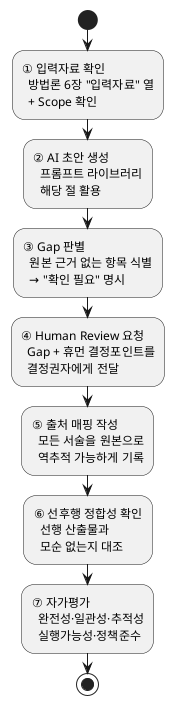

# AI 활용 개발방법론 — 적용 가이드

**버전: 2.0**
**관련 문서**: `AI활용_개발방법론_v2.3.md`(방법론 정의 — 단계·Scope·게이트·산출물 개념은 전부 이 문서를
따른다, 여기서 재정의하지 않음),
`별첨/AI활용_개발방법론_산출물_표준양식_v1.0.md`(산출물별 **무엇을** 담을지 — 필수 항목·파일 형식),
`별첨/AI활용_개발방법론_프롬프트_라이브러리_v2.0.md`(**어떤 프롬프트**로 AI 초안을 뽑을지),
`docs/reference/working/화면정의서_샘플/화면정의서_작성_표준안.md`(S3-4 화면 레이아웃 전용 — 영역(R)/속성(P)/
기능(F)/UI상태(S) 코드 체계로 와이어프레임과 상세디스크립션을 분리하는 표준)
**목적**: 7단계(S0~S6) 각각에서 대표 산출물 1건을 골라, 실제 runNshop 데이터(주로 Order·Payment
도메인)를 근거로 "AI 초안 생성 → 검토 → 확정"을 실습한다. 40종 전체를 다루지 않으며, 나머지
산출물은 표준양식·프롬프트 라이브러리·`docs/deliverables/`의 완성본을 참고한다.

**작성 역할 체계**:
- **작성**: 시니어 개발자 + AI 협업 (정형화된 구문 생성·구조화)
- **검토·확인**: 기획자·현업 (정책 부합, 업무 정확성, 누락 확인)
- **승인**: PM/TL (최종 확정)

---

## 0. 공통 작성 절차 (전 산출물 공통)

모든 산출물은 아래 7단계를 따른다 — 아래 각 대표 산출물의 실습은 이 절차를 그대로 적용한 사례다.

1. **입력자료 확인** — 방법론 6장의 "입력자료" 열 + 표준양식 문서의 Scope를 먼저 확인해 이 산출물이
   참조해야 할 원본(정책서·ERD·이전 단계 산출물 등)을 특정한다.
2. **AI 초안 생성** — 프롬프트 라이브러리의 해당 절 프롬프트를 그대로 쓰거나 현재 맥락에 맞게
   변형해 초안을 뽑는다.
3. **Gap 판별** — 초안 중 원본 근거가 없는 항목을 걸러낸다. **추정으로 채우지 않고 "확인 필요"로
   명시**한다.
4. **Human Review 요청** — Gap·휴먼결정포인트(방법론 6장)를 표로 정리해 결정권자에게 넘긴다.
5. **근거 자료 출처 매핑 작성** — 모든 서술을 원본 문서·확인 발언·타 산출물로 역추적 가능하게 표로
   남긴다(추적성 기준).
6. **선후행 산출물 정합성 확인** — 선행 산출물을 실제로 참조했는지, 모순되는 서술이 없는지 대조한다.
7. **자가평가** — 완전성·일관성·추적성·실행가능성·정책준수(방법론 5.1) 5개 기준으로 자가평가를
   남기고, 미충족 항목은 감추지 않고 정직하게 표기한다.



### 대표 산출물 지도

각 단계(S0~S6)에서 아래 산출물 1~2건을 대표로 골라 실습한다. 완성본 경로가 있는 것은 실 프로젝트
데이터(Order·Payment 도메인), 없는 것은 방법론 샘플로 대체했다.

| 단계 | 대표 산출물 | 완성본 경로 |
|---|---|---|
| S0 착수 | 문제정의서 | `docs/deliverables/S0-착수/D1-문제정의서.md` |
| S1 범위정의 | 도메인정의서 | `docs/deliverables/S1-범위정의/DB-도메인정의서.md` |
| S2 구조설계 | 상위 유스케이스, EARS, 상태머신, 이벤트플로우 | `docs/deliverables/S2-구조설계/DC-상위유스케이스(Order).md` 외 |
| S3 상세설계 | 세부 유스케이스, 인터페이스 명세, 시퀀스, 프로그램 목록 | `docs/deliverables/S3-상세설계/DK~DM, DQ` |
| S3 상세설계 | 화면 레이아웃 | `docs/reference/working/화면정의서_샘플/MOB-ORDER-01_모바일-장바구니.md`(화면정의서 작성 표준안 적용 — 기존 `S3-상세설계/DN-화면레이아웃(Order-Payment).md`는 와이어프레임을 md에 함께 담던 이전 방식) |
| S4 구현 | 코드 구현 | `docs/archive/산출물샘플-공정별/04-Code/01-코드구현.md`(방법론 샘플) |
| S5 테스트 | Go/No-Go 판단근거 | `docs/archive/산출물샘플-공정별/05-통합테스트/10-GoNoGo판단근거.md`(방법론 샘플) |
| S6 안정화 | 안정화 결과보고서 | `docs/archive/산출물샘플-공정별/06-안정화/09-안정화결과보고서.md`(방법론 샘플) |

---

## S0. 착수 — 문제정의서

**위치**: 방법론 6.1 착수 표, `D1 문제 정의서` (Proposal, Project 범위, 선행 산출물 없음 — 착수 최초 산출물)

**완성본**: `docs/deliverables/S0-착수/D1-문제정의서.md` — Background/Problem/Impact/Opportunity
(BPIO) 구조로, "AI 협업 산정 근거 부재"를 핵심 문제로 정의하고 있다.

**AI 초안 생성 프롬프트** (프롬프트 라이브러리 "1. Proposal — 문제정의서" 형식):

```
[역할]
당신은 커머스 사업의 시니어 비즈니스 분석가입니다.

[컨텍스트]
- 제안요청서(RFP)·제안서(있는 경우 최우선 원천)
- ASIS 정책서, 최근 CS/이슈 로그, 관련 회의록(있으면 참고)
- 참조자산(있으면 문서양식과 샘플 데이타를 참조)

[작업]
이 사업을 시작하는 이유를 BPIO(Background-Problem-Impact-Opportunity) 구조로 정의하세요.
제안요청서·제안서가 있으면 그 안의 사업 목적·범위·예산을 최우선으로 반영하고, 정책서·CS
로그·회의록은 있는 경우에만 보조 근거로 사용합니다.

[출력형식]
- Background(왜 시작됐는가, 인과관계 순서) → Problem(핵심 문제 1~3개, 우선순위 순) →
  Impact(방치 시 결과) → Opportunity(대응 시 기대효과)

[제약조건]
- Impact(방치 시 문제)와 Opportunity(대응 시 효과)를 한 문장에 섞지 않음
- 정량화할 근거(baseline 수치 등)가 없으면 "확인 필요"로 남기고 지어내지 않음 — 표준양식·샘플은
  형식만 참조하고 그 안의 수치를 이 프로젝트의 실제 값으로 가져오지 않음
- 제안요청서·제안서의 내용과 정책서·CS 로그가 상충하면 발주 문서(RFP·제안서)를 우선하고, 상충
  사실을 Human Review로 남김

[품질기준]
- 5.1 완전성·일관성 — 이후 목표KPI·범위·대안비교의 근거가 되므로 누락·모순이 없어야 함
```

**판단 기준/주의사항**: BPIO 순서를 지킨다. 발주 구조가 있는 프로젝트라면 제안요청서·제안서를
가장 먼저 확인한다 — 정책서·CS 로그·회의록은 있으면 참고할 보조 자료일 뿐 필수 전제가 아니다.
참조자산(표준양식·산출물 샘플)도 실제 데이터를 직접 끌어오는 게 아니라, "이 baseline 항목을
어떤 형식으로 기재하는지"만 참조한다 — 수치 자체의 근거가 없으면 "확인 필요"로 남긴다. 실제로
이 프로젝트에서도 Impact와 Opportunity가 한 문장에 섞여 있던 걸 분리한 사례가 있다 — "방치하면
산정이 실패한다"(Impact)와 "자산화하면 다음 프로젝트에 재사용 가능하다"(Opportunity)는 서로
다른 문단으로 분리해야 한다.

**완성본과 대조**: 문제정의서의 Problem 3건("자산화 부재"·"AI 협업 산정 불확실성"·"개발
패러다임 정합")이 각각 근거 문서(정책서·과거 프로젝트 baseline)로 역추적 가능한지 확인한다.

---

## S1. 범위정의 — 도메인정의서

**위치**: 방법론 6.2 범위정의 표, `DB 도메인 정의서` (Design, Project 범위, 선행 산출물: 제약사항·NFR·컴포넌트·시스템구성도)

**완성본**: `docs/deliverables/S1-범위정의/DB-도메인정의서.md` — 12개 도메인의 책임·소유
데이터·경계 규칙을 정의. 이후 모든 Domain 단위 산출물(상위UC·EARS·ERD 등)의 Scope 기준이 된다.

**AI 초안 생성 프롬프트**:

```
[역할]
당신은 시스템 아키텍처를 설계하는 시니어 소프트웨어 아키텍트입니다.

[컨텍스트]
- 제약사항, NFR, 컴포넌트, 시스템 구성도(최우선 원천)
- ASIS 정책서,현업 작업매뉴얼, 회의록(있으면 참고)
- 참조자산(있으면 참고)

[작업]
이 시스템의 업무 도메인 목록과 각 도메인의 책임·경계·소유 데이터를 정의하세요.

[출력형식]
- 도메인 목록(이름·핵심 책임·레이어)
- 도메인별 "하는 것/하지 않는 것" 표
- 도메인별 채널/앱 매핑(mobile/admin/partner 중 어디서 이 도메인의 업무가 수행되는지 — 하나의
  도메인이라도 앱마다 하는 일이 다르면 앱별로 구분해 기술, 예: "mobile(주문 생성), admin(주문
  관리), partner(주문 확인·발송)")
- 소유 데이터(주요 엔티티, 접두사)
- 도메인 간 의존관계 다이어그램(plantuml component)
- 경계 규칙(데이터 소유권, PublicApi 경유, 이벤트 기반 비동기 등)

[제약조건]
- 하나의 데이터를 두 도메인이 동시에 소유하지 않음(소유권 단일화)
- MSA 전환 가능성을 전제로 패키지 경계를 명확히 함
- 채널/앱 매핑은 이후 상위 유스케이스(S2-1)의 액터×앱 기술과 일치해야 함 — 여기서 도메인
  전체 관점으로 정의한 앱 범위를 상위 유스케이스가 유스케이스 단위로 세분화한다

[품질기준]
- 5.1 완전성 — 범위(Scope) 산출물의 In-Scope 업무가 모두 어느 도메인엔가 귀속됨
- 이후 모든 Domain 단위 산출물의 Scope 판단 기준이 되므로 경계가 모호하면 안 됨
```

**판단 기준/주의사항**: 제약사항·NFR·컴포넌트·시스템구성도는 이미 확정된 선행 산출물이므로
최우선 원천으로 삼는다. ASIS 정책서·현업 작업매뉴얼은 신규 구축이 아니라 **기존 시스템 개선
프로젝트**일 때만 근거가 되는 자료다 — 신규 구축이면 해당 자료 자체가 없으므로 참고하지 않는다.
회의록은 있으면 참고할 보조 자료일 뿐 필수 전제가 아니다. "하지 않는 것" 목록을 빠뜨리지
않는다 — 예를 들어 Order는 "재고를 직접 관리하지 않는다(→Catalog)"처럼, 인접 도메인과
헷갈리기 쉬운 경계를 명시적으로 적어야 나중에 EARS·인터페이스명세 작성 시 도메인 오귀속을
막는다. **채널/앱 매핑도 책임·경계와 동급으로 빠뜨리지 않는다** — 완성본처럼 하나의 도메인도
"mobile(조회), admin(관리), partner(등록)"처럼 앱마다 하는 일이 다르므로, 도메인 하나에
앱 하나만 적지 않는다.

**완성본과 대조**: 도메인정의서 "3. Catalog" 절처럼, 아직 착수되지 않은 도메인도 Project
범위 산출물(도메인정의서·컴포넌트)에는 이미 정의돼 있어야 한다 — Domain 단위 설계(S2~)가
없다고 Project 범위까지 비워두지 않는다. 채널 열도 마찬가지로, 이후 S2-1 상위 유스케이스가
그 채널 범위를 액터·유스케이스 단위로 더 세분화하는 관계다(도메인정의서: 도메인 전체가 쓰는
앱 목록 → 상위 유스케이스: 유스케이스 하나하나가 어느 액터·앱에서 일어나는지).

---

## S2. 구조설계 — 상위 유스케이스 / EARS / 상태머신 / 이벤트플로우

이 단계는 Domain 단위로 한 번에 4종을 순서대로 작성한다(상위UC → EARS는 병행, ERD → 상태머신
→ 비즈니스프로세스 → 이벤트플로우는 순차). 아래는 각각의 실습이다.

**EARS의 위치와 역할**: EARS 이전(문제정의서~메뉴구조도)은 범위와 제약사항을 업무 언어로
서술하는 단계다 — "이걸 구현했다/안 했다"를 판정할 단위가 아직 없다. EARS는 그 범위와
제약사항을 **실행 가능한 요구범위**(REQ-ID 단위로 식별 가능하고, 도출 근거가 명시되어 추적
가능한 요구사항)로 응축하는 지점이다. 이후 산출물(상태머신·이벤트플로우·세부UC·인터페이스
명세·시퀀스·화면레이아웃·프로그램목록·코드)은 구조설계에서 상세설계로 점점 구체화되지만,
공통적으로 이 실행 가능한 요구범위, 즉 EARS의 REQ-ID를 근거로 인용하며 추적성을 이어간다.
그래서 EARS 등록 시 출처(상위UC 항목명·정책서 챕터 등)를 반드시 명시해야 하고, 이후 모든
재참조는 "EARS 참조"라고만 쓰지 않고 REQ-ID로 명시한다 — 아래 각 실습의 [제약조건]에 반복
적용된 규칙이다.

### S2-1. 상위 유스케이스

**위치**: 방법론 6.3 구조설계 표, `DC 상위 유스케이스` (Design, Domain 범위, 선행 산출물: 도메인정의서, 정책서)

**완성본**: `docs/deliverables/S2-구조설계/DC-상위유스케이스(Order).md` — 액터(고객/입점사/CS
담당자/시스템) 정의 후 업무그룹별(장바구니·주문서 등) 유스케이스로 분류.

**AI 초안 생성 프롬프트** (프롬프트 라이브러리 "14. Design — 상위 유스케이스" 형식):

```
[역할]
당신은 도메인 분석에 능한 시니어 시스템 분석가입니다.

[컨텍스트]
- 도메인정의서(DB)의 해당 도메인 절(하는 것/하지 않는 것, 소유 데이터, 채널/앱 매핑)
- 기존 패턴 참고: DC-상위유스케이스(Order).md(액터-UC 관계도 "형식"만 — 표·다이어그램 구성 방식만 참고하고, 업무범주·항목 분할 수준은 이 도메인의 도메인정의서 기준으로 별도 판단)

[작업]
이 도메인의 액터별 상위 유스케이스를 도출하세요.

[출력형식]
- 액터 정의(역할별 권한 범위 + 접근 채널/앱: mobile/admin/partner/consumer/batch)
- 유스케이스 목록(유스케이스·액터·수행 앱/채널·도출 근거) — 업무가 "누가, 어느 앱에서" 하는
  일인지 액터·앱 두 축으로 기술
- 액터-유스케이스 관계도(plantuml usecase)
- 여러 업무 갈래로 나뉘면 업무그룹(대분류)으로 소제목 구분

[제약조건]
- 세부 유스케이스(버튼 단위)가 아니라 액터가 "하나의 목표를 완수하는" 수준으로 작성
- 하나의 유스케이스라도 앱마다 다르게 동작하면(예: 배송지 변경을 고객은 mobile, CS는 admin에서
  대행) 액터·앱 조합별로 행을 분리
- 액터가 앱을 통해 조작하지 않는 항목(도메인 간 이벤트 수신·동기 호출 등 시스템 내부 연동)은
  제외 — 상위 유스케이스가 아니라 이벤트 플로우(DI)·시퀀스(DM)의 대상
- Bounded Context 경계(도메인정의서의 "하지 않는 것")를 넘지 않음

[품질기준]
- 5.1 완전성 — 도메인의 핵심 책임이 최소 1개 유스케이스에 대응
- Bolt 분할(부록 A 기준)의 입력자료가 되므로 액터 목표 단위 준수
```

**판단 기준/주의사항**: 권한 범위(예: "본인 주문만 조회 가능")를 빠뜨리면 보안 결함으로
직결된다. 유스케이스는 액터만으로 끝내지 않고 반드시 앱(채널)까지 함께 적는다 — 완성본처럼
"입점사 주문 목록 조회"는 partner 앱, "전체 주문 검색"은 admin 앱으로 서로 다르며, 같은
업무라도 액터가 다르면 앱도 달라지는 경우가 많다(예: 배송지 변경을 고객이 하면 mobile, CS가
대행하면 admin). 유스케이스가 6개를 넘는 업무그룹만 중분류를 추가한다(조건부 3단, 모든
그룹에 강제하지 않음).

### S2-2. 기능요구(EARS)

**위치**: 방법론 6.3 구조설계 표, `DE EARS` (Spec, Domain 범위, 선행 산출물: 상위UC·메뉴구조도·정책서)

**완성본**: `docs/deliverables/S2-구조설계/DE-EARS기능요구(Order).md` → `REQ-ORD-001`(장바구니
담기 요구, Event-driven 패턴).

**AI 초안 생성 프롬프트**:

```
[역할]
당신은 이커머스 도메인의 시니어 요구사항 분석가입니다.

[컨텍스트]
- 상위 유스케이스(DC), 메뉴구조도(DD), 정책서 해당 챕터
- 도메인기능표(참고자료, 있는 경우) — 정식 확정 아닌 업무 후보 목록. 도메인기능표 README가
  스스로 "범위·요구사항(EARS)·인터페이스명세 작성 시 입력 자료로 활용한다"고 정의하고 있어,
  EARS부터 참조하는 것이 이 자료의 정의와 일치한다
- 용어집(있으면 용어 일관성 확보용)

[작업]
이 도메인의 기능요구사항을 EARS 5패턴(Ubiquitous/Event-driven/State-driven/
Unwanted-behavior/Optional) 중 적합한 패턴으로 작성하세요.

[출력형식]
- ID(REQ-{DOM}-{SEQ}), 패턴, 요구사항 문장, **도출 근거**(상위UC ID 또는 정책서 챕터 번호 등
  구체적 출처 — "정책상"·"업무상 당연히" 같은 근거 없는 서술 금지)

[제약조건]
- 트리거가 있는 요구는 Event-driven/State-driven, 없으면 Ubiquitous로 분류
- 이후 GWT 매핑을 염두에 두고 트리거를 명확히 서술
- 모든 REQ는 도출 근거를 반드시 명시 — 상위UC에서 왔으면 상위UC 항목명, 정책서에서 왔으면
  챕터 번호, 근거가 불명확하면 "확인 필요"로 표기(추정으로 채우지 않음)
- 도메인기능표는 상위UC에 없는 업무를 새로 만드는 근거로 쓰지 않음(참고자료일 뿐 확정
  산출물이 아니므로 상위UC가 우선, 도메인기능표는 상위UC 범위 내에서 세부 조건·경계값을
  보강하는 용도로만 사용)

[품질기준]
- 5.1 완전성 — 상위UC의 모든 유스케이스가 최소 1개 EARS로 커버
- 5.1 추적성 — 각 REQ가 어느 상위UC·정책서 챕터에서 도출됐는지 REQ 하나하나에 출처가 명시됨
  (이후 산출물이 이 REQ-ID를 인용할 때, 이 출처 표기가 곧 그 하위 산출물의 추적 근거가 된다)
```

**판단 기준/주의사항**: 패턴 선택을 틀리면(트리거가 있는데 Ubiquitous로 분류) 이후 GWT
작성이 꼬인다 — "트리거가 있는가"를 먼저 확인해 Event-driven/State-driven인지부터 가른다.
도메인기능표는 상위 유스케이스나 세부 유스케이스가 아니라 이 단계(EARS)부터 참조한다 —
도메인기능표 자체가 스스로 "요구사항(EARS)·인터페이스명세 작성 시 입력 자료"라고 정의하고
있어, 그보다 앞선 단계에서 참조하면 근거 없는 참조가 된다. **EARS의 출처 명시는 이후 모든
하위 산출물(상태머신·이벤트플로우·세부유스케이스·시퀀스·화면레이아웃 등)이 EARS를 재참조할
때의 추적 기준이 된다** — REQ 하나에 출처가 빠져 있으면, 그 REQ를 인용하는 모든 하위 산출물의
추적성도 함께 끊긴다.

### S2-3. 상태머신

**위치**: 방법론 6.3 구조설계 표, `DG 상태머신` (Design, Domain 범위, 선행 산출물: ERD·EARS)

**완성본**: `docs/deliverables/S2-구조설계/DG-상태머신(Order).md` — `ord_order.status` 10개
상태(TEMP~STOCK_FAILED)와 전이 규칙. v6 현행화 이력에서 "배송 실행을 별도 흐름(`ord_shipment`)
으로 분리"한 실제 변경 사례가 남아 있다.

**AI 초안 생성 프롬프트**:

```
[역할]
당신은 도메인 상태 모델링에 능한 시니어 설계자입니다.

[컨텍스트]
- ERD(DF)의 status 필드, EARS(DE)의 상태 관련 요구사항(State-driven 패턴 위주로 재확인 —
  EARS가 이 산출물 품질의 실질적 기준이 되므로 선행 산출물 외에도 자유롭게 재참조)
- 정책서의 상태 관련 규칙(예: 취소 불가 조건)

[작업]
이 엔티티의 상태 목록과 허용 전이표를 작성하세요.

[출력형식]
- 상태 목록(상태명·설명·진입 조건)
- 전이 다이어그램(plantuml state)
- forbidden_transitions와 사유

[제약조건]
- 금지 전이(예: DELIVERED에서 CANCELLED로 직접 전이 불가)를 반드시 명시
- 전이 트리거 조건을 EARS 요구사항과 연결하고, 참조한 REQ-ID를 명시(출처 없는 "EARS 참조" 금지)

[품질기준]
- 5.1 정책준수 — 정책서의 상태 규칙과 모순 0건
- forbidden_transitions가 있어야 코드 구현 시 AI가 잘못된 전이를 만들지 않음
```

**판단 기준/주의사항**: 금지 전이를 빠뜨리면 잘못된 상태 전이가 코드에 그대로 구현될 위험이
크다 — "이 상태에서 되돌아갈 수 없는 지점이 어디인가"를 항상 점검한다. EARS를 재참조할 때는
출처 경로(어느 단계에서 참조했는지)는 자유롭게 두되, 반드시 REQ-ID(예: REQ-ORD-014)를 명시해
"어떤 요구사항 때문에 이 전이가 금지됐는지"를 추적할 수 있게 한다.

### S2-4. 이벤트 플로우

**위치**: 방법론 6.3 구조설계 표, `DI 이벤트 플로우` (Design, Domain 간 범위, 선행 산출물:
비즈니스 프로세스·컴포넌트)

**완성본**: `docs/deliverables/S2-구조설계/DI-이벤트플로우.md` — Order↔Payment 간 이벤트
카탈로그(`PAYMENT_APPROVED`, `ORDER_CANCELLED` 등). v4 현행화 이력에서 "시퀀스가 실제 발행하는
이벤트명과 카탈로그 이름이 달랐던" 실제 불일치 사례와 정정 과정이 남아 있다.

**AI 초안 생성 프롬프트**:

```
[역할]
당신은 이벤트 기반 아키텍처에 능한 시니어 설계자입니다.

[컨텍스트]
- 비즈니스 프로세스(DH)의 상태전이 시점, 컴포넌트(D9)의 도메인 간 의존관계
- EARS(DE)의 Event-driven 패턴 요구사항 — 직접 선행 산출물은 아니지만, 이벤트 발행·수신
  조건의 근거로 자유롭게 재참조 가능(출처 경로는 제약 없음, 품질 판단 기준으로 활용)

[작업]
도메인 간 비동기 이벤트 계약을 정의하세요.

[출력형식]
- 이벤트 카탈로그(이벤트명·발행 도메인·수신 도메인·트리거·수신 액션·근거 REQ-ID)
- 동기/비동기 결정 근거

[제약조건]
- 구독 도메인이 아직 구현되지 않았으면 "구독 예정"(`*`)으로 표기 — 실제로 구독하지
  않는데 구독한다고 쓰지 않음
- Outbox 패턴(C5 이벤트설계컨벤션) 준수, AFTER_COMMIT 발행 원칙
- EARS를 근거로 삼은 이벤트는 반드시 REQ-ID를 명시(출처 없는 "EARS 참조" 금지)

[품질기준]
- 5.1 일관성 — 시퀀스(DM)가 실제 발행하는 이벤트명과 카탈로그 이벤트명이 1:1 일치
```

**판단 기준/주의사항**: 이 문서는 다른 산출물(시퀀스)이 먼저 바뀌면 뒤늦게 발견되는 불일치가
잦다 — 정기적으로 시퀀스의 실제 이벤트 발행 지점과 카탈로그를 대조해 동기화한다(완성본의
v4 현행화 이력이 실제 사례).

---

## S3. 상세설계 — 세부UC / 인터페이스명세 / 시퀀스 / 화면레이아웃 / 프로그램목록

Bolt 단위로 반복되는 5종을 순서대로 실습한다. 예시는 모두 "장바구니 담기" Bolt를 관통한다.

### S3-1. 세부 유스케이스

**위치**: 방법론 6.4 상세설계 표, `DK 세부 유스케이스` (Design, Bolt 범위, 선행 산출물: 상위UC)

**완성본**: `docs/deliverables/S3-상세설계/DK-세부유스케이스(Order-Payment).md` §1 "장바구니
담기 Bolt" — 상품상세 옵션 선택부터 API 호출까지 버튼 단위로 분해.

**AI 초안 생성 프롬프트**:

```
[역할]
당신은 UI 상호작용 분석에 능한 시니어 분석가입니다.

[컨텍스트]
- 상위 유스케이스(DC)의 해당 유스케이스, 화면 프로토타입(있으면)
- EARS(DE)의 해당 요구사항 — 직접 선행 산출물은 아니지만, 버튼·화면 요소 단위 행위를 EARS의
  트리거·조건과 대조해 빠짐없이 분해했는지 확인하는 기준으로 자유롭게 재참조 가능

[작업]
상위 유스케이스를 버튼·화면 요소 단위 행위로 분해하세요.

[출력형식]
- 단계별 액터 행위 → 기대 결과 표(플로우 다이어그램 병행 가능)
- 제목에 `[상위UC명]` 접두사 포함

[제약조건]
- 상위 유스케이스와의 연결(추적성)을 명시
- EARS를 재참조해 행위를 보강한 경우 REQ-ID를 함께 명시(출처 없는 "EARS 참조" 금지)

[품질기준]
- 5.1 추적성 — 어느 상위UC의 하위인지 역추적 가능
```

**판단 기준/주의사항**: 상위 유스케이스와의 연결을 명시해 추적성을 확보한다. EARS를 재참조할
때는 어느 REQ-ID를 근거로 삼았는지 반드시 밝힌다.

### S3-2. 인터페이스 명세

**위치**: 방법론 6.4 상세설계 표, `DL 인터페이스 명세` (Spec, Bolt 범위, 선행 산출물: GWT, 세부UC)

**완성본**: `docs/deliverables/S3-상세설계/DL-인터페이스명세(Order-Payment).md` "1. POST
/api/v1/cart/items" — 온보딩 가이드(`docs/onboarding/신규참여자_온보딩가이드.md` 4.2절)에서 이미
다룬 예시를 재사용한다. GWT `AC-ORD-008`(품절 상품 담기 시도)이 `409 PRODUCT_NOT_AVAILABLE`
코드와 1:1 대응하는 실제 사례가 있다.

**AI 초안 생성 프롬프트**:

```
[역할]
당신은 B2C 커머스 플랫폼의 시니어 API 설계자입니다.

[컨텍스트]
- 세부 유스케이스(DK)의 해당 행위 분해, 수용기준(GWT)의 해당 시나리오
- 기존 API 문서(네이밍 패턴 참고), API 설계 규칙(.kiro/steering/api-design-rules.md)

[작업]
이 Bolt의 API 인터페이스 명세를 작성하세요.

[출력형식]
- Method, Path, 인증, 설명
- Request Body / Response 200 예시 JSON
- Error Responses 표: HTTP 상태, code, message, 조건, 대응 GWT ID

[제약조건]
- Path Prefix 규칙 준수, 공통 응답구조 { "code": "SUCCESS", "data": {...} } 준수
- GWT의 모든 예외 카테고리 시나리오가 error_catalog에 1:1 대응해야 함

[품질기준]
- 5.1 완전성·추적성 — GWT 예외 시나리오 ↔ error_catalog 누락 0건
```

**판단 기준/주의사항**: error_catalog의 각 에러 코드가 GWT의 예외 카테고리 시나리오와 1:1
대응하는지 반드시 대조한다 — GWT에 있는 예외인데 에러코드가 없거나, 에러코드는 있는데 GWT에
대응 시나리오가 없는 상태를 남기지 않는다.

### S3-3. 시퀀스

**위치**: 방법론 6.4 상세설계 표, `DM 시퀀스` (Design, Bolt 범위, 선행 산출물: 세부UC·이벤트플로우)

**완성본**: `docs/deliverables/S3-상세설계/DM-시퀀스(Order-Payment).md` "1. [API] POST
/api/v1/cart/items" — Controller 네이밍(`CustomerCartController` 등 앱별 분리)과 Outbox 패턴
표현 규칙을 공통 규칙으로 먼저 선언한 뒤 개별 시퀀스를 작성하는 실제 구조.

**AI 초안 생성 프롬프트**:

```
[역할]
당신은 이커머스 도메인의 시니어 시스템 설계자입니다.

[컨텍스트]
- 세부 유스케이스(DK), 인터페이스 명세(DL)의 해당 API
- EARS(DE)의 해당 요구사항 — 직접 선행 산출물은 아니지만, 트랜잭션 경계·실패 분기가 원래
  요구사항(특히 Unwanted-behavior 패턴)을 빠뜨리지 않았는지 확인하는 기준으로 자유롭게 재참조
- 아키텍처컨벤션(C3, Controller 네이밍 등), 이벤트설계컨벤션(C5, Outbox 패턴)

[작업]
이 API의 호출 순서·참여 컴포넌트·트랜잭션 경계를 시퀀스로 정의하세요.

[출력형식]
- plantuml sequence, 트랜잭션 경계(rect 블록), 실패 분기(alt)
- 태그(`[API]`/`[컨슈머]`/`[배치]`) 명시

[제약조건]
- 외부 API(PG 등) 호출을 트랜잭션 안에서 동기 블로킹시키지 않음
- 이벤트는 AFTER_COMMIT에 발행(BEFORE_COMMIT 금지, wrong_patterns에 명시)
- 실패 분기(alt)를 EARS의 Unwanted-behavior 요구사항으로 보강한 경우 REQ-ID를 명시(출처 없는
  "EARS 참조" 금지 — REQ-ID가 이 실패 분기의 추적 기준이 된다)

[품질기준]
- 5.1 일관성 — 참여자명이 클래스설계(DP)의 클래스명과 일치
```

**판단 기준/주의사항**: 단순 CRUD 조회는 시퀀스를 생략한다(Controller→Service→Repository
직선 흐름은 설계 가치가 낮음) — 상태전이 또는 복수 도메인 협력이 있는 것만 작성한다. EARS를
재참조해 실패 분기를 추가했다면 REQ-ID를 밝힌다 — S2-2에서 EARS 등록 시 명시한 출처가 이
단계부터는 그대로 추적 기준으로 이어진다.

### S3-4. 화면 레이아웃

**위치**: 방법론 6.4 상세설계 표, `DN 화면 레이아웃` (Design, Bolt 범위, 선행 산출물: 시퀀스)

**완성본**: `docs/reference/working/화면정의서_샘플/MOB-ORDER-01_모바일-장바구니.md` — 화면정의서 작성
표준안(`화면정의서_작성_표준안.md`)에 따라 **와이어프레임(Figma/PPT→PDF, 별도 파일)과
상세디스크립션(md, 메타정보+영역·속성·기능·UI상태 4요소)을 분리**한 실제 사례. 기존
`DN-화면레이아웃(Order-Payment).md`는 와이어프레임을 md 안에 ASCII로 함께 담던 이전 방식이고,
이 표준안은 신규 도메인/화면 작성 시 적용하는 개정안이다(기존 문서 마이그레이션 여부는 별도
결정).

**AI 초안 생성 프롬프트** — 채널에 따라 경로가 다르다(admin/partner는 md→tsx 직행, mobile은
md→Figma→tsx). mobile(장바구니) 예시:

```
[역할]
당신은 UI/UX 설계에 능한 시니어 프론트엔드 설계자입니다.

[컨텍스트]
- 시퀀스(DM)의 API 호출 시점, 인터페이스 명세(DL)의 Request/Response 필드
- 화면정의서 작성 표준안(참조자산) — 영역(R)/속성(P)/기능(F)/UI상태(S) 코드 체계
- EARS(DE)의 해당 요구사항 — 직접 선행 산출물은 아니지만, 속성(Property)·기능(Function) 표의
  "제약사항"·"검증/제약사항" 칸을 채울 때 EARS의 조건·트리거를 근거로 자유롭게 재참조(출처
  경로는 제약 없음, 이 필드의 품질을 좌우하는 실질적 기준)
- 코딩 표준(.kiro/steering/coding-standards.md)

[작업]
시퀀스의 API 호출 시점을 화면 요소에 매핑하여, **와이어프레임과 상세디스크립션을 분리**해
작성하세요. 와이어프레임은 Figma(또는 PPT→PDF) 산출물로 별도 관리하고, 이 프롬프트의 결과물은
상세디스크립션(md)만 작성합니다.

[출력형식]
- 메타정보 블록(화면ID·화면명·유형·메뉴경로·권한·담당자·문서상태)
- 와이어프레임 참조 한 줄(`> **와이어프레임**: {화면ID}.pdf — N페이지 (원본: Figma 링크)`) —
  실제 그림은 이 md에 넣지 않음
- 영역(R)별 상세디스크립션: 영역 개요 / 속성(P) 표 / 기능(F) 표 / UI상태(S) 표
- 구성요소 인덱스(화면에서 쓰인 모든 R/P/F/S 코드 목록)

[제약조건]
- 실제 API(인터페이스 명세)에 없는 항목을 화면에 추가하지 않음
- 단순 노출/비활성 조건은 S코드로 승격하지 않고 속성·기능 표의 제약사항 칸에 조건문으로 기술
  (S코드는 다중 영향·타 영역 참조·전용 문구 필요 중 하나에 해당할 때만)
- 제약사항 칸에 EARS를 근거로 적을 때는 REQ-ID를 명시(출처 없는 "정책상"·"업무상" 서술 금지)

[품질기준]
- 5.1 실행가능성 — 이 설계만 보고 코드 구현을 바로 시작할 수 있는 구체성
- 상세디스크립션의 모든 코드가 와이어프레임(또는 구성요소 인덱스)에도 나타나는 1:1 대응
```

**판단 기준/주의사항**: admin/partner를 먼저 진행하고 mobile(고객웹)은 이후에 진행한다 —
admin/partner에서 API 계약이 확정되면 mobile 기획자가 그 계약을 참조해 재작업을 줄일 수 있다.
와이어프레임(그림)과 상세디스크립션(텍스트)을 같은 파일에 섞지 않는다 — 그림은 Figma/PPT로
그려 PDF로 내보내고, md에는 참조 링크와 코드(R/P/F/S)만 남겨 검색·유지보수가 되는 쪽(텍스트)에
규칙을 모은다.

### S3-5. 프로그램 목록

**위치**: 방법론 6.4 상세설계 표, `DQ 프로그램 목록` (Design, Domain 범위, 선행 산출물:
화면레이아웃·인터페이스명세·시퀀스·이벤트플로우·EARS)

**완성본**: `docs/deliverables/S3-상세설계/DQ-프로그램목록(Order-Payment).md` — 화면(SCR)·
API·컨슈머(CSM)·배치(BAT) PGM-ID 채번 후 전수 도출. v7 현행화 이력에서 "누락된 endpoint 1건을
찾아 API-050을 신규 부여"한 실제 정합성 검증 사례가 있다.

**AI 초안 생성 프롬프트**:

```
[역할]
당신은 프로젝트 거버넌스에 능한 시니어 PM입니다.

[컨텍스트]
- 화면레이아웃(DN), 인터페이스명세(DL), 시퀀스(DM)의 [컨슈머]/[배치] 태그
- 이벤트 플로우(DI)의 이벤트 카탈로그 — 이벤트를 구독하는 컨슈머(CSM) 프로그램의 존재 근거
- EARS(DE)의 시간조건(Optional 패턴, 예: 배치 스케줄) — 직접 선행 산출물은 아니지만, BAT
  프로그램의 존재 근거로 자유롭게 재참조 가능(출처 경로는 제약 없음)

[작업]
이 도메인에서 구현해야 할 화면·API·컨슈머·배치 프로그램을 전수 도출하세요.

[출력형식]
- PGM-ID(SCR-{채널}-{SEQ}/API-{SEQ}/CSM-{SEQ}/BAT-{SEQ}) 채번
- 도출 소스별 매핑 표, 정합성 체크리스트(누락 API·미매핑 화면 등)

[제약조건]
- 조회 전용 API도 포함(시퀀스 생략 대상이어도 구현 대상)
- 프로그램 총 건수 ≥ 인터페이스명세 API 수
- BAT 프로그램을 EARS의 시간조건으로 근거를 댄 경우 REQ-ID를 명시(출처 없는 "EARS 참조" 금지)

[품질기준]
- 5.1 완전성 — 인터페이스명세 모든 endpoint가 API-* 로 1:1 존재
```

**판단 기준/주의사항**: 프로그램 목록의 총 건수는 인터페이스명세 API 수보다 항상 크거나 같아야
한다(화면·컨슈머·배치가 추가되므로) — 이 부등식이 깨지면 누락을 의심한다. 배치(BAT)는 시퀀스가
없는 경우가 많아 EARS의 시간조건(Optional 패턴)이 유일한 도출 근거가 될 수 있다 — 이 경우도
REQ-ID로 추적한다.

---

## S4. 구현 — 코드 구현

**위치**: 방법론 6.5 구현 표, "코드 구현" (Bolt 범위, 선행 산출물: WBS·클래스설계·인터페이스명세)

**완성본**: `docs/archive/산출물샘플-공정별/04-Code/01-코드구현.md` — `PaymentController` →
`PaymentService` → `MockLoader` 구조의 실제 Kotlin 코드. `docs/deliverables/`에는 아직 이 Bolt의
코드 구현 산출물이 없어 방법론 샘플로 대체한다.

**AI 초안 생성 프롬프트** (프롬프트 라이브러리 "30. Code — 코드 구현" 형식):

```
[역할]
당신은 Kotlin/Spring Boot 기반 커머스 백엔드 시니어 개발자입니다.

[컨텍스트]
- 클래스 설계(DP)의 해당 Controller/Service, 인터페이스 명세(DL)의 해당 API
- 코딩 컨벤션(.kiro/steering/coding-standards.md), Mock 데이터 규칙(mock-data-rules.md)

[작업]
이 Bolt의 백엔드 코드를 구현하세요.

[출력형식]
- Kotlin 소스 파일(Controller → Service → MockLoader 구조)
- Mock JSON 파일(표준 응답 구조)

[제약조건]
- 프로토타입 단계: 실제 DB 연동 없이 MockLoader로 JSON 반환
- 상태 전이 검증 로직은 Service에 구현(비즈니스 로직 분리)
- 시퀀스 다이어그램의 메시지 순서와 코드 호출 순서 일치

[품질기준]
- 5.1 정책준수·실행가능성 — 컴파일 성공, 인터페이스 명세의 Request/Response와 DTO 필드 1:1 대응
```

**판단 기준/주의사항**: 설계와 다르게 구현해야 할 사정이 생기면(프로토타입 단순화 등) 조용히
다르게 만들지 않고 반드시 "클래스 설계(현행화)"에 diff로 남긴다.

---

## S5. 테스트 — Go/No-Go 판단근거

**위치**: 방법론 6.6 테스트 표, "Go/No-Go 판단근거" (Project 범위, 선행 산출물: 통합테스트
결과보고서·DoD 체크리스트)

**완성본**: `docs/archive/산출물샘플-공정별/05-통합테스트/10-GoNoGo판단근거.md` — 동시성 재고
오버셀을 **Critical**, 중복 결제 미차단을 **Major**로 분류해 최종 **No-Go** 판정을 내린 실제
사례. `docs/deliverables/` S5는 아직 비어 있어 방법론 샘플로 대체한다.

**AI 초안 생성 프롬프트**:

```
[역할]
당신은 오픈 승인 판단을 보조하는 시니어 PM입니다.

[컨텍스트]
- 통합테스트 결과보고서(결함 등급별 목록), DoD 체크리스트(최종), NFR 실측치

[작업]
결함 등급별 건수를 집계하고 방법론 5.2 Go/No-Go 판단 매트릭스를 적용해 최종 판정하세요.

[출력형식]
- 판단기준(5.2 결함분류)별 결함 목록 + 등급
- 최종 판정(Go/조건부 Go/No-Go) + 근거

[제약조건]
- Critical 결함이 남아 있으면 Go로 판정하지 않음 — 매트릭스 기준을 엄수
- 판정이 곤란하면 조건부(Hold)로 정직하게 남김

[품질기준]
- 5.2 매트릭스 기준 엄수 — Critical 0건 아니면 반드시 No-Go
```

**판단 기준/주의사항**: 등급을 실제보다 낮춰(예: Critical을 Minor로) 기재하지 않는다 — 이
등급이 Go/No-Go 판정에 직결된다. 완성본의 실제 사례처럼, No-Go 판정이라도 "프로토타입 단계의
의도된 미구현"인지 "반드시 해결해야 할 결함"인지 Human Review로 구분해 남긴다.

---

## S6. 안정화 — 안정화 결과보고서

**위치**: 방법론 6.7 안정화 표, "안정화 결과보고서" (Project 범위, 선행 산출물: 목표·KPI 최종·
장애/이슈 로그)

**완성본**: `docs/archive/산출물샘플-공정별/06-안정화/09-안정화결과보고서.md` — "Go-Live는
Critical 결함으로 Hold"라는 결과를 숨기지 않고 그대로 기록하고, 방법론 개선 제안(Spec 단계
NFR에 동시성 요건을 명시했어야 함)까지 남긴 실제 사례.

**AI 초안 생성 프롬프트**:

```
[역할]
당신은 프로젝트 마무리 보고에 능한 시니어 PM입니다.

[컨텍스트]
- 전체 과정 산출물(목표·KPI 최종, 장애/이슈 로그, NFR 최종 등)

[작업]
전체 과정을 종합하고 KPI 달성을 평가하며, 자산화(다음 프로젝트 재사용) 권고사항을 작성하세요.

[출력형식]
- 진행 결과 요약, KPI 평가, 방법론 관점 시사점, 자산화 권고사항

[제약조건]
- 미달 항목을 누락시키지 않음 — 성공 사례만 남기고 미달은 빼는 식으로 편집하지 않음
- 권고사항은 "어떤 산출물을 어떤 프로젝트에 어떻게 재사용할지" 구체적으로 작성

[품질기준]
- 5.1 완전성 — 이 산출물이 자산화와 직접 연결되므로 뭉뚱그린 서술("전반적으로 잘 됐다") 금지
```

**판단 기준/주의사항**: No-Go/Hold 상태인데 승인기록을 만들지 않는다 — Hold 상태면 Hold로
정직하게 표기한다(완성본의 실제 사례 참고). 이 산출물이 자산화와 직접 연결되는 지점이므로,
권고사항을 구체적으로 쓴다.

---

## 요약: 문서 간 이동 경로

```
방법론 6장          "이 산출물이 어느 단계·Scope인가" (위치 확인)
  ↓
별첨/표준양식        "이 산출물에 어떤 항목을 담아야 하는가" (양식)
  ↓
별첨/프롬프트 라이브러리  "어떤 프롬프트로 AI 초안을 뽑는가" (초안 생성)
  ↓
이 문서 (적용가이드)  "단계별 대표 산출물을 실제로 어떻게 완성하는가" (실습)
  ↓
docs/deliverables/    실제로 완성된 결과물 (대조·참고)
```

---

## 변경 이력

v1.0 (2026-07-28): 초판 작성(당시 이름: 산출물 작성 가이드) — 40종 전체에 대해 작성 순서·
판단 기준/주의사항·선행 산출물을 정의.

v1.1 (2026-08-25): 문서 앞부분에 온보딩 실습(인터페이스 명세 1건) 추가.

v2.0 (2026-08-25): **전면 재작성 — "산출물 작성 가이드"에서 "방법론 적용 가이드"로 성격 전환**.
기존 40종 전체 요약형 문서(`archive/AI활용_개발방법론_적용가이드_v1.0_2608251200.md`로 보관)를
대체 — 개념(단계·Scope·게이트)은 방법론 문서(`AI활용_개발방법론_v2.3.md`)를 참조하는 것으로
넘기고, 이 문서는 **7단계(S0~S6) 각 단계의 대표 산출물 1건**(문제정의서·도메인정의서·상위
유스케이스·EARS·상태머신·이벤트플로우·세부유스케이스·인터페이스명세·시퀀스·화면레이아웃·
프로그램목록·코드구현·Go/No-Go판단근거·안정화결과보고서, 총 14건)을 실제 runNshop 데이터
(주로 Order·Payment 도메인 완성본)를 근거로 실습하는 데 집중한다. S4~S6은 `docs/deliverables/`에
아직 실 데이터가 없어 방법론 샘플(`docs/archive/산출물샘플-공정별/`)로 대체했다.

v2.0 보완 (2026-08-25): S0 문제정의서 프롬프트의 [컨텍스트]에 **제안요청서(RFP)·제안서를
최우선 원천으로 추가** — 발주 구조가 있는 프로젝트에서는 정책서·CS 로그보다 제안요청서·제안서가
사업 범위·목표·baseline의 실제 원천이기 때문. 방법론 문서(`AI활용_개발방법론_v2.3.md`) 6.1
착수 표의 D1 입력자료도 함께 정정(v2.3 보완 7). [제약조건]에 "발주 문서와 정책서·CS 로그가
상충하면 발주 문서 우선"을 추가하고, 판단 기준/주의사항에 원천 우선순위를 명시했다.

v2.0 보완 2 (2026-08-25): 위 보완에서 정책서·CS 로그·회의록을 여전히 필수처럼 나열했던 걸
재정정 — 이 셋은 "있으면 참고"할 보조 자료일 뿐 필수 전제가 아님을 [컨텍스트]·판단 기준에
명시(방법론 문서도 v2.3 보완 8로 동일하게 정정). 또한 "과거 유사 프로젝트의 baseline" 항목의
성격을 재정의 — 실제 과거 프로젝트 데이터를 컨텍스트로 넣는 게 아니라, 산출물 표준양식·산출물
샘플(별첨)에서 baseline 항목을 **어떤 형식으로 기재하는지**만 참조하는 것으로 범위를 좁혔다.
수치 자체의 근거가 없으면 "확인 필요"로 남기고, 양식에 있는 예시 수치를 이 프로젝트의 실제
값으로 가져오지 않는다는 제약을 [제약조건]에 추가.

v2.0 보완 3 (2026-08-25): S0 프롬프트의 [컨텍스트] 3줄을 최종 확정 — ① 제안요청서(RFP)·제안서
(있는 경우 최우선 원천), ② 플랫폼 정책서·최근 CS/이슈 로그·관련 회의록(있으면 참고), ③
참조자산(있으면 문서양식과 샘플 데이터를 참조). v2.0 보완 2에서 "표준양식·산출물 샘플"이라
길게 풀어 쓰던 항목을 "참조자산"이라는 한 용어로 통일하고, 판단 기준/주의사항 문단의 표현도
동일 용어로 맞췄다.

v2.0 보완 4 (2026-08-25): S1 도메인정의서 프롬프트의 [컨텍스트]를 실제 산출물 흐름 순서에
맞춰 재구성 — 완성본 헤더("흐름 내 위치: 컴포넌트 → 시스템구성도 → 도메인 정의서")와 방법론
6.2 표의 D9·DA 선행관계를 근거로, ① 제약사항·NFR·컴포넌트·시스템구성도(최우선 원천, 이미
확정된 선행 산출물), ② 정책서·회의록(있으면 참고), ③ 참조자산(있으면 참고) 3줄로 정리했다.
기존 "기존 유사 커머스 플랫폼의 도메인 분리 사례"는 방법론·완성본 어디에도 근거가 없는
항목이라 제거했다.

v2.0 보완 5 (2026-08-25): 위 보완에서 "정책서"라고만 쓴 항목을 **"ASIS 정책서·현업 작업매뉴얼"
로 구체화** — 이 문서는 신규 구축이 아니라 **기존 시스템 개선 프로젝트**일 때 참고하는 자료임을
명시(runNshop은 신규 구축이라 해당 없음). 판단 기준/주의사항에도 "신규 구축이면 해당 자료
자체가 없으므로 참고하지 않는다"는 조건을 추가.

v2.0 보완 6 (2026-08-25): S2-1 상위 유스케이스 프롬프트의 [출력형식]에 **액터 × 앱(채널) 매핑을
명시적으로 추가** — 완성본(`DC-상위유스케이스(Order).md`)이 액터 정의 표에 채널(M/P/A/C/B)
열을 두고, 유스케이스마다 "누가·어느 앱에서" 하는 일인지 함께 기술하고 있는데도 기존 프롬프트의
[출력형식]에는 "액터 정의(권한 범위)"만 있어 앱 매핑이 빠져 있었다. 액터 정의에 접근
채널/앱을 추가하고, 유스케이스 목록 항목을 신설(유스케이스·액터·수행 앱/채널·도출 근거)했다.
[제약조건]에 "같은 유스케이스라도 액터에 따라 앱이 달라지면 조합별로 행 분리"를 추가하고,
판단 기준/주의사항에 배송지 변경(고객=mobile vs CS 대행=admin) 실제 사례를 반영했다.

v2.0 보완 7 (2026-08-25): 같은 문제가 **S1 도메인정의서 프롬프트에도 있어 동일하게 보완** —
완성본(`DB-도메인정의서.md`)은 도메인마다 "채널" 행(예: "mobile(주문 생성), admin(주문 관리),
partner(주문 확인·발송)")을 이미 두고 있는데, 기존 프롬프트의 [출력형식]에는 도메인 목록·
책임·소유데이터·의존관계만 있고 채널/앱 매핑이 빠져 있었다. [출력형식]에 "도메인별 채널/앱
매핑" 항목을 추가하고, [제약조건]에 "이 채널 범위가 S2-1 상위 유스케이스의 액터×앱 기술과
일치해야 한다"는 상하위 문서 간 정합 규칙을 추가했다. 판단 기준/주의사항·완성본과 대조 문단에도
도메인정의서(도메인 전체 단위 앱 범위) → 상위 유스케이스(유스케이스 단위 액터×앱 세분화)의
관계를 명시했다.

v2.0 보완 8 (2026-08-25): S2-1 상위 유스케이스 [컨텍스트]의 **"도메인기능표" 참조를 제거** —
방법론 6.3 표(DC 입력자료: 도메인정의서, 정책서)와 완성본(`DC-상위유스케이스(Order).md`)의
실제 도출 근거 어디에도 도메인기능표 참조가 없었다.

v2.0 보완 9 (2026-08-25): 위 보완에서 일단 도메인기능표를 S3-1 세부 유스케이스로 옮겼으나,
`docs/reference/working/도메인기능표/README.md`를 다시 확인한 결과 이 자료가 스스로 "범위·**요구사항
(EARS)**·인터페이스명세 작성 시 입력 자료로 활용한다"고 정의하고 있어 **세부 유스케이스가
아니라 EARS(S2-2)부터 참조하는 것이 맞다** — 재정정. S3-1에서 도메인기능표 참조를 제거하고
S2-2 [컨텍스트]에 추가, [제약조건]에 "도메인기능표는 상위UC 범위 내에서 세부 조건·경계값을
보강하는 용도로만 사용, 상위UC에 없는 업무를 새로 만드는 근거로 쓰지 않음"을 명시했다.

v2.0 보완 10 (2026-08-25): **EARS를 "산출물 품질의 실질적 기준"으로 여러 하위 산출물의
[컨텍스트]에 자유 참조 가능 항목으로 추가** — 방법론 6장 표에서 상태머신(DG)만 EARS를 직접
입력자료로 갖고, 이벤트플로우(DI)·세부유스케이스(DK)·시퀀스(DM)·화면레이아웃(DN, 속성·기능
표의 "제약사항"·"검증/제약사항" 칸)은 EARS와 단계상 간접 연결만 있어 AI 초안 작성 시 원래
요구사항을 놓칠 위험이 있었다. 방법론의 공식 선행 산출물 체계(직전 산출물만 입력자료로 인정)를
바꾸지 않고, 5개 지점의 [컨텍스트]에 "직접 선행 산출물은 아니지만 자유롭게 재참조 가능"이라는
조건으로 EARS를 추가 — 출처 경로는 자유롭게 두되, 해당 필드의 실질적 품질 기준으로 활용하도록
명시했다. S2-3(상태머신)은 이미 EARS가 입력자료였으나 "State-driven 패턴 위주로 재확인"이라는
구체적 활용법을 보강했다.

v2.0 보완 11 (2026-08-25): 위 보완 10에서 "출처는 자유"라고 정리했던 것을 재정정 — **EARS
등록 시점에는 출처(상위UC 항목명·정책서 챕터 등)가 반드시 명시되어야 하고, 이후 하위 산출물이
EARS를 재참조할 때는 그 REQ-ID 자체가 추적의 기준이 된다.** "출처가 자유롭다"는 것은 하위
산출물이 EARS를 참조하는 **경로**(선행 산출물이 아니어도 언제든 재참조할 수 있다는 뜻)를
말한 것이지, REQ-ID 없이 근거를 대도 된다는 뜻이 아니었다. 이에 따라:
- S2-2(EARS) [출력형식]의 "도출 근거"를 "상위UC ID 또는 정책서 챕터 번호 등 구체적 출처
  ('정책상'·'업무상 당연히' 같은 근거 없는 서술 금지)"로 구체화, [제약조건]에 "모든 REQ는
  도출 근거를 반드시 명시, 근거가 불명확하면 '확인 필요'로 표기(추정으로 채우지 않음)" 추가
- S2-3(상태머신), S2-4(이벤트플로우), S3-1(세부유스케이스), S3-3(시퀀스), S3-4(화면레이아웃),
  S3-5(프로그램목록) 각각의 [제약조건]에 "EARS 재참조 시 REQ-ID 명시 필수, 출처 없는 'EARS
  참조' 금지" 규칙을 추가하고, 출력형식에도 근거 REQ-ID 칸을 반영(이벤트카탈로그·화면레이아웃
  제약사항 칸 등)
- S3-2(인터페이스명세)는 EARS가 GWT를 경유해 간접 연결되고 이미 GWT ID로 추적되고 있어 별도
  수정 대상에서 제외

v2.0 보완 12 (2026-08-25): **"EARS의 위치와 역할" 문단을 S2 섹션 서두에 추가** — EARS 이전
(문제정의서~메뉴구조도)은 범위·제약사항을 업무 언어로 서술하는 단계이고, EARS 이후는 "구현
범위"로 이분하는 게 아니라(S2 나머지와 S3의 구체화 정도 차이가 여전히 존재하므로), EARS는
그 범위·제약사항을 **실행 가능한 요구범위**(REQ-ID로 식별·추적 가능한 요구사항)로 응축하는
지점이라고 정리했다. 이 관점이 v2.0 보완 11의 REQ-ID 추적 규칙 전체의 근거가 된다.

v2.0 보완 13 (2026-08-25): **S3-4(화면 레이아웃)의 완성본·프롬프트를 "와이어프레임/상세디스크립션
분리" 표준으로 교체** — `docs/reference/working/화면정의서_샘플/화면정의서_작성_표준안.md`가 이미
와이어프레임(Figma/PPT→PDF, 별도 파일)과 상세디스크립션(md, 메타정보+영역·속성·기능·UI상태
4요소)을 분리하는 표준으로 확정돼 있었는데, 적용가이드는 여전히 옛 `DN-화면레이아웃
(Order-Payment).md`(와이어프레임을 md 안에 ASCII로 함께 담는 방식)를 완성본으로 참조하고
있었다. 완성본을 표준안의 실제 샘플(`MOB-ORDER-01_모바일-장바구니.md`, S3 예시 Bolt인 "장바구니
담기"와 일치)로 교체하고, 프롬프트의 [작업]·[출력형식]·[제약조건]·판단 기준/주의사항을 분리
원칙에 맞게 재작성했다.

v2.0 보완 14 (2026-08-27): **내용 검토 후 잔재 3건 정정**. ① S3-2(인터페이스 명세)에서 인용한
온보딩 가이드 절 번호 오기재 정정 — `POST /api/v1/cart/items` 예시는 실제로는 3.2절("산출물
현황 확인")이 아니라 4.2절("실습: 장바구니 담기 API 구현 요청")에 있었다. ② "대표 산출물 지도"
표의 S3 상세설계 행이 화면 레이아웃(DN)까지 `S3-상세설계/DK~DQ`에 뭉뚱그려져 있어, 보완 13에서
이미 본문·프롬프트를 새 표준(`화면정의서_샘플/MOB-ORDER-01_모바일-장바구니.md`)으로 교체했음에도
표만 옛 `DN-화면레이아웃(Order-Payment).md` 경로를 가리키는 것처럼 남아 있던 것을 화면 레이아웃
행을 분리해 정정. 같은 표의 S2·S3 행에서 `docs/deliverables/` 접두사가 빠져 있던 경로 표기
형식도 다른 행과 통일했다. ③ 상단 "관련 문서" 목록에 `화면정의서_작성_표준안.md`가 빠져 있어
추가 — S3-4에서 표준양식·프롬프트 라이브러리와 동급으로 참조되는 문서다.

v2.0 보완 15 (2026-08-27): **방법론 표 대조 후 잔재 3건 정정**. ① S2-1(DC) 위치 줄의 "선행
산출물: 컴포넌트"가 방법론 6.3 표(도메인정의서, 정책서)와 불일치했던 것을 정정 — 아래
[컨텍스트]는 이미 도메인정의서 기준으로 올바르게 작성돼 있었다. ② S3-2(DL) 위치 줄·[컨텍스트]가
방법론 6.4 표의 "세부UC(DK)" 대신 EARS(DE)+GWT를 입력자료로 쓰고 있던 것을 표대로 정정 —
보완11에서 이미 "S3-2는 GWT가 EARS를 간접 추적하므로 EARS를 별도로 넣지 않는다"고 결정한 바
있어, 기존 [컨텍스트]가 그 결정과 모순되는 상태였다. ③ S3-5(DQ) [컨텍스트]에 이벤트 플로우(DI)가
빠져 있던 것을 추가 — 위치 줄과 방법론 표는 이미 이벤트플로우를 선행 산출물로 명시하고 있었으나
실제 프롬프트 본문엔 반영되지 않았다. 함께: 방법론 문서(`AI활용_개발방법론_v2.3.md`) 6.1 착수
표 입력자료 컬럼에 우선/참조/자산 3단계 구분 도입(v2.3 보완 9).
