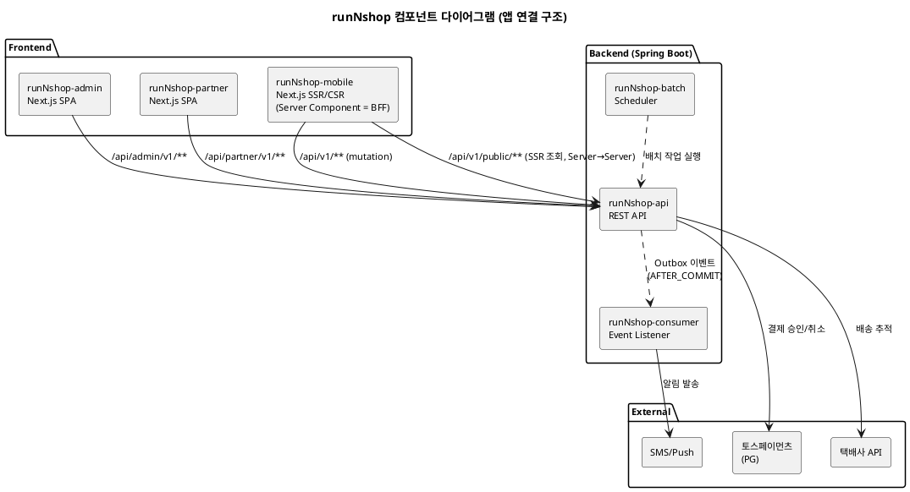

# 샘플: 컴포넌트

> **단계**: 범위정의
> **문서범위**: Project
> **문서종류**: Design

> **작성 목적**: 시스템의 기술 구조를 정의한다 — 배포 방식·앱 구성·연동·코드 저장소 구조.
> "무엇을 만드는가"의 기술적 골격을 확정하여, 이후 모든 산출물의 구현 범위를 제한한다.
>
> **흐름 내 위치**:
> ```
> ① 제약사항 → ② NFR → ③ 컴포넌트 → ④ 시스템구성도 → ⑤ 도메인 정의서
> ```
> 도메인 경계 확정 후 §6(도메인 모듈 구조)을 보완한다.
>
> **작성 주체**: 시니어 개발자 + AI 협업 (아키텍트 검토)
>
> **이 산출물이 다루는 것**: 시스템의 **기술 구조** — 배포 방식·앱 구성·연동·환경·운영 기반
> **이 산출물이 다루지 않는 것**: 앱 셸 UI(→⑰ 화면 레이아웃), 메뉴 항목(→⑦ 메뉴구조도), Platform Bolt 작업 순서(→Tasks), 클래스(→⑲)

---

## 1. 컴포넌트 다이어그램



---

## 2. 배포 구조

| 항목 | 결정 | 비고 |
|---|---|---|
| 아키텍처 | Modular Monolith | MSA 전환 대비 — 도메인 = 패키지 분리 |
| BE | Spring Boot 3.x (Kotlin) | 단일 jar (API + Consumer + Batch 포함) |
| FE | Next.js 14+ (App Router, TypeScript) | 앱별 독립 배포 |
| 이벤트 | Outbox Pattern + Spring Event Consumer | AFTER_COMMIT 발행 |
| 인증 | Bearer {userId} → JWT (본개발) | Path Prefix로 역할 판별 |
| BFF | Next.js Server Component (mobile 조회만) | admin/partner는 BE 직접 호출 |

---

## 3. 앱 구성

| 앱 | 기술 | 용도 | 화면 |
|---|---|---|---|
| runNshop-admin | Next.js (SPA) | 플랫폼 관리자 | ✅ |
| runNshop-partner | Next.js (SPA) | 입점 판매자 | ✅ |
| runNshop-mobile | Next.js (SSR/CSR) | 고객 (SEO 대상). Server Component가 BFF 역할 수행 (조회) | ✅ |
| runNshop-api | Spring Boot | BE API 서버 | ❌ |
| runNshop-consumer | Spring Boot (Event Listener) | 비동기 이벤트 처리. 상세: ⑫ 이벤트 플로우 | ❌ |
| runNshop-batch | Spring Boot (Scheduler) | 스케줄 배치 작업. 상세: EARS 배치 채널(B) | ❌ |

---

## 4. 코드 저장소 구조

```
runNshop/
├── apps/
│   ├── runNshop-admin/        ← Next.js (SPA)
│   │   └── lib/              ← FE 공통 (API 클라이언트·타입·유틸)
│   ├── runNshop-partner/      ← Next.js (SPA)
│   │   └── lib/
│   └── runNshop-mobile/       ← Next.js (SSR/CSR, Server Component = BFF)
│       ├── app/               ← 클라이언트 페이지 (CSR)
│       ├── app/api/           ← BFF (Route Handler)
│       └── lib/
├── api/
│   ├── runNshop-api/          ← Spring Boot (REST API)
│   │   └── src/.../common/   ← BE 공통 (응답 구조·예외 처리·Outbox 기반)
│   ├── runNshop-consumer/     ← Spring Boot (Event Listener)
│   ├── runNshop-batch/        ← Spring Boot (Scheduler)
│   └── resources/mock/        ← Mock 데이터 (도메인별 JSON)
├── docs/                      ← 산출물·방법론
├── docs_ai/                   ← AI 협업 자산
└── .kiro/                     ← Kiro 설정 (steering, hooks)
```

> - **BE 공통**: `api/runNshop-api/src/.../common/` — 응답 구조·예외 처리·Outbox 기반 클래스. 전 도메인에서 공유
> - **FE 공통**: `apps/{app}/lib/` — API 클라이언트·타입·유틸. 각 앱 내부 (앱 간 공유는 추후 패키지 추출)
> - **Mock 데이터**: `api/resources/mock/` — 도메인별 JSON (Mock 규칙 참조)
> - **api·consumer·batch**: 같은 레벨 별도 모듈. 독립 jar 배포 가능 (MSA 전환 대비)
> - **BFF**: `runNshop-mobile/app/api/` — 별도 프로젝트 아님

---

## 5. 외부 연동 시스템

| 외부 시스템 | 연동 도메인 | 제약 |
|---|---|---|
| **토스페이먼츠 (PG)** | Payment | CONS-004: 단일 PG |
| **택배사 API** (2곳) | Order (배송) | CONS-008: 2곳 한정 |
| **SMS/Push 발송** | Notification | 미확정 |

---

## 6. 도메인 모듈 구조 (도메인 경계 확정 후 보완)

> §1~5는 도메인 경계 없이 작성 가능. 이 섹션은 도메인 경계가 확정된 후에 보완한다.

### 도메인 패키지 구조

```
com.runnshop/
├── order/        ← 주문·배송·클레임
├── payment/      ← 결제·환불
├── catalog/      ← 상품·재고·전시
├── promotion/    ← 쿠폰·행사가·할인
├── member/       ← 회원·등급·포인트·배송지
├── vendor/       ← 입점사 관리
├── settlement/   ← 정산
├── platform/     ← 인증·인가·세션·운영정책·공통코드·약관·앱 셸
├── community/    ← 리뷰·QnA
├── notification/ ← 알림 발송
├── search/       ← 검색·인덱스
└── audit/        ← 감사·로그
```

### 도메인 간 통신 방식

| 호출 유형 | 방식 | 사용 조건 |
|---|---|---|
| **동기 (PublicApi)** | 도메인 인터페이스 호출 (in-process) | 즉시 응답 필요 (재고 선점, 포인트 확인 등) |
| **비동기 (이벤트)** | Outbox + Event Consumer (AFTER_COMMIT) | 후속 처리·알림·정산·복원 |

### 경계 규칙

| # | 규칙 |
|---|---|
| 1 | 각 도메인 소유 데이터는 타 도메인이 직접 SQL 접근 금지 → PublicApi 경유 |
| 2 | 비동기 이벤트는 AFTER_COMMIT 발행 (Outbox) |
| 3 | 도메인 패키지 간 import는 PublicApi 인터페이스만 허용 (구현체 직접 참조 금지) |

---

## 이 산출물이 다루지 않는 것

| 내용 | 해당 산출물 |
|---|---|
| 인프라 배치 (서버·네트워크·환경·스케일링·모니터링) | ④ 시스템구성도 |
| 앱 셸 UI 상세 (NavBar/Sidebar/BottomNav) | ⑰ 화면 레이아웃 (공통) |
| 메뉴 항목 (1depth→2depth→화면) | ⑦ 메뉴구조도(IA) |
| Platform Bolt 식별·작업 순서 | Tasks — 의존성맵·WBS |
| 도메인 간 이벤트 카탈로그 | ⑫ 이벤트 플로우 |
| 클래스 수준 상세 | ⑲ 클래스 설계 |
| API endpoint 정의 | ⑮ 인터페이스 명세 |

---

## 근거

| 항목 | 출처 |
|---|---|
| 배포 구조·경계 규칙 | `runNshop_modular_monolith_v1_0.md` |
| URL Path Prefix | `.kiro/steering/api-design-rules.md` |
| BFF 결정 | `docs/reference/working/API-오케스트레이션-위치별-비교.md` §8 |
| 도메인 패키지 구조 | `docs/reference/working/도메인정의서.md` |
| 외부 연동 | CONS-004(PG), CONS-008(택배사) |
