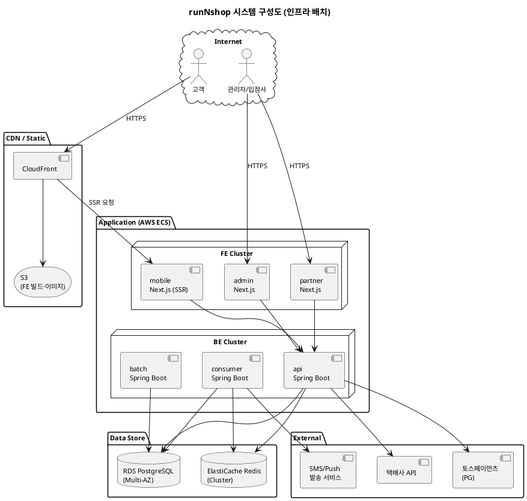

# 샘플: 시스템구성도

> **단계**: 범위정의
> **문서범위**: Project
> **문서종류**: Design

> **작성 목적**: 시스템을 "어디에 배포하는가"를 정의한다 — 서버·네트워크·데이터 저장소·외부 연동·환경 분리·스케일링.
> 컴포넌트(③)가 "코드를 어떻게 나누는가"라면, 시스템구성도는 **인프라 배치**를 다룬다.
>
> **흐름 내 위치**:
> ```
> ① 제약사항 → ② NFR → ③ 컴포넌트 → ④ 시스템구성도 → ⑤ 도메인 정의서
> ```
>
> **작성 주체**: 시니어 개발자 + AI 협업 (인프라 담당자 검토)
>
> **이 산출물이 다루는 것**: 인프라 배치 — 서버·네트워크·데이터 저장소·외부 연동·환경 분리·스케일링
> **이 산출물이 다루지 않는 것**: 소프트웨어 모듈 구조(→③ 컴포넌트), 도메인 패키지(→③ §6 보완)

---

## 1. 인프라 구성 다이어그램



---

## 2. 환경 구성

| 환경 | 용도 | 인프라 | DB | Redis | PG 연동 |
|---|---|---|---|---|---|
| **local** | 개발자 로컬 | Docker Compose | PostgreSQL (Docker) | Redis (Docker) | Mock |
| **dev** | 개발 통합 | AWS ECS (최소) | RDS (t3.micro) | ElastiCache (t3.micro) | 테스트 키 |
| **staging** | QA·통합테스트 | AWS ECS (prod 동일 구성) | RDS (운영 복제) | ElastiCache | 테스트 키 |
| **prod** | 운영 | AWS ECS (Auto Scaling) | RDS Multi-AZ | ElastiCache Cluster | 운영 키 |

---

## 3. 네트워크 구성

| 구성 요소 | 설명 |
|---|---|
| VPC | 단일 VPC, 환경별 서브넷 분리 |
| Public Subnet | CDN·LB·NAT Gateway |
| Private Subnet | ECS Tasks (FE/BE), RDS, ElastiCache |
| Security Group | BE: 8080 (from LB만), DB: 5432 (from BE만), Redis: 6379 (from BE만) |
| ALB | FE용 (443→3000), BE용 (443→8080) |

---

## 4. 데이터 저장소

| 저장소 | 용도 | 백업 | 비고 |
|---|---|---|---|
| **PostgreSQL (RDS)** | 전 도메인 영구 데이터 | 일일 자동 스냅샷, 7일 보관 | Multi-AZ (prod) |
| **Redis (ElastiCache)** | 행사 재고 선점, 세션, 카드 제한 | AOF 활성화 | 장애 시 DB fallback |
| **S3** | FE 빌드 결과, 상품 이미지, 증빙 이미지 | 버전 관리 활성화 | CloudFront 연동 |

### DB 스키마 그룹핑

| 스키마(계정) | 소속 도메인 | RDS 인스턴스 | 근거 |
|---|---|---|---|
| `rns_trade` | Order, Payment, Settlement | RDS-1 | 거래 트랜잭션 집중 — 동일 인스턴스에서 성능 확보 |
| `rns_product` | Catalog, Promotion | RDS-1 | 상품·프로모션 조회 연관성 높음 |
| `rns_user` | Member, Vendor | RDS-1 | 사용자 계정 그룹 |
| `rns_platform` | Platform | RDS-1 | 인증·정책·공통코드 — 전 도메인에서 참조 |
| `rns_support` | Notification, Community, Search, Audit | RDS-1 | 보조 도메인 통합 |

> - 프로토타입 단계: 단일 RDS 인스턴스 내 4개 스키마로 분리
> - 본개발/운영: 트래픽에 따라 스키마 단위로 RDS 인스턴스 분할 가능 (MSA 전환 대비)
> - **스키마 간 직접 JOIN 금지** — 논리적 경계는 ⑤ 도메인 정의서 §5 경계규칙 #5 참조
> - **소속 도메인은 ⑤ 도메인 정의서 확정 시 자연 보완된다** — 초기에는 예상 그룹핑으로 작성하고, 도메인 경계가 확정되면 실제 소속에 맞게 갱신

---

## 5. 외부 연동

| 외부 시스템 | 연동 방식 | 인증 | 장애 대응 |
|---|---|---|---|
| **토스페이먼츠 (PG)** | HTTPS REST | API Key + Secret | 재시도 3회 (비동기), 실패 시 운영팀 알림 |
| **택배사 API** (2곳) | HTTPS REST | API Key | 60분 주기 배치, 실패 시 다음 배치에서 재시도 |
| **SMS/Push 발송** | HTTPS REST | API Key | 실패 시 재시도 큐 |

---

## 6. 스케일링 전략

| 대상 | 전략 | 기준 | 범위 |
|---|---|---|---|
| BE API | Auto Scaling | CPU 70% 초과 | min 2 → max 10 |
| BE Consumer | Auto Scaling | 이벤트 큐 지연 | min 1 → max 5 |
| FE Mobile (SSR) | Auto Scaling | 요청 수 | min 2 → max 8 |
| FE Admin/Partner | 고정 | — | 1~2 (내부 사용) |
| DB | 수직 확장 | — | 필요 시 인스턴스 업그레이드 |
| Redis | Cluster 모드 | — | 샤딩 (행사 상품 트래픽 대비) |

---

## 근거

| 항목 | 출처 |
|---|---|
| NFR (성능·가용성 목표) | ② NFR 산출물 |
| 제약사항 (인프라) | ① 제약사항 |
| 외부 연동 | CONS-004(PG), CONS-008(택배사) |
| 컴포넌트 (앱 목록) | ③ 컴포넌트 |
