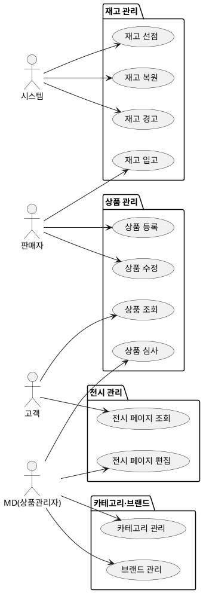

# 샘플: 상위 유스케이스 — Catalog

> **단계**: 구조설계
> **문서범위**: Domain
> **문서종류**: Design

> **작성 목적**: 도메인 정의서(⑤)의 책임 목록을 "누가(액터) 무엇을(업무) 하는가" 단위로 분해한다.
> 이 산출물은 메뉴구조도(⑦)의 직접 입력이자 EARS(⑧)의 후보 목록이 된다.
>
> **흐름 내 위치**:
> ```
> ⑤ 도메인 정의서 → ⑥ 상위 유스케이스 → ⑦ 메뉴구조도 → ⑧ EARS
> ```
>
> **작성 주체**: 시니어 개발자 + AI 협업 (기획자·현업 검토·확인)

---

## ① 액터 정의

> **목적**: 이 도메인의 유스케이스를 "누가" 수행하는지 식별한다.
> **도출 방법**: 도메인 정의서 §4(도메인 간 관계)에서 호출 주체를 추출하고, 컴포넌트(③) 앱 구성에서 채널을 매핑한다.

| 액터 | 설명 | 채널 |
|---|---|---|
| 고객 | 상품 조회·검색·찜하기 수행 | M(Mobile) |
| 판매자 | 상품 등록·수정·재고 관리 | P(Partner) |
| MD(상품관리자) | 상품 심사·카테고리·브랜드·전시 관리 | A(Admin) |
| 시스템 | Order 도메인 재고선점/복원 이벤트, 배치(재고 동기화) | C(Consumer)/B(Batch) |

---

## ② 업무그룹별 유스케이스

### 상품 관리
| 유스케이스 | 액터 | 도출 근거 |
|---|---|---|
| 상품 등록 (기본정보·옵션·이미지) | 판매자 | 도메인정의서 "상품 CRUD" 책임 |
| 상품 수정 / 판매중지 / 삭제 | 판매자 | 도메인정의서 "상품 CRUD" + 정책서: 수정 시 재심사 |
| 상품 심사 (승인/반려) | MD | 정책서: 입점 상품 승인 절차 |
| 상품 상세 조회 | 고객 | 도메인정의서 "상품 정보 관리" + SEO 요구 |
| 상품 목록 조회 (카테고리·검색·필터) | 고객 | 도메인정의서 "전시 관리" |

### 재고 관리
| 유스케이스 | 액터 | 도출 근거 |
|---|---|---|
| 재고 입고 (수량 증가) | 판매자 | 도메인정의서 "재고 관리" 책임 |
| 재고 선점 (주문 시) | 시스템(Order 연동) | 도메인정의서 §4: Order→Catalog 동기 호출 |
| 재고 복원 (취소·클레임 시) | 시스템(Order 연동) | 도메인정의서 §4: Order→Catalog 비동기 이벤트 |
| 재고 현황 조회 | 판매자 / MD | 도메인정의서 "재고 관리" |
| 재고 경고 알림 (안전재고 이하) | 시스템(배치) | 정책서: 안전재고 기준 → Notification 도메인 |

### 카테고리·브랜드
| 유스케이스 | 액터 | 도출 근거 |
|---|---|---|
| 표준 카테고리 CRUD (3depth) | MD | 도메인정의서 "상품 분류 체계" |
| 전시 카테고리 매핑 | MD | 정책서: 표준→전시 N:M 매핑 |
| 브랜드 CRUD | MD | 도메인정의서 "브랜드 관리" |
| 카테고리별 상품 목록 조회 | 고객 | 도메인정의서 "전시 관리" |

### 전시 관리
| 유스케이스 | 액터 | 도출 근거 |
|---|---|---|
| 전시 페이지 생성/편집/게시 | MD | 도메인정의서 "전시 관리" 책임 |
| 전시 섹션 구성 (상품 큐레이션) | MD | 정책서: 메인·기획전 구성 |
| 전시 템플릿 관리 | MD | 인터뷰: 재사용 레이아웃 필요 |
| 전시 페이지 조회 | 고객 | 도메인정의서 "전시 관리" — 메인 홈 |

---

## ③ 액터-유스케이스 관계도



---

## ④ 권한 범위

| 규칙 | 비고 |
|---|---|
| 판매자는 자기 매장(vendorId) 소속 상품만 등록·수정·재고 관리 가능 | |
| MD는 전체 상품에 대해 심사·카테고리·전시 권한 보유 | |
| 고객은 판매중(ACTIVE) 상태 상품만 조회 가능 | 판매중지·심사중 상품 비노출 |
| 재고 선점/복원은 Order 도메인만 호출 가능 (PublicApi 제한) | |

---

## Platform Bolt 예외

이 문서는 Domain(Catalog) 스코프 — 앱 셸·메뉴 접근·공통 UI는 메뉴구조도(⑦)에서 다룬다.
