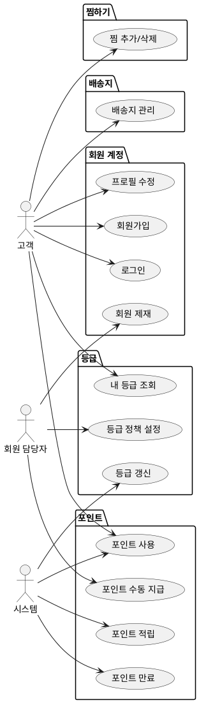

# 샘플: 상위 유스케이스 — Member

> **단계**: 구조설계
> **문서범위**: Domain
> **문서종류**: Design

> **작성 목적**: 도메인 정의서(⑤)의 책임 목록을 "누가(액터) 무엇을(업무) 하는가" 단위로 분해한다.
> 이 산출물은 메뉴구조도(⑦)의 직접 입력이자 EARS(⑧)의 후보 목록이 된다.
>
> **흐름 내 위치**:
> ```
> ⑤ 도메인 정의서 → ⑥ 상위 유스케이스 → ⑦ 메뉴구조도 → ⑧ EARS
> ```
>
> **작성 주체**: 시니어 개발자 + AI 협업 (기획자·현업 검토·확인)

---

## ① 액터 정의

> **목적**: 이 도메인의 유스케이스를 "누가" 수행하는지 식별한다.
> **도출 방법**: 도메인 정의서 §4(도메인 간 관계)에서 호출 주체를 추출하고, 컴포넌트(③) 앱 구성에서 채널을 매핑한다.

| 액터 | 설명 | 채널 |
|---|---|---|
| 고객 | 회원가입·로그인·프로필 관리·포인트 사용 | M(Mobile) |
| 회원 담당자 | 등급 정책·포인트 정책·회원 조회·제재 | A(Admin) |
| 시스템 | 등급 갱신 배치, 포인트 적립/차감 이벤트(Order 연동), 포인트 만료 배치 | C(Consumer)/B(Batch) |

---

## ② 업무그룹별 유스케이스

### 회원 계정
| 유스케이스 | 액터 | 비고 |
|---|---|---|
| 회원가입 (이메일/소셜) | 고객 | 프로토타입: 항상 성공 |
| 로그인 / 로그아웃 | 고객 | Bearer {userId} |
| 프로필 수정 (이름·연락처) | 고객 | 개인정보 마스킹 적용 |
| 비밀번호 변경 | 고객 | |
| 회원 탈퇴 | 고객 | 30일 유예 후 삭제 |
| 회원 목록 조회 / 상세 조회 | 회원 담당자 | 마스킹된 정보 노출 |
| 회원 제재 (정지/해제) | 회원 담당자 | |

### 등급
| 유스케이스 | 액터 | 비고 |
|---|---|---|
| 등급 정책 설정 (기준·혜택) | 회원 담당자 | 예: 구매금액 기준 4단계 |
| 등급 갱신 (월정산) | 시스템(배치) | 구매확정 실적 기반 자동 산정 |
| 내 등급 조회 | 고객 | 현재 등급·다음 등급 조건 |

### 포인트
| 유스케이스 | 액터 | 비고 |
|---|---|---|
| 포인트 적립 (구매확정 시) | 시스템(Order 이벤트) | 등급별 적립률 적용 |
| 포인트 사용 (주문 시 차감) | 고객 / 시스템(Order 연동) | 동기 — 잔액 확인 + 차감 |
| 포인트 복원 (취소·클레임 시) | 시스템(Order 이벤트) | 비동기 |
| 포인트 만료 처리 | 시스템(배치) | 12개월 미사용 포인트 소멸 |
| 포인트 내역 조회 | 고객 | 적립·사용·만료 이력 |
| 포인트 수동 지급/차감 | 회원 담당자 | CS 보상 등 |

### 배송지
| 유스케이스 | 액터 | 비고 |
|---|---|---|
| 배송지 등록 / 수정 / 삭제 | 고객 | 최대 10개 |
| 기본 배송지 설정 | 고객 | 주문서 자동 선택 |
| 배송지 목록 조회 | 고객 / 시스템(Order 연동) | Order에서 주문서 생성 시 조회 |

### 찜하기 (위시리스트)
| 유스케이스 | 액터 | 비고 |
|---|---|---|
| 찜하기 추가 / 삭제 | 고객 | 데이터 소유: Member 도메인 |
| 찜 목록 조회 | 고객 | 상품 정보는 Catalog PublicApi 조회 |

---

## ③ 액터-유스케이스 관계도



---

## ④ 권한 범위

| 규칙 | 비고 |
|---|---|
| 고객은 본인 계정 정보만 조회·수정 가능 | `memberId == 로그인 사용자` |
| 회원 담당자는 전체 회원 조회 가능 (마스킹 적용) | 홍*동, 010-****-5678 |
| 포인트 사용은 본인 잔액 내에서만 가능 | Order 연동 시 잔액 검증 |
| 포인트 수동 지급/차감은 회원 담당자만 가능 | 사유 필수 입력 |
| 배송지는 고객당 최대 10개 제한 | |
| 찜하기 데이터 소유권은 Member 도메인 | 상품 정보 조회는 Catalog PublicApi |

---

## Order 도메인 연동 포인트

| 연동 | 방식 | 트리거 |
|---|---|---|
| 포인트 잔액 확인 + 차감 | 동기 (PublicApi) | 주문서 제출 시 |
| 포인트 복원 | 비동기 (이벤트) | 취소·클레임 완료 시 |
| 포인트 적립 | 비동기 (이벤트) | 구매확정 시 |
| 배송지 목록 조회 | 동기 (PublicApi) | 주문서 생성 시 |
