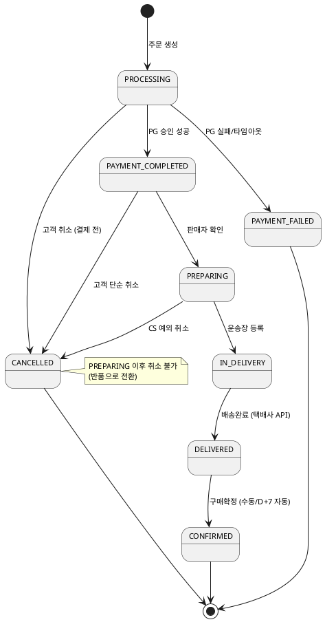

# 샘플: 상태머신

> **단계**: 구조설계
> **문서범위**: Domain
> **문서종류**: Design
>
> **작성 목적**: ERD(⑨)의 status 컬럼에서 허용 상태와 전이 규칙을 정의한다.
> "어떤 상태에서 어떤 상태로, 누가, 어떤 조건에서 전이할 수 있는가"를 확정하여
> Bolt 분할의 근거이자 비즈니스 프로세스(⑪)의 입력이 된다.
>
> **흐름 내 위치**:
> ```
> ⑨ ERD (status 컬럼) → ⑩ 상태머신 → ⑪ 비즈니스 프로세스 → ⑫ 이벤트 플로우 → Bolt 분할
> ```
>
> **작성 주체**: 시니어 개발자 + AI 협업 (기획자·현업 검토·확인)

---

## 작성 규칙

| 규칙 | 설명 |
|---|---|
| 1 상태 = 1 비즈니스 의미 | "PROCESSING"처럼 모호한 상태는 분리 검토 |
| 전이에는 트리거·가드·액션 명시 | 트리거(이벤트), 가드(조건), 액션(부수효과) |
| 금지 전이 명시 | "CONFIRMED → CANCELLED는 불가" |
| PlantUML statechart 사용 | 시각화 + 코드 검증 가능 |

---

## 샘플: Order 도메인 — ord_order.status

### 상태 목록

| 상태 | 설명 | 진입 조건 |
|---|---|---|
| PROCESSING | 결제 요청 중 | 주문 생성 시 |
| PAYMENT_COMPLETED | 결제 완료 | PG 승인 성공 |
| PREPARING | 출고 준비 중 | 판매자 확인 |
| IN_DELIVERY | 배송 중 | 운송장 등록 |
| DELIVERED | 배송 완료 | 택배사 배송완료 |
| CONFIRMED | 구매 확정 | 고객 확인 or D+7 자동 |
| CANCELLED | 취소 | 고객 취소 or CS 예외 취소 |
| PAYMENT_FAILED | 결제 실패 | PG 실패/타임아웃 |

### 전이 다이어그램



### 전이 규칙 상세

| From | To | 트리거 | 가드 (조건) | 액션 (부수효과) |
|---|---|---|---|---|
| PROCESSING | PAYMENT_COMPLETED | PG 승인 이벤트 | 금액 일치 | 재고 선점 확정 |
| PROCESSING | PAYMENT_FAILED | PG 실패 이벤트 | — | 재고 복원 |
| PAYMENT_COMPLETED | CANCELLED | 고객 취소 요청 | 출고 전 | PG 환불 요청, 재고 복원 |
| DELIVERED | CONFIRMED | D+7 배치 or 고객 수동 | — | 정산 대상 등록, 포인트 적립 이벤트 |

### 금지 전이

| From | To | 사유 |
|---|---|---|
| CONFIRMED | CANCELLED | 구매확정 후 취소 불가 (클레임으로 전환) |
| IN_DELIVERY | CANCELLED | 배송 중 취소 불가 (반품 신청 안내) |
| PAYMENT_FAILED | 어떤 상태든 | 종료 상태 (재주문 필요) |

---

## 작성 팁

| 팁 | 설명 |
|---|---|
| **status가 2개 이상이면 상태머신도 2개** | ord_order.status + ord_claim.status → 각각 별도 상태머신 |
| **"전이 1개 = Bolt 1개" 후보** | 상태 전이가 Bolt 분할의 자연스러운 단위 |
| **금지 전이가 더 중요** | 허용 전이보다 "못 하는 것"이 버그 방지에 핵심 |
| **타이머 전이 명시** | D+7 자동확정처럼 시간 기반 전이는 배치/스케줄러 구현 필요 |

---

## 근거

| 항목 | 출처 |
|---|---|
| 상태 목록 | ERD(⑨) ord_order.status note |
| 전이 규칙 | EARS(⑧) Event-driven/Unwanted 패턴 |
| 금지 전이 | 정책서 취소·반품 정책 |
| 자동 구매확정 | 정책서 4.7: 배송완료 후 7일 |
