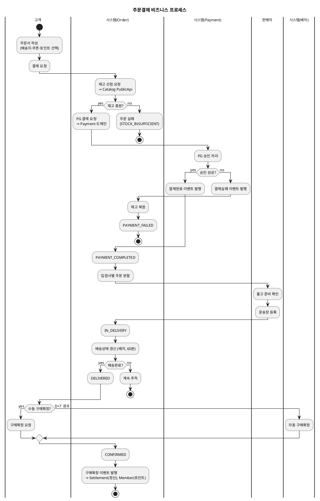

# 샘플: 비즈니스 프로세스

> **단계**: 구조설계
> **문서범위**: Domain
> **문서종류**: Design
>
> **작성 목적**: 상태머신(⑩)의 전이를 액티비티 흐름으로 확장하여,
> "누가 어떤 순서로 업무를 수행하는가"를 시각화한다.
> 상태머신이 "전이 규칙"이라면, 비즈니스 프로세스는 "전이를 포함한 업무 전체 흐름"이다.
>
> **흐름 내 위치**:
> ```
> ⑩ 상태머신 → ⑪ 비즈니스 프로세스 → ⑫ 이벤트 플로우
> ```
>
> **작성 주체**: 시니어 개발자 + AI 협업 (기획자·현업 검토·확인)

---

## 도출 방법

| 입력 | 변환 |
|---|---|
| 상태머신(⑩) 전이 1개 | → 프로세스 내 1 액티비티 |
| 상태머신(⑩) 가드 조건 | → 분기(Diamond) |
| 상위UC(⑥) 액터 | → 스윔레인 |
| 정책서 업무 규칙 | → 판단 조건·예외 흐름 |

---

## 샘플: 주문결제 프로세스 (Order 도메인)



---

## 작성 팁

| 팁 | 설명 |
|---|---|
| **스윔레인 = 액터** | 상위UC 액터를 그대로 사용 |
| **상태 전이마다 노드 표시** | 상태머신의 전이가 프로세스의 액티비티와 1:1 대응 |
| **도메인 경계 표시** | "→ Catalog PublicApi" 처럼 외부 호출을 명시 |
| **예외 흐름 포함** | 정상만 그리면 안 됨 — 실패·타임아웃 흐름 필수 |
| **이벤트 발행 표시** | 이벤트 플로우(⑫)의 입력이 됨 |

---

## 근거

| 항목 | 출처 |
|---|---|
| 상태 전이 | 상태머신(⑩) Order |
| 액터·업무 흐름 | 상위 유스케이스(⑥) 주문결제·연동 |
| 도메인 간 호출 | 도메인정의서(⑤) §4 관계도 |
| 업무 규칙 | 정책서 (D+7 자동확정, 재고선점 등) |
