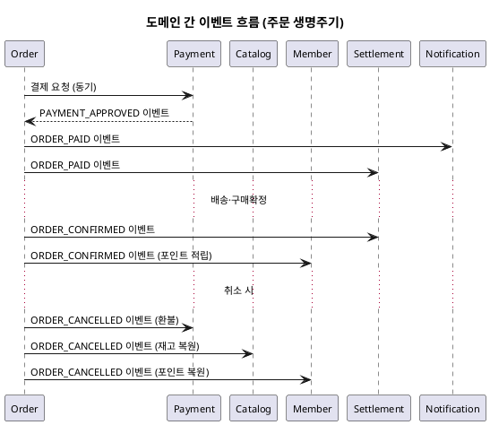

# 샘플: 이벤트 플로우

> **단계**: 구조설계
> **문서범위**: Domain 간
> **문서종류**: Design
>
> **작성 목적**: 도메인 간 비동기 이벤트 계약을 정의한다.
> "누가 어떤 이벤트를 발행하고, 누가 수신하여 무엇을 하는가"를 확정한다.
> 비즈니스 프로세스(⑪)에서 식별된 이벤트 발행 지점을 체계화한 것이다.
>
> **흐름 내 위치**:
> ```
> ⑪ 비즈니스 프로세스 → ⑫ 이벤트 플로우 → Bolt 분할
> ```
>
> **작성 주체**: 시니어 개발자 + AI 협업 (아키텍트 검토)

---

## 이벤트 카탈로그

| 이벤트명 | 발행 도메인 | 수신 도메인 | 트리거 | 수신 액션 |
|---|---|---|---|---|
| ORDER_PAID | Order | Settlement, Notification | 결제완료(PAYMENT_COMPLETED) | 정산 대기 등록, 주문확인 알림 |
| ORDER_CONFIRMED | Order | Settlement, Member | 구매확정(CONFIRMED) | 정산 확정, 포인트 적립 |
| ORDER_CANCELLED | Order | Payment, Catalog, Member | 주문 취소 | PG 환불, 재고 복원, 포인트 복원 |
| PAYMENT_APPROVED | Payment | Order | PG 승인 성공 | 주문 상태 → PAYMENT_COMPLETED |
| PAYMENT_FAILED | Payment | Order | PG 실패/타임아웃 | 재고 복원, 주문 → PAYMENT_FAILED |
| STOCK_RESTORED | Catalog | — | 재고 복원 완료 | (로그 기록) |
| CLAIM_COMPLETED | Order | Payment, Catalog, Member | 클레임 완료 | 부분환불, 재고복원, 포인트복원 |

---

## 이벤트 스키마 (예: ORDER_CONFIRMED)

```json
{
  "eventType": "ORDER_CONFIRMED",
  "eventId": "evt-ulid-001",
  "timestamp": "2026-08-01T10:00:00Z",
  "payload": {
    "orderId": "ord-ulid-001",
    "platformOrderId": "pord-ulid-001",
    "memberId": "mem-001",
    "vendorId": "vnd-001",
    "totalAmount": 35000,
    "items": [
      { "productId": "prod-001", "skuId": "sku-001", "quantity": 2, "amount": 35000 }
    ]
  }
}
```

---

## 이벤트 흐름 다이어그램



---

## 작성 규칙

| 규칙 | 설명 |
|---|---|
| Outbox 패턴 | 이벤트는 AFTER_COMMIT으로 발행 (트랜잭션 완료 후) |
| 멱등 보장 | 수신 측은 eventId로 중복 처리 방지 |
| 이벤트 스키마 버전 | 필드 추가는 허용, 삭제는 금지 (하위 호환) |
| 발행자는 수신자를 모름 | 이벤트 발행 시 수신 도메인을 하드코딩하지 않음 |

---

## 작성 팁

| 팁 | 설명 |
|---|---|
| **비즈니스 프로세스에서 "→" 표시된 것** | 이벤트 플로우의 후보 |
| **동기 vs 비동기 판단** | 즉시 응답 필요 → 동기 PublicApi, 후속 처리 → 비동기 이벤트 |
| **수신 액션이 실패하면?** | 재시도 정책 명시 (최대 3회, DLQ 등) |
| **통합테스트 시 현행화 대상** | 실제 구독 검증 후 누락·변경 반영 |

---

## 근거

| 항목 | 출처 |
|---|---|
| 이벤트 목록 | 비즈니스 프로세스(⑪) 이벤트 발행 지점 |
| 발행/수신 관계 | 도메인정의서(⑤) §4 도메인 간 관계 |
| Outbox 패턴 | 컴포넌트(③) §6 경계 규칙 #2 |
| 이벤트 스키마 | EARS(⑧) + 도메인 간 계약 합의 |
