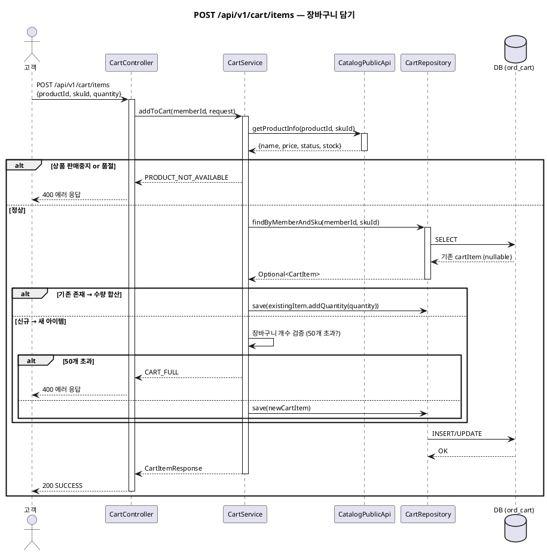

# 샘플: 시퀀스

> **단계**: 상세설계
> **문서범위**: Bolt
> **문서종류**: Design
>
> **작성 목적**: 인터페이스 명세(⑮)의 API를 호출 순서·참여 객체·트랜잭션 경계로 구체화한다.
> "이 API가 호출되면 내부에서 어떤 순서로 어떤 객체가 상호작용하는가"를 확정한다.
>
> **흐름 내 위치**:
> ```
> ⑮ 인터페이스 명세 → ⑯ 시퀀스 → ⑰ 화면 레이아웃 / ⑲ 클래스 설계
> ```
>
> **작성 주체**: 시니어 개발자 + AI 협업

---

## 샘플: 장바구니 담기 시퀀스



---

## 작성 규칙

| 규칙 | 설명 |
|---|---|
| 1 시퀀스 = 1 API endpoint | 인터페이스 명세의 endpoint와 1:1 |
| 참여자 = 클래스 후보 | Controller, Service, Repository, PublicApi |
| 트랜잭션 경계 표시 | `@Transactional` 시작/끝 명시 |
| 에러 분기 포함 | 인터페이스 명세의 에러 응답과 대응 |
| 도메인 경계 명시 | 타 도메인 호출은 PublicApi로 표현 |

---

## 작성 팁

| 팁 | 설명 |
|---|---|
| **참여 객체 = 클래스 설계(⑲) 입력** | 시퀀스에 등장한 객체가 클래스로 전환됨 |
| **alt 분기 = GWT 시나리오** | GWT의 정상/예외가 시퀀스의 alt와 대응 |
| **PublicApi 호출 = 도메인 경계** | 인터페이스 넘어가는 호출은 반드시 PublicApi 참여자로 |
| **DB 접근은 Repository 경유** | 직접 DB 접근 금지 (계층 분리) |

---

## 근거

| 항목 | 출처 |
|---|---|
| API endpoint | 인터페이스 명세(⑮) |
| 에러 분기 | GWT(⑬) 예외 시나리오 |
| 도메인 간 호출 | 이벤트 플로우(⑫) + 컴포넌트(③) 경계 규칙 |
| 참여 객체 | ERD(⑨) 엔티티 + 컴포넌트(③) 모듈 구조 |
