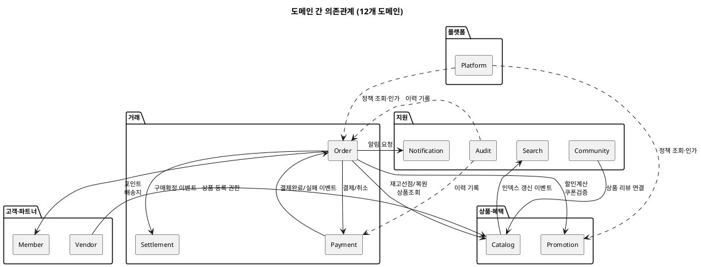

# 샘플: 도메인 정의서

> **단계**: 범위정의
> **문서범위**: Project
> **문서종류**: Design

> **작성 목적**: 도메인 경계를 확정한다 — "어떤 도메인이 있고, 각각 뭘 책임지며, 서로 어떻게 연결되는가".
> 이 산출물이 확정되면 컴포넌트 §6(도메인 모듈 구조)을 보완하고,
> 상위 유스케이스(⑥)·메뉴구조도(⑦)·EARS(⑧) 작성이 가능해진다.
>
> **흐름 내 위치**:
> ```
> ③ 컴포넌트 → ④ 시스템구성도 → ⑤ 도메인 정의서 → ⑥ 상위 유스케이스
> ```
>
> **작성 주체**: 시니어 개발자 + AI 협업 (기획자·현업 검토·확인)
>
> **이 산출물이 다루는 것**: 도메인 경계 — 도메인 목록·책임·소유 데이터·관계·경계 규칙
> **이 산출물이 다루지 않는 것**: 도메인 내부 데이터 구조(→⑨ ERD), 상태 전이(→⑩ 상태머신), 이벤트 상세(→⑫ 이벤트플로우)

---

## 필수 항목 (표준 양식)

| # | 항목 | 설명 | 작성 원천 |
|---|---|---|---|
| 1 | 도메인 목록 | 몇 개 도메인으로 나눌 것인가 | 정책서 챕터 구조, 업무 분류 |
| 2 | 도메인별 책임 | 각 도메인이 뭘 하는가 / 뭘 하지 않는가 | 정책서 업무 설명, 이해관계자 인터뷰 |
| 3 | 소유 데이터 | 각 도메인이 어떤 데이터를 소유하는가 | 업무 분석, 기존 시스템 ERD |
| 4 | 도메인 간 관계 | 누가 누구를 호출/참조하는가 | 업무 흐름 분석 |
| 5 | 경계 규칙 | 도메인 간 직접 접근 금지 등 | 아키텍처 결정 (ADR 후보) |

---

## 1. 도메인 목록

| # | 도메인 | 핵심 책임 | 업무그룹 |
|---|---|---|---|
| 1 | Order | 주문·배송·클레임 생명주기 오케스트레이션 | 거래 |
| 2 | Payment | 결제 트랜잭션 처리 (PG 연동·환불) | 거래 |
| 3 | Settlement | 정산 집계·지급 | 거래 |
| 4 | Catalog | 상품 정보·재고·전시 관리 | 상품 |
| 5 | Promotion | 쿠폰·행사가·수량할인·장바구니할인 관리 | 상품 |
| 6 | Member | 회원 계정·등급·포인트·배송지 관리 | 고객 |
| 7 | Vendor | 입점사 계약·스토어·정책 관리 | 고객 |
| 8 | Platform | 인증·인가·세션·앱 셸·운영정책·공통코드·약관 | 플랫폼 |
| 9 | Notification | 알림 발송 (SMS·Push·이메일) | 지원 |
| 10 | Community | 리뷰·Q&A·신고 | 지원 |
| 11 | Search | 검색 인덱스·자동완성 | 지원 |
| 12 | Audit | 감사 로그·이력 추적 | 지원 |

> **업무그룹**은 §5 스키마 그룹핑의 기본 단위가 된다. 동일 업무그룹 내 도메인은 하나의 DB 스키마로 묶는 것을 기본으로 하되, 트래픽 패턴에 따라 조정한다.

---

## 2. 도메인별 책임

### Order

| 항목 | 내용 |
|---|---|
| **하는 것** | 주문 생성·상태 관리, 환불금 계산, 클레임 접수, 배송 처리, 구매확정, 추가배송비 요청 |
| **하지 않는 것** | 재고 직접 관리(→Catalog), 결제 처리(→Payment), 포인트·쿠폰 차감(→Member/Promotion), 알림(→Notification) |

### Catalog

| 항목 | 내용 |
|---|---|
| **하는 것** | 상품 CRUD, SKU·옵션 관리, 재고 증감(입고·선점·복원), 카테고리·브랜드, 전시 페이지 구성 |
| **하지 않는 것** | 주문 흐름(→Order), 할인 정책(→Promotion), 검색 인덱싱(→Search), 입점사 계약(→Vendor) |

### Payment

| 항목 | 내용 |
|---|---|
| **하는 것** | PG 결제 승인·취소·환불 처리, 결제 상태 관리, 카드 제한 검증, 결제 재시도 |
| **하지 않는 것** | 주문 상태 변경(→Order), 포인트 차감(→Member), 정산 집계(→Settlement) |

> 나머지 9개 도메인도 동일 형식("하는 것 / 하지 않는 것")으로 작성.

---

## 3. 소유 데이터

| 도메인 | 주요 엔티티 | 테이블 접두사 | DB 스키마 |
|---|---|---|---|
| Order | Order, OrderItem, Delivery, Claim, Cart | `ord_` | rns_trade |
| Payment | Payment, PaymentLog, CardRestriction | `pay_` | rns_trade |
| Settlement | SettlementBatch, SettlementItem | `stl_` | rns_trade |
| Catalog | Product, SKU, Category, Brand, StockHistory | `cat_` | rns_product |
| Promotion | Coupon, EventPrice, CartDiscount | `prm_` | rns_product |
| Member | Member, Grade, Point, Address | `mem_` | rns_user |
| Vendor | Vendor, Store, Contract | `vnd_` | rns_user |
| Notification | NotificationLog, Template | `ntf_` | rns_support |
| Community | Review, QnA, Report | `cmt_` | rns_support |
| Search | SearchIndex, Synonym | `sch_` | rns_support |
| Platform | Policy, CommonCode, Terms, AuthToken, Role, Permission | `plf_` | rns_platform |
| Audit | AuditLog, ChangeHistory | `aud_` | rns_support |

> - 접두사 규칙: 도메인 약어 3글자 + `_` → 타 도메인 테이블과 구분
> - DB 스키마 그룹핑 근거: 트랜잭션 응집도 + 데이터 조회 패턴. 상세는 ④ 시스템구성도 §4 참조

---

## 4. 도메인 간 관계



### 통신 방식

| 호출 유형 | 방식 | 사용 조건 |
|---|---|---|
| **동기** | PublicApi 인터페이스 호출 (in-process) | 즉시 응답 필요 (재고 선점, 포인트 확인) |
| **비동기** | Outbox + Event Consumer | 후속 처리 (알림, 정산, 복원) |

---

## 5. 경계 규칙

| # | 규칙 | 설명 |
|---|---|---|
| 1 | 데이터 소유권 | 타 도메인이 직접 SQL 접근 금지 → PublicApi 경유 |
| 2 | Outbox 패턴 | 비동기 이벤트는 AFTER_COMMIT 발행 |
| 3 | 인터페이스 분리 | 도메인 간 import는 PublicApi 인터페이스만 허용 |
| 4 | MSA 전환 대비 | 도메인 = 독립 서비스로 추출 가능한 경계 유지 |
| 5 | DB 스키마 그룹핑 | 트랜잭션 응집도·데이터 조회 패턴이 유사한 도메인을 하나의 스키마로 묶되, 스키마 간 직접 JOIN 금지. 물리 배치는 ④ 시스템구성도에서 정의 |

### 스키마 그룹핑 논리적 기준

| 기준 | 설명 | 예시 |
|---|---|---|
| **트랜잭션 응집도** | 하나의 비즈니스 트랜잭션에서 함께 쓰이는 도메인 | Order+Payment+Settlement (주문→결제→정산) |
| **데이터 조회 패턴** | 조회 시 함께 참조되는 빈도가 높은 도메인 | Catalog+Promotion (상품 목록에 할인가 함께 노출) |
| **사용자 유형** | 동일 사용자 계정 기반으로 관리되는 도메인 | Member+Vendor (계정·프로필 관련) |
| **독립성** | 나머지에 속하지 않는 보조 도메인 통합 | Notification+Community+Search+Audit |
| **플랫폼 공통** | 인증·인가·정책처럼 전 도메인에서 참조하는 공통 기반 | Platform (독립 스키마) |

---

## 작성 팁

| 팁 | 설명 |
|---|---|
| **"하지 않는 것"이 더 중요** | 경계를 명확히 하려면 "이 도메인이 뭘 안 하는가"를 반드시 적어야 오해 방지 |
| **1 도메인 = 1 핵심 책임** | 2개 이상이면 분리 검토 |
| **의존 방향 주의** | 화살표가 양방향이면 순환 의존 — 비동기 이벤트로 끊기 |
| **참고자료 있으면 빠름** | 정책서·기존 ERD·업무 매뉴얼이 있으면 도메인 도출 속도 향상 |
| **소유 데이터 판단: "누가 생성하는가"** | 조회는 여러 도메인이 하지만 INSERT 주체가 소유자. 모호하면 경계가 흐려진다 |
| **경계는 의심스러우면 분리** | 합치는 건 쉽지만 분리는 어렵다. 초기에 보수적으로 나누는 편이 안전 |
| **동기 호출은 최소화** | 동기 호출이 많으면 장애 전파·순환 의존 발생. "정말 즉시 응답이 필요한가?" 먼저 자문 |

---

## 근거

| 항목 | 출처 |
|---|---|
| DDD Bounded Context 개념 | Eric Evans, Domain-Driven Design |
| 이 프로젝트 실제 적용 | `docs/자산화/참고자료/도메인정의서.md` |
| 설계 원칙 | `runNshop_modular_monolith_v1_0.md` |
