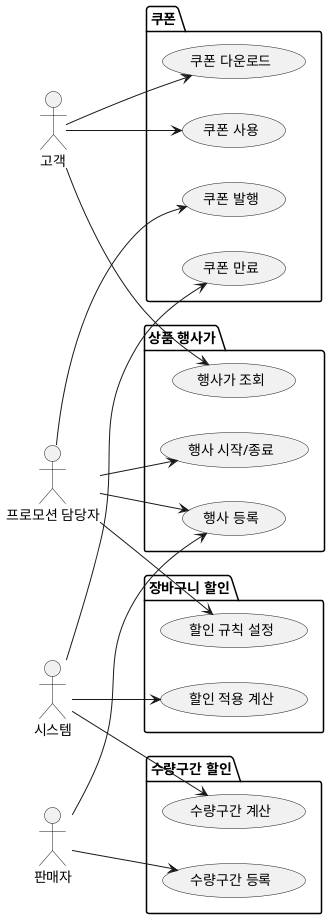

# 샘플: 상위 유스케이스 — Promotion

> **단계**: 구조설계
> **문서범위**: Domain
> **문서종류**: Design

> **작성 목적**: 도메인 정의서(⑤)의 책임 목록을 "누가(액터) 무엇을(업무) 하는가" 단위로 분해한다.
> 이 산출물은 메뉴구조도(⑦)의 직접 입력이자 EARS(⑧)의 후보 목록이 된다.
>
> **흐름 내 위치**:
> ```
> ⑤ 도메인 정의서 → ⑥ 상위 유스케이스 → ⑦ 메뉴구조도 → ⑧ EARS
> ```
>
> **작성 주체**: 시니어 개발자 + AI 협업 (기획자·현업 검토·확인)

---

## ① 액터 정의

> **목적**: 이 도메인의 유스케이스를 "누가" 수행하는지 식별한다.
> **도출 방법**: 도메인 정의서 §4(도메인 간 관계)에서 호출 주체를 추출하고, 컴포넌트(③) 앱 구성에서 채널을 매핑한다.

| 액터 | 설명 | 채널 |
|---|---|---|
| 고객 | 쿠폰 수령·사용, 할인 혜택 확인 | M(Mobile) |
| 판매자 | 상품 행사가·수량할인 등록 (상품 단위) | P(Partner) |
| 프로모션 담당자 | 쿠폰 발행·장바구니 할인 설정 (플랫폼 단위) | A(Admin) |
| 시스템 | 할인 계산 요청(Order 연동), 만료 배치 | C(Consumer)/B(Batch) |

---

## ② 업무그룹별 유스케이스

### 상품 행사가 (즉시할인)
| 유스케이스 | 액터 | 도출 근거 |
|---|---|---|
| 행사 등록 (기간·할인율·대상 상품) | 판매자 / 프로모션 담당자 | 도메인정의서 "행사가 관리" 책임 |
| 행사 시작/종료 관리 | 프로모션 담당자 | 정책서: Admin에서 적용시작·종료 제어 |
| 행사가 적용 조회 (상품 목록·상세) | 고객 | 도메인정의서 "할인 관리" — 원가 대비 할인가 노출 |
| 행사 중복등록 방지 검증 | 시스템 | 정책서: 즉시할인 ↔ 수량구간 택1 |

### 수량구간 할인
| 유스케이스 | 액터 | 도출 근거 |
|---|---|---|
| 수량구간 할인 등록 (구간별 할인율) | 판매자 | 도메인정의서 "수량할인 관리" |
| 수량구간 적용 계산 | 시스템(Order 연동) | 도메인정의서 §4: Order→Promotion 동기 호출 |
| 즉시할인과 중복 방지 검증 | 시스템 | 정책서: 동일 상품 택1 규칙 |

### 쿠폰
| 유스케이스 | 액터 | 도출 근거 |
|---|---|---|
| 쿠폰 발행 (유형·조건·기간·수량) | 프로모션 담당자 | 도메인정의서 "쿠폰 관리" 책임 |
| 쿠폰 다운로드 (수령) | 고객 | 인터뷰: 고객이 직접 쿠폰 수령 |
| 쿠폰 사용 (주문 시 적용) | 고객 | 도메인정의서 §4: Order→Promotion 쿠폰 검증 |
| 쿠폰 만료 처리 | 시스템(배치) | 정책서: 유효기간 만료 정책 |
| 쿠폰함 조회 | 고객 | 인터뷰: 마이페이지 쿠폰 목록 |

### 장바구니 할인 (플랫폼 단위)
| 유스케이스 | 액터 | 도출 근거 |
|---|---|---|
| 장바구니 할인 규칙 설정 (조건·할인액) | 프로모션 담당자 | 도메인정의서 "장바구니할인 관리" + 요구사항: **벤더 불가, 플랫폼 단위만** |
| 장바구니 할인 적용 계산 | 시스템(Order 연동) | 도메인정의서 §4: Order→Promotion 동기 호출 (총액 기준) |
| 장바구니 할인 혜택 조회 | 고객 | 인터뷰: 장바구니 화면에 혜택 표시 |

---

## ③ 액터-유스케이스 관계도



---

## ④ 권한 범위

| 규칙 | 비고 |
|---|---|
| 판매자는 자기 상품에 대해서만 행사가·수량구간 등록 가능 | 벤더 단위 |
| 장바구니 할인은 프로모션 담당자(Admin)만 설정 가능 — **벤더 불가** | 플랫폼 단위 요구사항 |
| 쿠폰 발행은 프로모션 담당자만 가능 | |
| 고객은 본인이 수령한 쿠폰만 사용 가능 | |
| 상품 행사가 ↔ 수량구간 할인은 동일 상품에 택1 (중복등록 방지) | |
| 상품 쿠폰은 행사가·수량구간과 별도로 중복 적용 가능 | |

---

## 할인 적용 순서 (참조)

> 상세는 `참고자료/프로모션-할인유형-적용순서.md` 참조

```
① 상품 행사가 (즉시할인) — 또는 — ② 수량구간 할인 (택1)
  ↓
③ 상품 쿠폰 (중복 가능)
  ↓
④ 장바구니 할인 (플랫폼 단위, 총액 기준)
  ↓
⑤ 포인트 사용 (Member 도메인)
```
