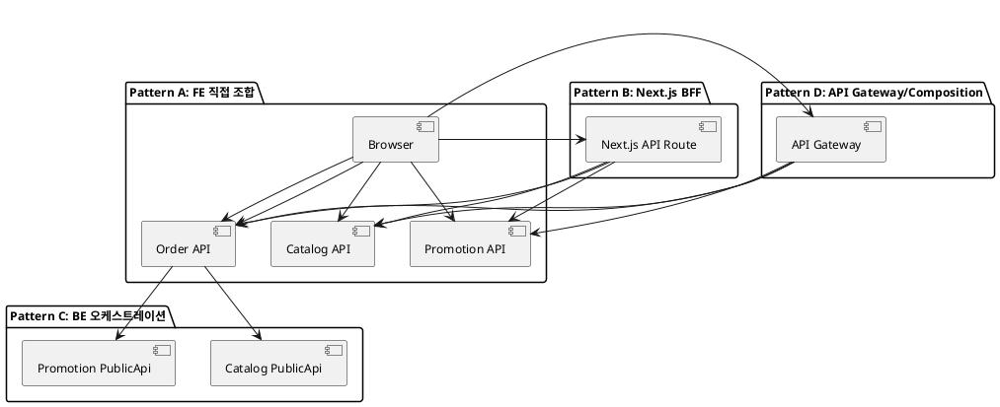
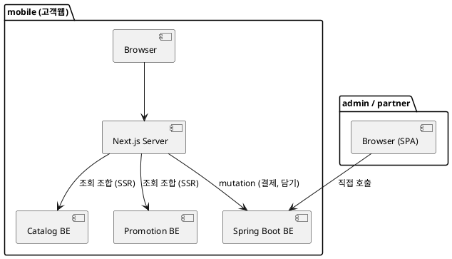

# API 오케스트레이션 위치별 비교 — 기술참조문서

| 항목 | 내용 |
|---|---|
| 문서 유형 | 기술참조 (ADR 입력자료) |
| 작성일 | 2026-07-30 |
| 적용 대상 | runNshop (Next.js FE + Spring Boot BE, Modular Monolith) |

---

## 1. 문제 정의

"장바구니 담기"처럼 하나의 사용자 액션이 여러 도메인(Order·Catalog·Promotion)의 데이터를 조합해야 할 때, **누가 어디서 오케스트레이션(호출 순서 관리·데이터 조합)을 담당하는가?**

이 결정에 따라 API의 request/response 구조, 에러 처리 방식, 성능 특성이 근본적으로 달라진다.

---

## 2. 선택지 4가지



---

## 3. 상세 비교

### Pattern A: FE 직접 조합 (Client-side Orchestration)

```
Browser → GET /catalog/products/{id}   (가격·재고)
Browser → GET /promotion/events/{id}   (행사가격)
Browser → POST /order/cart/items        (담기)
```

| 항목 | 내용 |
|---|---|
| **구조** | FE(React)가 여러 BE API를 순차/병렬 호출 후 결과 조합 |
| **장점** | BE 서비스 완전 독립, API 단순(각 도메인 자기 것만 제공), BE 변경 시 FE만 수정 |
| **단점** | 네트워크 왕복 多(latency 누적), FE 로직 복잡, 클라이언트에 비즈니스 로직 노출, 트랜잭션 일관성 보장 불가 |
| **적합** | 조합 로직 단순 + 순서 무관(병렬 가능) + 정합성 요구 낮은 경우 |
| **부적합** | 장바구니 담기처럼 "검증 → 행동"이 원자적이어야 하는 경우 |

---

### Pattern B: Next.js BFF (Backend-for-Frontend)

```
Browser → POST /api/cart/add   (Next.js API Route)
  Next.js → GET /catalog/products/{id}
  Next.js → GET /promotion/events/{id}
  Next.js → POST /order/cart/items
  Next.js ← 조합된 응답
Browser ← 통합 응답
```

| 항목 | 내용 |
|---|---|
| **구조** | Next.js 서버(API Route 또는 Server Action)가 여러 BE를 호출해 조합 |
| **장점** | FE 단순(1 endpoint 호출), 응답 최적화(FE에 필요한 형태로 가공), BE 토큰/시크릿 노출 방지, 서버 간 통신이라 latency 낮음 |
| **단점** | BFF 레이어 추가 유지비, Next.js 서버 부하 증가, BE-BFF-FE 3계층 → 디버깅 복잡, BFF가 비즈니스 로직을 갖기 시작하면 경계 모호 |
| **적합** | 채널별(mobile/web) 응답 구조가 다를 때, 인증 토큰을 서버에서만 관리할 때, MSA에서 API 조합이 필요할 때 |
| **최근 트렌드** | Next.js 공식 문서(2025)에서 [BFF 패턴 가이드](https://nextjs.org/docs/app/guides/backend-for-frontend)를 별도 섹션으로 제공. Server Actions로 mutation, Route Handler로 외부 공개 API 분리 권장 |

---

### Pattern C: BE 오케스트레이션 (Backend Orchestration)

```
Browser → POST /api/v1/cart/items   (Order BE)
  Order BE → Catalog.validateProduct(PublicApi)  (in-process 호출)
  Order BE → Promotion.getEventPrice(PublicApi)  (in-process 호출)
  Order BE → ord_cart INSERT
Browser ← 통합 응답
```

| 항목 | 내용 |
|---|---|
| **구조** | 하나의 BE 서비스(Order)가 오케스트레이터 역할. 다른 도메인은 PublicApi(인터페이스)로 호출 |
| **장점** | FE 단순(1 endpoint), 트랜잭션 경계 명확(검증→담기가 하나의 트랜잭션), Modular Monolith에서 in-process 호출로 네트워크 비용 0, 비즈니스 로직이 BE에 집중 |
| **단점** | 오케스트레이터 도메인에 의존성 집중(Order가 Catalog·Promotion을 알아야 함), MSA 전환 시 네트워크 호출로 변경 필요, 오케스트레이터 비대화 위험 |
| **적합** | Modular Monolith, 도메인 간 트랜잭션 일관성 필수, 프로토타입~중규모 |
| **최근 트렌드** | Shopify, GitHub 등 대형 서비스가 Modular Monolith 유지. "필요할 때만 MSA로 추출"이 2024~2025 메인스트림 ([참고](https://singhajit.com/modular-monolith-architecture/)) |

---

### Pattern D: API Gateway / Composition Layer

```
Browser → POST /gateway/cart/add
  Gateway → Catalog Service
  Gateway → Promotion Service
  Gateway → Order Service
Browser ← 조합된 응답
```

| 항목 | 내용 |
|---|---|
| **구조** | 별도 API Gateway(Kong, AWS API Gateway 등)가 요청을 라우팅하고 결과를 조합 |
| **장점** | BE 서비스 완전 독립, 인증·Rate Limit·로깅 중앙 집중, 서비스 교체 시 라우팅만 변경 |
| **단점** | 인프라 복잡도 높음, 조합 로직 작성이 어렵거나 제한적(Gateway에서 비즈니스 로직 넣기 부적합), 운영 비용(Kong/Envoy 운영) |
| **적합** | 대규모 MSA, 다수 팀/서비스 독립 배포, 외부 API 노출 시 |
| **부적합** | 소~중규모 팀, Modular Monolith, 프로토타입 |

---

## 4. 비교 매트릭스

| 기준 | A. FE 직접 | B. Next.js BFF | C. BE 오케스트레이션 | D. API Gateway |
|---|---|---|---|---|
| **FE 복잡도** | 높음 | 낮음 | 낮음 | 낮음 |
| **네트워크 왕복** | 多 (3+회) | 少 (1회) | 少 (1회) | 少 (1회) |
| **트랜잭션 일관성** | 보장 불가 | 부분 가능 | **완전 보장** | 부분 가능 |
| **Modular Monolith 적합** | △ | △ | **◎** | × |
| **MSA 전환 용이** | ◎ | ○ | △ (리팩터링 필요) | ◎ |
| **인프라 복잡도** | 없음 | Next.js 서버 | 없음 (BE 내부) | Gateway 운영 |
| **프로토타입 적합** | △ | ○ | **◎** | × |
| **비즈니스 로직 위치** | FE (부적합) | BFF (경계 모호) | **BE (적합)** | Gateway (부적합) |
| **팀 규모 적합** | 소규모 | 중규모 | 소~중규모 | 대규모 |

---

## 5. 최근 트렌드 (2024~2025)

| 트렌드 | 설명 | 출처 |
|---|---|---|
| **Modular Monolith 회귀** | "Microservices fatigue" — 과도한 MSA 대신 모듈 경계만 명확히 하고 단일 배포 유지. Shopify·GitHub·Basecamp 사례 | [singhajit.com](https://singhajit.com/modular-monolith-architecture/) |
| **Next.js BFF 공식화** | Next.js 14~15에서 BFF 패턴을 공식 가이드로 제공. Server Actions(mutation) + Route Handler(public API) 분리 | [nextjs.org/docs](https://nextjs.org/docs/app/guides/backend-for-frontend) |
| **Server Actions 부상** | API Route 없이 서버 함수를 직접 호출하는 패턴. mutation에는 Server Action, read에는 Server Component 권장 | [pedroalonso.net](https://www.pedroalonso.net/blog/nextjs-server-actions-complete-guide/) |
| **BFF ≠ API Gateway** | BFF는 클라이언트 전용 맞춤 백엔드, Gateway는 범용 트래픽 관리 — 둘은 공존하며 대체 관계 아님 | [apidog.com](https://apidog.com/blog/bff-vs-api-gateway/) |
| **Composable Commerce** | MACH(Microservices, API-first, Cloud-native, Headless) 아키텍처에서 오케스트레이션 레이어가 핵심 과제 | [ijirmps.org](https://www.ijirmps.org/papers/2026/2/233068.pdf) |

---

## 6. runNshop 현재 아키텍처 평가

### 현재 적용: Pattern C (BE 오케스트레이션)

```
FE (Next.js) → Spring Boot BE (Order)
                    │
                    ├→ Catalog PublicApi (in-process)
                    ├→ Promotion PublicApi (in-process)
                    └→ Payment 이벤트 (Outbox)
```

| 평가 항목 | 현재 상태 | 판정 |
|---|---|---|
| Modular Monolith 정합 | PublicApi 경유 경계 규칙 확립 | ✅ 적합 |
| 트랜잭션 일관성 | in-process 호출이라 DB 트랜잭션 공유 가능 | ✅ 강점 |
| FE 단순성 | 단일 API 호출 | ✅ 적합 |
| 프로토타입 속도 | 추가 인프라 없음 | ✅ 적합 |
| MSA 전환 대비 | PublicApi(인터페이스)로 분리돼 있어 추출 가능 | ○ 준비됨 |
| 오케스트레이터 비대화 | 현재 Order가 Catalog·Promotion·Payment 모두 호출 | ⚠️ 감시 필요 |

### 현재 빠진 것: Next.js BFF 역할

현재 Next.js는 **순수 FE**(React 렌더링만)로 쓰이고 있고, BE를 직접 호출합니다.

```
현재: Browser → Next.js(SSR/CSR) → Spring Boot BE 직접 호출
```

---

## 7. 개선 제안

### 7.1 프로토타입 단계: Pattern C 유지 + SEO 대상 페이지는 BFF(SSR) 적용

| 구분 | 방식 | 이유 |
|---|---|---|
| **SEO 필요 (공개 조회)** | Next.js Server Component → BE 호출 → SSR 렌더링 | 검색엔진 크롤러에 완성된 HTML 제공 (상품목록/상세, 카테고리, 메인, 검색) |
| **SEO 불필요 (인증 후)** | Browser → BE 직접 호출 (현행 유지) | 장바구니, 주문, 결제, 마이페이지 — 크롤러 접근 불가 |
| **admin / partner** | Browser → BE 직접 호출 | 내부 시스템, SEO 무관, BFF 불필요 |

**SEO 대상 도메인**: Catalog(상품), Search(검색), Display(전시/메인)
**SEO 비대상 도메인**: Order, Payment, Member, Settlement 등 (인증 후 페이지)

### 7.2 본개발 단계: 동일 구조 유지 (프로토타입에서 이미 적용)

프로토타입부터 SEO 대상에 BFF(SSR)를 적용하므로 본개발 전환 시 구조 변경 없음.

| 시나리오 | 적용 여부 | 이유 |
|---|---|---|
| **admin/partner** | ❌ BFF 불필요 | 시니어 Dev가 BE를 직접 호출하는 구조, 채널 특화 가공 불필요 |
| **mobile 공개 조회** | ✅ BFF(SSR) 적용 | SEO 필수 — 프로토타입부터 적용 완료 |
| **mobile 인증 후 (mutation)** | ❌ BFF 불필요 | BE 오케스트레이션으로 충분 (트랜잭션 필요) |

**BFF 도입이 유리한 케이스 (mobile):**

| 케이스 | 이유 |
|---|---|
| 인증 토큰 관리 | JWT를 브라우저에 노출하지 않고 Next.js 서버에서만 관리 (httpOnly cookie) |
| 응답 최적화 | mobile에 불필요한 admin용 필드 제거, 이미지 URL 변환 등 |
| API 조합 (조회) | 상품상세 = Catalog + Promotion + Review 조합 → BFF에서 1회 호출로 제공 |
| SEO/SSR | 서버에서 데이터 fetch → HTML 렌더링 (이미 Next.js의 핵심 기능) |

**BFF 도입이 불필요한 케이스:**

| 케이스 | 이유 |
|---|---|
| 장바구니 담기 (mutation) | BE 오케스트레이션으로 충분 (트랜잭션 필요) |
| 결제 요청 (mutation) | 동일 — BE가 트랜잭션 관리 |
| 단순 CRUD | 1:1 패스스루만 하는 BFF는 무의미한 레이어 |

### 7.3 확정 하이브리드 구조 (프로토타입~본개발 공통)

```
[mobile — SEO 필요 (공개)]
  조회 (SSR) → Next.js Server Component가 BE 호출 → 크롤러에 HTML 제공
  대상: 상품목록/상세, 카테고리, 메인(전시), 검색결과

[mobile — SEO 불필요 (인증 후)]
  변경 (mutation) → Browser → Spring Boot BE 직접
  대상: 장바구니, 주문서, 결제, 마이페이지, 클레임

[admin/partner]
  모든 요청 → Browser → Spring Boot BE 직접 (BFF 없음)
```



---

## 8. 결론 및 인터페이스 명세 적용

### 본개발 전환 결정 (2026-07-30 확정)

| 항목 | 내용 |
|---|---|
| **전환** | 프로토타입 → **본개발** |
| **1차 대상** | Order · Payment (실제 구현) |
| **연관 도메인** | Catalog · Promotion · Notification · Settlement 등 → **Mock 유지** |

| 도메인 | 상태 | 구현 수준 |
|---|---|---|
| **Order** | 본개발 | 실제 DB 저장, 상태머신 구현, 트랜잭션 처리 |
| **Payment** | 본개발 | PG 연동 (토스페이먼츠), 실제 결제 승인/취소 |
| Catalog | Mock | PublicApi 항상 성공 (상품정보·재고 고정값 반환) |
| Promotion | Mock | 행사가격·쿠폰 검증 → 항상 유효 응답 |
| Notification | Mock | 알림 발송 요청 → 로그만 남기고 성공 응답 |
| Settlement | Mock | 정산 이벤트 수신 → 로그만 남기고 성공 응답 |
| Config | Mock | 운영 정책 조회 → 기본값(하드코딩 fallback) 반환 |

### API 호출 구조 결정

| 결정 | 내용 | 영향 |
|---|---|---|
| mutation (Order/Payment) | Pattern C 유지 (BE 오케스트레이션) | 인터페이스 명세 현행 유지 |
| 공개 조회 (Catalog/Search) | BFF(SSR) 적용 — SEO 최적화 목적 | Catalog/Search 명세에 SSR 응답 구조(SEO 메타) 포함 |
| admin/partner | BE 직접 호출 | 변경 없음 |

**인터페이스 명세 도메인별 전제:**

> - **Order/Payment** (인증 후): 오케스트레이션 위치 = Order BE. FE→BE 직접 호출. BFF 미적용.
> - **Catalog/Search** (공개 조회): Next.js Server Component → BE 호출 → SSR. SEO 메타(title, description, og:image) 응답에 포함 필수.
> - **admin/partner**: BE 직접 호출. BFF 미적용.

**ADR 기록 대상:**

> ADR-014: "SEO 최적화를 위해 Catalog/Search 공개 조회에 Next.js BFF(SSR) 적용.
> mutation(Order/Payment)은 BE 오케스트레이션 유지." — 프로토타입부터 적용.

---

## 참고 자료

| 출처 | 내용 |
|---|---|
| [nextjs.org/docs/app/guides/backend-for-frontend](https://nextjs.org/docs/app/guides/backend-for-frontend) | Next.js 공식 BFF 가이드 (2025) |
| [singhajit.com/modular-monolith-architecture](https://singhajit.com/modular-monolith-architecture/) | Modular Monolith 트렌드 (Shopify·GitHub 사례) |
| [apidog.com/blog/bff-vs-api-gateway](https://apidog.com/blog/bff-vs-api-gateway/) | BFF vs API Gateway 차이 |
| [conscia.ai](https://www.conscia.ai/post/backend-for-frontend-vs-api-orchestration) | BFF vs Orchestration Layer 비교 |
| [netguru.com](https://www.netguru.com/blog/backend-for-frontend-for-headless-commerce) | Headless Commerce BFF 패턴 (2025) |

*Content was rephrased for compliance with licensing restrictions.*
