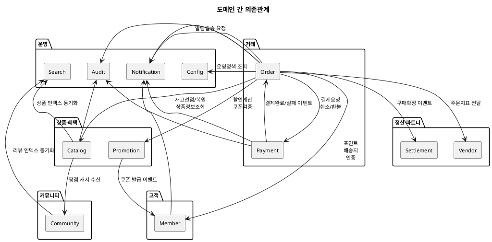

# 도메인 정의서

| 항목 | 내용 |
|---|---|
| 문서 유형 | 입력 자산 (산출물 흐름 ③.5 — 40종 산출물의 선행 참고자료) |
| 작성일 | 2026-07-30 |
| 원본 | `docs_archive/docs/3. 도메인/runNshop_bounded_context_v1_0.md` (v1.0, 2026-06-22) |
| 상태 | 현행화 (실증 경험 반영) |

> **이 문서의 역할**: 모든 도메인 단위 산출물(상위 유스케이스·EARS·ERD·상태머신 등)의 **출발점**.
> 도메인 경계가 없으면 "어떤 도메인의 요구사항인가", "어떤 도메인이 데이터를 소유하는가"를 판단할 수 없다.

---

## 1. 도메인 목록 (12개)

| # | 도메인 | 핵심 책임 | 레이어 |
|---|---|---|---|
| 1 | **Order** | 주문·배송·클레임 생명주기 오케스트레이션 | 거래 |
| 2 | **Catalog** | 상품 정보·재고·전시(Display) 관리 | 상품 |
| 3 | **Member** | 회원 계정·등급·포인트·배송지 관리 | 고객 |
| 4 | **Payment** | 결제 트랜잭션 처리 (PG 연동) | 거래 |
| 5 | **Promotion** | 쿠폰·행사가·수량할인·장바구니할인 관리 | 혜택 |
| 6 | **Settlement** | 정산 계산·지급 | 정산 |
| 7 | **Vendor** | 입점사 생명주기 관리 | 파트너 |
| 8 | **Notification** | 알림 발송 관리 (SMS·Push·이메일) | 운영 |
| 9 | **Community** | 리뷰·QnA·상품문의 | 커뮤니티 |
| 10 | **Search** | 통합 검색·인덱스 | 운영 |
| 11 | **Config** | 권한·공통코드·운영정책 설정 | 운영 |
| 12 | **Audit** | 로그·감사·Trace | 운영 |

---

## 2. 도메인별 책임

### Order

| 항목 | 내용 |
|---|---|
| **하는 것** | 주문 생성·상태 관리, 환불금 계산(안분), 클레임 접수·잠금, 배송 처리(운송장·추적), 구매확정(7일 자동/수동), 추가배송비 결제 요청, 배송지 변경, 운송장 수정 |
| **하지 않는 것** | 재고 직접 관리(→Catalog), 결제 처리(→Payment), 포인트·쿠폰 처리(→Member), 알림 발송(→Notification), 정산 계산(→Settlement) |

### Catalog

| 항목 | 내용 |
|---|---|
| **하는 것** | 상품 등록·심사·수정·상태관리, SKU·재고 관리, 카테고리(표준/전시) 관리, 브랜드 관리, 가격 관리, 재고 선점/복원(PublicApi), 전시(Display) 페이지·섹션·템플릿 관리 |
| **하지 않는 것** | 리뷰·평점·QnA(→Community), 행사가·쿠폰·수량할인(→Promotion), 검색 인덱스(→Search), 찜하기 데이터 소유(→Member) |

### Member

| 항목 | 내용 |
|---|---|
| **하는 것** | 회원가입·로그인·인증, 회원 상태 관리, 배송지 CRUD, 등급 산정(월 배치), 포인트 적립·사용·복원·소멸, 쿠폰함(보유 쿠폰 관리), 찜하기(관심상품) 소유 |
| **하지 않는 것** | 쿠폰 정책 정의·발행(→Promotion), 결제 처리(→Payment), 주문 처리(→Order) |

### Payment

| 항목 | 내용 |
|---|---|
| **하는 것** | PG 연동(토스페이먼츠), 결제 승인·실패·재시도, 취소·환불(전액/부분), 복합결제(포인트+카드), 금액 일치 검증, 이상거래 방지(3회 실패 제한), 결제수단 관리 |
| **하지 않는 것** | 주문 상태 관리(→Order), 포인트 차감/복원(→Member), 재고 관리(→Catalog) |

### Promotion

| 항목 | 내용 |
|---|---|
| **하는 것** | 행사가(즉시할인) 관리, 수량구간 할인 관리, 장바구니 할인 관리(플랫폼 단위), 쿠폰 등록·승인·타겟팅·발행·만료, 할인 적용 계산(PublicApi), 기획전 관리 |
| **하지 않는 것** | 결제 처리(→Payment), 재고 차감(→Catalog), 정산 계산(→Settlement), 포인트 적립/사용(→Member) |

### Settlement

| 항목 | 내용 |
|---|---|
| **하는 것** | 정산금 계산(수수료·분담금·배송비), 정산 주기 관리, 정산서 생성, 지급 처리 |
| **하지 않는 것** | 주문 확정 판단(→Order), 결제 처리(→Payment) |

### Vendor

| 항목 | 내용 |
|---|---|
| **하는 것** | 입점 신청·심사·계약, 스토어 정보 관리, 판매자 성과 통계, 수수료율 관리 |
| **하지 않는 것** | 상품 데이터 소유(→Catalog), 주문 처리(→Order), 정산 지급(→Settlement) |

### Notification

| 항목 | 내용 |
|---|---|
| **하는 것** | 알림 템플릿 관리, SMS·Push·이메일 발송, 발송 이력 관리 |
| **하지 않는 것** | 비즈니스 로직 판단 — 전 도메인에서 "발송 요청 이벤트"만 수신하여 발송 |

### Community

| 항목 | 내용 |
|---|---|
| **하는 것** | 리뷰 작성·관리, QnA 작성·답변, 상품문의 관리(데이터 소유) |
| **하지 않는 것** | 상품 데이터 관리(→Catalog), 회원 데이터 관리(→Member) |

### Search

| 항목 | 내용 |
|---|---|
| **하는 것** | 검색 인덱스 관리, 통합 검색(상품·기획전), 자동완성, 인기 검색어 |
| **하지 않는 것** | 원본 데이터 소유(→Catalog·Promotion·Community에서 동기화 수신) |

### Config

| 항목 | 내용 |
|---|---|
| **하는 것** | 공통코드 관리, 약관 관리, 운영정책 설정(주문 정책·결제 정책 수치), 금지어 관리, 권한 확인 |
| **하지 않는 것** | 비즈니스 로직 실행 — 설정값을 제공하고 타 도메인이 조회하여 적용 |

### Audit

| 항목 | 내용 |
|---|---|
| **하는 것** | 전 도메인 변경 로그 수집, 감사 이력 조회, 접근 이력 관리 |
| **하지 않는 것** | 비즈니스 판단 — 로그 수집·조회만 |

---

## 3. 소유 데이터

| 도메인 | 주요 엔티티 | 접두사 |
|---|---|---|
| **Order** | Order, OrderItem, OrderDiscount, Delivery, Claim, Cart, OrderHistory | `ord_` |
| **Catalog** | Product, SKU, Category, Brand, ProductPrice, StockHistory, DisplayPage, DisplaySection, DisplayTemplate | `cat_`, `cat_display_` |
| **Member** | Member, MemberGrade, Point, PointHistory, Address, Wishlist, MemberCoupon | `mem_` |
| **Payment** | Payment, PaymentLog, CardRestriction | `pay_` |
| **Promotion** | Coupon, CouponPolicy, InstantDiscount, QtyTierDiscount, CartDiscount, Exhibition | `prm_` |
| **Settlement** | SettlementPolicy, SettlementDetail, SettlementPayment | `stl_` |
| **Vendor** | Vendor, VendorContract, VendorMetric | `vnd_` |
| **Notification** | NotificationTemplate, NotificationLog | `ntf_` |
| **Community** | Review, QnA, ProductInquiry | `cmn_` |
| **Search** | SearchIndex, SearchKeyword, SearchLog | `sch_` |
| **Config** | CommonCode, Terms, PolicySetting, ForbiddenWord | `cfg_` |
| **Audit** | AuditLog, AccessLog | `aud_` |

---

## 4. 도메인 간 관계

### 의존관계 (화살표 = "A가 B를 호출/참조")

### 통신 방식

| 호출 유형 | 방식 | 사용 조건 | 예시 |
|---|---|---|---|
| **동기 (API)** | REST in-process 호출 | 즉시 응답 필요 (사전 검증·선점) | 재고 선점, 포인트 잔액 확인, 상품 유효성 |
| **비동기 (이벤트)** | Outbox + Event Consumer | 처리·알림·정산·복원 등 | 결제완료, 재고복원, 구매확정, 알림발송 |

---

## 5. 경계 규칙

| # | 규칙 | 설명 | 위반 시 |
|---|---|---|---|
| 1 | **데이터 소유권** | 각 도메인이 소유한 데이터는 타 도메인이 직접 접근(SQL)하지 않는다 | PublicApi 경유 필수 |
| 2 | **PublicApi 경유** | 도메인 간 데이터 조회·조작은 PublicApi(인터페이스)를 통해서만 | 직접 테이블 JOIN 금지 |
| 3 | **이벤트 기반 비동기** | 즉시 응답이 불필요한 처리는 비동기 이벤트로 | 동기 API 남용 방지 |
| 4 | **Outbox 패턴** | 이벤트 발행은 AFTER_COMMIT (유령 이벤트 방지) | BEFORE_COMMIT 발행 금지 |
| 5 | **MSA 전환 가능** | 현재 Modular Monolith이지만, 도메인 = 독립 서비스로 추출 가능한 경계 유지 | 패키지 분리 (`com.runnshop.{domain}`) |
| 6 | **택1 할인 규칙** | 동일 상품에 행사가(즉시할인)와 수량구간 할인을 동시 등록 불가 | Promotion 도메인에서 등록 시점 차단 |
| 7 | **장바구니 할인 = 플랫폼 단위** | 장바구니 할인은 벤더별이 아닌 플랫폼(운영자) 단위로만 적용 | 벤더 등록 불가 |
| 8 | **찜하기 소유권 = Member** | 상품 상세의 찜 버튼 진입점은 Catalog, 데이터 소유는 Member | Catalog는 전달만 |
| 9 | **상품문의 소유권 = Community** | 상품 상세의 문의 탭 진입점은 Catalog, 데이터·답변 소유는 Community | Catalog는 진입점만 |

---

## 6. 1차 본개발 대상과 Mock 관계

| 도메인 | 구현 상태 | 비고 |
|---|---|---|
| **Order** | 본개발 (실구현) | 오케스트레이터 — 다른 도메인 PublicApi 호출 |
| **Payment** | 본개발 (실구현) | PG 연동 (토스페이먼츠) |
| Catalog | Mock (PublicApi만 제공) | 상품조회·재고선점/복원 고정값 반환 |
| Promotion | Mock (PublicApi만 제공) | 할인계산·쿠폰검증 고정값 반환 |
| Member | Mock (PublicApi만 제공) | 포인트·배송지·인증 고정값 반환 |
| Settlement~Audit | Mock 미구현 | 이벤트 수신 시 로그만 남김 |

---

## 변경 이력

| 버전 | 일자 | 변경 내용 |
|---|---|---|
| v1.0 | 2026-06-22 | 초판 (원본: `runNshop_bounded_context_v1_0.md`) |
| v1.1 | 2026-07-30 | 자산화 참고자료로 이관 + 실증 경험 반영: 찜하기(Member), 상품문의(Community) 소유권 확정, 택1 할인·장바구니할인 플랫폼 규칙 추가, 1차 본개발/Mock 관계 명시 |
