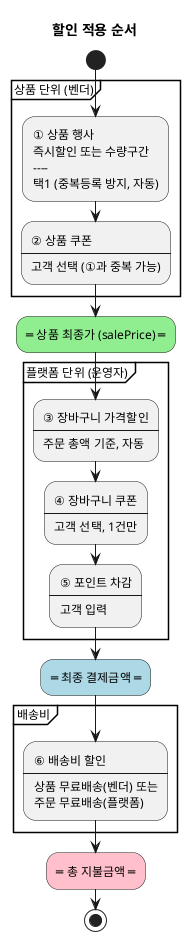

# 프로모션 할인 유형 및 적용 순서

| 항목 | 내용 |
|---|---|
| 문서 유형 | 기술참조 (EARS·인터페이스 명세·Design 입력자료) |
| 작성일 | 2026-07-30 |
| 적용 대상 | runNshop 전체 (Order·Promotion 도메인 연동) |
| 확정 상태 | **확정** (페페 확인) |

---

## 1. 분류 체계

### 축 1: 적용 단위

| 적용 단위 | 의미 | 등록 주체 |
|---|---|---|
| **상품 (SKU)** | 특정 상품에 걸림 | 벤더 (입점사) |
| **플랫폼 (주문 전체)** | 장바구니 총액 기준 | 플랫폼 운영자 |

### 축 2: 혜택 수단

| 혜택 수단 | 의미 | 적용 방식 |
|---|---|---|
| **가격 할인** | 결제 금액 직접 차감 | 자동 (조건 충족 시) |
| **쿠폰** | 다운로드 후 적용 | 고객 선택 |
| **배송비 할인** | 배송비 차감/면제 | 자동 (조건 충족 시) |
| **포인트** | 적립금 차감 | 고객 입력 |

---

## 2. 할인 유형 전체 목록

| 순서 | 유형명 | 적용 단위 | 혜택 수단 | 등록 주체 | 적용 방식 | 중복 규칙 |
|---|---|---|---|---|---|---|
| **①** | 상품 행사가 (즉시할인) | 상품 (SKU) | 가격 할인 | 벤더 | 자동 (등록 즉시) | 수량구간과 **택1** (중복등록 방지) |
| **①** | 수량구간 할인 | 상품 (수량 조건) | 가격 할인 | 벤더 | 자동 (조건 충족 시) | 행사가와 **택1** (중복등록 방지) |
| **②** | 상품 쿠폰 | 상품 (SKU) | 쿠폰 | 벤더 발행 | **고객 선택** | ①과 **중복 가능** |
| **③** | 장바구니 가격할인 | 플랫폼 (주문) | 가격 할인 | 플랫폼 운영자 | 자동 (조건 충족 시) | 1건만 |
| **④** | 장바구니 쿠폰 | 플랫폼 (주문) | 쿠폰 | 플랫폼 운영자 | **고객 선택** | 1건만 |
| **⑤** | 포인트 차감 | 플랫폼 (주문) | 포인트 | 고객 | **고객 입력** | — |
| **⑥-a** | 상품 무료배송 | 상품 (SKU) | 배송비 할인 | 벤더 | 자동 | 해당 벤더 배송비 면제 |
| **⑥-b** | 주문 무료배송 | 플랫폼 (주문) | 배송비 할인 | 플랫폼 운영자 | 자동 (조건 충족 시) | 전체 배송비 면제 |

---

## 3. 적용 순서



---

## 4. 핵심 규칙

### 중복 적용 규칙

| 규칙 | 설명 |
|---|---|
| 행사가 ↔ 수량구간 | **택1** — 벤더가 동일 상품에 두 행사를 동시 등록할 수 없음 (시스템이 등록 시점에 차단) |
| 행사(①) ↔ 상품 쿠폰(②) | **중복 가능** — 행사가로 할인된 가격에 추가로 쿠폰 적용 가능 |
| 상품 할인(①②) ↔ 플랫폼 할인(③④) | **중복 가능** — 적용 단위가 다르므로 독립 |
| 장바구니 가격할인(③) ↔ 장바구니 쿠폰(④) | **중복 가능** — 가격할인 적용 후 금액에 쿠폰 추가 적용 |
| 장바구니 할인 유형 내 | **각 1건만** — 가격할인 1건 + 쿠폰 1건까지 |

### 적용 방향 규칙

| 규칙 | 설명 |
|---|---|
| **상품 먼저, 플랫폼 나중** | 상품 할인(①②)이 먼저 적용되어야 플랫폼 할인(③④)의 기준 금액("주문 총액")이 확정됨 |
| **가격 할인 → 쿠폰 순** | 같은 레벨에서는 가격 할인(자동)이 먼저, 쿠폰(고객 선택)이 나중 |
| **배송비는 마지막** | 상품 금액 확정 후에 배송비 면제 여부 판단 |
| **역산 금지** | 이전 단계 할인으로 기준 금액이 줄어도, 이미 적용된 할인을 소급 재계산하지 않음 |
| **최저 보장** | 할인 적용 결과가 0원 이하가 되지 않음 (최소 결제금액 정책 적용) |

### 플랫폼 장바구니 할인 규칙

| 규칙 | 설명 |
|---|---|
| 등록 주체 | **플랫폼 운영자만** (벤더는 장바구니 할인 등록 불가) |
| 적용 단위 | **주문 전체** (벤더 단위 아님) |
| 조건 판단 기준 | 상품 할인(①②) 적용 후의 주문 총액 |

---

## 5. 계산 예시

```
상품A: 정상가 30,000원 × 3개
  ① 수량구간 할인 (3개↑ 10%): 30,000 × 0.9 = 27,000원 (단가)
  ② 상품 쿠폰 (2,000원): 27,000 - 2,000 = 25,000원 (단가)
  → 상품 최종가: 25,000 × 3 = 75,000원

상품B: 정상가 15,000원 × 1개
  ① 행사가 (20% 즉시할인): 15,000 × 0.8 = 12,000원
  ② 상품 쿠폰 없음
  → 상품 최종가: 12,000원

주문 총액 (상품 최종가 합계): 75,000 + 12,000 = 87,000원

  ③ 장바구니 가격할인 ("5만원↑ 5,000원"): 87,000 - 5,000 = 82,000원
  ④ 장바구니 쿠폰 ("10% 최대 5,000원"): 82,000 - 5,000 = 77,000원
  ⑤ 포인트 3,000P: 77,000 - 3,000 = 74,000원
  → 최종 결제금액: 74,000원

배송비:
  상품A 벤더: 3,000원 (묶음배송)
  상품B 벤더: 무료배송 (상품 무료배송 적용)
  ⑥ 주문 무료배송 미적용 (5만원↑ 조건은 결제금액이 아닌 상품금액 기준 — 87,000원 > 50,000원)
  → 배송비: 3,000원... 여기서 주문 무료배송 조건 충족 시 0원

총 지불금액: 74,000 + 3,000 = 77,000원
절약한 금액: (30,000×3 + 15,000 + 3,000) - 77,000 = 31,000원
```

---

## 6. API 응답 구조 반영

이 체계에 따라 인터페이스 명세의 응답 구조는 다음과 같이 분리해야 합니다:

```yaml
data:
  vendors: # 벤더별 그룹핑
    - vendorId: ...
      shippingFee: integer
      freeShippingApplied: boolean # ⑥-a 상품 무료배송
      items:
        - cartItemId: ...
          originalPrice: integer
          # ▼ 상품 단위 할인 (벤더 관할)
          appliedEvent: # ① 행사가 또는 수량구간 (택1)
            type: string # INSTANT_DISCOUNT | QTY_TIER_DISCOUNT
            name: string
            discountAmount: integer
          appliedProductCoupon: # ② 상품 쿠폰 (고객 선택)
            couponId: string | null
            couponName: string | null
            discountAmount: integer
          salePrice: integer # ① + ② 적용 후 단가

  # ▼ 플랫폼 단위 할인 (운영자 관할) — vendors 바깥
  platformDiscounts:
    cartDiscount: # ③ 장바구니 가격할인
      applied: boolean
      name: string | null
      discountAmount: integer
      condition: string # "5만원 이상 구매 시"
    cartCoupon: # ④ 장바구니 쿠폰
      couponId: string | null
      couponName: string | null
      discountAmount: integer
    pointUsed: integer # ⑤
    orderFreeShipping: # ⑥-b 주문 무료배송
      applied: boolean
      condition: string | null

  # ▼ 적용 가능한 할인 (아직 미적용 — 고객에게 안내)
  availableDiscounts:
    productCoupons: [...] # 다운로드 가능 상품 쿠폰
    cartCoupons: [...] # 사용 가능 장바구니 쿠폰
    nearConditions: # "N원 더 담으면 할인" 안내
      - type: string
        message: string # "12,000원 더 담으면 장바구니 할인 적용!"

  summary:
    totalOriginalPrice: integer
    totalProductDiscount: integer # ①+② 합계
    totalPlatformDiscount: integer # ③+④+⑤ 합계
    totalShippingDiscount: integer # ⑥ 합계
    finalPaymentAmount: integer
    totalShippingFee: integer
    totalPayableAmount: integer # 최종 결제 + 배송비
```

---

## 변경 이력

| 버전 | 일자 | 변경 내용 |
|---|---|---|
| v1.0 | 2026-07-30 | 초판 — 프로모션 할인 유형 8종 분류, 적용 순서 6단계 확정 |
