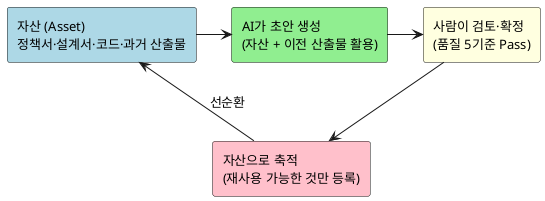
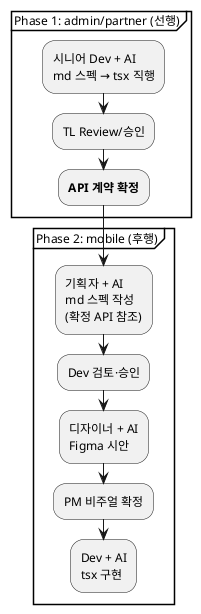

# AI 활용 개발 공정 지침서 — 직원 교육 및 실행 핸드북

**대상**: 프로젝트 참여 전 직원 (개발·기획·QA·PM)
**원본**: `AI활용_개발공정_지침서_v2.2`
**일자**: 2026-07-30

---

# Part 1. 방법론 소개 (10분 읽기)

---

## 1. 무엇이 바뀌는가

| 기존 | 앞으로 |
|---|---|
| 내가 처음부터 문서를 쓴다 | **AI가 초안을 만들고**, 나는 검토·수정·확정한다 |
| 내 머릿속에 있는 걸 매번 설명 | 자산(문서)으로 남겨두면 **AI가 다음에 알아서 활용** |
| 새 프로젝트마다 처음부터 | 이전 산출물이 자산으로 축적되어 **점점 빨라진다** |

---

## 2. 전체 구조



**핵심**: 모든 작업은 이 사이클을 따릅니다 — 자산 선택 → AI 초안 → 내가 검토 → 확정 → 자산 등록

---

## 3. 7개 공정과 40종 산출물

| 공정 | 핵심 질문 | AI가 하는 것 | 내가 하는 것 | 산출물 수 |
|---|---|---|---|---|
| **Proposal** | 왜 만드는가 | 정책서 분석 후 초안 | 비즈니스 판단·우선순위 | 6종 |
| **Spec** | 무엇을 만들 것인가 | EARS/GWT 패턴 적용 | 누락 검토·엣지케이스 | 6종 |
| **Design** | 어떻게 만들 것인가 | 패턴 기반 설계 초안 | 트랜잭션·실패 전략 결정 | 11종 |
| **Tasks** | 무엇부터 구현할 것인가 | 작업 분해 초안 | 공수 보정·의존성 조정 | 6종 |
| **Code** | 구현 | 코드 생성·자동검증 | 로직 검토·설계 준수 | 5종 |
| **통합테스트** | 검증 | 시나리오 실행 지원 | Pass/Fail·결함 분류 | 10종 |
| **안정화** | 운영·개선 | 장애 분석 지원 | 대응 판단·최종 확정 | 9종(합계 **40종**) |

Proposal~Tasks = 산출물 중심 (AI가 문서 생성)
Code~안정화 = 활동 중심 (AI가 실행·검증 참여)

---

## 4. 핵심 용어

| 용어 | 의미 | 나에게 |
|---|---|---|
| **Bolt** | 유스케이스 1개 = 설계·구현·테스트의 최소 단위 (약 2일) | **내 작업의 기본 단위** |
| **Platform Bolt** | 앱 셸 (NavBar·Sidebar·인증·공통UI) | 모든 업무화면의 전제 — **먼저 완성** |
| **Domain Bolt** | 업무 화면 (주문목록, 상품상세 등) | Platform Bolt 완료 후 진입 |
| **EARS** | 요구사항 작성 패턴 (When/Shall 문장) | Spec 공정에서 생성 |
| **GWT** | 수용기준 (Given-When-Then) | 테스트 시나리오의 원본 |
| **자산** | 재사용 가능한 산출물 | 잘 만들수록 다음이 빨라짐 |

---

## 5. 역할별 "나는 뭘 하는가" 요약

| 역할 | 핵심 활동 |
|---|---|
| **Dev** | AI 코드 리뷰 + admin 스펙 직접 작성 + mobile 스펙 검토·승인 |
| **기획** | mobile md 스펙 작성 + Figma 시안 협업 |
| **QA** | GWT 완전성 검토 + 통합테스트 판정 + 결함 분류 |
| **PM** | 공정 전이 승인 + WBS 확정 + Go/No-Go 최종 판단 |

---

# Part 2. 실행 핸드북 (작업 중 참조)

---

## 6. Bolt 시작~완료 체크리스트

하나의 Bolt가 시작되면 이 순서대로 진행합니다.

### Phase 0: Platform Bolt (앱당 1회, 최초에만)

- [ ] 컴포넌트 산출물에서 내 앱의 메뉴구조 확인
- [ ] 앱 셸 구현 (NavBar·Sidebar·TabBar·인증·공통UI)
- [ ] 셸 Review 통과
- [ ] → 이후 Domain Bolt 진입 가능

### Phase 1: Domain Bolt (매 Bolt 반복)

**① Spec (해당 Bolt 요구사항)**
- [ ] EARS 초안 검토 → Pass/Reject
- [ ] GWT 초안 검토 → Pass/Reject
- [ ] 인터페이스 명세 초안 검토 → Pass/Reject

**② Design (해당 Bolt 설계)**
- [ ] 세부 유스케이스 검토
- [ ] 시퀀스 검토 (트랜잭션 경계·실패 분기 확인)
- [ ] 화면 레이아웃 검토
  - admin/partner: md→tsx 직행 (Dev가 스펙+구현)
  - mobile: md(기획)→Dev검토→Figma→tsx
- [ ] 클래스 설계 검토

**③ Tasks (해당 Bolt 계획)**
- [ ] WBS 확인 (Task별 반나절 이내인지)
- [ ] DoD 체크리스트 확정

**④ Code (구현)**
- [ ] Mock JSON 작성 (API 계약 기준)
- [ ] BE 코드 구현
- [ ] FE 코드 구현 (Mock 기반 병렬)
- [ ] 자동 검증 통과 (컴파일·Lint·SAST)
- [ ] 단위 테스트 통과 (GWT 경계값 기반)
- [ ] 클래스 설계 현행화 (설계 차이 있으면 diff 기록)

**⑤ Bolt 완료**
- [ ] DoD 체크리스트 전 항목 충족
- [ ] 다음 Bolt로 이동 (또는 통합테스트 대기)

---

## 7. AI 프롬프트 실전 가이드

### 프롬프트 6요소

모든 AI 요청은 이 구조를 따릅니다:

```
[역할] 당신은 이커머스 도메인의 시니어 {역할}입니다
[컨텍스트] 첨부: {자산/이전 산출물 파일명}
[작업] {이 Bolt에서 만들어야 할 산출물} 작성
[출력형식] {표준양식 문서의 해당 산출물 형식}
[제약조건] {용어집 준수, 정책서 §X 반영, 이전 GWT와 모순 없이}
[품질기준] 5.1 품질 5기준 충족
```

### 공정별 프롬프트 예시

**EARS 작성 요청:**
```
[역할] 이커머스 도메인의 시니어 요구분석가
[컨텍스트] 첨부: 용어집, 정책서 §7.4, 도메인기능표 01-Order.md
[작업] Order 도메인 장바구니 영역의 기능요구사항을 EARS 패턴으로 작성
[출력형식] ID(REQ-ORD-{SEQ}), 패턴, 채널, 요구사항, 출처, 우선순위 테이블
[제약조건] 용어집 용어 사용, 트리거 명확히 서술, P1/P2/P3 우선순위 지정
[품질기준] 완전성(정책서 해당 절 전체 커버), 추적성(출처 명시)
```

**시퀀스 작성 요청:**
```
[역할] 시니어 백엔드 아키텍트
[컨텍스트] 첨부: 인터페이스 명세, 세부 유스케이스, 이벤트플로우, 클래스설계
[작업] 주문결제 Bolt의 시퀀스 다이어그램 작성
[출력형식] PlantUML, 트랜잭션 경계(rect), 이벤트 발행(AFTER_COMMIT), 실패분기(alt)
[제약조건] PG 호출을 트랜잭션 안에 넣지 않음, 이벤트를 BEFORE_COMMIT에 발행하지 않음
[품질기준] wrong_patterns 명시, 실행가능성(코드로 바로 전환 가능)
```

**코드 구현 요청:**
```
[역할] Kotlin/Spring Boot 시니어 개발자
[컨텍스트] 첨부: 클래스설계, 시퀀스, 인터페이스명세, 코딩표준(.kiro/steering/)
[작업] OrderController + OrderService 구현 (MockLoader 패턴)
[출력형식] Kotlin, 패키지 com.runnshop.order, Mock JSON 경로 규칙 준수
[제약조건] 도메인 간 직접 접근 금지(PublicApi 경유), 상태전이 검증 포함
[품질기준] 컴파일 통과, Lint 통과, 인터페이스 명세와 응답 필드 1:1 대응
```

---

## 8. 검토 체크리스트 (산출물 유형별)

### EARS 검토 시

- [ ] 모든 요구사항에 ID(REQ-{DOM}-{SEQ}) 부여됨
- [ ] EARS 패턴(Ubiquitous/Event-driven/State-driven/Optional/Unwanted) 정확 선택
- [ ] 트리거가 있는 요구사항은 Event-driven 또는 State-driven으로 분류됨
- [ ] 출처(정책서 §X, CONS-ID 등) 명시됨
- [ ] 용어집과 일치 (다른 용어 사용 없음)

### GWT 검토 시

- [ ] EARS 1개당 최소 1개 GWT 존재 (커버리지 100%)
- [ ] 카테고리(정상/경계값/예외) 분류됨
- [ ] 경계값 케이스 포함 ("이 요구사항이 깨지는 최소 조건은?")
- [ ] 대응 EARS ID 명시됨
- [ ] When절이 외부 관찰 가능한 트리거 (시스템 내부 판단 X)

### 시퀀스 검토 시

- [ ] 트랜잭션 경계(rect) 표시됨
- [ ] 이벤트 발행이 AFTER_COMMIT임
- [ ] 실패 분기(alt) 포함
- [ ] PG 등 외부 API가 트랜잭션 밖에 있음
- [ ] wrong_patterns 기록됨

### 코드 검토 시

- [ ] 자동 검증(컴파일·Lint·SAST) 통과 상태
- [ ] 클래스 설계의 책임 분배와 일치
- [ ] Mock JSON이 인터페이스 명세 response 필드와 1:1 대응
- [ ] 도메인 간 직접 접근 없음 (PublicApi 경유)
- [ ] 네이밍 규칙 준수 (코딩표준 참조)

---

## 9. Reject 피드백 작성법

AI 초안을 반려할 때 이 형식으로 피드백을 남기면 재생성 품질이 올라갑니다:

```markdown
## Reject 사유

### 위반 기준: [완전성/일관성/추적성/실행가능성/정책준수 중 택]

### 구체적 문제:
- [문제 1]: {어떤 항목이} {어떻게 잘못됐는지} — 기대값: {이래야 한다}
- [문제 2]: ...

### 참조 자료:
- {정정 근거가 되는 문서/정책서/이전 산출물 경로}

### 재생성 지시:
- {구체적으로 뭘 고쳐서 다시 만들어라}
```

**예시:**
```markdown
## Reject 사유

### 위반 기준: 일관성

### 구체적 문제:
- REQ-ORD-066: "병합한다"까지만 있고 동일 상품 수량 합산 규칙이 없음
  — 기대값: "동일 상품이면 수량 합산, 최대 수량 초과 시 최대 수량으로 제한"
- REQ-ORD-105: Config 조회 실패 시 동작이 미정의
  — 기대값: "fallback 기본값으로 동작"

### 참조 자료:
- 이커머스 표준 (장바구니 병합 시 수량 합산은 업계 관행)
- 장애대응 표준 (외부 서비스 실패 시 fallback 필수)

### 재생성 지시:
- REQ-ORD-066에 수량 합산 규칙 추가
- REQ-ORD-105에 Config 실패 시 fallback 동작 추가
```

---

## 10. 공정별 "이것만 보세요" 링크표

| 공정 | 내가 할 때 보는 문서 | 정확한 위치 |
|---|---|---|
| **Spec — EARS** | 표준양식 §2 Spec "기능요구" 행 | `산출물_표준양식_v1.0.md` |
| **Spec — GWT** | 작성가이드 §2 "수용기준(GWT)" | `산출물_작성가이드_v1.0.md` |
| **Design — 시퀀스** | 작성가이드 §3 "시퀀스" + 샘플 | `산출물-샘플/02-Design/08-시퀀스.md` |
| **Design — 화면레이아웃** | 작성가이드 §3 "화면 레이아웃(확정)" | 채널별 흐름 다이어그램 포함 |
| **Tasks — WBS** | 작성가이드 §4 "WBS(하위)·산정" | Platform Bolt Phase 0 규칙 포함 |
| **Code** | 작성가이드 §5 + 코딩표준 | `.kiro/steering/coding-standards.md` |
| **Code — Mock 규칙** | Mock 데이터 규칙 | `.kiro/steering/mock-data-rules.md` |
| **프롬프트** | 프롬프트 라이브러리 해당 절 | `프롬프트_라이브러리_v2.0.md` §7~40 |

---

## 11. 화면 작업 순서 (채널별)



| 규칙 | 이유 |
|---|---|
| admin/partner **먼저** | API 계약이 여기서 확정 |
| mobile **나중에** | 확정 API 참조 → 재작업 방지 |
| admin은 Figma **불필요** | 기능 도구, CSS 클래스 기반 |
| mobile은 Figma **필수** | 고객 접점, 비주얼 = UX |

---

## 12. FAQ

| 질문 | 답 |
|---|---|
| AI 초안이 엉터리면? | Reject + 구체적 피드백(§9 형식). 3회 Reject 시 사람이 직접 수정 |
| AI가 없는 API를 호출하면? | Code 자동검증(컴파일)에서 잡힘. 내가 볼 때는 이미 통과된 상태 |
| 이전 산출물이 없으면? | 첫 프로젝트(파일럿)라 AI 초안 품질이 낮을 수 있음 → 검토 비중 높게 |
| Bolt가 2일 넘으면? | 상태전이 단위로 더 쪼개기 (부록 A 분할 기준 참조) |
| 산출물 40종 다 만들어야? | 내 공정의 것만. Code면 5종, Spec이면 6종 |
| 설계와 구현이 달라졌으면? | 조용히 넘기지 말고 "클래스설계(현행화)"에 diff 기록 |

---

## 핵심 3줄 요약

1. **AI가 초안, 나는 판단** — 초안 작성이 아니라 검토·의사결정이 본업
2. **체크리스트로 검토** — 품질 5기준 + 산출물별 체크리스트(§8)로 Pass/Reject
3. **잘 만든 산출물이 자산** — 다음 Bolt, 다음 프로젝트에서 AI가 더 잘 만든다

---

*상세 규칙: `AI활용_개발공정_지침서_v2.2` | 산출물 형식: `산출물_표준양식_v1.0` | 프롬프트: `프롬프트_라이브러리_v2.0`*
