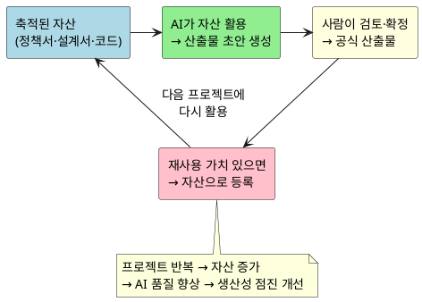
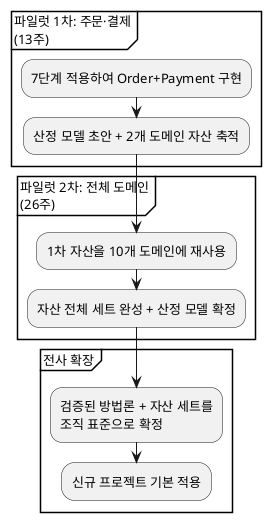

# AI 활용 개발 공정 지침서 — 사업 본부장 보고

**보고 시간**: 10~12분
**원본**: `AI활용_개발공정_지침서_v2.3`
**일자**: 2026-08-06

---

## 1. 문제 — 왜 기존 방식이 안 되는가

**한 줄 요약**: 기존 방법론에는 AI가 자산을 활용해 산출물을 생성하는 구조가 없어, 생산성 개선에 한계가 있습니다.

| 문제 | 영향 |
|---|---|
| 요구사항 변경 시 산출물 유지비용 폭증 | 문서 재작업에 개발 시간의 30~40% 소모 |
| 핵심 인력 의존도 높음 | 1명 이탈 시 해당 도메인 전체 지연 |
| AI 협업 구조 부재 | AI 도구를 도입해도 "사람이 다 쓰는" 구조 — 생산성 개선 제한적 |
| 프로젝트 종료 후 지식 소멸 | 다음 프로젝트에서 처음부터 반복 |
| AI 협업 시 비용·기간 산정 근거 부재 | 기존방식으로 비용을 산정한 뒤, 일정 비율로 할인하여 제안 |

> **핵심**: AI를 "도구"로만 쓰면 효과가 제한적.
> AI가 **조직의 자산을 이해하고 산출물을 직접 생성**하는 구조가 필요.

---

## 2. 해결 방향 — AI 협업 방법론

**한 줄 요약**: AI가 축적된 자산을 활용해 산출물 초안을 생성하고, 사람은 검토·의사결정에 집중

| 기존 | AI 활용 방법론 |
|---|---|
| 사람이 문서 작성 → AI가 보조 | **AI가 초안 생성** → 사람이 검토·확정 |
| 프로젝트 끝나면 지식 소멸 | 산출물 → **자산으로 축적** → 다음 AI 입력 |
| 인력 교체 시 다시 처음부터 | 자산이 남아 있으므로 **신규 인력도 AI+자산으로 즉시 생산** |

---

## 3. 핵심 — 구조와 효과

### 작동 원리: 자산 선순환

### 7단계 · 산출물 체계

**7단계**: [착수] → [범위정의] → [구조설계] → { [상세설계 → 구현] × Bolt 반복 } → [테스트] → [안정화]

| 단계 | 핵심 질문 | 산출물 예시 |
|---|---|---|
| 착수 | 왜, 무엇을 하는가 | 문제정의서, 목표KPI, 범위 |
| 범위정의 | 경계와 틀은 무엇인가 | 제약사항, NFR, 컴포넌트, 도메인정의서 |
| 구조설계 | 어떻게 나누고 연결하는가 | EARS, ERD, 상태머신, WBS |
| 상세설계 | 구체적으로 어떻게 만드는가 | GWT, 시퀀스, 화면, 클래스 |
| 구현 | 코드로 만든다 | 소스코드, 단위테스트 |
| 테스트 | 동작하는가 | 통합테스트, E2E, Go/No-Go |
| 안정화 | 서비스 가능한가 | 운영매뉴얼, 성능튜닝 |

각 산출물은 **산출물 종류**(AI 작성 방식 결정)와 **산출물 범위**(입력자료 참조·변경 영향 범위 결정)로 표준화됩니다.

### 산출물 표준화 — AI가 이해하고 생성하는 구조

모든 산출물은 **두 가지 축**으로 표준화됩니다.

**산출물 종류** — AI가 어떻게 작성하고, 검토자가 무엇을 확인하는가

| 종류 | AI 작성 방식 | 검토자 확인 |
|---|---|---|
| Proposal | 문제→목표→대안→결정 구조로 서술 | 방향이 맞는가 |
| Spec | 정형화된 구문으로 빠짐없이 나열 | 요구가 정확한가 |
| Design | 다이어그램과 테이블로 시각화 | 구조가 구현 가능한가 |
| Task | 작업을 분해하고 담당·일정 배정 | 계획이 현실적인가 |

**산출물 범위** — 변경 시 영향 범위가 얼마인가

| 범위 | 의미 | 변경 시 영향 |
|---|---|---|
| Project | 프로젝트 전체의 전제조건 | 전체 재검토 |
| Domain | 해당 도메인의 전제조건 | 그 도메인만 재검토 |
| Bolt | 해당 유스케이스 내부 | 그 Bolt만 재검토 |

> 이 표준화 덕분에 AI는 "어떤 방식으로 작성해야 하는지", 검토자는 "무엇을 확인해야 하는지"를 즉시 판단할 수 있습니다.

### 기대 효과

**한 줄 요약**:AI 활용으로 프로젝트의 품질과 속도를 높이고, 축적된 자산으로 수행 비용을 줄입니다.

| 항목 | 기존 방식 | AI 활용 | 개선 효과 |
|---|---|---|---|
| **산출물 작성** | 사람이 직접 | AI 초안 + 사람 검토 | **50~70% 시간 단축** |
| **인력 의존** | 핵심인력 부재 → 전체 지연 | 자산 기반 → 누구든 AI와 작업 | **인력 리스크 해소** |
| **품질 검증** | 수동 리뷰만 | AI 자동검증 + 사람 판단 | **반복 검증 비용 절감** |
| **지식 축적** | 종료 후 소멸 | 자산으로 영구 축적 | **반복 시 점진 향상** |
| **비용 (목표)** | 기준 대비 | AI 협업 적용 | **30% 절감** |

---

## 4. 검증 및 확산 — 파일럿 1·2차 → 전사 확장

### 파일럿을 통해 얻는 것

| 목표 | 설명 |
|---|---|
| **방법론 검증** | 7단계 진행 방식이 실제 프로젝트에서 작동하는지 실증 |
| **자산 전체 세트 확보** | 정책서 템플릿~안정화 결과보고서까지, 재사용 가능한 자산 라이브러리 완성 |

### 파일럿 1차: 주문·결제 도메인 (13주)

| 항목 | 내용 |
|---|---|
| **범위** | Order + Payment 도메인 (연관 도메인은 Mock) |
| **기간** | 13주 |
| **목표** | 방법론 실증 + 산정 모델 초안 + 2개 도메인 자산 세트 |

| 구간 | 기간 | 비고 |
|---|---|---|
| 착수~구조설계 | 3주 | 1회성 구조 확정 |
| **Bolt 반복 (상세설계+구현)** | **6주** | Order+Payment Bolt |
| 테스트 + 안정화 | 4주 | Go/No-Go 게이트 |

**1차에서 얻는 것**: 방법론 실증 + 산정 모델 초안 + 주문·결제 자산 세트

### 파일럿 2차: 전체 도메인 확장 (26주)

| 항목 | 내용 |
|---|---|
| **범위** | 12개 도메인 전체 (72개 Bolt) |
| **기간** | 26주 |
| **인력** | 4개 파트, 16명 |
| **목표** | 자산 전체 세트 완성 + 산정 모델 확정 + 범용성 검증 |

- 1차에서 축적된 자산(산출물·정책서 템플릿·산정 모델)을 나머지 10개 도메인에 재사용
- 1차 대비 생산성 향상 실측 (재사용 효과 검증)

**2차에서 얻는 것**: 자산 전체 세트 완성 + 산정 모델 확정 + 방법론 범용성 최종 검증

### 전사 확장

| 단계 | 목표 | 핵심 산출물 |
|---|---|---|
| **1차 (13주)** | 방법론 실증 | 산정 모델 초안 + 주문·결제 자산 |
| **2차 (26주)** | 전체 도메인 확장 | 자산 전체 세트 + 산정 모델 확정 |
| **전사** | 조직 표준 확정 | 전 프로젝트 적용, 비용 30% 절감 |

*상세 규칙·역할 정의·산출물 전체 목록은 원본(`AI활용_개발공정_지침서_v2.3`) 참조*
