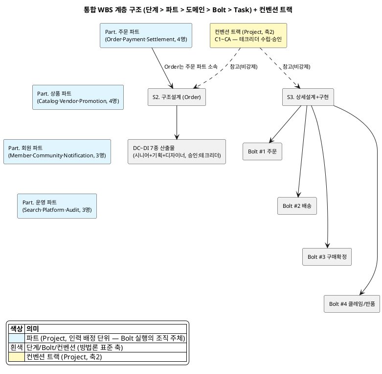

# WBS 방안 B (L0+L1 합본) — Order 도메인 Bolt 4회 가정 샘플

> **전제**: Order 도메인의 15개 Bolt 후보(`DH-상태머신/order.md`)를 업무 흐름 단위로 **4개
> Bolt로 그룹핑**했다고 가정한다. 이 문서는 단계별 로드맵과 Bolt별 Task 목록을 **하나의
> 계층형 WBS**로 합쳐, 단계 → 도메인 → Bolt → Task 컬럼 분리로 표현한다. 담당자는 방법론
> v2.3 부록 C RACI 조건표(3.5 역할 정의)를 근거로 **수행(R)/승인(A)을 분리**해 표기하고,
> **담당자는 이름 대신 역할로 표기**한다(실제 배정은 프로젝트별로 다르므로). 컨벤션 산출물
> (축 2, C1~CA)은 별도 트랙으로 둔다. 날짜는 프로젝트 시작일을 2026-08-31(월)로 가정한
> 예시이며, 주말은 제외한 영업일 기준이다.

## 0. 구조 요약

- 표 1개로 통합하되 **단계 / 도메인 / Bolt / Task를 별도 컬럼 4개로 분리**하고, 담당자도
  **담당(R) / 승인(A) 2개 컬럼으로 분리**한다 — RACI의 R·A만 표에 담고 C·I는 생략한다.
- **구조설계는 도메인 단위로 반복**되며(방법론 Scope: Domain), 산출물마다 실제 작성자 역할이
  다르다(v2.3 6.3 표 "작성주체" 기준): 시니어 개발자가 대부분을 작성하고, 기획자가 상위UC·
  메뉴구조도를 함께 작성·검토하며, 디자이너는 메뉴구조도(IA)의 화면 구조 검토에 참여한다.
  **승인(A)은 테크리더**가 대부분 맡고, 비즈니스 프로세스만 현업(MD)이 승인한다(부록 C RACI).
- **컨벤션 산출물(C1~CA)은 Project 범위의 별도 트랙**이다 — 도메인·Bolt에 속하지 않고, 각
  설계 산출물의 수립 데드라인(예: C2 용어컨벤션 → S1 시작 전)에 맞춰 별도 행으로 배치한다.
- 프로그램(화면·API 등) 전수 목록은 이 표에 나열하지 않고 `DQ-프로그램목록`을 참조 링크로
  연결한다.
- **단계 행 자체가 Gate Task다** — 일반 WBS는 "산출물 검토"를 단계 사이에 별도 행으로 넣지만,
  이 표는 단계 행의 **종료일 = 그 단계 산출물 검토·승인이 끝나는 시점**, **승인(A) = 게이트
  승인권자**로 이미 표현하고 있어(4.2 단계전환 조건 근거) 별도 검토 행을 추가하지 않는다.
  예: "구조설계" 단계 종료일(09-25)이 곧 DC~DI 7종에 대한 게이트 통과 시점이고, 다음 단계
  "상세설계+구현"이 09-28에 시작하는 것이 그 게이트를 통과했다는 뜻이다.
- **주간보고·이슈관리·리스크관리 등 상시 관리 업무는 WBS Task로 만들지 않는다** — 이들은
  전체 기간에 걸쳐 계속되는 관리 활동이라 시작일·종료일·완료 상태를 가진 산출물 단위 Task와
  성격이 다르다. 별도의 프로젝트 관리 트랙(주간보고 등)에서 관리하고, 이 WBS에는 담지 않는다.
- **데이터 이관 Task는 별도 트랙이 아니라 통합 WBS 표(1번) 안에 단계별로 직접 배치**한다 —
  범위정의~안정화 각 단계에 이관 관련 Task 7개를 끼워 넣고, 담당(R)은 **데이터아키텍트(DA)**로
  둔다. **[방법론 검토 필요]**: 방법론 v2.3 3.5 역할 정의·6장 산출물 표 어디에도 데이터
  이관 산출물과 "DA(데이터 아키텍트)" 역할이 정의돼 있지 않다 — 이 문서의 DA 표기는 검토를
  위한 임시 배정이며, 방법론 본문에 역할·산출물로 정식 반영할지는 별도 결정이 필요하다.

**역할 범례**: 시니어(BE) · 기획자 · 디자이너 · 개발자(BE) · QA · 테크리더 · 수행PM · 발주PM ·
현업(MD) · 운영팀 · **데이터아키텍트(DA)** [방법론 검토 필요 — v2.3 3.5에 미정의]

---

## 1. 통합 WBS

| 단계(L0) | 도메인(L0) | Bolt(L1) | Task(L1) | 담당(R) | 승인(A) | 시작일 | 종료일 | 상태 | 비고 |
|---|---|---|---|---|---|---|---|---|---|
| 착수 | | | | 수행PM | 발주PM | 08-31 | 09-11 | 완료 | D1~D6, Project 단위 |
| 범위정의 | | | | 테크리더 | 수행PM | 09-14 | 09-18 | 완료 | D7~DB, Project 단위 |
| 범위정의 | | | 이관 대상/범위 정의 | **DA** | 수행PM | 09-14 | 09-18 | 완료 | **[방법론 검토 필요]** D4 범위(Scope) 병행, 방법론에 산출물 미정의 |
| 구조설계 | Order | | DC 상위 유스케이스 | 시니어(BE) | 테크리더 | 09-21 | 09-22 | 완료 | 기획 검토 병행 |
| 구조설계 | Order | | DD EARS(기능요구) | 시니어(BE) | 테크리더 | 09-22 | 09-23 | 완료 | 기획 검토 병행 |
| 구조설계 | Order | | DE 메뉴구조도(IA) | 기획자 | 테크리더 | 09-22 | 09-23 | 완료 | 기획+개발 협업(대표: 기획자), 디자이너 화면구조 검토 |
| 구조설계 | Order | | DF 도메인모델(ERD) | 시니어(BE) | 테크리더 | 09-23 | 09-24 | 완료 | DBA 검토 |
| 구조설계 | Order | | DG 비즈니스 프로세스 | 시니어(BE) | 현업(MD) | 09-24 | 09-24 | 완료 | RACI상 승인권자가 현업(부록 C) |
| 구조설계 | Order | | DH 상태머신 | 시니어(BE) | 테크리더 | 09-24 | 09-25 | 완료 | Bolt 분할 후보 도출(4개) |
| 구조설계 | Order | | DI 이벤트 플로우 | 시니어(BE) | 테크리더 | 09-25 | 09-25 | 완료 | 아키텍트 검토 |
| 구조설계 | Payment | (동일 7종 산출물) | | 시니어(BE) | 테크리더 | 09-21 | 09-25 | 완료 | Order와 동일 세트, 병렬 진행 |
| 구조설계 | Catalog | (동일 7종 산출물) | | 시니어(BE) | 테크리더 | 09-21 | 09-25 | 완료 | Order와 동일 세트, 병렬 진행 |
| 구조설계 | ... (나머지 9개 도메인) | | | 시니어(BE) | 테크리더 | 09-21 | 09-25 | 완료 | 도메인마다 반복, 병렬 진행 |
| 구조설계 | Order | | Target 데이터 구조 분석 | **DA** | 테크리더 | 09-21 | 09-25 | 완료 | **[방법론 검토 필요]** DF 도메인모델(ERD) 확정과 병행 |
| 상세설계+구현 | Order | #1 주문 (장바구니~결제) | | 시니어(BE) | 테크리더 | 09-28 | 09-30 | 완료 | 3일, 선행 없음. Bolt 요약행은 대표 역할만 표기 |
| 상세설계+구현 | Order | #1 주문 | GWT 수용기준 | 시니어(BE) | QA | 09-28 | 09-28 | 완료 | Spec RACI: A=QA |
| 상세설계+구현 | Order | #1 주문 | 세부 유스케이스 | 기획자 | 테크리더 | 09-28 | 09-28 | 완료 | |
| 상세설계+구현 | Order | #1 주문 | 인터페이스 명세 | 시니어(BE) | 테크리더 | 09-29 | 09-29 | 완료 | |
| 상세설계+구현 | Order | #1 주문 | 시퀀스 | 시니어(BE) | 테크리더 | 09-29 | 09-29 | 완료 | |
| 상세설계+구현 | Order | #1 주문 | 화면 레이아웃(스펙+Figma) | 기획자 | 현업(MD) | 09-29 | 09-30 | 완료 | mobile: 기획 스펙→디자이너 Figma(대표: 기획자) |
| 상세설계+구현 | Order | #1 주문 | 클래스 설계 | 개발자(BE) | 테크리더 | 09-30 | 09-30 | 완료 | |
| 상세설계+구현 | Order | #1 주문 | 코드 구현 + 단위테스트 | 개발자(BE) | 테크리더 | 09-30 | 09-30 | 완료 | |
| 상세설계+구현 | Order | #1 주문 | Source→Target 매핑 | **DA** | 테크리더 | 09-28 | 09-29 | 완료 | **[방법론 검토 필요]** DP 클래스설계와 별개 매핑 문서 |
| 상세설계+구현 | Order | #1 주문 | 변환/이관 프로그램 구현 | **DA**+개발자(BE) | 테크리더 | 09-30 | 09-30 | 완료 | **[방법론 검토 필요]** 배치 성격, DQ 프로그램목록에 별도 유형(이관 배치) 등재 필요 |
| 상세설계+구현 | Order | #1 주문 | 이관 테스트 | QA | QA | 09-30 | 09-30 | 완료 | **[방법론 검토 필요]** 방법론 6.5 "단위 테스트"와 동일 위치 |
| 상세설계+구현 | Order | #2 배송 (출고~완료) | | 시니어(BE) | 테크리더 | 10-01 | 10-05 | 진행중 | 3일, 선행 #1 |
| 상세설계+구현 | Order | #2 배송 | GWT 수용기준 | 시니어(BE) | QA | 10-01 | 10-01 | 완료 | |
| 상세설계+구현 | Order | #2 배송 | 세부 유스케이스 | 기획자 | 테크리더 | 10-01 | 10-01 | 진행중 | |
| 상세설계+구현 | Order | #2 배송 | 인터페이스 명세 | 시니어(BE) | 테크리더 | 10-02 | 10-02 | 진행중 | |
| 상세설계+구현 | Order | #2 배송 | 시퀀스 | 시니어(BE) | 테크리더 | 10-02 | 10-02 | 예정 | |
| 상세설계+구현 | Order | #2 배송 | 화면 레이아웃(스펙+Figma) | 기획자 | 현업(MD) | 10-02 | 10-05 | 예정 | |
| 상세설계+구현 | Order | #2 배송 | 클래스 설계 | 개발자(BE) | 테크리더 | 10-05 | 10-05 | 예정 | |
| 상세설계+구현 | Order | #2 배송 | 코드 구현 + 단위테스트 | 개발자(BE) | 테크리더 | 10-05 | 10-05 | 예정 | |
| 상세설계+구현 | Order | #3 구매 확정 | | 시니어(BE) | 테크리더 | 10-06 | 10-06 | 예정 | 0.5일, 선행 #2 |
| 상세설계+구현 | Order | #3 구매 확정 | GWT 수용기준 | 시니어(BE) | QA | 10-06 | 10-06 | 예정 | |
| 상세설계+구현 | Order | #3 구매 확정 | 시퀀스 (D+7 자동확정 배치) | 시니어(BE) | 테크리더 | 10-06 | 10-06 | 예정 | |
| 상세설계+구현 | Order | #3 구매 확정 | 코드 구현 + 단위테스트 (배치) | 개발자(BE) | 테크리더 | 10-06 | 10-06 | 예정 | 기존 화면 재사용, 화면Task 없음 |
| 상세설계+구현 | Order | #4 클레임/반품 | | 시니어(BE) | 테크리더 | 10-07 | 10-13 | 예정 | 3.5일, 선행 #2·#3 |
| 상세설계+구현 | Order | #4 클레임/반품 | GWT 수용기준 | 시니어(BE) | QA | 10-07 | 10-07 | 예정 | |
| 상세설계+구현 | Order | #4 클레임/반품 | 세부 유스케이스 | 기획자 | 테크리더 | 10-07 | 10-08 | 예정 | |
| 상세설계+구현 | Order | #4 클레임/반품 | 인터페이스 명세 | 시니어(BE) | 테크리더 | 10-08 | 10-09 | 예정 | |
| 상세설계+구현 | Order | #4 클레임/반품 | 시퀀스 | 시니어(BE) | 테크리더 | 10-09 | 10-12 | 예정 | |
| 상세설계+구현 | Order | #4 클레임/반품 | 화면 레이아웃(스펙+Figma) | 기획자 | 현업(MD) | 10-09 | 10-12 | 예정 | admin 탭은 개발팀 직접(디자이너 미개입) |
| 상세설계+구현 | Order | #4 클레임/반품 | 클래스 설계 | 개발자(BE) | 테크리더 | 10-12 | 10-12 | 예정 | |
| 상세설계+구현 | Order | #4 클레임/반품 | 코드 구현 + 단위테스트 | 개발자(BE) | 테크리더 | 10-13 | 10-13 | 예정 | |
| 상세설계+구현 | Order | #4 클레임/반품 | DoD 체크·리뷰 | QA | QA | 10-13 | 10-13 | 예정 | Tasks RACI: DoD체크리스트 A=QA |
| 상세설계+구현 | Payment | (Payment 도메인 Bolt들) | | 시니어(BE) | 테크리더 | 09-28 | 10-13 | 예정 | Order와 병렬, 별도 Bolt 분할 |
| 상세설계+구현 | ... (나머지 도메인) | | | 시니어(BE) | 테크리더 | 09-28 | 10-13 | 예정 | 도메인마다 병렬 진행 |
| 테스트 | | | | QA | 수행PM | 10-14 | 11-03 | 예정 | Order↔Payment 이벤트 연동 검증 포함, Project 단위. Go/No-Go는 PM+QA 공동(부록 C) |
| 테스트 | | | 이관 데이터 연계 검증 | **DA**+QA | 수행PM | 10-14 | 11-03 | 예정 | **[방법론 검토 필요]** 방법론 6.6 "통합테스트 계획서" 범위에 포함 필요 |
| 안정화 | | | | 운영팀 | 발주PM | 11-04 | 11-17 | 예정 | Project 단위, Go-Live 승인은 발주PM(부록 C) |
| 안정화 | | | 최종 이관 | **DA**+운영팀 | 발주PM | 11-04 | 11-04 | 예정 | **[방법론 검토 필요]** 오픈(Go-Live) 시점 1회성 컷오버, 기간 없음 |

> **표기 규칙**: 도메인 칸까지만 채워지고 Bolt·Task가 빈 행은 그 단계에서 그 도메인 전체의
> 요약이다. Bolt 칸까지 채워지고 Task가 빈 행은 그 Bolt 전체의 요약이다. 모든 칸이 채워진
> 행이 실제 작업 단위다. 착수·범위정의·테스트·안정화는 Project 단위라 도메인 칸부터 빈칸이다.
> **담당(R)은 실제 작성자, 승인(A)은 확정 권한자**로 분리했다 — 방법론 부록 C RACI 조건표를
> 그대로 따른 것이며, 임의로 지정한 것이 아니다. **담당자는 실명이 아니라 역할로 표기**한다 —
> 실제 인원 배정은 프로젝트마다 달라지므로, WBS 산출물 자체는 역할 기준을 유지한다.
> **담당(R)에는 산출물별 대표(메인) 역할 하나만** 적는다 — 여러 역할이 공동 참여해도(예: DE
> 메뉴구조도는 기획+개발+디자이너 협업) 그 산출물의 주 작성 책임자만 표기하고 나머지는
> 비고에 서술한다.

> **파트(Part)의 위치**: 파트는 방법론의 정식 축(단계/Scope/Bolt)이 아니라, 부록 B "파트
> 구성"에서 정의한 **인력 배정 단위**다. 도메인을 업무 연관성으로 묶어 팀을 나눈 것으로,
> Order는 주문 파트(Order·Payment·Settlement, 4명) 소속이다. 다이어그램에서 파트가 도메인
> 위에 오는 것은 계층 관계가 아니라 **"이 도메인을 누가 담당하는가"를 나타내는 조직 매핑**
> 이며, 위 통합 WBS 표의 "담당(R)" 컬럼에 배정되는 인원의 소속 근거가 된다.

---

## 1-1. [검증용] 규칙2(복잡도 기반 분할) 적용 예시 — Bolt #1 "결제 완료 처리" Task

> **검증 목적**: 일반 SI WBS 샘플(6.3.2 PG 연동만 4레벨까지 세분화)을 본떠 "외부 연동이 있으면
> Task를 더 쪼갠다"는 규칙2를 실제로 적용했을 때 WBS가 어떻게 되는지 확인한다.
> **결론(먼저 밝힘)**: 아래 실험 결과, 이 세분화는 **Bolt 산출물 체계(GWT~클래스설계 7종)를
> 무시하고 산출물 경계를 가로지르는 임시 To-Do 목록을 만드는 부작용**이 있었다. 상세는
> 3번 "검증 결과" 참고. → **규칙2는 반영하지 않고, Task 생성 기준은 "Scope × 산출물 1종"
> 하나로 유지**하는 이전 결정을 재확인한다.

### (실험) 세분화 적용 — 코드 구현 Task를 PG 연동 세부 단계로 분할

Bolt #1의 "코드 구현 + 단위테스트" 한 줄(개발자(BE), 09-30, 1일)을, 일반 SI 6.3.2 패턴을 따라
PG 연동 세부 단계로 쪼개면:

| Task ID | 세부 작업 | 담당(R) | 승인(A) | 시작일 | 종료일 | 상태 |
|---|---|---|---|---|---|---|
| T1-7a | PG API 분석 | 개발자(BE) | 테크리더 | 09-30 | 09-30 | 완료 |
| T1-7b | 결제요청 API 개발 | 개발자(BE) | 테크리더 | 09-30 | 09-30 | 완료 |
| T1-7c | 결제승인 API 개발 | 개발자(BE) | 테크리더 | 09-30 | 09-30 | 완료 |
| T1-7d | 결제취소 API 개발 | 개발자(BE) | 테크리더 | 09-30 | 09-30 | 완료 |
| T1-7e | 결제 결과 처리 개발 | 개발자(BE) | 테크리더 | 09-30 | 09-30 | 완료 |
| T1-7f | 결제 실패 처리 개발 | 개발자(BE) | 테크리더 | 09-30 | 09-30 | 완료 |
| T1-7g | PG 연동 테스트 | 개발자(BE) | QA | 09-30 | 09-30 | 완료 |

### 검증 결과 — 근본 원인: 참조 샘플이 폭포수(waterfall) 구조이기 때문

표면적으로는 아래 3가지 문제가 관찰되지만, 이들은 모두 하나의 원인에서 나온다.

- 일반 SI WBS의 "6. 개발" 대분류는 **프로젝트 전체를 대상으로 한 번만 지나가는 폭포수 단계**다
  (요구사항분석→업무설계→화면설계→시스템설계→개발→테스트가 순서대로 1회 진행). 그 안에서
  "6.3.2 PG 연동"이 4레벨로 세분화된 것은, 폭포수 구조에서는 개발 단계 자체가 유일하게
  구체적 절차를 적는 곳이라 기능별로 깊이 파고든 것뿐이다.
- 반면 우리 방법론은 **상세설계+구현이 Bolt마다 반복(iteration)되는 구조**다. "코드 구현"은
  이미 Bolt 반복 안에 있는 산출물 1건이며, 폭포수의 "개발 단계 내부의 기능별 4단계"라는
  개념 자체가 반복 구조에는 존재하지 않는다 — 옮겨올 원본 개념이 없는 것을 억지로 옮긴 것이다.

이 근본 원인에서 아래 3가지 부작용이 파생된다:

1. **산출물 경계와 안 맞음**: T1-7a~g는 모두 "코드 구현" 산출물 **하나** 안에서 벌어지는 일이다.
   방법론의 Task 정의(`Task 1건 = Scope 인스턴스 × 산출물 1종`)를 지키면 이건 원래 1개 행
   이어야 하는데, 억지로 7개로 쪼개니 "산출물"이 아니라 "코드 구현이라는 산출물 내부의
   구현 절차"를 나열하게 된다 — WBS가 산출물 진행상태 표에서 프로그래머의 To-Do 리스트로
   성격이 바뀐다.
2. **일관성이 깨짐**: 다른 Bolt(#2 배송, #3 구매확정, #4 클레임)의 "코드 구현" 행은 여전히
   1줄인데 Bolt #1만 7줄이 되어, Bolt 간 Task 수를 단순 비교(진척률 계산의 분모)할 수 없게
   된다 — 3번 "롤업 집계"의 "Task 25개" 같은 합계가 도메인마다 다른 기준으로 세어져 무의미해짐.
3. **분할 기준이 방법론에 없음**: "외부 연동이면 쪼갠다"는 부록 A의 Bolt 분할 기준 7가지에
   없는 새 규칙이다. 일반 SI 샘플의 PG 세분화는 반복 구조의 "복잡도 판단 기준"이 아니라
   폭포수 구조 특유의 개발 단계 서술 방식이므로, 우리 구조에 이식할 근거 자체가 없다.

### 결론

**일반 SI WBS의 세분화 패턴은 참조하지 않는다** — 폭포수(1회성 순차 단계) 방법론의 산물이라
반복(Bolt) 구조와 전제가 다르기 때문이다. 우리 방법론에서 "세분화가 필요해 보이는 지점"은
Task를 쪼개는 문제가 아니라, 그 **Bolt 자체를 부록 A 기준(#3 상태전이 단위, #4 API 1~3개,
#5 Time-box)으로 더 작은 Bolt로 나누는 문제**로 흡수된다. 실제로 우리 Order 15개 Bolt
원본에서 "결제 완료 처리"(#4)와 "결제 실패·재고부족 처리"(#5)가 이미 분리되어 있는 것이
이 원칙의 실제 적용 사례다 — Task를 쪼개는 대신 Bolt를 쪼갠 것이다. 따라서 WBS Task
레벨에는 규칙2를 추가하지 않는다.

---

## 2. 컨벤션 산출물 트랙 (Project 범위, 축 2)

> 도메인·Bolt에 속하지 않는 Project 범위 산출물이므로 위 통합 WBS 표에 섞지 않고 별도로
> 관리한다. 수립 데드라인은 방법론 v2.3 §3.2.4.2·부록 C 기준이며, "참고 대상" 설계 산출물이
> 시작되기 전까지 초판이 나와야 한다.

| ID | 컨벤션명 | 담당(R) | 승인(A) | 수립 데드라인 | 시작일 | 종료일 | 상태 |
|---|---|---|---|---|---|---|---|
| C1 | 보안 컨벤션 | 테크리더(AI CoE 겸임) | 수행PM | S0 착수 중 | 09-01 | 09-05 | 완료 |
| C2 | 용어 컨벤션 | 시니어(BE) | 테크리더 | S1 시작 전 | 09-11 | 09-13 | 완료 |
| C3 | 아키텍처 컨벤션 | 테크리더 | 테크리더 | S2 시작 전 | 09-18 | 09-20 | 완료 |
| C4 | 데이터 모델링 컨벤션 | 시니어(BE) | 테크리더 | S2 ERD 작성 전 | 09-19 | 09-20 | 완료 |
| C5 | 이벤트 설계 컨벤션 | 시니어(BE) | 테크리더 | S2 이벤트플로우 작성 전 | 09-19 | 09-20 | 완료 |
| C6 | API 설계 컨벤션 | 시니어(BE) | 테크리더 | S3 인터페이스명세 작성 전 | 09-26 | 09-27 | 완료 |
| C7 | 디자인 시스템 | 디자이너 | 기획자 | S3 화면레이아웃 작성 전 | 09-26 | 09-27 | 완료 |
| C8 | UX Writing 컨벤션 | 기획자 | 기획자 | S3 화면레이아웃 작성 전 | 09-26 | 09-27 | 완료 |
| C9 | 코딩 컨벤션 | 개발자(BE) | 테크리더 | S3 클래스설계 작성 전 | 09-26 | 09-27 | 완료 |
| CA | 테스트 컨벤션 | QA | 테크리더 | S4 구현 시작 전 | 10-13 | 10-14 | 예정 |

> C7(디자인 시스템)의 담당(R)이 **디자이너**인 것이 위 통합 WBS의 "화면 레이아웃 Task"와
> 맞물린다 — Bolt별 화면 레이아웃 Task가 참조하는 컴포넌트·톤앤매너 기준이 여기서 나온다.

---

## 3. 롤업 집계 (통합 WBS 표에서 자동 파생)

| 레벨 | 항목 수 | 완료 | 진행중 | 예정 |
|---|---|---|---|---|
| 단계 | 6 | 3 | 1 | 2 |
| 구조설계 산출물(Order) | 7 | 7 | 0 | 0 |
| Bolt | 4 | 1 | 1 | 2 |
| Task | 25 | 8 | 2 | 15 |
| 컨벤션 산출물 | 10 | 9 | 0 | 1 |
| 데이터 이관 Task [방법론 검토 필요] | 7 | 5 | 0 | 2 |

| Bolt | 기간 | Task 수 | 예상 프로그램 수 | 확정 근거(참조만) |
|---|---|---|---|---|
| #1 주문 | 09-28~09-30 | 7 | 화면 3, API 9 (확정) | `DQ-프로그램목록/order.md` SCR-M-002/003/004, API-006~009 |
| #2 배송 | 10-01~10-05 | 7 | 화면 2, API 8 (추정) | Bolt #1 유사 규모 기준, #2 완료 후 DQ 반영 |
| #3 구매확정 | 10-06 | 3 | 화면 0(재사용), API 2 (추정) | #3 완료 후 DQ 반영 |
| #4 클레임/반품 | 10-07~10-13 | 8 | 화면 5, API 15 (추정) | #4 완료 후 DQ 반영 |

> 프로그램 전수 목록은 이 문서에 없다 — 각 Bolt가 끝날 때마다
> `docs/deliverables/S3-상세설계/DQ-프로그램목록/order.md`가 갱신되고, 위 표의 "확정 근거"
> 열이 그 문서를 가리키는 참조 역할만 한다.

---

## 4. 요약

| 질문 | 답 |
|---|---|
| 구조설계 산출물 담당(R)이 산출물마다 다른 이유는? | 실제 작성 역할이 다름(v2.3 6.3 "작성주체") — DE 메뉴구조도처럼 기획·디자이너가 공동 참여해도 담당(R)엔 대표 역할 하나만 표기(나머지는 비고) |
| 테크리더는 어디 있나? | 모든 행에 "승인(A)" 컬럼으로 명시 — 구조설계·상세설계 대부분의 산출물은 테크리더가 승인권자(부록 C RACI) |
| 컨벤션 산출물은 왜 별도 표인가? | Project 범위(도메인·Bolt 없음)이며 설계 산출물의 "참고 대상"일 뿐 선후행 의존이 아니라, 같은 표에 섞으면 계층이 깨짐 |
| 디자이너는 언제 참여하나? | 구조설계의 메뉴구조도(IA)와 상세설계의 화면 레이아웃(mobile, Figma) — 컨벤션에서는 C7 디자인시스템의 담당(R) |
| 왜 이름이 아니라 역할로 표기하나? | WBS는 산출물 표준양식 성격이라 실제 배정 인원(이름)은 프로젝트별로 바뀌지만 역할 구조는 방법론 공통이므로, 역할 기준을 유지한다 |
| 데이터 이관 Task는 왜 별도 트랙이 아니라 표 안에 있나? | 이관 대상 도메인의 실제 진행 단계(범위정의~안정화)와 시점이 겹치므로, 컨벤션(축2)처럼 독립적인 게 아니라 그 단계 행에 자연스럽게 끼워 넣는 편이 실제 일정 관리에 더 맞다 |
| 담당(R)이 DA인데 왜 "[방법론 검토 필요]"가 붙나? | 방법론 v2.3 3.5 역할 정의·6장 산출물 표에 데이터 이관 산출물과 DA(데이터 아키텍트) 역할이 정의돼 있지 않다 — 이 문서에서 임시로 배정한 표기이며 방법론 본문 반영 여부는 별도 결정 필요 |

---

## 근거

| 항목 | 출처 |
|---|---|
| Order 15개 Bolt 원본(그룹핑 전) | `docs/deliverables/S2-구조설계/DH-상태머신/order.md` §Bolt 분할 후보 |
| 구조설계 산출물별 작성주체(시니어/기획/디자이너) | `docs/methodology/AI활용_개발방법론_v2.3.md` 6.3 구조설계 표 |
| 담당(R)/승인(A) 배정 | 동일 문서 부록 C RACI 조건표(3.5 역할 정의) — 상위UC~클래스설계 A=테크, 비즈니스프로세스 A=현업(MD), GWT A=QA, WBS A=수행PM, DoD체크리스트 A=QA |
| 컨벤션 산출물 10종·수립 데드라인 | 동일 문서 §3.2.4.2, 부록 A/B 관련 서술 |
| mobile 화면 흐름(기획→Figma→Dev) | `docs/methodology/appendix/AI활용_개발방법론_산출물_표준양식_v1.0.md` v1.0 개정 5 |
| DQ 프로그램목록 참조 방식 | `docs/deliverables/S3-상세설계/DQ-프로그램목록/order.md`, `readme.md` |
| 단계전환 조건(Gate 근거) | 방법론 v2.3 4.2 단계전환 조건 표 |
| Gate Task·상시관리 업무 제외 검토 | `docs/weekly-report/tmp/WBS_태스크_참조.md` D·A섹션 대비 검토 |
| 데이터 이관 Task, DA 역할(방법론 공백 확인) | 방법론 v2.3 전체 grep(이관/migration/DA 무매칭) + `docs/weekly-report/tmp/WBS_태스크_참조.md`(일반 SI "8. 데이터" 챕터) 대비 검토 — **[방법론 검토 필요]** 3.5 역할 정의·6장 산출물 표에 정식 반영 여부 결정 필요 |
