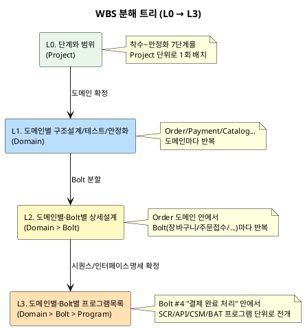
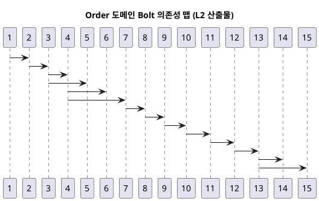

# WBS 작성 레벨과 수립 절차 (정리안 + 샘플)

> **작성 목적**: "전체 WBS는 어느 시점에 잡아야 하나"에 대한 답을 정리한다. 방법론 문서(v2.3)는
> WBS를 구조설계 단계의 Tasks 산출물(Scope: Project→Bolt)로만 정의하고, 몇 단계로 나눠 언제
> 구체화하는지는 명시하지 않는다. 본 문서는 **단계(Stage)→도메인(Domain)→Bolt→프로그램
> (Program)으로 내려가는 4계층 분해 트리**를 WBS 레벨(L0~L3)로 제안하고, Order 도메인 데이터로
> 각 레벨의 실제 모습을 샘플로 보여준다.
> **범위**: 이 문서는 참고용 샘플이며 정식 산출물이 아니다. Order 도메인 데이터는 기존 확정
> 문서(`docs/deliverables/S2-구조설계/`, `S3-상세설계/`)에서 그대로 인용했다(연동 참조 목적,
> 원본 미수정).

---

## 1. 핵심 결론

**WBS는 하나의 평면 목록이 아니라, 단계→도메인→Bolt→프로그램 순으로 내려가는 4계층
분해 트리(Work Breakdown *Structure*)다.** 위 레벨(L0)은 "단계와 범위"만 다루고, 아래로
내려갈수록 도메인·Bolt·프로그램 단위로 좁아지며 구체화된다. 상위 레벨이 확정돼야 하위
레벨을 만들 근거가 생긴다 — 순서를 건너뛸 수 없다.

| 레벨 | 분해 축 | 다루는 범위 |
|---|---|---|
| **L0** | 단계(Stage) × 범위(Scope) | 착수~안정화 7단계 전체를 Project 단위로 배치 |
| **L1** | 도메인(Domain) × 단계 | 도메인별로 구조설계(Bolt 분할 포함)~테스트~안정화까지의 배치 |
| **L2** | 도메인 × Bolt | 도메인 안에서 Bolt별 상세설계(GWT~클래스설계) 작업 분해 |
| **L3** | 도메인 × Bolt × 프로그램 | Bolt가 실제로 구현해야 하는 화면·API·컨슈머·배치 프로그램 단위까지 전개 |

---

## 2. 레벨별 정의

| 레벨 | 이름 | 단위 | 나오는 시점 | 하는 일 | 근거 |
|---|---|---|---|---|---|
| **L0** | 단계와 범위 | Project | S0(착수) — 대안비교·목표KPI 확정 시점 | 착수~안정화 7단계를 Project 전체 일정으로 배치. 아직 도메인별 세부는 모름 | 부록 B 마일스톤 가이드 |
| **L1** | 도메인별 구조설계·테스트·안정화 | Domain | S1(범위정의) 완료 — 도메인정의서(DB) 확정 시점 | 도메인마다 "구조설계(+Bolt 분할)→(Bolt 반복)→테스트 참여→안정화 참여" 일정을 배치 | 부록 B "파트 구성", DB 도메인정의서 |
| **L2** | 도메인별·Bolt별 상세설계 | Domain → Bolt | S2(구조설계) 완료 — 도메인의 Bolt 분할 확정 시점 | Bolt마다 GWT·세부UC·인터페이스명세·시퀀스·화면레이아웃·클래스설계 작업을 배치 | 부록 A.2 매크로 레벨, DH 상태머신 "Bolt 분할 후보" |
| **L3** | 도메인별·Bolt별 프로그램목록 | Domain → Bolt → Program | S3(상세설계) 진행 중 — Bolt의 시퀀스·인터페이스명세 확정 시점 | Bolt가 실제로 구현할 화면(SCR)·API·컨슈머(CSM)·배치(BAT) 프로그램을 전수 도출. 이 레벨이 구현(S4) 착수의 실제 작업 단위(Task) 목록이 된다 | DQ 프로그램목록 |

---

## 3. 레벨별 샘플 (Order 도메인 기준)

### 3-1. L0. 단계와 범위 (Project 전체)

> 출처: `docs/methodology/AI활용_개발방법론_v2.3.md` 부록 B (12개 도메인·16명 팀 가정 예시를
> 단계(3.1/3.6) 기준으로 재정리). 이 레벨은 도메인 구분 없이 Project 전체를 다룬다.

| 단계 | 내용 | 기간 | 시점 |
|---|---|---|---|
| 착수 | 이니셔티브 착수(D1~D6) | 2주 | Week 1-2 |
| 범위정의 | Project 공통(용어집·제약사항·NFR, D7~DB) | 1주 | Week 3 |
| 구조설계 | 12개 도메인 병렬로 상위유스케이스~이벤트플로우 확정 + Bolt 분할 | 1주 | Week 4 |
| 상세설계+구현 | 전체 60~90 Bolt 반복 (도메인별 파트가 병렬 진행) | 10주 | Week 5-14 |
| 테스트 | Bolt 간 연동·성능·보안 + 내부오픈 | 5주 | Week 15-19 |
| 안정화 | Go-Live + Hypercare | 3주 | Week 20-22 |

> 이 표에는 "Order 도메인이 몇 Bolt인지", "Order가 테스트 단계에서 무엇을 맡는지"가 전혀
> 없다 — L0은 도메인을 아직 나누지 않은 Project 전체 배치이기 때문이다. 도메인별 배치는
> L1에서 시작된다.

### 3-2. L1. 도메인별 구조설계·테스트·안정화 (Order 도메인)

> 도메인정의서(DB) 확정 후, Order 도메인 하나가 L0의 각 단계에서 무엇을 하는지 배치한다.
> **테스트·안정화까지 포함** — 구조설계·상세설계만 다루던 이전 안과의 차이점이다.

| 단계 | Order 도메인이 하는 일 | 산출물 | 비고 |
|---|---|---|---|
| 구조설계 | 상위유스케이스(DC)·EARS(DD)·ERD(DF)·비즈니스프로세스(DG)·상태머신(DH)·이벤트플로우(DI) 확정 | S2-구조설계/*/order.md | Order+Payment+Settlement 파트 공동 진행 |
| 구조설계 (Bolt 분할) | 상태머신(DH)의 "Bolt 분할 후보" 표로 Order 도메인을 15개 Bolt로 분할 | DH-상태머신/order.md §Bolt 분할 후보 | L2 입력자료가 됨 |
| 상세설계+구현 | 15개 Bolt를 순서대로(의존성 맵 기준) 반복 — GWT~프로그램목록~코드 | S3-상세설계/*/order.md | L2·L3가 여기서 나옴 |
| 테스트 | Order↔Payment 이벤트 연동 검증(PAYMENT_APPROVED 등), 배송/클레임 E2E 시나리오 | 통합테스트 계획서·결과보고서 중 Order 관련 항목 | Order 단독이 아니라 Payment와 결합 시나리오 위주 |
| 안정화 | 배송 실행 분리(v6) 등 운영 중 발견된 상태전이 이슈 대응, Runbook 중 Order 장애 대응 절차 | 장애/이슈 로그, 운영매뉴얼 중 Order 섹션 | 상태머신·ERD 현행화가 이 단계에서도 계속 발생 |

> **판단 근거**: L1에서 "Order가 테스트·안정화 단계에서 무엇을 맡는가"를 미리 명시해 둬야,
> 상세설계(L2/L3)에서 만든 산출물이 나중에 통합테스트·운영 문서 어디에 연결되는지 추적할 수
> 있다. 이 연결을 L2/L3로 미루면 "구조설계~구현"만 보이고 "테스트~안정화"에서 Order의 역할이
> 누락되기 쉽다.

### 3-3. L2. 도메인별·Bolt별 상세설계 (Order 도메인, 15개 Bolt)

> 출처: `docs/deliverables/S2-구조설계/DH-상태머신/order.md` "Bolt 분할 후보(상태 전이 기반)" —
> 상태 전이 1개 = Bolt 1개 원칙(방법론 부록 A 기준 #3)을 그대로 인용

| # | Bolt | 근거 상태전이 | 상세설계 대상 산출물 | 선행 Bolt |
|---|---|---|---|---|
| 1 | 장바구니 | — (독립 CRUD) | GWT·세부UC·인터페이스명세·시퀀스·화면레이아웃(CartPage) | — |
| 2 | 주문서 생성(임시주문) | [\*]→TEMP | 위 5종 (OrderNewPage) | 1 |
| 3 | 주문접수·재고선점 | TEMP→ORDER_RECEIVED→PAYMENT_PENDING | 위 5종 (재고선점 로직) | 2 |
| 4 | 결제 완료 처리 | PAYMENT_PENDING→PAYMENT_COMPLETED | 위 5종 (PaymentService) | 3 |
| 5 | 결제 실패·재고부족 처리 | PAYMENT_PENDING→PAYMENT_FAILED, ORDER_RECEIVED→STOCK_FAILED | 위 5종 | 3 |
| 6 | 고객 취소 | PAYMENT_COMPLETED→CANCELLED | 위 5종 | 4 |
| 7 | 출고 처리 | PAYMENT_COMPLETED→PREPARING | 위 5종 | 4 |
| 8 | 배송 실행(공용) | shipment: PENDING→IN_TRANSIT→DELIVERED/FAILED | 위 5종 (ord_shipment) | 7 |
| 9 | 배송 완료 | PREPARING→DELIVERED | 위 5종 | 8 |
| 10 | 구매 확정 | DELIVERED→CONFIRMED | 위 5종 | 9 |
| 11 | 반품/교환 신청 | [\*]→RECEIVED | 위 5종 (ClaimRequestPage) | 10 |
| 12 | 클레임 귀책판정·배송비결제 | RECEIVED→PAYMENT_PENDING / →INSPECTING | 위 5종 | 11 |
| 13 | 품질점검(입점사) | INSPECTING→PICKED_UP/PICKUP_REJECTED | 위 5종 | 12 |
| 14 | 환불 처리(어드민) | PICKED_UP→REFUNDED→COMPLETED | 위 5종 | 13 |
| 15 | 폐기·반송 판정(어드민) | PICKUP_REJECTED→DISPOSED/RETURN_PAYMENT_PENDING→COMPLETED | 위 5종 | 13 |

**Bolt #4 "결제 완료 처리" 상세설계 작업 분해** — L2는 Bolt 하나를 산출물 종류(GWT/세부UC/
인터페이스명세/시퀀스/화면레이아웃/클래스설계) 단위까지 쪼갠다. 프로그램(화면·API 등 구체
아이템) 단위까지는 아직 안 내려간다 — 그건 L3의 일이다.

| 산출물 | 작업 내용 | 담당 | 예상시간 |
|---|---|---|---|
| GWT 수용기준 | 정상/경계/예외 시나리오 작성 | BE+AI | 1h |
| 세부 유스케이스 | 결제 확인 버튼 클릭~완료 화면까지 행위 분해 | BE+AI | 1h |
| 인터페이스 명세 | POST /payments/confirm 등 endpoint 정의 | BE+AI | 1h |
| 시퀀스 | 결제승인→상태전이→이벤트발행 흐름 정의 | BE+AI | 1h |
| 화면 레이아웃 | 결제 완료/실패 화면 요소 정의 | 기획+AI | 1h |
| 클래스 설계 | PaymentService 등 참여 클래스 정의 | BE+AI | 0.5h |

### 3-4. L3. 도메인별·Bolt별 프로그램목록 (Order 도메인, Bolt #4 예시)

> 출처: `docs/deliverables/S3-상세설계/DQ-프로그램목록/order.md` 형식(SCR/API/CSM/BAT
> PGM-ID 체계)을 Bolt #4 범위로 발췌·재구성. 이 레벨이 구현(S4) 착수 시 실제로 착수하는
> 작업(Task) 목록이 된다 — Epic\>Story\>Task가 아니라 **프로그램(PGM) 단위**로 표현된다.

| PGM-ID | 유형 | 프로그램명 | 채널 | 근거(시퀀스/인터페이스명세) | 상태 |
|---|---|---|---|---|---|
| API-006 | API | POST /orders/sheet (주문서 생성) | mobile | DL §6, DM §2 | 완료 |
| API-007 | API | POST /payments/confirm (결제 완료 처리) | mobile | DL §7, DM §4 | 예정 |
| SCR-M-003 | 화면 | 주문 접수 완료 (OrderCompletePage) | mobile | DN §3 | 예정 |
| SCR-M-004 | 화면 | 주문 접수 실패 (OrderFailedPage) | mobile | DN §4 | 예정 |
| CSM-002 | 컨슈머 | PAYMENT_APPROVED 수신 → 주문 상태 갱신 | — | DI 이벤트플로우, DM §4-1 | 예정 |

> **판단 근거**: L2에서 "Bolt #4는 인터페이스명세·시퀀스가 필요하다"까지만 알 수 있고,
> "정확히 API가 몇 개, 화면이 몇 개인지"는 그 시퀀스·인터페이스명세를 실제로 작성해봐야
> 나온다. 그래서 L3는 L2 산출물이 확정된 뒤에만 만들 수 있다 — DQ 프로그램목록의 방법론
> 표준 선행산출물이 화면레이아웃·인터페이스명세·시퀀스·이벤트플로우·EARS인 것과 동일한 이유다.

### 3-5. 전체 롤업 — Order 도메인 15개 Bolt의 L3 프로그램 집계

> 15개 Bolt의 L3(프로그램목록)가 쌓이면 도메인 전체 프로그램 수가 롤업된다. 이 표는 신규
> 작성물이 아니라 `DQ-프로그램목록/order.md`의 실제 집계를 그대로 인용한 것이다.

| 유형 | 건수 | 비고 |
|---|---|---|
| 화면(SCR) | mobile 11 + admin 13(탭 포함) + partner 14(탭 포함) | 컨테이너 화면·탭 포함 |
| API | 50건 | 도메인 전체(Order+Payment 공동 문서 기준) |
| 컨슈머(CSM) | 4건 | PAYMENT_APPROVED/FAILED, ORDER_CANCELLED, CLAIM_COMPLETED 수신 |
| 배치(BAT) | 5건 | REQ-ORD-015/027/042/043 시간조건 기반 |

> 이 집계가 L1에서 배치한 "상세설계+구현" 기간(전체 60~90 Bolt 중 Order 파트 분량)과 실제로
> 맞는지가 L1 재검토의 근거가 된다.

---

## 4. 요약: 이 문서가 답하는 질문

| 질문 | 답 |
|---|---|
| WBS는 몇 계층으로 내려가나? | 4계층 — 단계(L0) → 도메인(L1) → Bolt(L2) → 프로그램(L3) |
| 테스트·안정화는 어디서 다루나? | L1에서 도메인별로 배치(구조설계·상세설계뿐 아니라 테스트·안정화까지 포함) |
| 실제 "일" 단위(Task)는 어디서 나오나? | L3 — 화면·API·컨슈머·배치 프로그램 단위가 구현 착수의 실제 작업 목록 |
| 상위 레벨을 건너뛸 수 있나? | 없다 — L2는 L1의 Bolt 분할이 있어야, L3는 L2의 시퀀스·인터페이스명세가 있어야 만들어진다 |

---

## 근거

| 항목 | 출처 |
|---|---|
| DQ 프로그램목록 PGM-ID 체계(SCR/API/CSM/BAT) | `docs/deliverables/S3-상세설계/DQ-프로그램목록/order.md` |
| Bolt 분할 기준 7가지 | `docs/methodology/AI활용_개발방법론_v2.3.md` 부록 A |
| Bolt 분할 시점(매크로 레벨) | 동일 문서 부록 A.2 |
| 마일스톤·리소스 전제 예시 | 동일 문서 부록 B |
| Order Bolt 후보 15개 | `docs/deliverables/S2-구조설계/DH-상태머신/order.md` "Bolt 분할 후보" (원본 미수정, 인용) |
| Order 프로그램 집계(화면/API/컨슈머/배치) | `docs/deliverables/S3-상세설계/DQ-프로그램목록/readme.md`, `order.md` (원본 미수정, 인용) |
