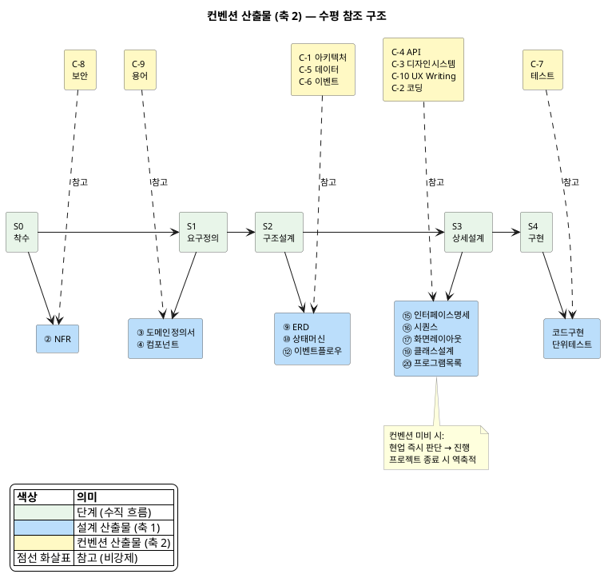
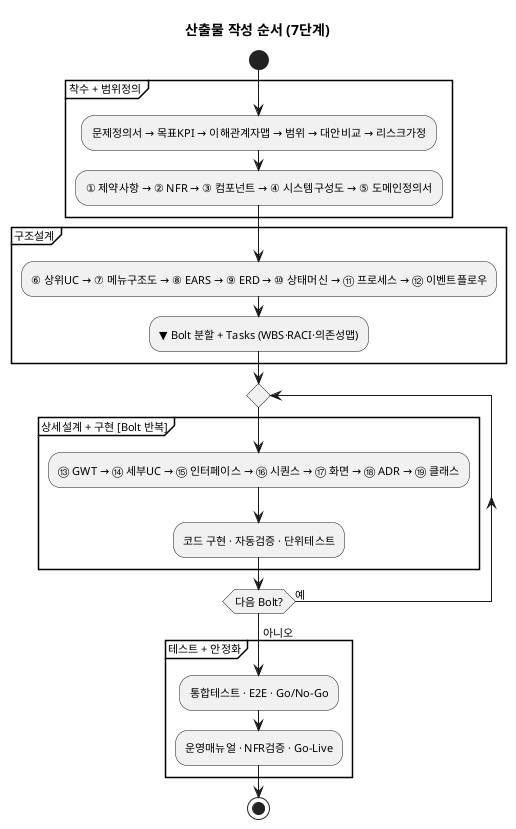

# AI 활용 개발 공정 — 산출물 흐름

**버전**: 1.0
**작성일**: 2026-07-30
**목적**: 산출물의 **작성 순서·단위·선행관계**를 정의한다.

- **작성순서가 핵심이다.** "이걸 모르면 다음 걸 만들 수 없다"는 의존관계가 실행 순서를 결정한다.
- **단계는 작성순서의 큰 구간이다.** 착수→범위정의→구조설계→상세설계→구현→테스트→안정화.
- **현행화는 자연 발생이다.** 뒤 산출물이 더 구체적이므로, 앞 산출물은 뒤 작업 과정에서 자연스럽게 보완된다. 별도의 "현행화 활동"을 계획할 필요 없다.

---

## 단계 정의

| 단계 | 범위 | 단위 | 핵심 질문 |
|---|---|---|---|
| **착수(Proposal)** | 기술스택·범위·일정·비용 확정 | Project | "왜, 무엇을 하는가" |
| **범위정의** | ①~⑤ (제약사항~도메인정의서) | Project | "기술 제약·품질 목표·시스템 구조·도메인 경계를 확정합니다" |
| **구조설계** | ⑥~⑫ + Bolt 분할 + Tasks(WBS·RACI·의존성맵·DoD·리스크대응) | Domain→Project | "도메인별 내부 구조를 설계하고, 구현 단위(Bolt)를 나눠 일정을 계획합니다" |
| **상세설계** | ⑬~⑲ (GWT~클래스설계) | Bolt | "각 Bolt를 구현 가능한 수준까지 상세하게 설계합니다" |
| **구현** | Mock API, Frontend, Backend, DB스크립트 | Bolt | "코드로 만든다" |
| **테스트** | 단위테스트, 통합테스트, E2E | Bolt→Domain | "동작하는가" |
| **안정화** | 성능튜닝, 버그수정, NFR검증, 운영이관 | Project | "서비스 가능한가" |

---

## 용어 정리

| 용어 | 의미 | 예시 |
|---|---|---|
| **도메인 경계** (Bounded Context) | 업무 영역 분류 — "어떤 도메인들이 있고 각각 뭘 책임지는가" | Order, Catalog, Payment... 12개 |
| **도메인 모델** (ERD) | 도메인 내부 데이터 구조 — "어떤 엔티티·관계가 있는가" | ord_order, ord_cart, FK... |
| **도메인 단위** | 도메인 전체를 대상으로 1회 작성 | Order 도메인의 EARS 전체 |
| **Bolt 단위** | 유스케이스 1개를 대상으로 반복 작성 | "장바구니 담기" Bolt의 시퀀스 |
| **현행화** | 후속 작업에서 기존 산출물을 갱신 | Code 중 ERD에 컬럼 추가 |
| **입력 자산** | 40종 산출물이 아닌 선행 참고 문서 | 도메인정의서, 정책서, 도메인기능표, 용어집 |

---

## 입력 자산 (40종 산출물이 아닌 참고자료)

> **입력 자산은 "있으면 빨라진다"이지 "없으면 못 한다"가 아닙니다.**
> 참고자료가 없으면 해당 단계에서 직접 분석·정의하면 됩니다 — 시간이 더 걸릴 뿐.

| 자산 | 성격 | 있으면 | 없으면 |
|---|---|---|---|
| **용어집** | 모든 산출물의 용어 통일 기준 | 바로 참조 | 산출물 작성하며 동시에 정리 |
| **도메인정의서** | 12개 도메인 경계·책임 정의 | 도메인 경계 즉시 확정 | 정책서·업무분석에서 직접 도출 |
| **정책서** | 비즈니스 규칙·정책 원본 | EARS 작성 시 근거로 인용 | **자산 정책서 템플릿**을 발주자에게 전달 → 수정본 회수하여 확정 정책서로 활용 |
| **도메인기능표** | 도메인별 소분류 기능 목록 | EARS 후보 즉시 도출 | 상위 유스케이스에서 직접 분해 |
| **기술스택 문서** | 확정된 기술 선택·아키텍처 결정 | 컴포넌트·제약사항 즉시 작성 | Proposal 대안비교에서 도출 |

---

## 컨벤션 산출물 (축 2 — 수평 참고)

> 설계 산출물(축 1)의 각 단계에서 **참고**하는 표준화 기준.
> 블로커가 아니며, 해당 설계 산출물 작성 전까지 초판 수립을 권장한다.

### 매핑 테이블

| ID | 컨벤션명 | 수립 데드라인 | 참고하는 설계 산출물 |
|---|---|---|---|
| C-8 | 보안 컨벤션 | S0 착수 중 | ② NFR |
| C-9 | 용어 컨벤션 | S1 시작 전 | ③ 도메인정의서, ⑧ EARS, 전체 |
| C-1 | 아키텍처 컨벤션 | S2 시작 전 | ④ 컴포넌트, ⑨ ERD, ⑫ 이벤트플로우, ⑯ 시퀀스 |
| C-5 | 데이터 모델링 컨벤션 | S2 ERD 전 | ⑨ ERD, ⑩ 상태머신 |
| C-6 | 이벤트 설계 컨벤션 | S2 이벤트플로우 전 | ⑫ 이벤트플로우, ⑯ 시퀀스 |
| C-4 | API 설계 컨벤션 | S3 인터페이스명세 전 | ⑮ 인터페이스명세, ⑯ 시퀀스, ⑳ 프로그램목록 |
| C-3 | 디자인 시스템 | S3 화면레이아웃 전 | ⑰ 화면레이아웃, tsx 구현 |
| C-10 | UX Writing 컨벤션 | S3 화면레이아웃 전 | ⑰ 화면레이아웃, 알림 문구 |
| C-2 | 코딩 컨벤션 | S3 클래스설계 전 | ⑲ 클래스설계, 코드구현, 코드리뷰 |
| C-7 | 테스트 컨벤션 | S4 구현 시작 전 | 단위테스트, 통합테스트 |

---

## 산출물 작성 순서

| # | 산출물 | 단계 | 단위 | 선행 | 작성 원천 | 비고 |
|---|---|---|---|---|---|---|
| ① | 제약사항 | 범위정의 | Project | — | RFP·제안서·Proposal, 정책서, 법무/보안 정책, 벤더 계약서, 기술스택 문서(자산) | 법무·보안·기술·벤더 제약 |
| ② | NFR | 범위정의 | Project | — | 정책서, 인프라 스펙, SLA, 벤치마크 | 성능·보안 목표 수치 |
| ③ | 컴포넌트 | 범위정의 | Project | ①② | 기술스택 문서(자산), 아키텍처 결정, 제약사항 | 소프트웨어 모듈 구조. 도메인 경계 확정 후 §6 보완 |
| ④ | 시스템구성도 | 범위정의 | Project | ③② | NFR(성능·가용성), 제약사항(인프라), 컴포넌트 | 인프라 배치 (서버·네트워크·환경·빌드·배포·모니터링) |
| ⑤ | 도메인 정의서 | 범위정의 | Project | ③ | 정책서, 범위(Scope), 업무 분석, 이해관계자 인터뷰 | 도메인 목록·책임·소유 데이터·관계·경계 규칙 → ③ §6 보완 트리거 |
| ⑥ | 상위 유스케이스 | 구조설계 | Domain | ⑤ | 도메인 정의서, 정책서, 도메인기능표 | 도메인별 액터·업무 나열 |
| ⑦ | 메뉴구조도(IA) | 구조설계 | Project (앱별) | ⑥, ③ | 상위 유스케이스, 컴포넌트(앱 셸), 도메인기능표 | 앱별 네비게이션 트리. 기획자+개발자 협업 |
| ⑧ | EARS (기능요구) | 구조설계 | Domain | ⑥ | 도메인기능표, 정책서, 상위 유스케이스 | "시스템이 뭘 해야 하는가" |
| ⑨ | 도메인 모델 (ERD) | 구조설계 | Domain | ⑧ | EARS, 용어집, 정책서 | EARS에서 엔티티 도출 → 테이블 설계 |
| ⑩ | 상태머신 | 구조설계 | Domain | ⑨ | ERD(status 필드), EARS, 정책서 | ERD의 status 필드 → 전이 규칙 |
| ⑪ | 비즈니스 프로세스 | 구조설계 | Domain | ⑩ | 상태머신, 정책서, 조직 업무 매뉴얼 | 상태 전이를 액티비티 흐름으로 확장 |
| ⑫ | 이벤트 플로우 | 구조설계 | Domain 간 | ⑪ | 비즈니스 프로세스, 컴포넌트(통신 규칙), 도메인 간 의존관계 | 도메인 간 이벤트 계약 |
| — | **▼ Bolt 분할** | 구조설계 | — | ⑩⑫ | 상태머신(전이 단위), 이벤트 플로우(의존 순서) | 상태 전이 단위로 Bolt 확정 |
| — | RACI | 구조설계 | Project | ⑥, ③ | 상위UC(역할), 컴포넌트(모듈 경계), 조직도 | 역할별 담당자 배정 |
| — | DoD 템플릿 | 구조설계 | Project | ②, ① | NFR, 코딩 표준, 과거 장애 유형 | 완료 기준 정의 |
| — | 의존성 맵 | 구조설계 | Domain→Bolt | ⑫, Bolt 분할 | 이벤트 플로우, Bolt 목록 | Bolt 간 선후행 관계 |
| — | WBS·산정 | 구조설계 | Project→Bolt | 의존성 맵, Bolt 분할 | Bolt 목록, 의존성 맵, 과거 유사 Bolt 실적 | 작업 분해 + 공수·일정 추정 |
| — | 리스크 대응계획 | 구조설계 | Project | Proposal 리스크 | Proposal 리스크·가정, 과거 대응 이력 | 트리거-대응액션 정의 |
| — | DoD 체크리스트 | 구조설계 | Bolt | DoD 템플릿, WBS | DoD 템플릿, 해당 Bolt 기술적 관심사 | Bolt별 완료 기준 적용본 |
| ⑬ | GWT (수용기준) | 상세설계 | Bolt | ⑧ | EARS, 정책서 예외 케이스 | EARS → 시나리오(정상/경계/예외) |
| ⑭ | 세부 유스케이스 | 상세설계 | Bolt | ⑥ | 상위 유스케이스, 화면 프로토타입 | 버튼/화면 단위 행위 분해 |
| ⑮ | 인터페이스 명세 | 상세설계 | Bolt | ⑬⑭ | GWT(예외→에러코드), 세부 유스케이스(행위→endpoint), 기존 API 문서 | GWT 예외→에러코드, 행위→endpoint |
| ⑯ | 시퀀스 | 상세설계 | Bolt | ⑮ | 인터페이스 명세, 세부 유스케이스, 이벤트 플로우, 컴포넌트(경계 규칙) | API 호출 순서·트랜잭션 경계 |
| ⑰ | 화면 레이아웃 | 상세설계 | Bolt | ⑯ | 시퀀스(API 호출 시점), 화면 프로토타입, 인터페이스 명세 | API→화면 매핑, 상태 소스 |
| ⑱ | ADR | 상세설계 | 발생 시 | — | 설계 중 발생한 결정 사항, 대안비교, 제약사항, 기술스택 문서 | 기술 결정 기록 (어느 시점이든) |
| ⑲ | 클래스 설계 | 상세설계 | Bolt | ⑯ | 시퀀스(참여 객체), ERD, 인터페이스 명세, 코딩 컨벤션 | 시퀀스 참여 객체 → 클래스 전환 |

---

## 다이어그램

---

## 현행화 관계

> **현행화는 별도 행위가 아니다.** 작성순서로 산출물을 만들면, 뒤 산출물이 앞 산출물보다 항상 더 구체적이다.
> 따라서 앞 산출물의 보완은 뒤 작업 중에 자연스럽게 발생한다 — 별도 계획이나 일정이 필요 없다.

| 앞 산출물 (보완 대상) | 보완 트리거 (뒤 산출물) | 자연 발생 이유 |
|---|---|---|
| ③ 컴포넌트 §6 | ⑤ 도메인 정의서 | 도메인 경계가 구체화되면 모듈 구조도 구체화됨 |
| ⑧ EARS | ⑯ 시퀀스 | 호출 순서를 그리면 누락 요구가 드러남 |
| ⑨ ERD | ⑲ 클래스 설계 / Code | 구현하면 컬럼·관계가 더 정밀해짐 |
| ⑩ 상태머신 | Code | 구현 중 상태·전이가 추가됨 |
| ⑮ 인터페이스 명세 | ⑯ 시퀀스 | 호출 순서 확정 시 파라미터·에러코드 상세화 |
| ⑫ 이벤트 플로우 | 통합테스트 | 실제 구독 검증 시 누락·변경 발견 |
| ② NFR | 통합테스트·안정화 | 실측치로 목표 수치 보정 |

---

## 핵심 원칙

| 원칙 | 설명 |
|---|---|
| **작성순서가 곧 실행순서** | 단계(착수→범위정의→구조설계→상세설계→구현→테스트→안정화) 순서대로 산출물을 만든다 |
| **의존관계가 순서를 결정** | "이걸 모르면 다음 걸 만들 수 없다" 기준 |
| **현행화는 자연 발생** | 뒤 산출물이 더 구체적이므로 앞 산출물은 자연히 보완됨 — 별도 행위 불필요 |
| **EARS는 Domain 단위** | ERD·상태머신의 입력이므로 구조설계 단계에서 작성 |
| **Bolt 분할은 구조설계 마지막** | 상태머신·이벤트플로우가 있어야 "전이 1개 = Bolt 1개" 판단 가능 |
| **GWT·시퀀스·인터페이스는 Bolt 단위** | 상세설계 단계에서 Bolt별로 반복 작성 |

---

## 지침서와의 관계

> 지침서 v2.3에서 7단계 체계를 공식 채택하였으므로, 이 문서와 지침서는 동일한 단계 구조를 사용합니다.
> 아래는 v2.2 이전의 구 체계(문서종류 기반 분류)와 현 7단계의 대응 관계를 기록한 것입니다.

| 항목 | 구 체계 (문서종류 기반) | 현 체계 (7단계) | 비고 |
|---|---|---|---|
| 분류 체계 | Proposal/Spec/Design/Task 4종류 | 착수~안정화 7단계 | 문서종류는 산출물 분류 라벨로 유지 |
| EARS 위치 | Spec (문서종류) | 구조설계 (단계) | 도메인 구조를 잡는 행위 |
| GWT 위치 | Spec (문서종류) | 상세설계 (단계) | Bolt별 상세화 행위 |
| ERD 위치 | Design (문서종류) | 구조설계 (단계) | EARS 직후 자연 연결 |
| Tasks 위치 | 독립 단계 | 구조설계 마지막 | Bolt 분할 직후 계획 수립 |

---

## 변경 이력

| 버전 | 일자 | 변경 내용 |
|---|---|---|
| v1.0 | 2026-07-30 | 초판 — runNshop 1차 본개발(Order·Payment) 실증 경험 기반 |
| v1.1 | 2026-07-30 | 7단계 체계 도입 (착수→범위정의→구조설계→상세설계→구현→테스트→안정화), 공정 열→단계 열 교체, 현행화=자연발생 관점 반영 |
| v1.2 | 2026-08-06 | Tasks를 구조설계 마지막 산출물로 배치 (6종 추가), 다이어그램 Tasks 노드 추가, Platform 도메인 승격(Config 흡수), 지침서 v2.3 동기화 (단계=공정, 문서종류=분류 라벨), 지침서 관계 섹션 갱신 |
