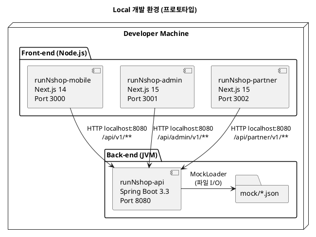
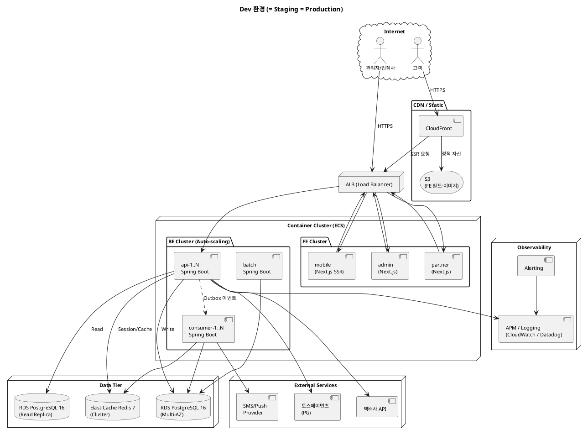

# 시스템 구성도

> **단계**: 범위정의
> **문서범위**: Project
> **문서종류**: Design
>
> **작성 목적**: 컴포넌트가 물리적·논리적으로 어떻게 배치되고 연결되는지를 환경별로 시각화한다.
> **흐름 내 위치**: 컴포넌트 → **시스템구성도** → 도메인 정의서
> **작성 주체**: 시니어 + AI (인프라 검토)

| 항목 | 내용 |
|---|---|
| ID | DESIGN-SYSARCH-001 |
| 상태 | **Finalized** |
| 작성일 | 2026-08-11 |
| 갱신일 | 2026-08-11 |

---

## 환경 구분

| 환경 | 용도 | 비고 |
|---|---|---|
| **Local** | 개발자 로컬 머신에서 전체 스택 실행 | 현재 운영 중 |
| **Dev (= Staging = Production)** | 통합 개발 + QA + 운영 단일 환경 | Staging·Production을 별도로 두지 않음 |

> 소규모 팀(초기 1인 → 최대 5인)이므로 환경 분리 비용 대비 효과가 낮아 단일 서버 환경으로 운영한다.
> **2차 파트(전체 도메인 확장, 10주 후) 시점에 Staging 분리 확정** — 팀 규모 증가·동시 개발 도메인 수 확대에 따른 QA 격리 필요성 판단.

---

## 1. Local 환경 (현재 프로토타입)



### Local 환경 특징

| 항목 | 1차 파트 (Order, Payment) — 본 구현 | 2~4차 파트 (나머지 10개 도메인) — 프로토타입 |
|---|---|---|
| DB | Dev RDS 원격 접속 (`application-local.yml`) | Mock JSON |
| 캐시 | Dev ElastiCache 원격 접속 | 미사용 |
| 인증 | JWT 실동작 | Mock (항상 인증됨 가정) |
| HTTPS | HTTP (Dev에서 TLS 종단) | HTTP |
| 실행 방법 | 터미널 4개: API + FE 3개 (Docker Compose 불필요 — DB/Redis는 Dev 리소스 활용) | 동일 |

> 단일 API 서버 내에서 도메인별로 Mock/실구현이 공존한다. Controller가 MockLoader를 호출하는 도메인은 프로토타입, Repository를 호출하는 도메인은 본 구현.

---

## 2. Dev 환경 (통합 — Staging·Production 겸용)



---

## 3. 환경별 구성 매트릭스

| 구성 요소 | Local | Dev (= Staging = Production) |
|---|---|---|
| **Front-end** | Node.js 직접 실행 | Docker + CDN (CloudFront) |
| **API Server** | JVM 직접 실행 | Docker (Auto-scaling, 2~N대) |
| **Consumer** | 미사용 (API 내 동기 처리) | Docker (Auto-scaling, 1~5대) |
| **Batch** | 미사용 | Docker (고정, 1대) |
| **DB** | 1차 파트: Dev RDS 원격 / 나머지: Mock JSON | RDS PostgreSQL (Multi-AZ + Replica) |
| **Cache** | 1차 파트: Dev ElastiCache 원격 / 나머지: 없음 | ElastiCache Redis Cluster |
| **Object Storage** | 없음 | S3 (버전관리 + CloudFront) |
| **LB** | 없음 | ALB (FE용 + BE용 분리) |
| **CDN** | 없음 | CloudFront → S3 |
| **HTTPS** | HTTP | ACM 인증서 |
| **인증** | 1차 파트: JWT 실동작 / 나머지: Mock | JWT (실동작) |
| **외부 연동** | Mock JSON | 실 API (PG 테스트키 → 운영키 전환) |
| **모니터링** | 없음 | APM + Log + Alert |
| **CI/CD** | 수동 | GitHub Actions → 자동 배포 |

---

## 4. 네트워크 구성

### 4.1 VPC / 서브넷 구조

| 구성 요소 | 설명 |
|---|---|
| VPC | 단일 VPC, 환경별 서브넷 분리 |
| Public Subnet | CDN·ALB·NAT Gateway |
| Private Subnet | ECS Tasks (FE/BE), RDS, ElastiCache |
| NAT Gateway | Private Subnet → 외부 API 호출 경로 (PG, 택배사, SMS) |
| ALB | FE용 (443→3000), BE용 (443→8080) — 2개 분리 |

### 4.2 포트 매핑

| 컴포넌트 | Local Port | Container Port | 외부 노출 |
|---|---|---|---|
| runNshop-mobile | 3000 | 3000 | CDN → LB → 3000 |
| runNshop-admin | 3001 | 3000 | LB → 3000 (내부 접근만) |
| runNshop-partner | 3002 | 3000 | LB → 3000 (내부 접근만) |
| runNshop-api | 8080 | 8080 | LB → 8080 (내부) |
| runNshop-consumer | — | 8080 | VPC 내부만 (이벤트 처리) |
| runNshop-batch | — | 8080 | VPC 내부만 (스케줄 실행) |
| PostgreSQL | — | 5432 | VPC 내부만 |
| Redis | — | 6379 | VPC 내부만 |

### 4.3 보안 그룹 (목표)

| 소스 | 대상 | 포트 | 프로토콜 |
|---|---|---|---|
| Internet | CDN/LB | 443 | HTTPS |
| LB | Front-end Containers | 3000 | HTTP |
| LB | API Containers | 8080 | HTTP |
| API Containers | PostgreSQL | 5432 | TCP |
| API Containers | Redis | 6379 | TCP |
| API Containers | External Services | 443 | HTTPS |

---

## 5. 데이터 저장소

| 저장소 | 용도 | 백업 | 비고 |
|---|---|---|---|
| **PostgreSQL (RDS)** | 전 도메인 영구 데이터 | 일일 자동 스냅샷 7일 보관 + 실시간 WAL | Multi-AZ (prod) |
| **Redis (ElastiCache)** | 세션, 캐시(상품 목록·검색), 분산 락, 재고 선점 | AOF 활성화 | 장애 시 DB fallback |
| **S3** | FE 빌드 결과, 상품 이미지, 증빙 이미지 | 버전 관리 활성화 | CloudFront 연동 |

### DB 스키마 그룹핑

| 스키마(계정) | 소속 도메인 | RDS 인스턴스 | 근거 |
|---|---|---|---|
| `rns_trade` | Order, Payment, Settlement | RDS-1 | 거래 트랜잭션 집중 — 동일 인스턴스에서 성능 확보 |
| `rns_product` | Catalog, Promotion | RDS-1 | 상품·프로모션 조회 연관성 높음 |
| `rns_user` | Member, Vendor | RDS-1 | 사용자 계정 그룹 |
| `rns_platform` | Platform | RDS-1 | 인증·정책·공통코드 — 전 도메인에서 참조 |
| `rns_support` | Notification, Community, Search, Audit | RDS-1 | 보조 도메인 통합 |

> - 프로토타입 단계: Mock JSON (DB 미사용)
> - 본개발 초기: 단일 RDS 인스턴스 내 5개 스키마로 논리 분리
> - 운영: 트래픽에 따라 스키마 단위로 RDS 인스턴스 분할 가능 (MSA 전환 대비)
> - **스키마 간 직접 JOIN 금지** — `05-도메인정의서.md` Bounded Context 경계 규칙 참조

---

## 6. 외부 연동 장애 대응

| 외부 시스템 | 연동 방식 | 인증 | 장애 대응 |
|---|---|---|---|
| **토스페이먼츠 (PG)** | HTTPS REST | API Key + Secret | 재시도 3회 (비동기), 실패 시 운영팀 알림 |
| **택배사 API** (2곳) | HTTPS REST | API Key | 60분 주기 배치, 실패 시 다음 배치에서 재시도 |
| **SMS/Push 발송** | HTTPS REST | API Key | 실패 시 재시도 큐 (최대 3회, 지수 백오프) |

> 프로토타입 단계에서는 모두 Mock 처리. 본 구현 전환 시 위 장애 대응 전략 적용.

---

## 7. 스케일링 전략

| 계층 | 전략 | 트리거 | 범위 |
|---|---|---|---|
| FE Mobile (SSR) | 수평 Auto-scaling | 요청 수 기준 | min 2 → max 8 |
| FE Admin/Partner | 고정 | — | 1~2 (내부 사용) |
| API Server | 수평 Auto-scaling | CPU ≥ 70% 또는 응답시간 p95 > 1초 | min 2 → max 10 |
| Consumer | 수평 Auto-scaling | 이벤트 큐 지연 | min 1 → max 5 |
| Batch | 고정 | — | 1 (스케줄 실행) |
| DB (Read) | Read Replica 추가 | 읽기 부하 집중 시 | NFR-SC-02 |
| DB (Write) | 수직 (인스턴스 업그레이드) | 쓰기 TPS 임계 초과 | 샤딩은 장기 과제 |
| Redis | 클러스터 노드 추가 | 메모리 사용률 ≥ 80% | 샤딩 (행사 상품 트래픽 대비) |

---

## 8. 배포 파이프라인 (목표)

```
[Push to branch] → [CI: Build + Test + Lint + SAST]
                        ↓
              [Docker Image Build & Push (ECR)]
                        ↓
                  [Dev 자동 배포]
                        ↓
              [Health Check + Rollback 대기]
```

| 단계 | 도구 | 비고 |
|---|---|---|
| CI | GitHub Actions | 빌드·테스트·린트·보안스캔 |
| 이미지 | Docker + ECR | 태그: `{branch}-{commit-sha}` |
| 배포 | ECS (Rolling) | 단일 환경이므로 수동 승인 게이트 없음 |
| 롤백 | 이전 이미지 태그로 재배포 | MTTR ≤ 30분 목표 (NFR-RE-03) |

> 환경 분리(Staging/Prod) 도입 시 배포 파이프라인에 수동 승인 게이트를 추가한다.

---

## 근거 자료 출처 매핑

| 서술 위치 | 출처 |
|---|---|
| Local 환경 | 프로젝트 구조 실측 (port, 실행 방법) |
| Production 목표 | `02-NFR.md` NFR-SC-01~03 (확장성), NFR-RE-01~04 (신뢰성) |
| 환경 분리 | `02-NFR.md` NFR-PO-03 (dev/staging/prod) |
| 보안 그룹 | `01-제약사항.md` CT-3 (URL Prefix), `02-NFR.md` NFR-SE-03 (HTTPS) |
| 스케일링 | `02-NFR.md` NFR-PE-05 (CPU 70%), NFR-SC-01 (Stateless) |
| 배포 파이프라인 | `02-NFR.md` NFR-PO-02 (컨테이너화), NFR-MA-05 (빌드 3분) |

## Human Review

| # | 항목 | 사유 |
|---|---|---|
| 1 | ~~클라우드 벤더 선정~~ | **AWS 확정** (2026-08-11) |
| 2 | ~~k8s vs ECS 선택~~ | **ECS 확정** (2026-08-11) — 소규모 팀 운영 부담 최소화 |
| 3 | ~~CDN 도입 범위~~ | **전체 (고객웹 + 어드민 + 입점사) 확정** (2026-08-11) |
| 4 | ~~Staging 분리 시점~~ | **전체 도메인 확장 시(10주 후) 분리 확정** (2026-08-11) |

## 5.1 자가평가

- **완전성**: 충족 — 2개 환경(Local + Dev) 전부 기술, 네트워크·스케일링·배포 파이프라인 포함. Staging 분리는 2차 파트 검토 사항으로 명시
- **일관성**: 충족 — `03-컴포넌트.md`의 모든 컴포넌트가 배치도에 등장, NFR 수치와 스케일링 트리거 정합
- **추적성**: 충족 — 각 설계 결정이 NFR/제약사항 ID로 역추적 가능
- **실행가능성**: 충족 — Local 환경은 즉시 실행 가능, Production은 인프라 구성 시 참조 가능한 수준
