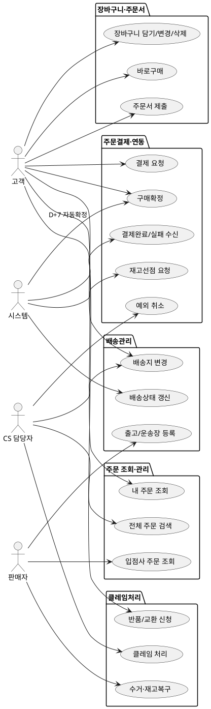

# 상위 유스케이스 — Order

> **단계**: 구조설계
> **문서범위**: Domain
> **문서종류**: Design
>
> **작성 목적**: 도메인 정의서(⑤)의 책임 목록을 "누가(액터) 무엇을(업무) 하는가" 단위로 분해한다.
> **흐름 내 위치**: ⑤ 도메인 정의서 → **⑥ 상위 유스케이스** → ⑦ 메뉴구조도 → ⑧ EARS
> **작성 주체**: 시니어 개발자 + AI 협업 (기획자·현업 검토·확인)

| 항목 | 내용 |
|---|---|
| ID | DESIGN-UC-ORDER-001 |
| 상태 | **Finalized** |
| 작성일 | 2026-08-11 |
| 갱신일 | 2026-08-11 |

---

## ① 액터 정의

| 액터 | 설명 | 채널 |
|---|---|---|
| 고객 | 로그인한 최종 구매자. 본인 주문에 대해서만 조회·조작 가능 | M(Mobile) |
| 판매자 | 입점사 운영자. 자기 매장으로 걸린 주문만 처리 | P(Partner) |
| CS 담당자 | 플랫폼 관리자. 예외 처리·클레임 중재 권한을 가짐 | A(Admin) |
| 시스템 | Payment·Catalog 도메인의 비동기 이벤트, 배치 스케줄러 | C(Consumer)/B(Batch) |

---

## ② 업무그룹별 유스케이스

### 장바구니·주문서

| 유스케이스 | 액터 | 도출 근거 |
|---|---|---|
| 장바구니 담기 / 수량 변경 / 삭제 | 고객 | 도메인정의서 "주문 생성" 책임 |
| 바로구매 (장바구니 미경유) | 고객 | 정책: 상품상세에서 즉시구매 지원 |
| 배송지·포인트·결제수단 선택 후 주문서 제출 | 고객 | 도메인정의서 "주문 생성" + 결제 프로세스 |

### 주문결제·연동

| 유스케이스 | 액터 | 도출 근거 |
|---|---|---|
| 결제 요청 (TEMP→PROCESSING) | 고객 | 도메인정의서 "주문 상태 관리" |
| 결제완료/결제실패 이벤트 수신 | 시스템(Payment 발행) | 도메인정의서 §4: Payment→Order 비동기 이벤트 |
| 재고선점 요청 | 시스템(Catalog 연동) | 도메인정의서 §4: Order→Catalog 동기 호출 |
| 구매확정 (수동/자동) | 고객 / 시스템(배치) | 정책: 배송완료 후 7일 자동확정 |
| 예외 취소 | CS 담당자 | CS 운영: 결제 후에도 취소 가능 |

### 배송관리

| 유스케이스 | 액터 | 도출 근거 |
|---|---|---|
| 출고 처리 / 운송장 등록 | 판매자 | 도메인정의서 "배송 처리" 책임 |
| 배송지 변경 (출고 전) | 고객 / CS 담당자 | 정책: 출고 전까지 변경 허용 |
| 배송상태 갱신 배치 | 시스템(배치) | 도메인정의서 §5: 택배사 API 연동 |

### 클레임처리

| 유스케이스 | 액터 | 도출 근거 |
|---|---|---|
| 반품/교환 신청 | 고객 | 도메인정의서 "클레임 접수" 책임 |
| 수거·재고복구 처리 | 판매자 | 정책: 판매자 귀책 시 수거 의무 |
| 클레임 접수/처리시작/완료처리/반려확정 | CS 담당자 | CS 운영: 중재·예외처리 워크플로우 |

### 주문 조회·관리

| 유스케이스 | 액터 | 도출 근거 |
|---|---|---|
| 내 주문 목록·상세 조회 | 고객 | 도메인정의서 "주문 조회" |
| 입점사 주문 목록·상세 조회 | 판매자 | 도메인정의서 "입점사 주문 확인" |
| 전체 주문 검색·필터·상세 조회 | CS 담당자 | 관리자 업무 |
| 주문 통계 (대시보드) | CS 담당자 | 운영 모니터링 |

---

## ③ 액터-유스케이스 관계도

---

## ④ 권한 범위

| 규칙 | 도출 근거 |
|---|---|
| 고객은 본인 주문만 조회·결제·취소 가능 (`order.memberId == 로그인 사용자`) | 개인정보 보호 원칙 |
| 판매자는 자기 매장으로 걸린 주문만 출고·클레임 처리 가능 | 도메인정의서 §4: Vendor→Order 관계 |
| 고객의 단순 취소는 PAYMENT_COMPLETED 상태에서만 허용, 이후 상태는 CS 예외 취소만 가능 | 취소 정책 |
| 반품·교환 신청은 배송완료 후 10일 이내로 제한 | 반품 기한 규정 |
| 재고 수동 복구·귀책 이의제기는 반품 건당 1회로 제한 (중복 방지) | CS 운영 규칙 |

---

## 근거

| 항목 | 출처 |
|---|---|
| 업무그룹 분류 | `05-도메인정의서.md` Order "핵심 책임" |
| 액터·채널 | `03-컴포넌트.md` 앱 구성 + 도메인 정의서 "채널" |
| 권한 범위 | 정책 규칙 + CS 운영 인터뷰 |
| 이벤트 연동 | `05-도메인정의서.md` Order "의존·이벤트 발행" |
