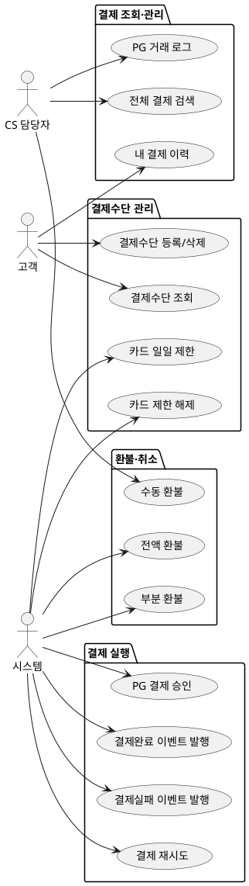

# 상위 유스케이스 — Payment

> **단계**: 구조설계
> **문서범위**: Domain
> **문서종류**: Design
>
> **작성 목적**: 도메인 정의서(⑤)의 책임 목록을 "누가(액터) 무엇을(업무) 하는가" 단위로 분해한다.
> **흐름 내 위치**: ⑤ 도메인 정의서 → **⑥ 상위 유스케이스** → ⑦ 메뉴구조도 → ⑧ EARS
> **작성 주체**: 시니어 개발자 + AI 협업 (기획자·현업 검토·확인)

| 항목 | 내용 |
|---|---|
| ID | DESIGN-UC-PAYMENT-001 |
| 상태 | **Finalized** |
| 작성일 | 2026-08-11 |
| 갱신일 | 2026-08-11 |

---

## ① 액터 정의

| 액터 | 설명 | 채널 |
|---|---|---|
| 고객 | 로그인한 최종 구매자. 본인 결제수단 관리·결제 실행 | M(Mobile) |
| CS 담당자 | 플랫폼 관리자. 환불 처리·결제 이력 조회 권한 | A(Admin) |
| 시스템 | Order 도메인의 결제 요청, 배치 스케줄러 (카드 제한 해제) | C(Consumer)/B(Batch) |

---

## ② 업무그룹별 유스케이스

### 결제 실행

| 유스케이스 | 액터 | 도출 근거 |
|---|---|---|
| PG 결제 승인 요청 | 시스템(Order 도메인 요청) | 도메인정의서 "결제 승인" 책임 |
| 결제완료 이벤트 발행 → Order | 시스템 | 도메인정의서 §4: Payment→Order |
| 결제실패 이벤트 발행 → Order | 시스템 | 도메인정의서 §4: Payment→Order |
| 결제 재시도 (최대 3회) | 시스템 | PG 일시 장애 대응 |

### 환불·취소

| 유스케이스 | 액터 | 도출 근거 |
|---|---|---|
| 전액 환불 (주문 취소 시) | 시스템(Order 이벤트 수신) | 도메인정의서 "취소·환불" 책임 |
| 부분 환불 (클레임 완료 시) | 시스템(Order 이벤트 수신) | 부분반품 환불 정책 |
| 수동 환불 처리 | CS 담당자 | CS 운영: PG 자동 환불 실패 시 |

### 결제수단 관리

| 유스케이스 | 액터 | 도출 근거 |
|---|---|---|
| 결제수단 등록 / 삭제 | 고객 | 도메인정의서 "결제수단 관리" |
| 결제수단 목록 조회 | 고객 | 마이페이지 기능 |
| 카드 일일 제한 (3회 실패 시 당일 차단) | 시스템 | 보안 정책: 부정결제 방지 |
| 카드 제한 자동 해제 (익일 00:00) | 시스템(배치) | 보안 정책: 익일 자동 해제 |

### 결제 조회·관리

| 유스케이스 | 액터 | 도출 근거 |
|---|---|---|
| 내 결제 이력 조회 | 고객 | 마이페이지 기능 |
| 전체 결제 이력 검색·필터 | CS 담당자 | 관리자 업무 |
| PG 거래 로그 조회 | CS 담당자 | 장애 대응·감사 |

---

## ③ 액터-유스케이스 관계도

---

## ④ 권한 범위

| 규칙 | 도출 근거 |
|---|---|
| 고객은 본인 결제수단만 등록·삭제·조회 가능 | 개인정보 보호 원칙 |
| 환불은 원결제 수단으로만 가능 (다른 수단 환불 불가) | PG 환불 정책 |
| CS 수동 환불은 PG 자동 환불 실패 건에 한함 | CS 운영 규칙 |
| 카드 정보 원본(카드번호·CVV)은 서버 미저장, PG 토큰만 보유 | NFR-SE-08 PCI DSS |
| 동일 카드 3회 연속 실패 시 당일 결제 차단 | 보안 정책: 부정결제 방지 |

---

## 근거

| 항목 | 출처 |
|---|---|
| 업무그룹 분류 | `05-도메인정의서.md` Payment "핵심 책임" |
| 액터·채널 | `03-컴포넌트.md` 앱 구성 + 도메인 정의서 "채널" |
| 환불 정책 | PG 표준 환불 규칙 |
| 카드 제한 규칙 | `02-NFR.md` NFR-SE-08, 보안 정책 |
| 이벤트 연동 | `05-도메인정의서.md` Payment "의존·이벤트 발행" |
