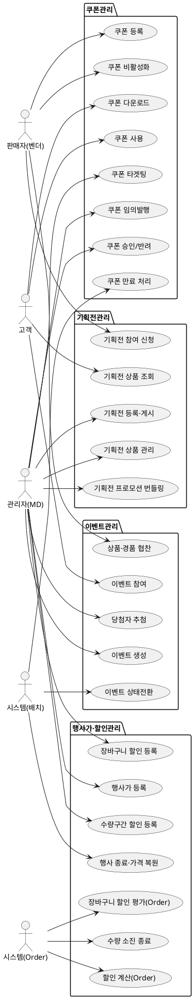

# 상위 유스케이스 — Promotion

> **단계**: 구조설계
> **문서범위**: Domain
> **문서종류**: Design
>
> **작성 목적**: 도메인 정의서(⑤)의 책임 목록을 "누가(액터) 무엇을(업무) 하는가" 단위로 분해한다.
> **흐름 내 위치**: ⑤ 도메인 정의서 → **⑥ 상위 유스케이스** → ⑦ 메뉴구조도 → ⑧ EARS
> **작성 주체**: 시니어 개발자 + AI 협업 (기획자·현업 검토·확인)

| 항목 | 내용 |
|---|---|
| ID | DESIGN-UC-PROMOTION-001 |
| 상태 | **Draft** |
| 작성일 | 2026-07-08 |
| 갱신일 | 2026-07-08 |

---

## ① 액터 정의

| 액터 | 설명 | 채널 |
|---|---|---|
| 관리자(MD) | 플랫폼 운영자. 행사가·장바구니 할인·기획전·이벤트·사은품 등록·관리, 쿠폰 승인 | A(Admin) |
| 판매자(벤더) | 입점사 담당자. 쿠폰 등록·비활성화, 기획전 참여 신청 | P(Partner) |
| 고객 | 로그인한 최종 구매자. 쿠폰 다운로드·사용, 이벤트 참여 | M(Mobile) |
| 시스템(Order) | Order 도메인이 할인 계산·쿠폰 검증을 동기 요청 | C(Consumer) |
| 시스템(배치) | 행사 종료·쿠폰 만료·이벤트 상태 전환 스케줄러 | B(Batch) |

---

## ② 업무그룹별 유스케이스

### 쿠폰관리

| 유스케이스 | 액터 | 도출 근거 |
|---|---|---|
| 쿠폰 직접 등록 (플랫폼 직매입, 즉시 ACTIVE) | 관리자(MD) | 정책서 §9.0: 직매입 프로모션 등록 규칙 |
| 쿠폰 등록 (정률/정액, 유효기간, 발급한도, 최소주문금액) | 판매자 | 도메인기능표: 쿠폰 등록(벤더) |
| 쿠폰 승인 / 반려 (입점사 쿠폰만) | 관리자(MD) | 도메인기능표: 쿠폰 승인/반려(MD) |
| 쿠폰 타겟팅 설정 (회원 대상 + 상품 대상) | 관리자(MD) | 도메인기능표: 쿠폰 타겟팅 |
| 쿠폰 임의 발행 (특정 회원 개별 지급) | 관리자(CS) | 도메인기능표: 쿠폰 임의발행 |
| 쿠폰 비활성화 (조기 종료) | 판매자 / 관리자(MD) | 도메인기능표: 쿠폰 비활성화 |
| 쿠폰 다운로드 | 고객 | 도메인기능표: 쿠폰 다운로드(고객) |
| 쿠폰 사용 (주문 시 적용) | 고객 | 도메인기능표: 쿠폰 사용(고객) |
| 쿠폰 만료 일괄 처리 | 시스템(배치) | 도메인기능표: 쿠폰 만료 처리(배치) |

### 행사가·할인관리

| 유스케이스 | 액터 | 도출 근거 |
|---|---|---|
| 행사가(즉시할인) 등록·활성화 | 관리자(MD) | 도메인기능표: 행사가 관리 |
| 수량구간 할인 등록·활성화 | 관리자(MD) | 도메인기능표: 수량 할인 관리 |
| 장바구니 할인 정책 등록·활성화 | 관리자(MD) | 도메인기능표: 장바구니 할인 관리 |
| 행사 시작 시 노출 할인가 갱신 (배치) | 시스템(배치/Consumer) | 상품 목록 할인가 사전 계산 |
| 행사 종료 시 가격 자동 복원 | 시스템(배치) | 정책서 §3.7, REQ-PRM-011 |
| 행사가 수량 소진 시 종료 처리 | 시스템(Consumer) | 정책서 §9.1-1, REQ-PRM-012 |
| 할인 적용 계산 (Order 연동) | 시스템(Order) | REQ-PRM-001, PublicApi |
| 할인가 실시간 계산 (상품 상세 조회) | 시스템(Catalog/BFF) | REQ-PRM-052, PublicApi |
| 장바구니 할인 조건 평가 (Order 연동) | 시스템(Order) | REQ-PRM-002, PublicApi |

### 기획전관리

| 유스케이스 | 액터 | 도출 근거 |
|---|---|---|
| 기획전 등록·게시 | 관리자(MD) | 도메인기능표: 기획전 등록·게시 |
| 기획전 상품 관리 (추가/제거) | 관리자(MD) | 도메인기능표: 기획전 상품 관리 |
| 기획전 프로모션 번들링 | 관리자(MD) | 도메인기능표: 기획전 프로모션 번들링 |
| 기획전 상품 조회 | 고객 | 도메인기능표: 기획전 상품 조회(고객) |
| 기획전 참여 신청 | 판매자 | 도메인기능표: 기획전 참여 신청(입점사) |

### 이벤트관리

| 유스케이스 | 액터 | 도출 근거 |
|---|---|---|
| 이벤트 생성·기본설정 | 관리자(MD) | 도메인기능표: 이벤트 생성·기본설정 |
| 이벤트 예약 게시·자동 상태전환 | 시스템(배치) | 도메인기능표: 이벤트 예약 게시 |
| 이벤트 대상자 설정 (타겟팅) | 관리자(MD) | 도메인기능표: 이벤트 대상자 설정 |
| 당첨자 추첨·발표 | 관리자(MD) | 도메인기능표: 당첨자 추첨·발표 |
| 경품 재고·발송 관리 | 관리자(MD) | 도메인기능표: 경품 재고·발송 관리 |
| 이벤트 참여 (출석/룰렛/응모) | 고객 | 도메인기능표: 고객참여 |
| 이벤트 참여 이력·당첨 확인 | 고객 | 도메인기능표: 참여이력·당첨확인 |
| 이벤트 상품·경품 협찬 | 판매자 | 도메인기능표: 입점사 협찬 |

---

## ③ 액터-유스케이스 관계도

---

## ④ 권한 범위

| 규칙 | 도출 근거 |
|---|---|
| 판매자는 본인 입점사 소속 쿠폰만 등록·비활성화 가능 | 입점사 권한 경계 |
| MD는 직매입 상품(vendor.is_platform_direct=TRUE) 쿠폰을 직접 등록하며 승인 게이트 생략 | 정책서 §9.0: 직매입 프로모션 등록 규칙 |
| 입점사 쿠폰은 반드시 MD 승인을 거쳐야 ACTIVE 전환 | 정책서 §9.0: 입점형 프로모션 등록 규칙 |
| 장바구니 할인은 플랫폼 운영자만 등록 가능 (벤더 불가) | REQ-PRM-031, 할인유형 적용순서 §4 |
| 장바구니 가격할인은 동시 1건만 ACTIVE 허용 | REQ-PRM-032 |
| 동일 상품에 행사가와 수량구간 할인 택1 (중복 등록 방지) | REQ-PRM-007, 할인유형 적용순서 §4 |
| 고객은 본인 보유 쿠폰만 사용 가능 | 개인정보 보호 원칙 |
| 쿠폰 승인은 MD만 수행 (벤더 등록 → MD 승인 게이트) | 도메인기능표: 승인 워크플로우 |
| 장바구니 쿠폰은 주문 시 동시 1건만 적용 허용 | REQ-PRM-048 |

---

## ⑤ Bolt 분할 후보

| Bolt 후보 | 업무그룹 | 예상 규모 |
|---|---|---|
| 쿠폰 CRUD + 승인 워크플로우 | 쿠폰관리 | 1.5일 |
| 쿠폰 발급·사용·만료 | 쿠폰관리 | 1일 |
| 행사가(즉시할인) 관리 | 행사가·할인관리 | 1일 |
| 수량구간 할인 관리 | 행사가·할인관리 | 1일 |
| 장바구니 할인 관리 | 행사가·할인관리 | 반나절 |
| PublicApi (Order 연동: 할인 계산·쿠폰 검증) | 행사가·할인관리 | 1일 |
| 노출 할인가 사전 계산·갱신 (배치/이벤트) | 행사가·할인관리 | 반나절 |
| 상품 상세 실시간 할인가 계산 (Catalog/BFF 연동) | 행사가·할인관리 | 반나절 |
| 기획전 관리 | 기획전관리 | 1일 |
| 이벤트 관리 (MD 운영) | 이벤트관리 | 1.5일 |
| 이벤트 참여 (고객) | 이벤트관리 | 1일 |

---

## 근거

| 항목 | 출처 |
|---|---|
| 업무그룹 분류 | `05-도메인정의서.md` Promotion "핵심 책임" |
| 액터·채널 | `03-컴포넌트.md` 앱 구성 + 도메인 정의서 "채널" |
| PublicApi 연동 | `04-기능요구사항(EARS)/05-Promotion.md` REQ-PRM-001~007 |
| 할인 유형·규칙 | `프로모션-할인유형-적용순서.md` §4 |
| 도메인기능표 | `도메인기능표/05-Promotion.md` (41개 소분류) |
| 승인 워크플로우 | 도메인기능표 코드 기반 보완 (2026-07-28) |
