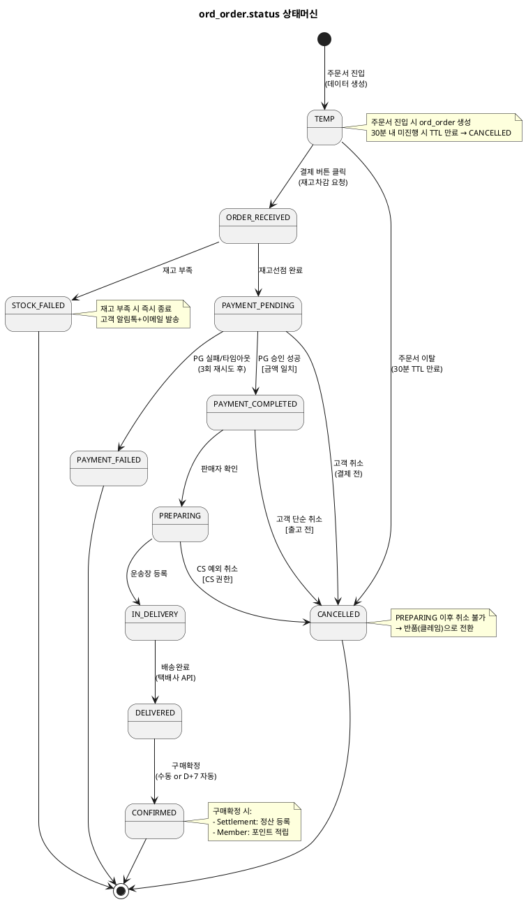
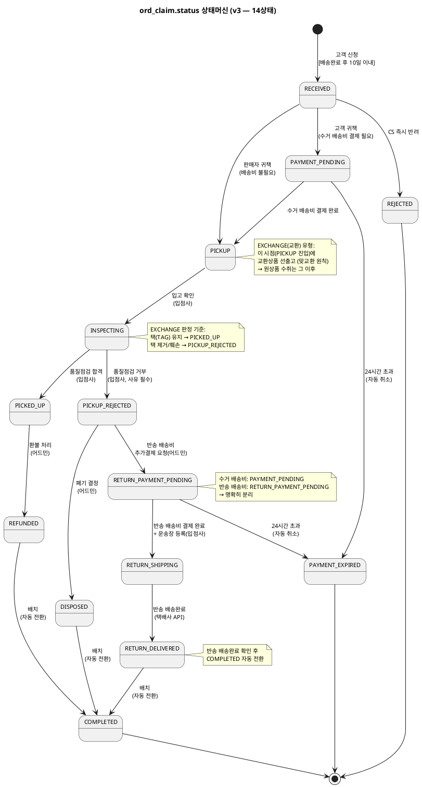

# 상태머신 — Order

> **단계**: 구조설계
> **문서범위**: Domain
> **문서종류**: Design
>
> **작성 목적**: ERD(⑨)의 status 컬럼에서 허용 상태와 전이 규칙을 정의한다.
> **흐름 내 위치**: ⑨ ERD → **⑩ 상태머신** → ⑪ 비즈니스 프로세스 → ⑫ 이벤트 플로우
> **작성 주체**: 시니어 개발자 + AI 협업 (기획자·현업 검토·확인)

| 항목 | 내용 |
|---|---|
| ID | DESIGN-SM-ORDER-001 |
| 상태 | **Finalized** |
| 작성일 | 2026-08-11 |
| 갱신일 | 2026-08-20 |

---

## 1. ord_order.status 상태머신

### 상태 목록

| 상태 | 설명 | 진입 조건 |
|---|---|---|
| TEMP | 임시주문 생성 (주문서 진입) | 주문서 화면 진입 시 데이터 생성 |
| ORDER_RECEIVED | 주문접수 (재고차감 요청 중) | 고객 결제 버튼 클릭 |
| PAYMENT_PENDING | 결제 요청 중 (재고선점 완료) | 재고 선점 성공 |
| PAYMENT_COMPLETED | 결제 완료 (PG 승인) | PG 승인 성공 |
| PREPARING | 출고 준비 중 | 판매자 확인 |
| IN_DELIVERY | 배송 중 | 운송장 등록 |
| DELIVERED | 배송 완료 | 택배사 배송완료 |
| CONFIRMED | 구매 확정 | 고객 수동 or D+7 자동 |
| CANCELLED | 취소 | 고객 취소 or CS 예외 취소 |
| PAYMENT_FAILED | 결제 실패 | PG 실패/타임아웃 (3회 재시도 후) |
| STOCK_FAILED | 재고 부족 실패 | 재고 선점 실패 |

### 전이 다이어그램

### 전이 규칙 상세

| From | To | 트리거 | 가드 (조건) | 액션 (부수효과) |
|---|---|---|---|---|
| TEMP | ORDER_RECEIVED | 고객 결제 버튼 클릭 | 주문서 유효성 검증 통과 | Catalog에 재고차감 요청 |
| TEMP | CANCELLED | 주문서 이탈 (TTL 30분) | — | 임시 데이터 정리 |
| ORDER_RECEIVED | PAYMENT_PENDING | 재고선점 성공 | Catalog 응답 success | PG 결제 요청 시작 |
| ORDER_RECEIVED | STOCK_FAILED | 재고선점 실패 | Catalog 응답 StockInsufficient | 고객 알림톡+이메일 발송 |
| PAYMENT_PENDING | PAYMENT_COMPLETED | PAYMENT_APPROVED 이벤트 | 금액 일치 검증 | 주문확인 알림톡+이메일 |
| PAYMENT_PENDING | PAYMENT_FAILED | PAYMENT_FAILED 이벤트 | 3회 재시도 소진 | 재고 복원, 고객 알림 |
| PAYMENT_PENDING | CANCELLED | 고객 취소 요청 | — | 재고 복원 |
| PAYMENT_COMPLETED | PREPARING | 판매자 확인 | — | — |
| PAYMENT_COMPLETED | CANCELLED | 고객 취소 요청 | 출고 전 상태 | PG 환불 요청, 재고 복원 |
| PREPARING | IN_DELIVERY | 운송장 등록 | — | 배송 추적 시작, 고객 알림톡 |
| PREPARING | CANCELLED | CS 예외 취소 요청 | CS 담당자 권한 | PG 환불 요청, 재고 복원 (REQ-ORD-017) |
| IN_DELIVERY | DELIVERED | 택배사 배송완료 | — | D+7 자동확정 타이머 시작, 고객 알림톡 |
| DELIVERED | CONFIRMED | 고객 수동 or D+7 배치 | — | 정산 등록 이벤트, 포인트 적립 이벤트 |

### 금지 전이

| From | To | 사유 | EARS 근거 |
|---|---|---|---|
| CONFIRMED | CANCELLED | 구매확정 후 취소 불가 (클레임으로 전환) | REQ-ORD-019 |
| IN_DELIVERY | CANCELLED | 배송 중 취소 불가 (반품 신청 안내) | REQ-ORD-019 |
| PREPARING | CANCELLED | 출고 준비 중 **고객** 취소 불가 (CS 예외취소는 허용) | REQ-ORD-017 |
| PAYMENT_FAILED | 모든 상태 | 종료 상태 (재주문 필요) | — |
| STOCK_FAILED | 모든 상태 | 종료 상태 (재주문 필요) | — |
| CANCELLED | 모든 상태 | 종료 상태 | — |

---

## 2. ord_claim.status 상태머신

> **v3 (2026-08-12 현행화)**: 반송 배송비결제 대기/반송배송완료 상태 추가 (12상태 → 14상태).
> **v4 (2026-08-20 현행화)**: 교환(EXCHANGE)은 "맞교환" 원칙 — PICKUP 진입 시 교환상품을 선출고(선출고 후 수취)하며, INSPECTING 판정 기준은 택(TAG) 유지 여부로 한다(REQ-ORD-056/057 참고).

### 상태 목록

| 상태 | 설명 | 진입 조건 | 수행 주체 |
|---|---|---|---|
| RECEIVED | 접수됨 | 고객 반품/교환 신청 | 고객 |
| PAYMENT_PENDING | 수거 배송비 결제 대기 | 고객 귀책 확정 시 | 고객 |
| PAYMENT_EXPIRED | 결제 만료 (자동 취소) | 24시간 초과 | 배치 |
| PICKUP | 수거 진행 중 | 배송비 결제 완료 또는 판매자 귀책 | 입점사 |
| INSPECTING | 품질점검 진행 중 | 상품 입고 확인 | 입점사 |
| PICKED_UP | 수거완료 (품질점검 합격) | 합격 판정 | 입점사 |
| PICKUP_REJECTED | 수거거부 (품질점검 불합격) | 불합격 판정 + 사유 등록 | 입점사 |
| REFUNDED | 환불 완료 | 어드민 환불 처리 | 어드민 |
| RETURN_PAYMENT_PENDING | 반송 배송비 결제 대기 | 어드민 반송결제 요청 | 고객 |
| RETURN_SHIPPING | 반송 배송 중 | 반송 배송비 결제 완료 + 운송장 등록 | 입점사 |
| RETURN_DELIVERED | 반송 배송 완료 | 택배사 반송완료 | 시스템 |
| DISPOSED | 폐기 처리 | 어드민 폐기 결정 | 어드민 |
| COMPLETED | 클레임 전체 완료 | 환불완료 or 반송배송완료 or 폐기 후 자동 | 배치 |
| REJECTED | 접수 단계 반려 | CS 반려 확정 | 어드민 |

### 전이 다이어그램

### 전이 규칙 상세

| From | To | 트리거 | 가드 (조건) | 액션 (부수효과) | 수행 주체 |
|---|---|---|---|---|---|
| RECEIVED | PAYMENT_PENDING | 귀책 판정 (고객) | 고객 귀책 사유 | 수거 배송비 결제 알림톡 발송 | 시스템 |
| RECEIVED | PICKUP | 귀책 판정 (판매자) | 판매자 귀책 사유 | 수거 즉시 시작. **EXCHANGE 유형은 이 시점에 교환상품 선출고**(맞교환 원칙, REQ-ORD-056) | 시스템 |
| RECEIVED | REJECTED | CS 즉시 반려 | 사유 필수 | 고객 알림톡 | 어드민 |
| PAYMENT_PENDING | PICKUP | 수거 배송비 결제 완료 | PG 결제 성공 | 수거 시작, 알림톡 발송. **EXCHANGE 유형은 이 시점에 교환상품 선출고**(맞교환 원칙, REQ-ORD-056) | 고객 |
| PAYMENT_PENDING | PAYMENT_EXPIRED | 24시간 초과 | 미결제 | 클레임 자동 취소, 알림톡 | 배치 |
| PICKUP | INSPECTING | 입고 확인 | 상품 도착 | — | 입점사 |
| INSPECTING | PICKED_UP | 품질점검 합격 | 상품 상태 양호(RETURN) / 택(TAG) 유지(EXCHANGE, REQ-ORD-057) | — | 입점사 |
| INSPECTING | PICKUP_REJECTED | 품질점검 거부 | 사유 필수. 상품 훼손(RETURN) / 택 제거·훼손(EXCHANGE, REQ-ORD-057) | 어드민 판정 대기 | 입점사 |
| PICKED_UP | REFUNDED | 환불 처리 | — | PG 환불 또는 계좌이체 | 어드민 |
| PICKUP_REJECTED | DISPOSED | 폐기 결정 | 반송 불가 판단 | 고객 알림톡 | 어드민 |
| PICKUP_REJECTED | RETURN_PAYMENT_PENDING | 반송 배송비 요청 | — | 고객에게 결제 알림톡 | 어드민 |
| RETURN_PAYMENT_PENDING | RETURN_SHIPPING | 반송 배송비 결제 완료 + 운송장 등록 | PG 결제 성공 | 반송 배송 시작 | 고객결제 + 입점사운송장 |
| RETURN_PAYMENT_PENDING | PAYMENT_EXPIRED | 24시간 초과 | 미결제 | 클레임 자동 취소, 알림톡 | 배치 |
| RETURN_SHIPPING | RETURN_DELIVERED | 택배사 반송완료 | — | 고객 알림톡 | 시스템(배치) |
| RETURN_DELIVERED | COMPLETED | 배치 자동 전환 | — | 클레임 완료 알림톡 | 배치 |
| REFUNDED | COMPLETED | 배치 자동 전환 | — | 클레임 완료 알림톡 | 배치 |
| DISPOSED | COMPLETED | 배치 자동 전환 | — | — | 배치 |

### 금지 전이

| From | To | 사유 |
|---|---|---|
| COMPLETED | 모든 상태 | 종료 상태 (신규 클레임 생성 필요) |
| REJECTED | 모든 상태 | 종료 상태 |
| PAYMENT_EXPIRED | 모든 상태 | 종료 상태 (재신청 필요) |
| PICKED_UP | PICKUP_REJECTED | 합격 확정 후 거부 불가 |
| PICKUP_REJECTED | PICKED_UP | 거부 확정 후 합격 불가 |
| RETURN_DELIVERED | RETURN_SHIPPING | 배송완료 후 역행 불가 |

---

## Bolt 분할 후보 (상태 전이 기반)

> 상태 전이 1개 = Bolt 1개 후보 (부록 A 기준 #3)

| Bolt 후보 | 상태 전이 | 예상 규모 |
|---|---|---|
| 장바구니 | — (독립 CRUD + 옵션변경) | 반나절 |
| 주문서 생성 (임시주문) | [*]→TEMP | 반나절 |
| 주문접수·재고선점 | TEMP→ORDER_RECEIVED→PAYMENT_PENDING | 1일 |
| 결제 완료 처리 | PAYMENT_PENDING→PAYMENT_COMPLETED | 반나절 |
| 결제 실패·재고 부족 처리 | PAYMENT_PENDING→PAYMENT_FAILED, ORDER_RECEIVED→STOCK_FAILED | 반나절 |
| 고객 취소 | PAYMENT_COMPLETED→CANCELLED | 반나절 |
| 출고 처리 | PAYMENT_COMPLETED→PREPARING→IN_DELIVERY | 1일 |
| 배송 완료 | IN_DELIVERY→DELIVERED | 반나절 |
| 구매 확정 | DELIVERED→CONFIRMED | 반나절 |
| 반품/교환 신청 | [*]→RECEIVED | 반나절 |
| 클레임 배송비 결제 | RECEIVED→PAYMENT_PENDING→PICKUP | 반나절 |
| 수거·품질점검 (입점사) | PICKUP→INSPECTING→PICKED_UP/PICKUP_REJECTED | 1일 |
| 환불 처리 (어드민) | PICKED_UP→REFUNDED→COMPLETED | 반나절 |
| 폐기·반송 판정 (어드민) | PICKUP_REJECTED→DISPOSED→COMPLETED, PICKUP_REJECTED→RETURN_PAYMENT_PENDING→RETURN_SHIPPING→RETURN_DELIVERED→COMPLETED | 1일 |

---

## 근거

| 항목 | 출처 |
|---|---|
| 상태 목록 | `09-도메인모델ERD(Order).md` ord_order.status, ord_claim.status |
| 전이 규칙 | `08-EARS기능요구(Order).md` Event-driven/Unwanted 패턴 |
| 금지 전이 | REQ-ORD-017, REQ-ORD-019 |
| D+7 자동확정 | REQ-ORD-015 |
| 반품 10일 기한 | REQ-ORD-030 |
| 교환(맞교환) 선출고·택유지 판정 | REQ-ORD-056, REQ-ORD-057 |
| Bolt 분할 기준 | 방법론 부록 A (전이 1개 = Bolt 1개) |
