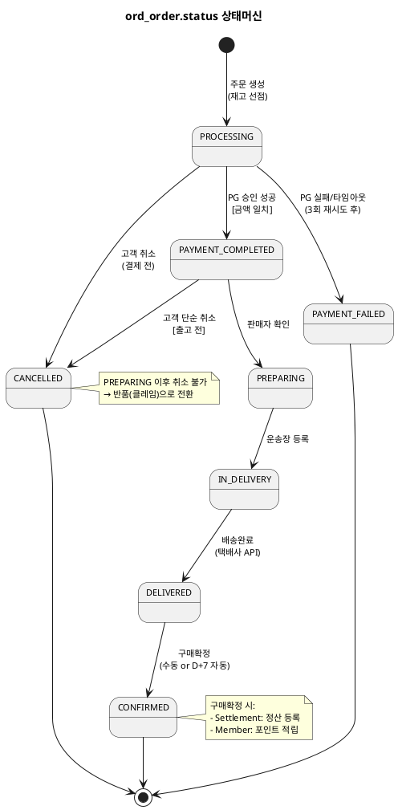
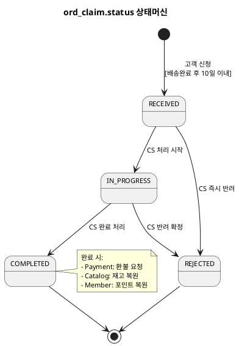

# 상태머신 — Order

> **단계**: 구조설계
> **문서범위**: Domain
> **문서종류**: Design
>
> **작성 목적**: ERD(⑨)의 status 컬럼에서 허용 상태와 전이 규칙을 정의한다.
> **흐름 내 위치**: ⑨ ERD → **⑩ 상태머신** → ⑪ 비즈니스 프로세스 → ⑫ 이벤트 플로우
> **작성 주체**: 시니어 개발자 + AI 협업 (기획자·현업 검토·확인)

| 항목 | 내용 |
|---|---|
| ID | DESIGN-SM-ORDER-001 |
| 상태 | **Finalized** |
| 작성일 | 2026-08-11 |
| 갱신일 | 2026-08-11 |

---

## 1. ord_order.status 상태머신

### 상태 목록

| 상태 | 설명 | 진입 조건 |
|---|---|---|
| PROCESSING | 결제 요청 중 (재고 선점 완료) | 주문 생성·결제 요청 시 |
| PAYMENT_COMPLETED | 결제 완료 | PG 승인 성공 |
| PREPARING | 출고 준비 중 | 판매자 확인 |
| IN_DELIVERY | 배송 중 | 운송장 등록 |
| DELIVERED | 배송 완료 | 택배사 배송완료 |
| CONFIRMED | 구매 확정 | 고객 수동 or D+7 자동 |
| CANCELLED | 취소 | 고객 취소 or CS 예외 취소 |
| PAYMENT_FAILED | 결제 실패 | PG 실패/타임아웃 |

### 전이 다이어그램

### 전이 규칙 상세

| From | To | 트리거 | 가드 (조건) | 액션 (부수효과) |
|---|---|---|---|---|
| PROCESSING | PAYMENT_COMPLETED | PAYMENT_APPROVED 이벤트 | 금액 일치 검증 | 재고 선점 확정 |
| PROCESSING | PAYMENT_FAILED | PAYMENT_FAILED 이벤트 | 3회 재시도 소진 | 재고 복원 |
| PROCESSING | CANCELLED | 고객 취소 요청 | — | 재고 복원 |
| PAYMENT_COMPLETED | PREPARING | 판매자 확인 | — | — |
| PAYMENT_COMPLETED | CANCELLED | 고객 취소 요청 | 출고 전 상태 | PG 환불 요청, 재고 복원 |
| PREPARING | IN_DELIVERY | 운송장 등록 | — | 배송 추적 시작 |
| IN_DELIVERY | DELIVERED | 택배사 배송완료 | — | D+7 자동확정 타이머 시작 |
| DELIVERED | CONFIRMED | 고객 수동 or D+7 배치 | — | 정산 등록 이벤트, 포인트 적립 이벤트 |

### 금지 전이

| From | To | 사유 | EARS 근거 |
|---|---|---|---|
| CONFIRMED | CANCELLED | 구매확정 후 취소 불가 (클레임으로 전환) | REQ-ORD-019 |
| IN_DELIVERY | CANCELLED | 배송 중 취소 불가 (반품 신청 안내) | REQ-ORD-019 |
| PREPARING | CANCELLED | 출고 준비 중 고객 취소 불가 (CS 예외만 가능) | REQ-ORD-017 |
| PAYMENT_FAILED | 모든 상태 | 종료 상태 (재주문 필요) | — |
| CANCELLED | 모든 상태 | 종료 상태 | — |

---

## 2. ord_claim.status 상태머신

### 상태 목록

| 상태 | 설명 | 진입 조건 |
|---|---|---|
| RECEIVED | 접수됨 | 고객 반품/교환 신청 |
| IN_PROGRESS | 처리 중 | CS 담당자 처리 시작 |
| COMPLETED | 완료 | CS 완료 처리 (환불/교환 진행) |
| REJECTED | 반려 | CS 반려 확정 |

### 전이 다이어그램

### 전이 규칙 상세

| From | To | 트리거 | 가드 (조건) | 액션 (부수효과) |
|---|---|---|---|---|
| RECEIVED | IN_PROGRESS | CS 처리 시작 | — | — |
| RECEIVED | REJECTED | CS 즉시 반려 | 사유 필수 | 고객 알림 |
| IN_PROGRESS | COMPLETED | CS 완료 처리 | 수거 확인 완료 | CLAIM_COMPLETED 이벤트 발행 |
| IN_PROGRESS | REJECTED | CS 반려 확정 | 사유 필수 | 고객 알림 |

### 금지 전이

| From | To | 사유 |
|---|---|---|
| COMPLETED | RECEIVED/IN_PROGRESS | 완료 후 재오픈 불가 (신규 클레임 생성) |
| REJECTED | 모든 상태 | 종료 상태 |

---

## Bolt 분할 후보 (상태 전이 기반)

> 상태 전이 1개 = Bolt 1개 후보 (부록 A 기준 #3)

| Bolt 후보 | 상태 전이 | 예상 규모 |
|---|---|---|
| 장바구니 | — (독립 CRUD) | 반나절 |
| 주문 생성·결제 요청 | [*]→PROCESSING | 1일 |
| 결제 완료 처리 | PROCESSING→PAYMENT_COMPLETED | 반나절 |
| 결제 실패 처리 | PROCESSING→PAYMENT_FAILED | 반나절 |
| 고객 취소 | PAYMENT_COMPLETED→CANCELLED | 반나절 |
| 출고 처리 | PAYMENT_COMPLETED→PREPARING→IN_DELIVERY | 1일 |
| 배송 완료 | IN_DELIVERY→DELIVERED | 반나절 |
| 구매 확정 | DELIVERED→CONFIRMED | 반나절 |
| 반품/교환 신청 | [*]→RECEIVED | 반나절 |
| 클레임 처리 | RECEIVED→IN_PROGRESS→COMPLETED/REJECTED | 1일 |

---

## 근거

| 항목 | 출처 |
|---|---|
| 상태 목록 | `09-도메인모델ERD(Order).md` ord_order.status, ord_claim.status |
| 전이 규칙 | `08-EARS기능요구(Order).md` Event-driven/Unwanted 패턴 |
| 금지 전이 | REQ-ORD-017, REQ-ORD-019 |
| D+7 자동확정 | REQ-ORD-015 |
| 반품 10일 기한 | REQ-ORD-030 |
| Bolt 분할 기준 | 방법론 부록 A (전이 1개 = Bolt 1개) |
