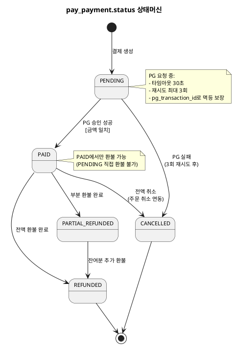

# 상태머신 — Payment

> **단계**: 구조설계
> **문서범위**: Domain
> **문서종류**: Design
>
> **작성 목적**: ERD(⑨)의 status 컬럼에서 허용 상태와 전이 규칙을 정의한다.
> **흐름 내 위치**: ⑨ ERD → **⑩ 상태머신** → ⑪ 비즈니스 프로세스 → ⑫ 이벤트 플로우
> **작성 주체**: 시니어 개발자 + AI 협업 (기획자·현업 검토·확인)

| 항목 | 내용 |
|---|---|
| ID | DESIGN-SM-PAYMENT-001 |
| 상태 | **Finalized** |
| 작성일 | 2026-08-11 |
| 갱신일 | 2026-08-11 |

---

## pay_payment.status 상태머신

### 상태 목록

| 상태 | 설명 | 진입 조건 |
|---|---|---|
| PENDING | 결제 대기 (PG 요청 전 또는 요청 중) | 결제 생성 시 |
| PAID | 결제 완료 (PG 승인 성공) | PG 승인 응답 |
| CANCELLED | 결제 취소 (PG 실패 또는 전액 환불) | 실패/취소 처리 |
| REFUNDED | 전액 환불 완료 | 전액 환불 성공 |
| PARTIAL_REFUNDED | 부분 환불 완료 | 부분 환불 성공 |

### 전이 다이어그램

### 전이 규칙 상세

| From | To | 트리거 | 가드 (조건) | 액션 (부수효과) |
|---|---|---|---|---|
| PENDING | PAID | PG 승인 성공 응답 | 금액 일치 (REQ-PAY-007) | PAYMENT_APPROVED 이벤트 발행 → Order |
| PENDING | CANCELLED | PG 실패 (3회 재시도 소진) | retry_count ≥ 3 | PAYMENT_FAILED 이벤트 발행 → Order |
| PAID | CANCELLED | ORDER_CANCELLED 이벤트 수신 | — | PG 전액 환불 요청 |
| PAID | REFUNDED | PG 전액 환불 성공 | 환불액 == 원결제액 | 환불 완료 로그 기록 |
| PAID | PARTIAL_REFUNDED | PG 부분 환불 성공 | 환불액 < 원결제액 | 환불 완료 로그 기록 |
| PARTIAL_REFUNDED | REFUNDED | 잔여분 추가 환불 성공 | 누적 환불액 == 원결제액 | 최종 환불 완료 |

### 금지 전이

| From | To | 사유 | EARS 근거 |
|---|---|---|---|
| PENDING | REFUNDED/PARTIAL_REFUNDED | 미결제 상태에서 환불 불가 | 논리적 불가 |
| REFUNDED | 모든 상태 | 종료 상태 | — |
| CANCELLED | 모든 상태 | 종료 상태 | — |
| PAID | PENDING | 역행 불가 | — |

---

## Bolt 분할 후보 (상태 전이 기반)

| Bolt 후보 | 상태 전이 | 예상 규모 |
|---|---|---|
| 결제 승인 | PENDING→PAID | 1일 |
| 결제 실패 | PENDING→CANCELLED | 반나절 |
| 전액 환불 | PAID→REFUNDED (또는 PAID→CANCELLED) | 반나절 |
| 부분 환불 | PAID→PARTIAL_REFUNDED | 반나절 |
| 결제수단 관리 | — (독립 CRUD) | 반나절 |
| 카드 제한/해제 | — (보안 배치) | 반나절 |

---

## 근거

| 항목 | 출처 |
|---|---|
| 상태 목록 | `09-도메인모델ERD(Payment).md` pay_payment.status |
| 전이 규칙 | `08-EARS기능요구(Payment).md` REQ-PAY-001~013 |
| 금액 일치 검증 | REQ-PAY-007 |
| 재시도 3회 | REQ-PAY-003 |
| 타임아웃 30초 | REQ-PAY-005 |
| 원결제 수단 환불 | REQ-PAY-013 |
| Bolt 분할 기준 | 방법론 부록 A (전이 1개 = Bolt 1개) |
