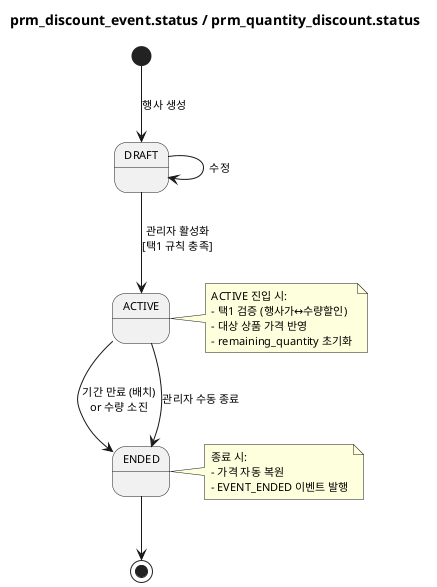
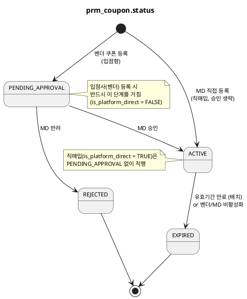
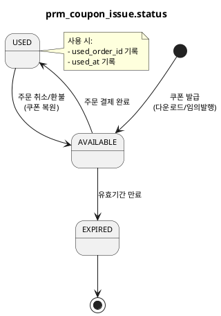

# 상태머신 — Promotion

> **단계**: 구조설계
> **문서범위**: Domain
> **문서종류**: Design
>
> **작성 목적**: ERD(⑨)의 status 컬럼에서 허용 상태와 전이 규칙을 정의한다.
> **흐름 내 위치**: ⑨ ERD → **⑩ 상태머신** → ⑪ 비즈니스 프로세스 → ⑫ 이벤트 플로우
> **작성 주체**: 시니어 개발자 + AI 협업 (기획자·현업 검토·확인)

| 항목 | 내용 |
|---|---|
| ID | DESIGN-SM-PROMOTION-001 |
| 상태 | **Draft** |
| 작성일 | 2026-07-08 |
| 갱신일 | 2026-07-08 |

---

## 1. prm_discount_event.status (행사가·수량할인 공통)

### 상태 목록

| 상태 | 설명 | 진입 조건 |
|---|---|---|
| DRAFT | 작성 중, 미활성 | 행사 생성 시 |
| ACTIVE | 활성 (할인 적용 중) | 관리자 활성화 |
| ENDED | 종료 (기간 만료 또는 수량 소진) | 배치/시스템 처리 |

### 전이 다이어그램

### 전이 규칙 상세

| From | To | 트리거 | 가드 (조건) | 액션 (부수효과) |
|---|---|---|---|---|
| DRAFT | ACTIVE | 관리자 활성화 | 동일 상품에 ACTIVE 행사 없음 (택1) | 대상 상품 할인가 반영, Redis 수량 셋업 |
| ACTIVE | ENDED | 기간 만료 | end_at ≤ now | 가격 복원, EVENT_ENDED 이벤트 발행 |
| ACTIVE | ENDED | 수량 소진 | remaining_quantity = 0 | 가격 복원, EVENT_ENDED 이벤트 발행 |
| ACTIVE | ENDED | 관리자 수동 종료 | — | 가격 복원 |

### 금지 전이

| From | To | 사유 |
|---|---|---|
| ENDED | DRAFT / ACTIVE | 종료 상태는 불변 (재활성화는 신규 생성으로) |
| ACTIVE | DRAFT | 역행 불가 (이미 고객에게 노출) |

---

## 2. prm_coupon.status (쿠폰 정의)

### 상태 목록

| 상태 | 설명 | 진입 조건 |
|---|---|---|
| PENDING_APPROVAL | 벤더 등록, MD 승인 대기 | 쿠폰 등록 시 |
| ACTIVE | 승인 완료, 발급·사용 가능 | MD 승인 |
| REJECTED | 반려 (사유 기록) | MD 반려 |
| EXPIRED | 만료 (기간 경과 또는 조기 비활성화) | 배치 또는 벤더 비활성화 |

### 전이 다이어그램

### 전이 규칙 상세

| From | To | 트리거 | 가드 (조건) | 액션 (부수효과) |
|---|---|---|---|---|
| — | ACTIVE | MD 직매입 쿠폰 직접 등록 | vendor.is_platform_direct = TRUE | 승인 게이트 생략, 즉시 발급 가능 |
| PENDING_APPROVAL | ACTIVE | MD 승인 | vendor.is_platform_direct = FALSE | 쿠폰 발급 가능 상태 |
| PENDING_APPROVAL | REJECTED | MD 반려 | 사유 필수 입력 | reject_reason 기록 |
| ACTIVE | EXPIRED | 유효기간 만료 | valid_to < now | 미사용 발급 건 일괄 EXPIRED |
| ACTIVE | EXPIRED | 벤더/MD 비활성화 | — | 조기 종료 |

### 금지 전이

| From | To | 사유 |
|---|---|---|
| REJECTED | ACTIVE | 반려 쿠폰 재승인 불가 (신규 등록 필요) |
| EXPIRED | ACTIVE | 만료 후 재활성화 불가 |
| ACTIVE | PENDING_APPROVAL | 역행 불가 |

---

## 3. prm_coupon_issue.status (발급 건별)

### 상태 목록

| 상태 | 설명 | 진입 조건 |
|---|---|---|
| AVAILABLE | 사용 가능 | 발급 시 |
| USED | 사용 완료 | 주문 결제 시 |
| EXPIRED | 만료 | 유효기간 경과 (배치) |

### 전이 다이어그램

### 전이 규칙 상세

| From | To | 트리거 | 가드 (조건) | 액션 (부수효과) |
|---|---|---|---|---|
| AVAILABLE | USED | 주문 결제 완료 | 유효기간 내 + 사용 조건 충족 | used_order_id, used_at 기록 |
| AVAILABLE | EXPIRED | 유효기간 만료 | expired_at ≤ now | — |
| USED | AVAILABLE | 주문 취소/환불 | 원래 쿠폰이 아직 유효기간 내 | used_order_id 초기화, used_at 초기화 |

---

## 4. prm_cart_discount.status (장바구니 할인)

> prm_discount_event.status와 동일한 DRAFT → ACTIVE → ENDED 전이.
> 추가 제약: **ACTIVE 상태 최대 1건** (REQ-PRM-032).

---

## Bolt 분할 후보 (상태 전이 기반)

| Bolt 후보 | 관련 상태 전이 | 예상 규모 |
|---|---|---|
| 쿠폰 등록·승인 워크플로우 | PENDING_APPROVAL→ACTIVE/REJECTED | 1일 |
| 쿠폰 발급·사용·복원 | AVAILABLE→USED→AVAILABLE | 1일 |
| 행사가 관리 | DRAFT→ACTIVE→ENDED | 1일 |
| 수량구간 할인 관리 | DRAFT→ACTIVE→ENDED | 1일 |
| 장바구니 할인 관리 | DRAFT→ACTIVE→ENDED | 반나절 |
| PublicApi (할인 계산·쿠폰 검증) | — (상태전이 없음, 조회·계산) | 1일 |

---

## 근거

| 항목 | 출처 |
|---|---|
| 상태 목록 | `09-도메인모델ERD(Promotion).md` 각 테이블 status 컬럼 |
| 전이 규칙 | `08-EARS기능요구(Promotion).md` REQ-PRM-010~048 |
| 택1 규칙 | REQ-PRM-007, REQ-PRM-021 |
| 장바구니 1건 제한 | REQ-PRM-032 |
| 쿠폰 승인 워크플로우 | REQ-PRM-040~042 |
| 쿠폰 복원 (주문 취소) | 정책서 §9 + 정산 정책 연동 |
