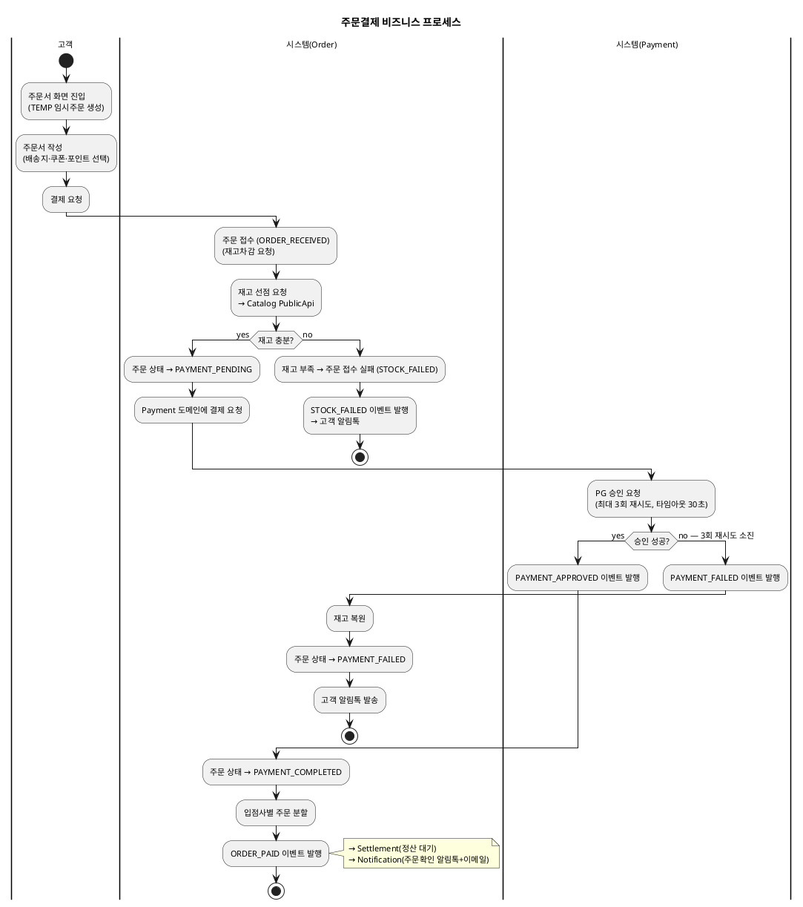
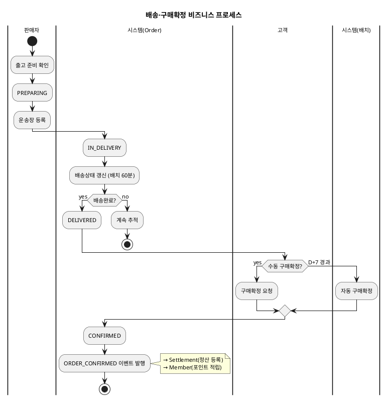
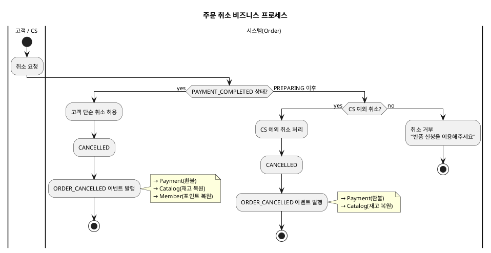
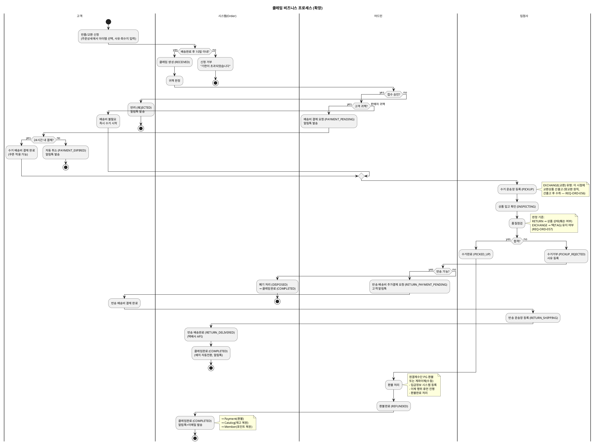

# 비즈니스 프로세스 — Order

> **단계**: 구조설계
> **문서범위**: Domain
> **문서종류**: Design
>
> **작성 목적**: 상태머신(⑩)의 전이를 액티비티 흐름으로 확장하여, "누가 어떤 순서로 업무를 수행하는가"를 시각화한다.
> **흐름 내 위치**: ⑩ 상태머신 → **⑪ 비즈니스 프로세스** → ⑫ 이벤트 플로우
> **작성 주체**: 시니어 개발자 + AI 협업 (기획자·현업 검토·확인)

| 항목 | 내용 |
|---|---|
| ID | DESIGN-BP-ORDER-001 |
| 상태 | **Finalized** |
| 작성일 | 2026-08-11 |
| 갱신일 | 2026-08-20 |

---

## 1. 주문결제 프로세스

> v2 (2026-08-20 현행화): 구모델 잔재 `PROCESSING` 제거 — 상태머신(⑩) TEMP→ORDER_RECEIVED→PAYMENT_PENDING 3단계로 정정

---

## 2. 배송·구매확정 프로세스

---

## 3. 취소 프로세스

---

## 4. 클레임(반품/교환) 프로세스

> v2 (2026-08-12 현행화): 12상태 확장 반영 (배송비 결제→수거→품질점검→합격/거부→환불/폐기/반송)
> v3 (2026-08-20 현행화): 14상태 반영 — 반송 배송비결제 대기(RETURN_PAYMENT_PENDING)·반송배송완료(RETURN_DELIVERED) 상태 보강
> v4 (2026-08-20 현행화): 교환(EXCHANGE) "맞교환" 원칙 반영 — PICKUP 진입 시 교환상품 선출고, 품질점검 판정 기준을 EXCHANGE는 택(TAG) 유지 여부로 명시

---

## 근거

| 항목 | 출처 |
|---|---|
| 상태 전이 | `10-상태머신(Order).md` |
| 액터·업무 흐름 | `06-상위유스케이스(Order).md` |
| 도메인 간 호출 | `05-도메인정의서.md` §4 관계도 |
| 업무 규칙 | REQ-ORD-015 (D+7), REQ-ORD-019 (취소 제한), REQ-ORD-030 (반품 10일) |
