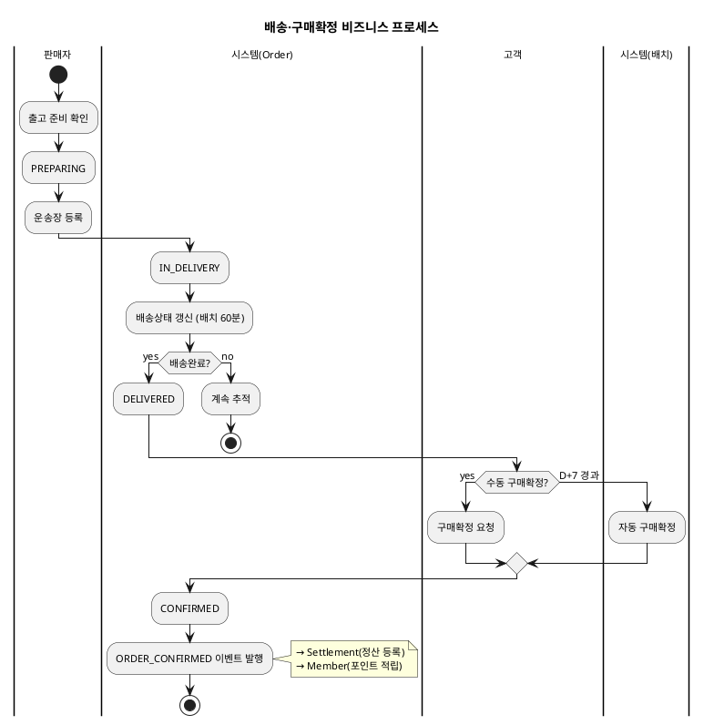
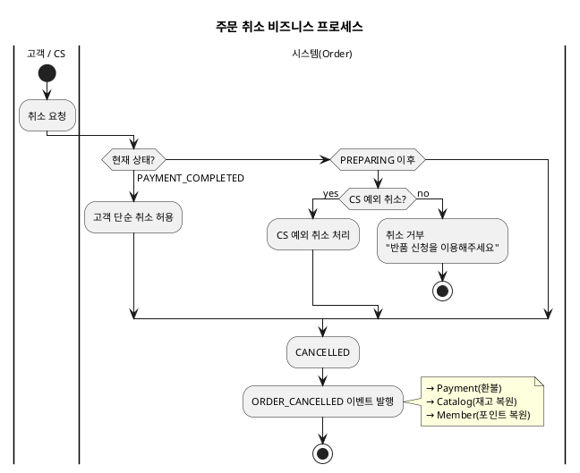
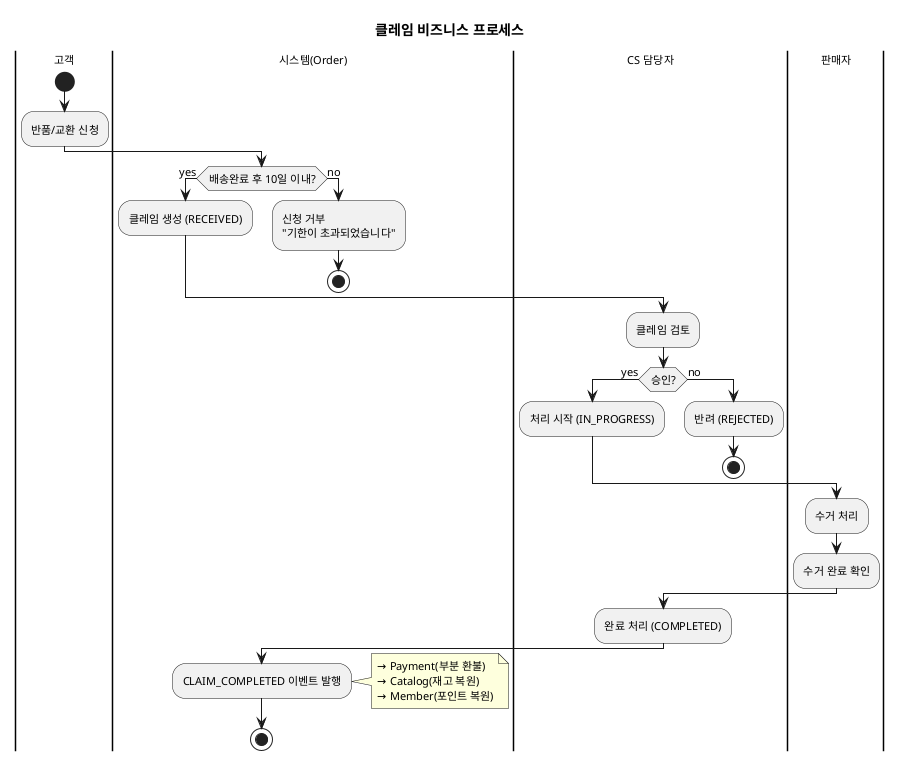

# 비즈니스 프로세스 — Order

> **단계**: 구조설계
> **문서범위**: Domain
> **문서종류**: Design
>
> **작성 목적**: 상태머신(⑩)의 전이를 액티비티 흐름으로 확장하여, "누가 어떤 순서로 업무를 수행하는가"를 시각화한다.
> **흐름 내 위치**: ⑩ 상태머신 → **⑪ 비즈니스 프로세스** → ⑫ 이벤트 플로우
> **작성 주체**: 시니어 개발자 + AI 협업 (기획자·현업 검토·확인)

| 항목 | 내용 |
|---|---|
| ID | DESIGN-BP-ORDER-001 |
| 상태 | **Finalized** |
| 작성일 | 2026-08-11 |
| 갱신일 | 2026-08-11 |

---

## 1. 주문결제 프로세스

```plantuml
@startuml
skinparam backgroundColor transparent
skinparam defaultFontSize 11
title 주문결제 비즈니스 프로세스

|고객|
start
:주문서 작성\n(배송지·쿠폰·포인트 선택);
:결제 요청;

|시스템(Order)|
:주문 생성 (PROCESSING);
:재고 선점 요청\n→ Catalog PublicApi;

if (재고 충분?) then (yes)
  :Payment 도메인에 결제 요청;
else (no)
  :주문 실패\n(STOCK_INSUFFICIENT);
  stop
endif

|시스템(Payment)|
:PG 승인 요청;

if (승인 성공?) then (yes)
  :PAYMENT_APPROVED 이벤트 발행;
else (no)
  if (재시도 가능?) then (retry < 3)
    :재시도;
    backward :PG 승인 요청;
  else (3회 소진)
    :PAYMENT_FAILED 이벤트 발행;
    |시스템(Order)|
    :재고 복원;
    :PAYMENT_FAILED;
    stop
  endif
endif

|시스템(Order)|
:PAYMENT_COMPLETED;
:입점사별 주문 분할;
:주문확인 알림 → Notification;

stop
@enduml
```

---

## 2. 배송·구매확정 프로세스



---

## 3. 취소 프로세스



---

## 4. 클레임(반품/교환) 프로세스



---

## 근거

| 항목 | 출처 |
|---|---|
| 상태 전이 | `10-상태머신(Order).md` |
| 액터·업무 흐름 | `06-상위유스케이스(Order).md` |
| 도메인 간 호출 | `05-도메인정의서.md` §4 관계도 |
| 업무 규칙 | REQ-ORD-015 (D+7), REQ-ORD-019 (취소 제한), REQ-ORD-030 (반품 10일) |
