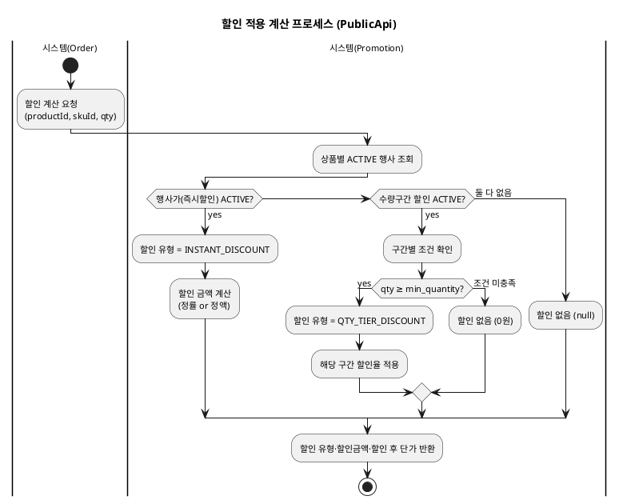
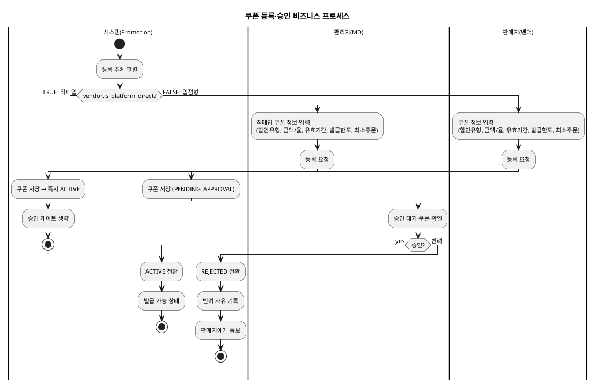
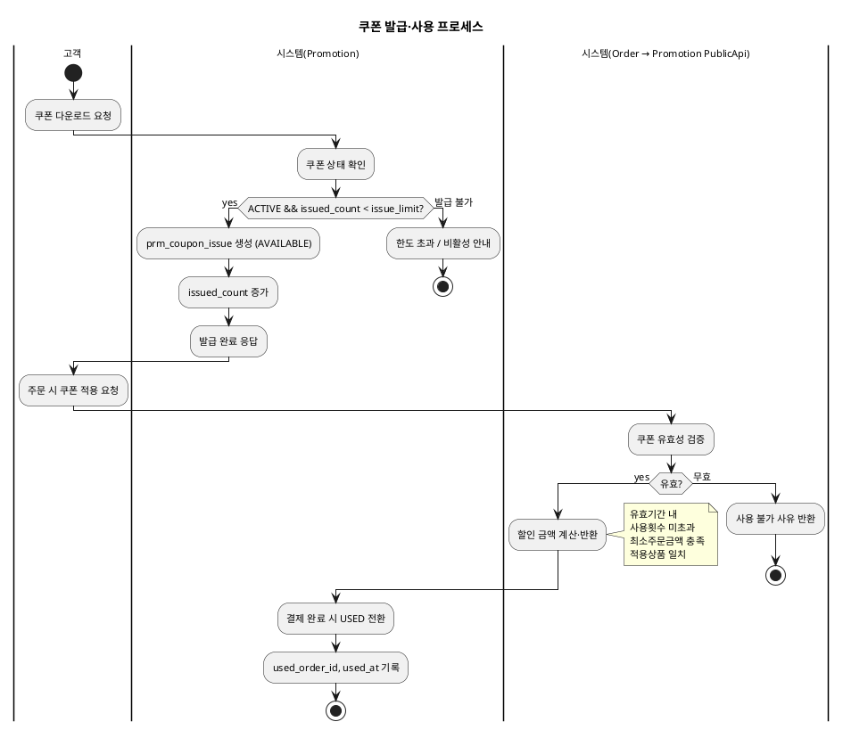
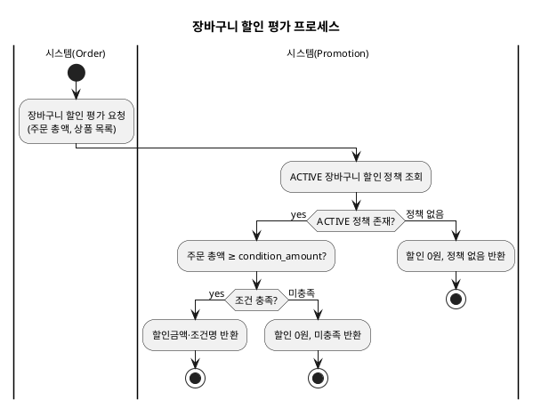
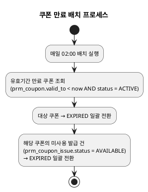
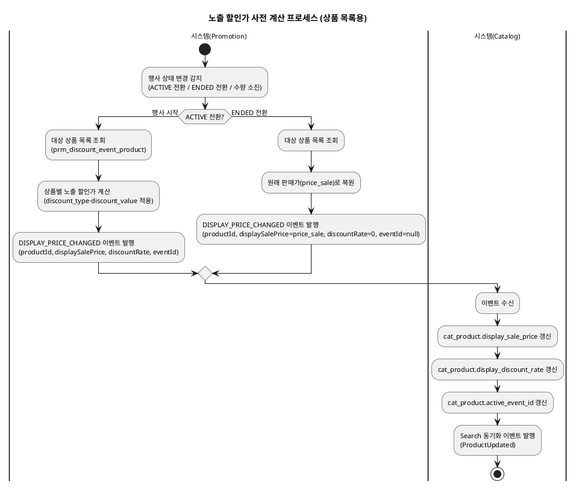
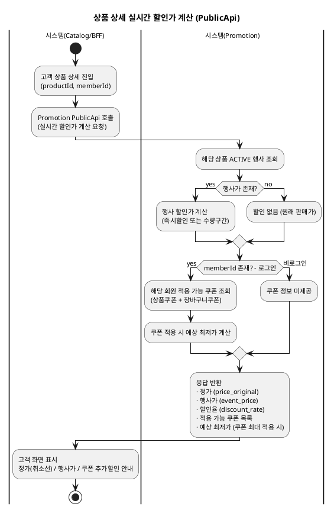

# 비즈니스 프로세스 — Promotion

> **단계**: 구조설계
> **문서범위**: Domain
> **문서종류**: Design
>
> **작성 목적**: 상태머신(⑩)의 전이를 액티비티 흐름으로 확장하여, "누가 어떤 순서로 업무를 수행하는가"를 시각화한다.
> **흐름 내 위치**: ⑩ 상태머신 → **⑪ 비즈니스 프로세스** → ⑫ 이벤트 플로우
> **작성 주체**: 시니어 개발자 + AI 협업 (기획자·현업 검토·확인)

| 항목 | 내용 |
|---|---|
| ID | DESIGN-BP-PROMOTION-001 |
| 상태 | **Draft** |
| 작성일 | 2026-07-08 |
| 갱신일 | 2026-07-08 |

---

## 1. 할인 적용 계산 프로세스 (Order 연동)



---

## 2. 쿠폰 등록·승인 프로세스



---

## 3. 쿠폰 발급·사용 프로세스



---

## 4. 행사가(즉시할인) 등록·종료 프로세스

```plantuml
@startuml
skinparam backgroundColor transparent
skinparam defaultFontSize 11
title 행사가 등록·종료 프로세스

|관리자(MD)|
start
:행사가 정보 입력\n(대상상품, 할인율/금액, 기간, 수량);
:활성화 요청;

|시스템(Promotion)|
:택1 규칙 검증;

if (동일 상품에 ACTIVE 수량할인 존재?) then (yes)
  :등록 거부\n(택1 규칙 위반);
  stop
else (통과)
  :DRAFT → ACTIVE 전환;
  :대상 상품 할인가 반영;
  :Redis remaining_quantity 초기화;
endif

... 시간 경과 ...

|시스템(배치/Consumer)|
if (end_at 도래?) then (기간 만료)
  :ACTIVE → ENDED;
  :가격 자동 복원;
  :EVENT_ENDED 이벤트 발행;
  stop
else if (remaining_quantity = 0?) then (수량 소진)
  :ACTIVE → ENDED;
  :가격 자동 복원;
  :EVENT_ENDED 이벤트 발행;
  stop
endif

@enduml
```

---

## 5. 장바구니 할인 평가 프로세스



---

## 6. 쿠폰 만료 배치 프로세스



---

## 7. 노출 할인가 사전 계산·갱신 프로세스



---

## 8. 상품 상세 실시간 할인가 계산 프로세스



---

## 근거

| 항목 | 출처 |
|---|---|
| 상태 전이 | `10-상태머신(Promotion).md` |
| PublicApi 흐름 | `06-상위유스케이스(Promotion).md` 행사가·할인관리 업무그룹 |
| 택1 규칙 | REQ-PRM-007, REQ-PRM-021 |
| 쿠폰 검증 로직 | REQ-PRM-003, REQ-PRM-004 |
| 장바구니 할인 | REQ-PRM-002, REQ-PRM-030~032 |
| 배치 스케줄 | REQ-PRM-011, REQ-PRM-047 |
| 할인 적용 순서 | `프로모션-할인유형-적용순서.md` §3 |
