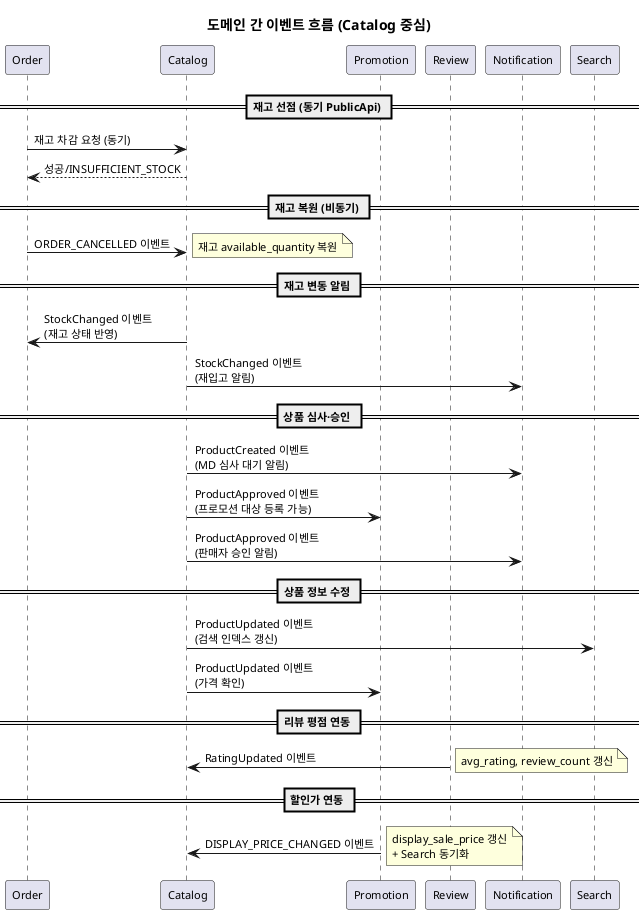

# 이벤트 플로우 — Catalog

> **단계**: 구조설계
> **문서범위**: Domain 간
> **문서종류**: Design
>
> **작성 목적**: Catalog 도메인이 발행·수신하는 비동기 이벤트 계약을 정의한다.
> **흐름 내 위치**: ⑪ 비즈니스 프로세스 → **⑫ 이벤트 플로우** → Bolt 분할
> **작성 주체**: 시니어 개발자 + AI 협업 (아키텍트 검토)

| 항목 | 내용 |
|---|---|
| ID | DESIGN-EVENT-CATALOG-001 |
| 상태 | **Draft** |
| 작성일 | 2026-07-08 |
| 갱신일 | 2026-07-08 |

> **범위**: Catalog 도메인과 Order·Promotion·Review·Notification 간 이벤트.

---

## 이벤트 카탈로그

| 이벤트명 | 방향 | 발행 도메인 | 수신 도메인 | 트리거 | 수신 액션 |
|---|---|---|---|---|---|
| ProductCreated | 발행 | Catalog | Notification* | 상품 최초 심사 요청 | MD에게 심사 대기 알림 |
| ProductApproved | 발행 | Catalog | Promotion*, Notification* | MD 심사 승인 | 프로모션 대상 등록 가능, 판매자 승인 알림 |
| ProductUpdated | 발행 | Catalog | Search*, Promotion* | 상품 정보 수정 | 검색 인덱스 갱신, 프로모션 가격 확인 |
| StockChanged | 발행 | Catalog | Order, Notification* | 재고 변동 (선점/복원/수동) | Order: 재고 상태 반영, 재입고 알림 |
| StockReleaseRequested | 수신 | Order | Catalog | 주문 생성 시 재고 차감 요청 | 동기 PublicApi (재고 선점) |
| ORDER_CANCELLED | 수신 | Order | Catalog | 주문 취소 확정 | 재고 복원 (비동기) |
| RatingUpdated | 수신 | Review | Catalog | 리뷰 작성/수정/삭제 | 상품 avg_rating·review_count 갱신 |
| DISPLAY_PRICE_CHANGED | 수신 | Promotion | Catalog | 행사 시작/종료/수량 소진 | display_sale_price·discount_rate 갱신 + Search 동기화 |

> `*` 표시: 2~4차 파트 착수 시 수신측 구현. 이벤트 스키마는 본 문서에서 확정.

---

## 이벤트 흐름 다이어그램



---

## 이벤트 스키마

### ProductCreated

```json
{
  "eventType": "ProductCreated",
  "eventId": "evt-ulid-201",
  "timestamp": "2026-07-08T10:00:00Z",
  "payload": {
    "productId": "prod-ulid-001",
    "name": "러닝화 에어맥스",
    "vendorId": "vendor-001",
    "categoryId": "cat-001",
    "status": "REVIEW_REQUESTED"
  }
}
```

### ProductApproved

```json
{
  "eventType": "ProductApproved",
  "eventId": "evt-ulid-202",
  "timestamp": "2026-07-08T14:00:00Z",
  "payload": {
    "productId": "prod-ulid-001",
    "name": "러닝화 에어맥스",
    "vendorId": "vendor-001",
    "categoryId": "cat-001",
    "priceSale": 89000,
    "approvedBy": "admin-001"
  }
}
```

### ProductUpdated

```json
{
  "eventType": "ProductUpdated",
  "eventId": "evt-ulid-203",
  "timestamp": "2026-07-08T16:00:00Z",
  "payload": {
    "productId": "prod-ulid-001",
    "changedFields": ["price_sale", "description"],
    "priceSale": 79000,
    "updatedBy": "vendor-001"
  }
}
```

### StockChanged

```json
{
  "eventType": "StockChanged",
  "eventId": "evt-ulid-204",
  "timestamp": "2026-07-08T10:05:00Z",
  "payload": {
    "productId": "prod-ulid-001",
    "skuId": "sku-ulid-001",
    "changeType": "RESERVE",
    "changeQuantity": -2,
    "afterAvailable": 8,
    "afterStock": 10,
    "reason": "order-ulid-001"
  }
}
```

### ORDER_CANCELLED (수신)

```json
{
  "eventType": "ORDER_CANCELLED",
  "eventId": "evt-ulid-301",
  "timestamp": "2026-07-08T12:00:00Z",
  "payload": {
    "orderId": "ord-ulid-001",
    "items": [
      {
        "skuId": "sku-ulid-001",
        "quantity": 2
      }
    ],
    "cancelReason": "CUSTOMER_REQUEST"
  }
}
```

### RatingUpdated (수신)

```json
{
  "eventType": "RatingUpdated",
  "eventId": "evt-ulid-401",
  "timestamp": "2026-07-08T18:00:00Z",
  "payload": {
    "productId": "prod-ulid-001",
    "avgRating": 4.5,
    "reviewCount": 128,
    "latestReviewId": "rev-ulid-001"
  }
}
```

---

## 동기 vs 비동기 판단

| 호출 | 방식 | 사유 |
|---|---|---|
| Order → Catalog (재고 차감) | **동기** (PublicApi) | 결제 전 즉시 재고 확보 필수 (UX 대기) |
| Order → Catalog (재고 확인) | **동기** (PublicApi) | 장바구니/결제 진입 시 즉시 검증 |
| Order → Catalog (상품 정보 조회) | **동기** (PublicApi) | 주문서 구성 시 즉시 필요 |
| Order → Catalog (주문 취소 시 재고 복원) | **비동기** (이벤트) | 후속 처리, 즉시 응답 불필요 |
| Catalog → Order (StockChanged) | **비동기** (이벤트) | 재고 변동 후속 알림 |
| Catalog → Notification (ProductCreated/Approved) | **비동기** (이벤트) | 알림은 후속 처리 |
| Catalog → Search (ProductUpdated) | **비동기** (이벤트) | 검색 인덱스 갱신은 후속 처리 |
| Review → Catalog (RatingUpdated) | **비동기** (이벤트) | 평점 갱신은 후속 처리 (eventual consistency) |
| Promotion → Catalog (DISPLAY_PRICE_CHANGED) | **비동기** (이벤트) | 노출 할인가 갱신은 후속 처리 (eventual consistency) |
| Catalog/BFF → Promotion (상품 상세 실시간 할인가) | **동기** (PublicApi) | 상세 화면 진입 시 즉시 할인가 필요 (UX 대기) |

---

## 이벤트 운영 규칙

| 규칙 | 설명 |
|---|---|
| Outbox 패턴 | 이벤트는 AFTER_COMMIT으로 Outbox 테이블에 기록 후 Consumer가 처리 |
| 멱등 보장 | 수신 측은 `eventId`로 중복 처리 방지 |
| 이벤트 스키마 버전 | 필드 추가는 허용, 삭제는 금지 (하위 호환) |
| 발행자는 수신자를 모름 | 이벤트 발행 시 수신 도메인을 하드코딩하지 않음 |
| 재시도 정책 | 수신 실패 시 최대 3회 재시도 (지수 백오프), 이후 DLQ |
| 순서 보장 | 동일 productId/skuId에 대한 이벤트는 순서 보장 (파티션 키) |
| 재고 이벤트 우선순위 | StockChanged는 재고 차감/복원 트랜잭션 커밋 후 즉시 발행 |

---

## 근거

| 항목 | 출처 |
|---|---|
| 이벤트 목록 | `11-비즈니스프로세스(Catalog).md` 이벤트 발행 지점 |
| 발행/수신 관계 | `05-도메인정의서.md` §4 Catalog "의존·이벤트 발행" |
| Outbox 패턴 | `03-컴포넌트.md` 배포 구조·도메인 간 통신 방식 |
| 동기/비동기 판단 | 응답 즉시성 요구 여부 (UX 대기 vs 후속 처리) |
| 재고 선점/복원 | REQ-CAT-002~006 |
| 평점 연동 | REQ-CAT-030 |
| 상품 심사 이벤트 | REQ-CAT-011 (ProductApproved) |
| Redis 캐시 대상 | REQ-CAT-031, 정책서 §3 성능 정책 |
